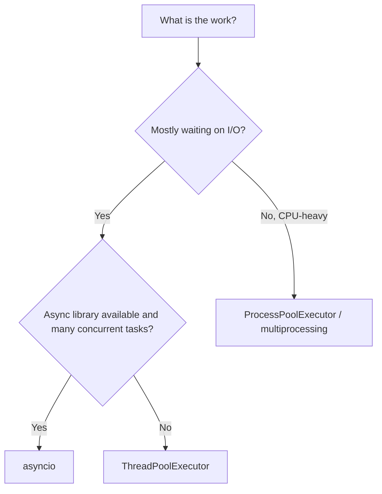

import TOCInline from '@theme/TOCInline';

# Python Concurrency & Multithreading

<TOCInline toc={toc} minHeadingLevel={2} maxHeadingLevel={2} />

:::tip[In this guide]
Learn to do many things at once in Python — threads for blocking I/O, `asyncio`
for high-concurrency I/O, processes for CPU-bound work — then apply them
safely in production FastAPI and GenAI services (bounded concurrency, retries,
queues, graceful shutdown).
:::

## What Is It?

Concurrency is structuring a program so multiple tasks make progress during
overlapping time periods. Python gives you three main tools — **threads**,
**coroutines (`asyncio`)**, and **processes** — and choosing the right one
depends almost entirely on whether your work is waiting (I/O-bound) or
computing (CPU-bound).

## Why Does It Matter?

A RAG or LLM service spends most of its life waiting: on the LLM, the vector
DB, the network. Done sequentially, 10 LLM calls of 2 seconds each take 20
seconds. Done concurrently, they take about 2. But concurrency also brings
bugs (races, deadlocks, leaked tasks) and can overload dependencies if
unbounded. This guide covers both the speed-up and the safety.

## Roadmap

| Phase | Topic | Priority | Time |
| --- | --- | --- | --- |
| 1 | Foundations | P0 | 1–2 days |
| 2 | Multithreading | P0 | 1–2 days |
| 3 | Async Python | P0 | 2–3 days |
| 4 | Multiprocessing | P0 | 1–2 days |
| 5 | Production patterns | P0 | 2–3 days |
| 6 | FastAPI & GenAI applications | P0 | 2–3 days |

## Phase 1 — Foundations

### Concurrency vs Parallelism

- **Concurrency**: dealing with many things at once (interleaving). One cook
  switching between several pots.
- **Parallelism**: doing many things at the *same instant* on multiple CPU
  cores. Several cooks, one pot each.

You can have concurrency without parallelism (a single-threaded event loop
juggling thousands of sockets) and parallelism without much concurrency
(a process pool crunching numbers).

### Synchronous vs Asynchronous Execution

- **Synchronous**: each step finishes before the next begins; the caller waits.
- **Asynchronous**: a step can *yield control* while waiting, letting other work
  run, then resume when its result is ready.

### CPU-bound vs I/O-bound

| | I/O-bound | CPU-bound |
| --- | --- | --- |
| Time spent | Waiting (network, disk, DB, LLM) | Computing (parsing, math, embeddings on CPU) |
| Examples | HTTP calls, DB queries, reading files | Image processing, local embedding, compression |
| Best tool | `asyncio` or threads | `multiprocessing` / process pool |
| Why | Waiting can overlap | Needs more cores, not more waiting |

**First step in any concurrency problem: identify which kind of bound you are.**
Measure before you optimize.

### Processes, Threads, and Coroutines

| | Process | Thread | Coroutine |
| --- | --- | --- | --- |
| Memory | Separate | Shared | Shared |
| Scheduling | OS | OS (preemptive) | Event loop (cooperative) |
| Overhead | High | Medium | Very low |
| Scale | Tens | Hundreds | Thousands to hundreds of thousands |
| Parallel Python code? | Yes | No (GIL), except for I/O and some C code | No (single thread) |
| Switches | Anytime | Anytime | Only at `await` |

### Blocking vs Non-blocking

A **blocking** call holds the thread until it finishes (`time.sleep`,
`requests.get`, a synchronous DB driver). A **non-blocking** call returns
control while waiting (`await asyncio.sleep`, `await httpx_client.get`). Inside
an event loop, one blocking call freezes *everything*.

### See It: Sequential vs Concurrent

```python
import time
from concurrent.futures import ThreadPoolExecutor

def fake_io(i: int) -> int:
    time.sleep(1)               # stands in for a network call
    return i

start = time.perf_counter()
for i in range(5):
    fake_io(i)
print(f"sequential: {time.perf_counter() - start:.1f}s")      # ~5s

start = time.perf_counter()
with ThreadPoolExecutor(max_workers=5) as pool:
    list(pool.map(fake_io, range(5)))
print(f"threaded:   {time.perf_counter() - start:.1f}s")      # ~1s
```

### Which Tool Do I Use?



## Phase 2 — Multithreading

### `threading.Thread`

```python
import threading, time

def worker(name: str, delay: float) -> None:
    time.sleep(delay)
    print(f"{name} done")

t1 = threading.Thread(target=worker, args=("a", 1.0))
t2 = threading.Thread(target=worker, args=("b", 0.5), daemon=True)

t1.start(); t2.start()
t1.join()                    # wait for t1 to finish
```

- `start()` begins the thread; `join()` waits for it.
- **Daemon threads** are killed abruptly when the main program exits, so don't
  use them for work that must finish or clean up.
- An uncaught exception in a thread does **not** crash the main thread; it is
  printed and the thread dies. Prefer executors, which capture exceptions.

### `ThreadPoolExecutor`

Reuses a fixed set of threads instead of creating one per task, and returns
results through `Future` objects:

```python
from concurrent.futures import ThreadPoolExecutor, as_completed
import httpx

def fetch(url: str) -> int:
    return httpx.get(url, timeout=10).status_code

urls = ["https://example.com", "https://httpbin.org/status/200"]

with ThreadPoolExecutor(max_workers=8) as pool:
    futures = {pool.submit(fetch, u): u for u in urls}
    for fut in as_completed(futures):          # yields as each finishes
        url = futures[fut]
        try:
            print(url, fut.result())
        except Exception as exc:
            print(url, "failed:", exc)
```

### `submit()`, `map()`, `Future`, `result()`

- `submit(fn, *args)` → schedules one call, returns a **`Future`** immediately.
- `map(fn, iterable)` → returns results **in input order**; an exception from
  one task is raised when you *iterate to that item*.
- `as_completed(futures)` → iterate in **completion order**.

A `Future` is a handle to a result that isn't ready yet:

```python
fut = pool.submit(fetch, "https://example.com")

fut.done()                     # True when finished (or cancelled/failed)
fut.result(timeout=5)          # blocks; raises TimeoutError if not ready,
                               # or re-raises the task's exception
fut.exception()                # the exception, or None
fut.cancel()                   # only works if the task hasn't started
fut.add_done_callback(lambda f: print("finished", f.result()))
```

Size `max_workers` deliberately. For I/O-bound work you can use more threads
than cores, but each thread costs memory, and downstream services have limits.

### Race Conditions

A **race condition** occurs when the outcome depends on the timing of threads
accessing shared data. `counter += 1` looks atomic but is really read, add,
write — two threads can read the same value and both write back, losing an
update:

```python
import threading

counter = 0

def unsafe_increment(n: int) -> None:
    global counter
    for _ in range(n):
        counter += 1           # read-modify-write: NOT atomic

threads = [threading.Thread(target=unsafe_increment, args=(1_000_000,)) for _ in range(4)]
for t in threads: t.start()
for t in threads: t.join()
print(counter)                 # may be less than 4,000,000, and varies by run
```

Whether you see lost updates on a given run or Python version is unreliable —
which is exactly why races are dangerous. Never depend on luck.

### Locks

```python
lock = threading.Lock()
counter = 0

def safe_increment(n: int) -> None:
    global counter
    for _ in range(n):
        with lock:             # only one thread inside at a time
            counter += 1
```

- Always use `with lock:` so it's released even on exceptions.
- Keep the locked section **small**; locks serialize work.
- `threading.RLock` can be re-acquired by the same thread (re-entrant).
- Other primitives: `Event` (signal between threads), `Semaphore` (limit
  concurrent access), `Condition`, `Barrier`.

### Deadlocks

Two threads each hold a lock the other needs, and both wait forever:

```python
lock_a, lock_b = threading.Lock(), threading.Lock()

def task1():
    with lock_a:
        with lock_b: ...      # waits for lock_b

def task2():
    with lock_b:
        with lock_a: ...      # waits for lock_a  → DEADLOCK
```

Avoid deadlocks by:

- Always acquiring multiple locks in the **same global order**.
- Holding as few locks as possible, for as short as possible.
- Using timeouts: `lock.acquire(timeout=2)`.
- Preferring **queues / message passing** over shared locked state.

### Thread-safe Shared State and Queues

`queue.Queue` is thread-safe and is the safest way to hand work between
threads (producer–consumer):

```python
import queue, threading

q: queue.Queue = queue.Queue(maxsize=100)     # bounded: producers block when full
STOP = object()                                # sentinel to shut consumers down

def producer():
    for i in range(1000):
        q.put(i)                               # blocks if the queue is full
    q.put(STOP)

def consumer():
    while True:
        item = q.get()
        if item is STOP:
            q.put(STOP)                        # let other consumers see it too
            break
        process(item)
        q.task_done()

threading.Thread(target=producer).start()
consumers = [threading.Thread(target=consumer) for _ in range(4)]
for c in consumers: c.start()
```

Other safe patterns: keep state **local** to each thread, use
`threading.local()` for per-thread data, treat shared data as **immutable**, or
guard it with a lock. Individual built-in operations like `list.append` are
atomic in CPython, but *sequences* of operations are not.

### Python's Global Interpreter Lock (GIL)

The **GIL** is a lock inside CPython that lets only **one thread execute Python
bytecode at a time**. Consequences:

- **CPU-bound** code in threads gets **no speed-up** (often slightly slower).
- **I/O-bound** code in threads *does* speed up, because the GIL is **released**
  while a thread waits on I/O (sockets, file reads, `time.sleep`).
- Many C extensions (NumPy, some compression and hashing code) also release the
  GIL during heavy work.
- The GIL does **not** make your code thread-safe — compound operations still
  race, as shown above.

```python
import time
from concurrent.futures import ThreadPoolExecutor

def cpu_work(n: int) -> int:
    return sum(i * i for i in range(n))

# 4 threads on CPU-bound work: roughly the same time as running them one by one
with ThreadPoolExecutor(4) as pool:
    list(pool.map(cpu_work, [5_000_000] * 4))
```

Recent Python versions (3.13+) offer an **experimental free-threaded build**
without the GIL, but the default builds still have it, and library support is
still maturing. For CPU-bound parallelism today, use processes.

## Phase 3 — Async Python

### `async def` and `await`

```python
import asyncio

async def fetch_data(n: int) -> str:
    await asyncio.sleep(1)          # non-blocking wait; yields to the event loop
    return f"data {n}"

async def main():
    result = await fetch_data(1)    # runs the coroutine and waits for it
    print(result)

asyncio.run(main())                 # entry point: creates and runs the event loop
```

- `async def` defines a **coroutine function**; calling it returns a coroutine
  object that does **nothing until awaited or scheduled**.
- `await` pauses the current coroutine until the awaited thing is done, and lets
  the event loop run other tasks meanwhile.

### Event Loop and Coroutines

The **event loop** is a single-threaded scheduler. It runs a coroutine until it
hits an `await` on something not ready, then switches to another ready
coroutine. That's **cooperative multitasking**: tasks only switch at `await`
points, so a task that never awaits (CPU loop, blocking call) starves
everything else.

### `asyncio.gather()` and `asyncio.create_task()`

`await` on coroutines one after another is still sequential. To run them
concurrently, wrap them in tasks:

```python
async def main():
    # ❌ sequential: ~3s
    a = await fetch_data(1)
    b = await fetch_data(2)
    c = await fetch_data(3)

    # ✅ concurrent: ~1s
    a, b, c = await asyncio.gather(fetch_data(1), fetch_data(2), fetch_data(3))
```

`gather` options:

```python
# One failure raises immediately (others keep running unless cancelled by you)
results = await asyncio.gather(*coros)

# Collect failures as values instead of raising
results = await asyncio.gather(*coros, return_exceptions=True)
for r in results:
    if isinstance(r, Exception):
        handle(r)
```

`create_task` schedules a coroutine to run in the background right away:

```python
async def main():
    task = asyncio.create_task(fetch_data(1))   # starts running now
    other = await do_something_else()           # meanwhile, do other work
    result = await task                         # collect the result
```

:::warning
Keep a **reference** to tasks you create. The event loop only holds weak
references, so a "fire-and-forget" task can be garbage-collected mid-run.
Store tasks in a set and discard them when done:

```python
background: set[asyncio.Task] = set()

def spawn(coro):
    task = asyncio.create_task(coro)
    background.add(task)
    task.add_done_callback(background.discard)
    return task
```
:::

### `asyncio.TaskGroup` (Python 3.11+)

Structured concurrency: all tasks started in the group are awaited when the
`async with` block exits, and if one fails the others are **cancelled**:

```python
async def main():
    async with asyncio.TaskGroup() as tg:
        t1 = tg.create_task(fetch_data(1))
        t2 = tg.create_task(fetch_data(2))
    # leaving the block means both are finished
    print(t1.result(), t2.result())
```

Failures are raised as an `ExceptionGroup`; handle them with `except*`:

```python
try:
    async with asyncio.TaskGroup() as tg:
        tg.create_task(might_fail())
        tg.create_task(might_also_fail())
except* ValueError as eg:
    print("value errors:", eg.exceptions)
except* TimeoutError as eg:
    print("timeouts:", eg.exceptions)
```

Prefer `TaskGroup` over bare `create_task`/`gather` for new code: no leaked
tasks, and failures cancel siblings automatically.

### Timeouts, Cancellation and Exceptions

**Timeouts:**

```python
# Python 3.11+: context manager
try:
    async with asyncio.timeout(5):
        result = await slow_call()
except TimeoutError:
    result = None

# Older / simple form
result = await asyncio.wait_for(slow_call(), timeout=5)
```

**Cancellation** works by raising `asyncio.CancelledError` inside the task at
its current `await`. Rules:

- Use `task.cancel()` to request cancellation.
- **Always re-raise `CancelledError`** after cleanup. Swallowing it breaks
  timeouts, TaskGroups, and shutdown.
- Clean up in `finally`.

```python
async def worker():
    try:
        await long_operation()
    except asyncio.CancelledError:
        await cleanup()          # keep it short
        raise                    # always re-raise
    finally:
        release_resources()
```

- `asyncio.shield(coro)` protects an inner awaitable from *this* waiter's
  cancellation; use sparingly (e.g. finishing a DB commit).
- Don't catch bare `except Exception` around awaits without thinking:
  `CancelledError` is a `BaseException` (not `Exception`) in modern Python, so
  it passes through, but a bare `except:` would swallow it.
- Exceptions in a task you never await are only reported when the task is
  garbage-collected ("Task exception was never retrieved"). Always await or
  attach a done-callback.

### `asyncio.Semaphore`, `Lock`, `Queue`

```python
# Semaphore: cap concurrent operations
sem = asyncio.Semaphore(5)

async def limited_call(x):
    async with sem:                      # at most 5 inside at once
        return await call_api(x)

results = await asyncio.gather(*(limited_call(x) for x in items))
```

```python
# Lock: protect a critical section across awaits
lock = asyncio.Lock()
async def update_shared():
    async with lock:
        value = await read()
        await write(value + 1)
```

```python
# Queue: async producer-consumer
q: asyncio.Queue = asyncio.Queue(maxsize=50)

async def producer():
    for i in range(200):
        await q.put(i)                   # waits when full (backpressure)

async def consumer():
    while True:
        item = await q.get()
        try:
            await handle(item)
        finally:
            q.task_done()
```

Note: asyncio primitives are **not thread-safe** and are for coroutines in one
event loop. They differ from `threading.Lock` / `queue.Queue`. You also need a
`Lock` far less often than in threads, because tasks only switch at `await`;
but if a critical section contains an `await`, another task can interleave
there.

### Blocking Calls Inside Async Functions

This is the #1 async bug. A blocking call inside `async def` freezes the whole
event loop — every other request or task stalls:

```python
import time, requests

async def bad():
    time.sleep(2)                        # ❌ blocks the loop
    requests.get("https://example.com")  # ❌ blocks the loop

async def good():
    await asyncio.sleep(2)               # ✅
    async with httpx.AsyncClient() as client:
        await client.get("https://example.com")   # ✅
```

When you must call blocking or CPU-heavy code, move it off the loop:

```python
import asyncio

result = await asyncio.to_thread(blocking_function, arg)     # runs in a thread

# or with an explicit executor (e.g. a process pool for CPU-bound work)
loop = asyncio.get_running_loop()
result = await loop.run_in_executor(executor, cpu_function, arg)
```

Signs of a blocked loop: latency spikes for *unrelated* requests, timeouts
under low load, and `asyncio` debug mode warnings about slow callbacks
(`asyncio.run(main(), debug=True)`).

## Phase 4 — Multiprocessing

### `multiprocessing` and Process vs Thread Memory

Each process has its **own interpreter and its own memory**, so there is no
shared GIL and CPU-bound work runs truly in parallel across cores. The trade-off:
data must be **copied** (serialized) between processes, and starting a process
is expensive.

```python
import multiprocessing as mp

def square(x: int) -> int:
    return x * x

if __name__ == "__main__":                  # REQUIRED on Windows/macOS (spawn)
    with mp.Pool(processes=4) as pool:
        print(pool.map(square, range(10)))
```

Because memory is separate, mutating a global in a child does **not** affect the
parent. Share data explicitly (below).

### `ProcessPoolExecutor`

Same `submit`/`map`/`Future` API as threads, so switching is easy:

```python
from concurrent.futures import ProcessPoolExecutor

def heavy(n: int) -> int:
    return sum(i * i for i in range(n))

if __name__ == "__main__":
    with ProcessPoolExecutor(max_workers=4) as pool:
        results = list(pool.map(heavy, [10_000_000] * 4))   # ~4x faster on 4 cores
```

Tuning:

- Set `max_workers` to about the number of **CPU cores** (`os.cpu_count()`).
- Use `pool.map(fn, items, chunksize=50)` for many small items to reduce
  per-task overhead.
- Each task has overhead (pickling + IPC), so give each task **enough work**;
  tiny tasks can be slower than serial code.
- If a worker dies hard (killed, out of memory), the pool raises
  `BrokenProcessPool`.

### Pickling and Process Startup

Arguments and return values travel between processes via **pickle**. So:

- Functions must be **importable top-level functions** — no lambdas, no nested
  or local functions.
- Arguments/results must be picklable (no open files, sockets, DB connections,
  locks, generators).
- Large arguments are slow to copy; pass **file paths or IDs** and load inside
  the worker.

Start methods:

| Method | Behavior | Notes |
| --- | --- | --- |
| `spawn` | Fresh interpreter, re-imports your module | Default on Windows and macOS; safe but slower startup |
| `fork` | Copies the parent process | Fast, but unsafe with threads, and can duplicate locks/connections |
| `forkserver` | Dedicated server forks clean children | Safer alternative on Unix |

Because `spawn` re-imports your module, **guard entry code with
`if __name__ == "__main__":`** or you'll recursively spawn processes. Create
expensive resources (models, DB connections) **inside each worker**, once, via
an initializer:

```python
_model = None

def init_worker():
    global _model
    _model = load_model()                    # once per worker process

def predict(text: str):
    return _model.predict(text)

with ProcessPoolExecutor(max_workers=4, initializer=init_worker) as pool:
    results = list(pool.map(predict, texts))
```

### Inter-process Communication (IPC)

| Mechanism | Use for |
| --- | --- |
| `mp.Queue` | Passing work/results between processes (pickled) |
| `mp.Pipe` | Fast two-way channel between exactly two processes |
| `mp.Value` / `mp.Array` | Small shared numbers/arrays, with a lock |
| `multiprocessing.shared_memory` | Large numeric data (e.g. NumPy arrays) without copying |
| `mp.Manager` | Shared dicts/lists via a server process (convenient, slower) |
| Files / Redis / DB | Durable, cross-service sharing |

```python
import multiprocessing as mp

def worker(q: "mp.Queue", n: int) -> None:
    q.put(n * n)

if __name__ == "__main__":
    q = mp.Queue()
    procs = [mp.Process(target=worker, args=(q, i)) for i in range(4)]
    for p in procs: p.start()
    results = [q.get() for _ in procs]       # read BEFORE join to avoid blocking
    for p in procs: p.join()
    print(results)
```

### CPU-bound Parallel Execution (also from async code)

Combine processes with `asyncio` so CPU-heavy work doesn't block the loop:

```python
import asyncio
from concurrent.futures import ProcessPoolExecutor

pool = ProcessPoolExecutor(max_workers=4)

async def handler(data):
    loop = asyncio.get_running_loop()
    return await loop.run_in_executor(pool, heavy, data)
```

Rule of thumb: **threads/async for waiting, processes for computing.** If the
heavy work is a numeric library that releases the GIL (NumPy), or a GPU/remote
model call, you may not need processes at all.

## Phase 5 — Production Patterns

### Bounded Concurrency and Backpressure

Unbounded concurrency is a bug. Launching 10,000 simultaneous requests can
exhaust memory, sockets, rate limits, and the dependency you're calling.

- **Bound** concurrent work with a `Semaphore` or a fixed worker pool.
- Use **bounded queues** (`maxsize`) so a fast producer is slowed (**backpressure**)
  rather than filling memory.
- At the system edge, **shed load**: return `429`/`503` quickly instead of
  queueing forever.

```python
async def process_all(items, concurrency: int = 10):
    sem = asyncio.Semaphore(concurrency)

    async def run(item):
        async with sem:
            return await handle(item)

    return await asyncio.gather(*(run(i) for i in items), return_exceptions=True)
```

For huge inputs, don't create a million tasks up front — use a bounded queue
with a fixed number of workers (next section).

### Retries, Timeouts and Rate Limiting

Every external call needs a timeout; retry only transient, idempotent failures
with exponential backoff and jitter (full patterns in
[API & service design](../../08-llm-application-development/02-api-service-design.mdx)):

```python
import asyncio, random

async def retry(fn, retries=3, base=0.5, cap=8.0):
    for attempt in range(retries + 1):
        try:
            return await fn()
        except (TimeoutError, ConnectionError):
            if attempt == retries:
                raise
            await asyncio.sleep(random.uniform(0, min(cap, base * 2 ** attempt)))
```

A semaphore limits how many calls are **in flight**; a **rate limiter** limits
how many **start per second** (providers enforce both). A minimal spacing
limiter:

```python
import asyncio, time

class RateLimiter:
    def __init__(self, per_second: float):
        self.interval = 1.0 / per_second
        self._next = 0.0
        self._lock = asyncio.Lock()

    async def acquire(self):
        async with self._lock:
            now = time.monotonic()
            wait = self._next - now
            if wait > 0:
                await asyncio.sleep(wait)
            self._next = max(now, self._next) + self.interval

limiter = RateLimiter(per_second=5)

async def call_llm(prompt):
    await limiter.acquire()
    async with sem:
        return await llm(prompt)
```

Also honor `Retry-After` headers on `429` responses.

### Producer–Consumer Pattern

A fixed pool of workers pulls from a bounded queue — constant memory no matter
how large the input:

```python
async def worker(name: str, q: asyncio.Queue, results: list):
    while True:
        item = await q.get()
        try:
            results.append(await handle(item))
        except Exception as exc:
            logger.exception("item failed", extra={"ctx": {"item": str(item)}})
        finally:
            q.task_done()

async def run_pipeline(items, n_workers: int = 8):
    q: asyncio.Queue = asyncio.Queue(maxsize=100)
    results: list = []
    workers = [asyncio.create_task(worker(f"w{i}", q, results)) for i in range(n_workers)]

    for item in items:
        await q.put(item)            # blocks when full → backpressure
    await q.join()                   # wait until every item is processed

    for w in workers:
        w.cancel()
    await asyncio.gather(*workers, return_exceptions=True)
    return results
```

Handle a failing item inside the worker so one bad item doesn't kill the worker,
and consider a **dead-letter** list/queue for items that repeatedly fail.

### Task Queues: Celery, RQ, Dramatiq

In-process concurrency dies with the process. For **durable**, **retryable**,
**distributed** background work, use a task queue with a broker:

| | Celery | RQ | Dramatiq |
| --- | --- | --- | --- |
| Broker | Redis, RabbitMQ, others | Redis only | Redis, RabbitMQ |
| Features | Very rich: scheduling, routing, chords, retries | Simple, minimal | Reliable defaults, simpler than Celery |
| Complexity | High | Low | Medium |
| Good for | Large/complex systems | Small projects | Reliability with less config |

```python
# Celery example
from celery import Celery

celery_app = Celery("rag", broker="redis://localhost:6379/0",
                    backend="redis://localhost:6379/1")

@celery_app.task(bind=True, autoretry_for=(ConnectionError,),
                 retry_backoff=True, max_retries=3, acks_late=True)
def ingest_document(self, doc_id: str) -> None:
    ...

ingest_document.delay("doc_123")            # enqueue and return immediately
```

Design tasks to be **idempotent** (safe to run twice) because most queues give
**at-least-once** delivery. Pass **IDs, not large payloads**, and look the data up
inside the task. Run workers as a separate process/deployment from your API.

### Redis, RabbitMQ and Kafka Fundamentals

| | Redis | RabbitMQ | Kafka |
| --- | --- | --- | --- |
| Model | In-memory data store; lists/streams used as queues | Message broker with exchanges and queues | Distributed append-only log |
| Strengths | Simple, fast, also a cache | Flexible routing, acks, per-message delivery | Huge throughput, replay, ordering per partition |
| Consumption | Task popped by one worker | Message removed after ack | Consumers track an **offset**; messages stay |
| Typical use | Small task queues, caching, rate limits | Reliable work queues, complex routing | Event streams, pipelines, analytics |

Key vocabulary: **acknowledgement (ack)** — consumer confirms a message was
handled, otherwise it's redelivered; **at-least-once** vs **at-most-once** vs
(hard) **exactly-once**; **dead-letter queue** — where poison messages go after
repeated failures; **consumer group** — workers sharing a stream of messages;
**visibility timeout** — how long a message is hidden while a worker processes
it. Pick the simplest tool that meets your needs: a Redis-backed queue is plenty
for most RAG ingestion; Kafka is for high-volume event streaming.

### Graceful Shutdown, Monitoring and Failure Handling

On deploy or scale-down your process gets `SIGTERM`. Stop taking new work,
finish or hand back in-flight work, then exit:

```python
import asyncio, signal

async def main():
    stop = asyncio.Event()
    loop = asyncio.get_running_loop()
    for sig in (signal.SIGINT, signal.SIGTERM):
        loop.add_signal_handler(sig, stop.set)      # Unix; not on Windows

    q: asyncio.Queue = asyncio.Queue(maxsize=100)
    workers = [asyncio.create_task(worker(f"w{i}", q, [])) for i in range(8)]

    await stop.wait()                               # run until told to stop
    # 1) stop intake (stop producers / readiness fails), 2) drain in-flight work
    try:
        await asyncio.wait_for(q.join(), timeout=25)   # shorter than the platform's grace period
    except TimeoutError:
        logger.warning("shutdown timed out with work remaining")
    for w in workers:
        w.cancel()
    await asyncio.gather(*workers, return_exceptions=True)
```

Monitor concurrency like any other service component:

- **Queue depth** and **oldest message age** (are workers keeping up?).
- **In-flight tasks**, worker utilization, task duration percentiles.
- **Failure/retry rate**, dead-letter count.
- Event-loop lag (how late scheduled callbacks run) to detect blocking calls.

Failure handling checklist: timeouts on everything, retries with backoff,
idempotent tasks, dead-letter queues, structured logs with a task/request id,
and alerts on queue growth. See
[logging & monitoring](../../13-production-genai-and-llmops/04-logging-monitoring-guardrails.mdx).

## Phase 6 — FastAPI & GenAI Applications

### Concurrent API and Database Calls

Independent calls inside one request should run together:

```python
from fastapi import FastAPI

app = FastAPI()

@app.get("/dashboard/{user_id}")
async def dashboard(user_id: int):
    profile, docs, usage = await asyncio.gather(
        get_profile(user_id),
        get_documents(user_id),
        get_usage(user_id),
    )
    return {"profile": profile, "documents": docs, "usage": usage}
```

**`async def` vs `def` endpoints:**

- `async def` runs **on the event loop**. Use it only if everything inside
  awaits non-blocking code. A blocking call inside stalls the whole server.
- Plain `def` runs in a **worker thread pool** (by default about 40 threads), so
  blocking code won't freeze the loop. Use it when you must call a synchronous
  library.

### Async SQLAlchemy and HTTP Clients

```python
from sqlalchemy.ext.asyncio import AsyncSession, async_sessionmaker, create_async_engine

engine = create_async_engine("postgresql+asyncpg://user:pw@db/app",
                             pool_size=10, max_overflow=5)
SessionLocal = async_sessionmaker(engine, expire_on_commit=False)

async def get_session():
    async with SessionLocal() as session:        # one session per request
        yield session
```

Rules:

- Use an **async driver** (`asyncpg`, `aiosqlite`); a sync driver blocks the loop.
- **One `AsyncSession` per task.** A session is not safe for concurrent use, so
  don't share one across `gather`; open a separate session per concurrent query.
- Keep the **pool size** consistent with your concurrency, or tasks will wait
  for connections.

```python
async def count_for(doc_id: int) -> int:
    async with SessionLocal() as s:              # own session per concurrent task
        return (await s.execute(...)).scalar_one()

counts = await asyncio.gather(*(count_for(i) for i in ids))
```

For HTTP, create **one shared `httpx.AsyncClient`** at startup (in the lifespan
hook) and reuse its connection pool — never a new client per call (see
[API & service design](../../08-llm-application-development/02-api-service-design.mdx)).

### Parallel LLM Calls with Concurrency Limits

```python
import asyncio

llm_sem = asyncio.Semaphore(5)                  # provider/GPU-friendly limit

async def ask_llm(client, prompt: str) -> str:
    async with llm_sem:
        resp = await client.post(LLM_URL, json={"prompt": prompt}, timeout=60)
        resp.raise_for_status()
        return resp.json()["response"]

async def summarize_many(client, docs: list[str]) -> list[str | Exception]:
    return await asyncio.gather(
        *(ask_llm(client, f"Summarize: {d}") for d in docs),
        return_exceptions=True,                  # one failure shouldn't lose the rest
    )
```

Create the semaphore **once per process** and share it, not per request, so the
limit applies globally. Pair it with retries and a rate limiter, and remember a
local model (Ollama) may handle only a few requests at once regardless of how
many you send.

### RAG Ingestion Workers and Embedding Batches

Embedding one chunk at a time is slow. **Batch** chunks per call, and run a
bounded number of batches concurrently:

```python
def batched(items: list, size: int):
    for i in range(0, len(items), size):
        yield items[i:i + size]

async def embed_all(chunks: list[str], batch_size: int = 64, concurrency: int = 4):
    sem = asyncio.Semaphore(concurrency)

    async def embed_batch_limited(batch: list[str]):
        async with sem:
            return await embed_batch(batch)       # one API call for 64 texts

    batches = list(batched(chunks, batch_size))
    results = await asyncio.gather(*(embed_batch_limited(b) for b in batches))
    return [vec for batch_vecs in results for vec in batch_vecs]   # preserves order
```

Ingestion pipeline design:

- Stages: **load → chunk → embed → upsert**, connected by bounded queues so a
  slow stage applies backpressure.
- **Batch size** trades throughput against memory and per-request limits; tune it.
- Chunking and parsing are often **CPU-bound** → process pool; embedding and
  upserting are **I/O-bound** → async.
- Make ingestion **idempotent and resumable**: deterministic chunk IDs and
  upserts, and track per-document status so a retry doesn't duplicate data.
- Run it as a **separate worker**, not inside the serving process, so ingestion
  can't spike `/ask` latency.

### Background Jobs vs Durable Task Queues

FastAPI's `BackgroundTasks` runs work after the response is sent, but **inside
the same process**:

```python
from fastapi import BackgroundTasks

@app.post("/documents", status_code=202)
async def upload(doc: Doc, background: BackgroundTasks):
    background.add_task(send_notification, doc.id)       # quick, loss-tolerable work
    return {"status": "accepted"}
```

| | `BackgroundTasks` / in-process tasks | Durable task queue (Celery/RQ/Dramatiq) |
| --- | --- | --- |
| Survives a crash or deploy | No — lost | Yes — stays in the broker |
| Retries, scheduling | Manual | Built in |
| Separate scaling | No | Yes (scale workers independently) |
| Visibility (status/progress) | None | Yes |
| Good for | Send an email, clear a cache | Ingestion, indexing, long or critical jobs |

For anything long-running or that must not be lost, return **`202 Accepted`** with
a job id, enqueue to a durable queue, and let clients poll a status endpoint (or
get a webhook).

### Streaming Responses and Cancellation

Stream LLM tokens as they're produced so users see output immediately:

```python
from fastapi import Request
from fastapi.responses import StreamingResponse

@app.get("/ask/stream")
async def ask_stream(request: Request, q: str):
    async def event_stream():
        try:
            async for token in llm_stream(q):
                if await request.is_disconnected():      # client went away
                    break
                yield f"data: {token}\n\n"               # Server-Sent Events format
        finally:
            await close_upstream()                       # stop paying for tokens nobody reads

    return StreamingResponse(event_stream(), media_type="text/event-stream")
```

Cancellation matters for cost: when a client disconnects, the framework cancels
the request's task (raising `CancelledError`), and you should make sure the
**upstream LLM request is also closed** so you stop generating and paying for
unwanted output. Use `try/finally` or async context managers around the upstream
call, and don't swallow `CancelledError`. Apply timeouts to the **gap between
chunks**, not only the total, so a stalled stream doesn't hang forever.

## Common Mistakes

- Using threads for CPU-bound work and expecting a speed-up (GIL).
- Blocking calls (`time.sleep`, `requests`, sync DB drivers) inside `async def`.
- Forgetting `await`, so the coroutine never runs ("coroutine was never awaited").
- Awaiting coroutines one by one and thinking it's concurrent; fire-and-forget
  tasks with no stored reference.
- Swallowing `CancelledError`, breaking timeouts and shutdown.
- Unbounded concurrency: no semaphore, no queue limit, thousands of simultaneous calls.
- Sharing one `AsyncSession` or non-thread-safe object across concurrent tasks.
- Unsynchronized shared state across threads; inconsistent lock ordering (deadlock).
- Sending unpicklable objects or huge payloads to a process pool; missing the
  `if __name__ == "__main__":` guard.
- Using `BackgroundTasks` for work that must survive restarts.
- Creating a new HTTP client or DB engine per request.
- Ignoring graceful shutdown, so in-flight work is lost on deploy.

## Interview Questions

- Concurrency vs parallelism? Give an example of each.
- How do you decide between threads, `asyncio`, and multiprocessing?
- What is the GIL, and when does it matter? What releases it?
- What is a race condition? How do locks and queues prevent it? What causes a deadlock?
- `gather` vs `create_task` vs `TaskGroup`: differences and when to use each?
- What happens when you call a blocking function inside `async def`? How do you fix it?
- How does cancellation work in `asyncio`, and why must you re-raise `CancelledError`?
- Why can't you pickle a lambda for a process pool? What is the `spawn` vs `fork` difference?
- What is backpressure, and how do you implement it?
- `BackgroundTasks` vs Celery: when do you need a durable queue?
- What does at-least-once delivery mean for how you write tasks?
- How would you embed 100,000 chunks safely and quickly?
- How do you stop paying for an LLM stream when the client disconnects?

## Things to Remember

- **I/O-bound** → async or threads; **CPU-bound** → processes.
- The GIL blocks parallel *Python bytecode* in threads, not I/O waits.
- Never block the event loop; use `asyncio.to_thread` or a process pool.
- Prefer `TaskGroup`; keep references to tasks; always re-raise `CancelledError`.
- Bound everything: semaphores, queue sizes, pool sizes, timeouts.
- Prefer queues and message passing over shared locked state.
- Use durable task queues for work that must not be lost; make tasks idempotent.
- Plan for shutdown, cancellation, and failure from the start.

## Mini Exercise

1. Time 20 simulated 1-second I/O calls sequentially, with a `ThreadPoolExecutor`,
   and with `asyncio.gather`. Then repeat with a CPU-bound function and compare
   threads vs `ProcessPoolExecutor`.
2. Reproduce a race condition with unsynchronized threads, then fix it with a
   `Lock`, then with a `queue.Queue`.
3. Write an async function that fetches 50 URLs with a semaphore of 5, a
   per-call timeout, and retry with backoff; collect failures instead of raising.
4. Build an async producer–consumer pipeline with a bounded queue and graceful
   `SIGTERM` handling.
5. In FastAPI, add an endpoint that calls the LLM 5 times in parallel under a
   global concurrency limit, and an SSE endpoint that stops generating when the
   client disconnects.

## Done When

- [ ] You can classify a task as CPU- or I/O-bound and pick the right tool.
- [ ] You can write thread-safe code using locks and queues, and explain the GIL.
- [ ] You can write async code with `gather`/`TaskGroup`, timeouts, cancellation,
      and semaphores, and never block the loop.
- [ ] You can parallelize CPU-bound work with a process pool and explain pickling limits.
- [ ] Concurrency in your services is bounded, retried, rate-limited, and shuts down gracefully.
- [ ] You can run concurrent API/DB/LLM calls, batch embeddings, and stream
      responses with correct cancellation in FastAPI.
