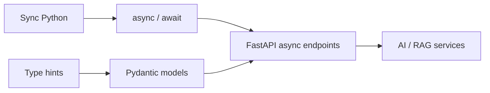

import TOCInline from '@theme/TOCInline';

# 01 · Python

<ProgressToggle sectionId="01-python" />

<TOCInline toc={toc} minHeadingLevel={2} maxHeadingLevel={2} />

:::tip[In this guide]
Python is the foundation of everything that follows. This is a full roadmap —
not a setup page — organized into **six phases** that take you from syntax to
async, typing, clean backend structure, interview-ready data structures and
algorithms, and every kind of testing.
:::

## Goal

Become comfortable writing production-quality Python required for FastAPI and
AI engineering.

## Estimated Time

2–3 weeks.

## Prerequisites

- Completed [Prerequisites](../00-prerequisites/index.mdx).
- A working Python 3.11+ environment with an activated virtual environment.

## The Six Phases

1. **[Phase 1 — Python Fundamentals](./01-core-python/01-python-fundamentals.mdx)**
   Setup and execution, variables, data types, strings, numbers, booleans,
   `if/elif/else`, `for` and `while` loops, functions, scope, `*args`/`**kwargs`,
   modules and imports, exceptions, and file handling.
2. **[Phase 2 — Python Data Structures](./01-core-python/02-data-structures.mdx)**
   Lists, tuples, sets, dictionaries, list and dict comprehensions, slicing,
   iterators, generators, and the `collections` module.
3. **[Phase 3 — Object-Oriented Python](./01-core-python/03-oop.mdx)**
   Classes, objects, `__init__`, instance vs class attributes, methods,
   inheritance, polymorphism, encapsulation, abstract classes, magic/dunder
   methods, and dataclasses.
4. **[Phase 4 — Professional Python](./01-core-python/04-professional-python.mdx)**
   Type hints, `mypy`, dataclasses, virtual environments, `pip`,
   `requirements.txt`, `pyproject.toml`, logging, testing with `pytest`, async
   Python, context managers, decorators, and clean backend patterns.
5. **[Phase 5 — DSA with Python](./01-core-python/05-dsa-with-python.mdx)**
   Data structures and algorithms for interviews: arrays, stacks, queues,
   deques, heaps, hash maps/sets, `Counter`, `defaultdict`, linked lists, trees,
   tries, graphs, union-find, plus binary search, two pointers, sliding window,
   prefix sums, recursion, backtracking, dynamic programming, and Python tricks.
6. **[Phase 6 — Testing Python Code](./01-core-python/06-testing-python.mdx)**
   Every type of testing with examples: unit, integration, functional/E2E,
   regression, and smoke; `unittest`, `pytest`, and `doctest`; fixtures,
   parametrization, mocking and test doubles, async tests, coverage,
   property-based (Hypothesis), snapshot, benchmark, load, mutation, and fuzz
   testing, plus TDD, BDD, tox/nox, and CI.

## Language Deep Dives

Reference guides you'll come back to. Read them when the phases above make you
curious, or when an interviewer pushes past the surface.

| Guide | What it covers |
| --- | --- |
| [Typing Cheat Sheet](./02-language-deep-dives/01-typing-cheat-sheet.mdx) | `Optional`, `Union`, `Literal`, `TypedDict`, generics, protocols |
| [Slicing](./02-language-deep-dives/02-slicing.mdx) | Slice objects, negative steps, reversal, every sequence type |
| [Collections](./02-language-deep-dives/03-collections.mdx) | `Counter`, `defaultdict`, `deque`, `namedtuple`, `OrderedDict` |
| [Decorators & Annotations](./02-language-deep-dives/04-decorators-and-annotations.mdx) | `property`, `cached_property`, `classmethod`, `Annotated` |
| [Exceptions](./02-language-deep-dives/05-exceptions.mdx) | The hierarchy, custom errors, wrapping, exception groups |
| [Generator Expressions](./02-language-deep-dives/06-generator-expressions.mdx) | The `sum(... for ...)` pattern and when it beats a list |
| [Concurrency](./02-language-deep-dives/07-concurrency.mdx) | GIL, threading, multiprocessing, `concurrent.futures`, asyncio |
| [Memory Management](./02-language-deep-dives/08-memory-management.mdx) | Reference counting, GC, interning, leaks |
| [Sorting](./02-language-deep-dives/09-sorting.mdx) | `key` functions, stability, custom orderings |

## DSA Practice

Phase 5 teaches the structures and patterns. These put them to work.

- [Dynamic Programming](./03-dsa-practice/01-dynamic-programming.mdx) — memoization, tabulation, and the classic DP families.
- [Blind 75](./03-dsa-practice/02-blind-75.mdx) — the canonical list, brute force vs optimal for each.
- [LeetCode Top 100 Liked](./03-dsa-practice/03-leetcode-top-100.mdx) — broader coverage, same treatment.

## SQL & Databases

You can't build a backend without these, and they're asked about constantly.

- [SQL Cheatsheet & Roadmap](./04-sql-and-databases/01-sql-cheatsheet-and-roadmap.mdx) — schema, SELECT, joins, aggregation, window functions, indexes.
- [PostgreSQL Cheatsheet & Roadmap](./04-sql-and-databases/02-postgresql-cheatsheet-and-roadmap.mdx) — connection strings, async SQLAlchemy, JSONB, pgvector.

## Interview Prep

- [Python Interview Guide](./05-interview-prep/01-python-interview-guide.mdx) — the questions that come up again and again, with answers worth saying out loud.

## Why Python First?

FastAPI is "just Python" — it leans heavily on type hints, async, and clean
structure. Every hour here pays off later.

## Interview Relevance

Python fundamentals are a staple of backend interviews: mutability, `list` vs
`tuple`, generators vs iterators, decorators, the GIL, and async vs threads all
appear repeatedly. Each phase ends with an interview section.

## Done When

You can build a small Python application using typing, OOP, async/await,
testing, error handling, and package management **without following a
tutorial**.

- [ ] Comfortable with fundamentals: control flow, functions, scope, exceptions.
- [ ] Comfortable with data structures, comprehensions, and generators.
- [ ] Can design classes and use dataclasses/abstract base classes.
- [ ] Can annotate code and pass `mypy`.
- [ ] Can write and run `pytest` tests, including async ones.
- [ ] Understand when (and when not) to use `async`.
- [ ] Can map each DSA structure to its Python built-in and solve with the core patterns.
- [ ] Can choose the right kind of test and write it (unit, integration, E2E, mocks, async).

Next: [02 · FastAPI](../02-fastapi/index.mdx).
