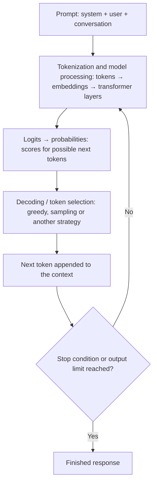
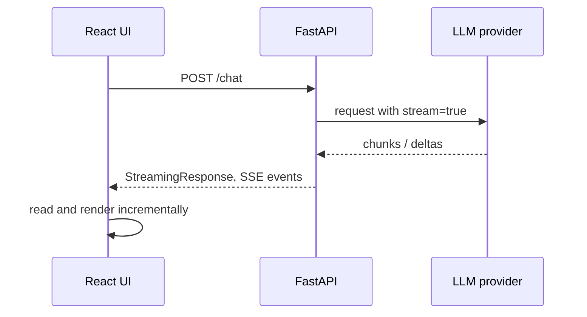

import TOCInline from '@theme/TOCInline';

# LLM Fundamentals Roadmap

<TOCInline toc={toc} minHeadingLevel={2} maxHeadingLevel={2} />

:::tip[In this guide]
Learn LLM fundamentals in the order that matters for building real
applications: generation parameters, tokens and context, how a model produces
text, streaming, measurement, reasoning, and production behavior. It covers what
you need to build LLM applications, RAG systems, and AI agents, and to explain
their behavior in interviews.
:::

## What Is It?

An LLM (large language model) is a model that predicts the next token given the
tokens before it, repeated many times to produce text. Knowing the dial
settings (such as `temperature`) is only the start; to build and operate LLM
features you also need to understand tokens, context windows, token generation,
streaming, cost, latency, and how these behave in production.

## Why Does It Matter?

Every later topic — RAG, agents, evaluation, cost control — rests on these
basics. Most "mystery" behavior in LLM apps (slow responses, truncated answers,
runaway cost, inconsistent outputs) traces back to a parameter, a token budget,
or a streaming detail covered here.

## 1. Complete Roadmap

| Phase | Topic | Priority | Key topics |
| --- | --- | --- | --- |
| 1 | Model parameters and generation | P0 · Must know | `temperature`, `top_p`, `top_k`, `max_tokens`, `stop`, `seed`, `n`, penalties, greedy decoding, sampling |
| 2 | Tokens and context | P0 · Must know | Tokens vs words, tokenization, input/output tokens, context window, truncation, context limits, special tokens |
| 3 | How an LLM generates answers | P0 · Must know | Next-token prediction, logits, softmax, probability distributions, decoding, autoregressive generation, reasoning vs final answer |
| 4 | Streaming and API behavior | P0 · Must know | Streaming vs non-streaming, SSE, chunked responses, time to first token, cancellation, usage metadata, retries and timeouts |
| 5 | Measurements and evaluation | P0 · Must know | Latency, throughput, tokens/second, TTFT, time per output token, token usage, cost, accuracy, hallucination rate |
| 6 | Reasoning and model capabilities | P1 · Important | Reasoning models, thinking budgets, tool calling, structured output, multimodal models, model selection, quantization basics |
| 7 | Reliability and production | P1 · Important | Retries, rate limits, fallbacks, prompt injection, output validation, caching, observability, load testing |

**Suggested order:** Phases 1–3 first (how the model behaves), then Phase 4
(how you serve it), then Phase 5 (how you measure it) before building larger
RAG or agent systems. Phases 6–7 deepen capabilities and production readiness.

## 2. Phase 1 — Model Parameters and Generation

**P0 · Must know**

These are the first concepts to master when calling a model through NVIDIA's
API, OpenAI-compatible APIs, or local Ollama.

- [ ] `temperature`, `top_p`, `top_k`
- [ ] `max_tokens` / `max_completion_tokens`
- [ ] `stop` sequences
- [ ] `seed` and reproducibility limits
- [ ] `n` (multiple completions)
- [ ] `frequency_penalty` and `presence_penalty`
- [ ] `logprobs`
- [ ] Greedy decoding vs sampling

| Parameter | What it controls | Practical understanding |
| --- | --- | --- |
| `temperature` | Randomness of token selection | Lower values generally make outputs more predictable |
| `top_p` | Nucleus sampling probability threshold | Restricts sampling to a high-probability set of tokens |
| `top_k` | Number of highest-probability token candidates | Available only on some models/APIs |
| `max_tokens` / `max_completion_tokens` | Output token budget, depending on API | Limits generation length; naming and counting rules vary |
| `stop` | Stop sequences | Ends generation when a configured sequence is encountered |
| `n` | Number of completions | Requests multiple candidate outputs, if supported |
| `seed` | Reproducibility hint | Can help repeat results, but exact reproducibility isn't guaranteed |
| `frequency_penalty` | Repetition based on token frequency | Can discourage repeated tokens |
| `presence_penalty` | Repetition based on whether tokens appeared | Can encourage introducing new topics |
| `logprobs` | Token probability information | Useful for inspecting model confidence signals, when supported |

### Understand temperature with an example

Suppose the model is completing:

```text
The capital of France is...
```

Its possible next tokens might have probabilities like these (illustrative, not
actual model output):

| Next token | Probability |
| --- | --- |
| Paris | 90% |
| Lyon | 6% |
| Berlin | 3% |
| London | 1% |

- **Low temperature**: makes the distribution more concentrated around the most
  likely tokens.
- **High temperature**: flattens the distribution, giving less likely tokens a
  greater chance of being selected.
- **Temperature = 0**: often approximates greedy decoding, but provider
  implementations differ, and ties or nondeterminism can still matter.

:::note
Temperature does not directly control intelligence, factuality, or reasoning
depth.
:::

You can see the effect directly. Temperature divides the logits before softmax:

```python
import math

def softmax(logits: list[float], temperature: float = 1.0) -> list[float]:
    scaled = [x / temperature for x in logits]
    m = max(scaled)                                   # subtract max for numerical stability
    exps = [math.exp(x - m) for x in scaled]
    total = sum(exps)
    return [e / total for e in exps]

logits = [3.0, 1.0, 0.0]            # three candidate tokens

print(softmax(logits, 0.5))         # about [0.980, 0.018, 0.002]  sharper
print(softmax(logits, 1.0))         # about [0.844, 0.114, 0.042]  baseline
print(softmax(logits, 2.0))         # about [0.629, 0.231, 0.140]  flatter
```

### `temperature` vs `top_p`

- `temperature` changes the **shape** of the probability distribution.
- `top_p` **filters** the candidates based on cumulative probability.
- Using both at once can make behavior harder to reason about, so start by
  adjusting one parameter at a time.

```python
def top_p_filter(probs: dict[str, float], p: float) -> dict[str, float]:
    """Keep the smallest set of top tokens whose cumulative probability reaches p."""
    kept, total = {}, 0.0
    for token, prob in sorted(probs.items(), key=lambda kv: kv[1], reverse=True):
        kept[token] = prob
        total += prob
        if total >= p:
            break
    norm = sum(kept.values())
    return {t: pr / norm for t, pr in kept.items()}      # renormalize before sampling

top_p_filter({"Paris": 0.90, "Lyon": 0.06, "Berlin": 0.03, "London": 0.01}, p=0.95)
# keeps Paris and Lyon only
```

### Passing parameters to a model

Most hosted providers, NVIDIA's API, and local Ollama expose an
OpenAI-compatible endpoint, so one client works for all of them:

```python
from openai import AsyncOpenAI

client = AsyncOpenAI(base_url="http://localhost:11434/v1", api_key="ollama")   # Ollama example

resp = await client.chat.completions.create(
    model="llama3",
    messages=[{"role": "user", "content": "Name three French cities."}],
    temperature=0.2,
    top_p=1.0,
    max_tokens=100,
    stop=["\n\n"],
    seed=42,                       # hint only; not a guarantee
    n=1,
    frequency_penalty=0.0,
    presence_penalty=0.0,
    # top_k is not part of the OpenAI schema; send provider-specific options like this:
    extra_body={"top_k": 40},
)
print(resp.choices[0].message.content, resp.choices[0].finish_reason)
```

Parameter support and names vary by provider and model, so check the provider's
documentation rather than assuming.

**Practical starting points:** low temperature (about 0 to 0.3) for extraction,
classification, and RAG answers where consistency matters; moderate to higher
for brainstorming and creative writing. Set `max_tokens` deliberately: too low
truncates answers, too high wastes budget and can let responses run long.

:::info[Interview checkpoint]
**Explain why a lower temperature can make a response more consistent but cannot
guarantee that the answer is correct.**

Lower temperature concentrates probability on the model's most likely tokens, so
repeated runs agree more often. But "most likely" is not "true": if the model's
highest-probability continuation is wrong (a gap in knowledge, bad retrieved
context, an ambiguous question), it will be confidently and consistently wrong.
Correctness comes from grounding, evaluation, and validation, not from sampling
settings.
:::

## 3. Phase 2 — Tokens and Context Window

**P0 · Must know**

Learn these concepts before moving to RAG or agent workflows.

- [ ] Tokens vs words, and tokenization
- [ ] Input vs output tokens
- [ ] Context window and context limits
- [ ] Truncation
- [ ] Special tokens
- [ ] Context management

Definitions:

- **Tokenization**: converting text into tokens that a model processes. Tokens
  are pieces of text (words, sub-words, punctuation, whitespace), so token count
  differs from word count and varies by tokenizer and language.
- **Input tokens**: system instructions, user messages, conversation history,
  retrieved documents, and tool results.
- **Output tokens**: generated content, and sometimes reasoning-related tokens
  depending on the model and API.
- **Context window**: the maximum token capacity available to a model for a
  request, including applicable input and generated tokens.
- **Truncation**: content being cut or omitted when limits are reached.
- **Special tokens**: reserved tokens used for message boundaries, roles, and
  end-of-sequence. The chat template adds them, which is one reason your own
  token estimate can differ from the billed count.
- **Context management**: deciding which conversation history and retrieved
  information to retain.

For example, in a RAG request:

```text
System prompt          500 tokens
Conversation history 1,000 tokens
Retrieved documents  3,000 tokens
Current question       100 tokens
Expected output        500 tokens
--------------------------------
Approximate total     5,100 tokens
```

This is a planning estimate, not a universal token-counting formula. Actual usage
depends on the tokenizer, message formatting, and model-specific rules.

Counting tokens and enforcing a budget:

```python
import tiktoken

enc = tiktoken.get_encoding("cl100k_base")        # tokenizers are model-specific

def count_tokens(text: str) -> int:
    return len(enc.encode(text))

def fit_context(chunks: list[str], budget: int) -> list[str]:
    """Keep chunks (already ranked best-first) until the token budget is used."""
    kept, used = [], 0
    for chunk in chunks:
        n = count_tokens(chunk)
        if used + n > budget:
            break
        kept.append(chunk)
        used += n
    return kept

CONTEXT_WINDOW = 8192
RESERVED_FOR_OUTPUT = 500
available_for_input = CONTEXT_WINDOW - RESERVED_FOR_OUTPUT
```

Use the tokenizer that matches your model; a mismatched one gives only a rough
estimate, so leave a safety margin and prefer the `usage` numbers the API
returns for real accounting.

:::info[Interview checkpoint]
**Why might adding more retrieved documents make a RAG response slower, more
expensive, or less accurate?**

More input tokens mean more prefill compute (slower time to first token) and
higher per-token cost. Accuracy can also drop: relevant evidence gets diluted by
noise, and models can overlook information buried in the middle of a long
context. Better retrieval and reranking with a smaller, higher-quality context
often beats stuffing in more documents.
:::

## 4. Phase 3 — How the Model Generates a Response

**P0 · Must know**

Understand this simplified generation pipeline:



Key terminology:

- **Logits**: raw scores assigned to possible next tokens.
- **Softmax**: converts logits into a probability distribution.
- **Autoregressive generation**: generates tokens sequentially, conditioning on
  the preceding context.
- **Decoding**: chooses which token to emit from the model's predictions.
- **KV cache**: reuses attention key/value computations to avoid recomputing the
  entire prefix at every generation step.

You do not need to derive all the transformer mathematics immediately.
Understand the data flow and what each component does.

**Two phases of inference** (useful for performance reasoning):

- **Prefill**: the model processes the whole input prompt in parallel. Cost grows
  with prompt length and determines time to first token.
- **Decode**: tokens are generated one at a time, each depending on the previous
  ones (using the KV cache). This determines generation speed.

This is why long prompts hurt time to first token, and long outputs hurt total
latency.

**Decoding strategies**

| Strategy | How it picks the next token | Typical use |
| --- | --- | --- |
| Greedy | Always the highest-probability token | Deterministic tasks, extraction |
| Sampling (temperature) | Samples from the (re-scaled) distribution | Varied, natural text |
| Top-k / top-p sampling | Samples only from a filtered candidate set | Avoids low-probability junk tokens |
| Beam search | Tracks several candidate sequences | Less common for chat LLM APIs |

**Reasoning vs final answer:** some models produce intermediate reasoning
tokens before the answer the user sees. Those tokens take compute and time, are
often billed as output tokens, and may be hidden or only partly exposed by the
API. Treat the reasoning (if shown) and the final answer as separate things, and
read the provider's documentation on how each is returned and billed. See
Phase 6.

## 5. Phase 4 — Streaming and API Behavior

**P0 · Must know**

Streaming is one of the most practical LLM application concepts for a FastAPI
developer.

| Mode | Behavior | Trade-off |
| --- | --- | --- |
| **Non-streaming** | Wait for the completed response, then return it to the client | Simpler response handling; potentially longer perceived wait |
| **Streaming** | Send output chunks as they become available | Faster perceived response; requires chunk and connection handling |

Typical flow:



Important concepts to learn:

1. **SSE (Server-Sent Events)**: a common way to stream text updates from server
   to browser over HTTP.
2. **Delta chunks**: partial changes to the generated response, not necessarily
   complete words.
3. **Time to First Token (TTFT)**: time until the first generated output token
   becomes available.
4. **Cancellation**: stop upstream generation when the user cancels or
   disconnects, where supported.
5. **Stream completion**: handle final usage metadata, finish reasons, and errors
   correctly.
6. **Backpressure and buffering**: prevent slow clients from causing
   uncontrolled buffering.
7. **Retries and timeouts**: distinguish failures before generation from
   failures after partial output has already been sent.

:::warning
Streaming is a **transport behavior**, not a different intelligence mode. It
changes *when* the client receives output, not necessarily *how* the model
reasons.
:::

### Streaming from a provider through FastAPI

```python
import json
from fastapi import FastAPI, Request
from fastapi.responses import StreamingResponse
from openai import AsyncOpenAI

app = FastAPI()
client = AsyncOpenAI(base_url="http://localhost:11434/v1", api_key="ollama")

@app.post("/chat")
async def chat(request: Request, body: ChatRequest):
    async def event_stream():
        stream = await client.chat.completions.create(
            model="llama3",
            messages=body.messages,
            stream=True,
            stream_options={"include_usage": True},   # ask for usage in the final chunk (support varies)
        )
        try:
            async for chunk in stream:
                if await request.is_disconnected():    # client left: stop paying for tokens
                    break
                if chunk.choices:
                    choice = chunk.choices[0]
                    if choice.delta.content:
                        yield f"data: {json.dumps({'type': 'token', 'text': choice.delta.content})}\n\n"
                    if choice.finish_reason:
                        yield f"data: {json.dumps({'type': 'finish', 'reason': choice.finish_reason})}\n\n"
                if getattr(chunk, "usage", None):
                    yield f"data: {json.dumps({'type': 'usage', 'completion_tokens': chunk.usage.completion_tokens})}\n\n"
        finally:
            await stream.close()                        # always release the upstream connection

    return StreamingResponse(event_stream(), media_type="text/event-stream")
```

Things this handles: forwarding deltas as SSE events, the `finish_reason` and
usage metadata at the end, and cancelling the upstream request on disconnect.
The browser's `EventSource` only supports `GET`, so for a `POST` body the React
client usually reads the response with `fetch` and a stream reader.

**Retries and partial output:** if a request fails *before* any token has been
sent, a retry is usually safe. After partial output has already reached the
client, a blind retry can duplicate or contradict what the user has seen, so
either resume carefully, show an error with a "retry" action, or restart the
visible message cleanly. Also apply a timeout to the **gap between chunks** so a
stalled stream doesn't hang forever. For deeper coverage see
[Python concurrency](../01-python/02-language-deep-dives/07-concurrency.mdx) and
[API & service design](../08-llm-application-development/02-api-service-design.mdx).

## 6. Phase 5 — Measurements and Performance Metrics

**P0 · Must know**

This is the section to prioritize after model parameters and streaming. These
metrics are frequently useful when optimizing LLM applications in production.

| Metric | Meaning | Why it matters |
| --- | --- | --- |
| TTFT | Time to first token | Measures initial perceived responsiveness |
| Total latency | Total time until completion | Measures end-to-end response time |
| TPOT | Time per output token | Measures average generation delay per token |
| Tokens/second | Output generation throughput | Measures generation speed |
| Throughput | Requests or tokens processed per unit time | Measures system capacity |
| Input tokens | Prompt token usage | Affects context consumption and often cost |
| Output tokens | Generated token usage | Affects cost and generation time |
| Error rate | Failed requests / total requests | Measures reliability |
| P50 / P95 / P99 | Latency percentiles | Reveals typical and slow-tail experiences |
| Cost per request | Estimated model and infrastructure cost | Helps control operating expenses |

### Example: calculating latency

Suppose a request produces 100 output tokens:

- TTFT = 0.8 seconds
- Time until completion = 4.8 seconds
- Time spent generating after the first token = approximately 4.0 seconds

Average generation time per token:

```text
TPOT             ≈ 4.0 s / 99 = about 40.4 ms per token
Generation speed ≈ 99 / 4.0 s = about 24.75 tokens per second
```

The calculation uses **99 token intervals** between 100 tokens. Real providers
may define these metrics differently, and measurements should use consistent
timestamps.

### Measuring it in code

```python
import time

async def measure(client, model: str, messages: list[dict]) -> dict:
    start = time.perf_counter()
    first_token_at = None
    completion_tokens = None

    stream = await client.chat.completions.create(
        model=model, messages=messages, stream=True,
        stream_options={"include_usage": True},
    )
    async for chunk in stream:
        if chunk.choices and chunk.choices[0].delta.content and first_token_at is None:
            first_token_at = time.perf_counter()
        if getattr(chunk, "usage", None):
            completion_tokens = chunk.usage.completion_tokens
    end = time.perf_counter()

    ttft = first_token_at - start
    gen_time = end - first_token_at
    tpot = gen_time / (completion_tokens - 1) if completion_tokens and completion_tokens > 1 else None
    return {
        "ttft_s": ttft,
        "total_s": end - start,
        "tpot_ms": tpot * 1000 if tpot else None,
        "tokens_per_s": (completion_tokens - 1) / gen_time if tpot else None,
        "completion_tokens": completion_tokens,
    }
```

Use the token count from the API's `usage` data rather than counting stream
chunks: one chunk does not necessarily equal one token.

### What do P50, P95 and P99 mean?

Imagine 1,000 requests sorted by latency.

- **P50**: half the requests finish at or below this latency.
- **P95**: 95% finish at or below this latency.
- **P99**: 99% finish at or below this latency.

A P50 of 2 seconds and P95 of 10 seconds means the typical experience may be
acceptable while a significant minority of requests are much slower. Averages
hide that tail, so track percentiles:

```python
import numpy as np

latencies = [1.8, 2.1, 1.9, 2.0, 9.5, 2.2, 2.3, 12.0, 2.0, 1.9]
p50, p95, p99 = np.percentile(latencies, [50, 95, 99])
```

### Cost per request

```python
def request_cost(input_tokens: int, output_tokens: int,
                 input_price_per_m: float, output_price_per_m: float) -> float:
    """Prices are per one million tokens; use your provider's current rates."""
    return (input_tokens / 1_000_000) * input_price_per_m \
         + (output_tokens / 1_000_000) * output_price_per_m
```

Remember cached-token discounts, separate output-token pricing, and
reasoning-token billing where they apply.

### Performance metrics vs evaluation metrics

:::warning
**A key distinction:** model *performance* metrics (latency, throughput, tokens,
cost) measure speed and resource usage. *Evaluation* metrics (accuracy,
relevance, groundedness, hallucination rate, refusal behavior, task completion)
measure response quality. You need both: a fast, cheap system that gives wrong
answers is not a success.
:::

:::info[Interview checkpoint]
**Your LLM API has good average latency but poor P95 latency. How would you
investigate it?**

Break latency into stages (queueing, retrieval, prefill/TTFT, generation) and
look at which stage widens at the tail. Segment by input length, output length,
model, tenant, and time of day; check for retries and timeouts, cold starts,
rate-limit throttling, long-context outliers, noisy neighbors, and provider
incidents. Use traces to compare a slow request against a typical one, then fix
the dominant cause (cap context size, add concurrency limits, adjust timeouts,
add a faster fallback model).
:::

## 7. Phase 6 — Thinking and Reasoning Models

**P1 · Important**

Learn the difference between the model's *generation settings* and its
*reasoning capabilities*.

| Concept | What it means |
| --- | --- |
| Standard generation | Produces an answer using the model's learned capabilities and supplied context |
| Reasoning model | A model designed or trained to spend additional computation on difficult problems |
| Thinking budget | A provider-specific control over reasoning effort or tokens, when available |
| Visible reasoning | Any reasoning-related content the API explicitly exposes |
| Final answer | The user-facing answer produced by the model |
| Tool calling | The model requests an action, such as invoking a function |
| Structured output | Constrains the response to a schema, often JSON |

For example, consider a multi-step math problem.

- A standard model might answer directly.
- A reasoning-oriented model may use additional internal computation before
  returning its answer.
- A tool-enabled model might invoke a calculator to verify a calculation.

These are different capabilities. A higher temperature does not enable
reasoning, and a larger `max_tokens` value does not automatically improve it.

Also learn:

- **Stop reasons** (`finish_reason`): completed normally, reached an output
  limit, requested a tool, or stopped according to provider-specific conditions.
  A `length` finish means the output was cut off, and with reasoning models the
  budget can be consumed before a complete final answer appears, so check it.
- **Tool-call loop**: model request → application executes tool → tool result →
  model continues.
- **Multimodal inputs**: images, audio, and video, where supported.
- **Quantization**: reducing numerical precision to reduce memory usage and
  potentially improve inference efficiency, with possible quality trade-offs.
- **Model selection**: pick the smallest model that meets your quality bar on
  *your* evaluation set, and use a larger or reasoning model only for hard
  cases (routing).

### Tool-call loop

```python
async def run_with_tools(messages: list[dict], max_steps: int = 5) -> str:
    for _ in range(max_steps):                                   # bounded loop
        resp = await client.chat.completions.create(
            model="llama3", messages=messages, tools=TOOL_SPECS,
        )
        msg = resp.choices[0].message
        if not msg.tool_calls:                                   # normal completion
            return msg.content
        messages.append(msg)                                     # keep the model's tool request
        for call in msg.tool_calls:
            args = json.loads(call.function.arguments)           # validate before executing!
            result = await TOOLS[call.function.name](**args)
            messages.append({
                "role": "tool",
                "tool_call_id": call.id,
                "content": json.dumps(result),
            })
    raise RuntimeError("tool loop exceeded max steps")
```

### Structured output with validation

```python
from pydantic import BaseModel, ValidationError

class Ticket(BaseModel):
    category: str
    priority: int

def parse_ticket(raw: str) -> Ticket | None:
    try:
        return Ticket.model_validate_json(raw)
    except ValidationError:
        return None          # re-ask (bounded) or fall back
```

Constraining output to a schema reduces malformed responses, but still validate:
a schema-conformant answer can be wrong, and not every provider or model
enforces schemas the same way.

## 8. Phase 7 — Cost, Reliability and Production Patterns

**P1 · Important**

Before building larger RAG or agent systems, understand these production
concerns.

- **Cost estimation**: input and output token pricing, cached-token pricing, and
  model-specific billing.
- **Rate limits**: requests per minute and tokens per minute.
- **Timeouts**: connection, first-token, and total-request timeouts.
- **Retries**: exponential backoff and jitter, with care around duplicate
  requests.
- **Fallback models**: switching to an alternative when a provider or model
  fails.
- **Caching**: reusing suitable prior results or prompt prefixes when supported.
- **Observability**: logging model, latency, usage, finish reason, and error
  details.
- **Evaluation**: correctness, relevance, groundedness, refusal behavior, and
  task completion.
- **Security**: secret management, prompt injection defenses, PII handling, and
  validation of tool arguments.

A short sketch tying several of these together (retry on transient errors,
bounded attempts, then a fallback model):

```python
import asyncio, random
import httpx

RETRYABLE = {429, 500, 502, 503, 504}

async def complete_with_fallback(messages, models=("primary-model", "fallback-model")):
    for model in models:
        for attempt in range(3):
            try:
                return await asyncio.wait_for(
                    client.chat.completions.create(model=model, messages=messages),
                    timeout=30,
                )
            except (TimeoutError, httpx.TransportError):
                pass                                            # transient: retry
            except Exception as exc:
                status = getattr(exc, "status_code", None)
                if status not in RETRYABLE:
                    raise                                       # 4xx like bad request: don't retry
            await asyncio.sleep(random.uniform(0, min(8, 0.5 * 2 ** attempt)))   # jittered backoff
    raise RuntimeError("all models failed")
```

Notes: honor `Retry-After` on `429`; respect token-per-minute limits as well as
request limits; log which model actually served each request; and only retry
operations that are safe to repeat. For production patterns in depth, see
[API & service design](../08-llm-application-development/02-api-service-design.mdx),
[Logging, monitoring & guardrails](../13-production-genai-and-llmops/04-logging-monitoring-guardrails.mdx), and
[AI system design](../16-ai-system-design/06-ai-system-design.mdx).

## Common Mistakes

- Expecting a low temperature to make answers *correct* rather than *consistent*.
- Tuning `temperature` and `top_p` together without isolating their effects.
- Assuming `seed` guarantees identical output across runs or providers.
- Treating tokens as words, or ignoring that output tokens count toward the
  context window.
- Setting `max_tokens` too low (truncated answers) or never checking
  `finish_reason`.
- Stuffing more retrieved documents into the prompt instead of improving
  retrieval.
- Believing streaming makes the model faster or smarter; it only changes when
  output arrives.
- Not cancelling the upstream request when the client disconnects.
- Retrying blindly after partial output has already been streamed.
- Counting stream chunks as tokens instead of using reported `usage`.
- Watching only average latency; ignoring P95/P99 and TTFT.
- Measuring speed and cost but never measuring answer quality.
- Executing tool-call arguments without validating them.

## Interview Questions

- What do `temperature`, `top_p`, and `top_k` do, and how do they differ?
- Why can't temperature = 0 guarantee identical outputs?
- What is a token, and why does it matter for cost and context?
- Explain next-token prediction, logits, softmax, and autoregressive generation.
- What is the KV cache, and what is the difference between prefill and decode?
- Why does streaming improve perceived latency without changing model quality?
- Define TTFT, TPOT, tokens/second, and P95. How would you measure them?
- What is the difference between a reasoning model and a standard model with a
  higher `max_tokens`?
- Walk through a tool-calling loop. How do you keep it safe and bounded?
- How would you reduce cost and latency without hurting quality?
- Performance metrics vs evaluation metrics: what's the difference, and why do
  you need both?

## Things to Remember

- Parameters shape the *probability distribution and selection*; they don't add
  knowledge or reasoning ability.
- Context window = input + output; budget it explicitly.
- Prefill drives TTFT; decode drives generation speed.
- Streaming is a transport feature: handle cancellation, usage, finish reasons,
  and partial-failure retries.
- Measure TTFT, TPOT, tokens/second, percentiles, and cost, *and* quality.
- Validate structured output and tool arguments; bound every loop.
- Retry transient failures with backoff and jitter, and have a fallback.

## Mini Exercise

1. Implement `softmax` with temperature and print the distribution for logits
   `[3.0, 1.0, 0.0]` at 0.5, 1.0, and 2.0; then add `top_p_filter` and observe
   which tokens survive.
2. Call a local Ollama (or NVIDIA/OpenAI-compatible) model with
   `temperature=0` and `temperature=1` ten times each and compare the variety of
   outputs.
3. Build a FastAPI `/chat` SSE endpoint that streams tokens, forwards the final
   usage, and stops upstream generation when the client disconnects.
4. Write a `measure()` helper that reports TTFT, TPOT, tokens/second, and total
   latency; run it 50 times and report P50/P95/P99.
5. Make a token budget function for a RAG prompt (system, history, retrieved
   chunks, reserved output) and verify it never exceeds the context window.

## Done When

- [ ] You can explain every generation parameter and when to change it.
- [ ] You can count tokens, budget a context window, and explain truncation.
- [ ] You can describe the generation pipeline (logits → softmax → decoding →
      repeat), prefill vs decode, and the KV cache.
- [ ] You can build a streaming endpoint with cancellation, usage metadata, and
      sensible retry behavior.
- [ ] You can measure and explain TTFT, TPOT, tokens/second, percentiles, and
      cost per request.
- [ ] You can distinguish reasoning, tool calling, and structured output, and
      keep tool loops safe.
- [ ] You can describe reliability patterns: timeouts, retries, rate limits,
      fallbacks, caching, and observability.
