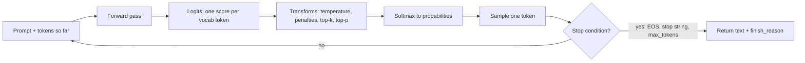

import TOCInline from '@theme/TOCInline';

# Decoding & Sampling

<TOCInline toc={toc} minHeadingLevel={2} maxHeadingLevel={2} />

:::tip[In this guide]
Every request you send carries half a dozen sampling parameters, and most teams
copy them from a blog post and never touch them again. This page covers what
each one does to the probability distribution, which ones interact, which are
redundant together, and a settings table by task. It is also honest about what
`temperature=0` and `seed` do not guarantee.
:::

## What Is It?

A language model does not emit text. At each step it emits a vector of
**logits** — one real number per token in the vocabulary, typically 32,000 to
200,000 of them. **Decoding** is the algorithm that turns that vector into a
single chosen token, which is then appended to the sequence and fed back in.

The model is fixed. Decoding is the part you control at request time, and it
changes the output substantially without touching a single weight.

How the forward pass produces those logits is covered in
[LLM Fundamentals](./03-llm-fundamentals.mdx); this page
starts where that leaves off.



Two things to notice in that loop. Transforms happen **before** sampling, in a
fixed order the server decides — so top-k and temperature are not independent
of each other. And the loop is autoregressive: a bad token chosen at step 4 is
part of the input at step 5, which is why sampling errors compound rather than
average out.

## Why Does It Matter?

| Symptom | Common decoding cause |
| --- | --- |
| Answer repeats the same sentence forever | Greedy or near-greedy decoding on an open-ended prompt |
| JSON output is occasionally malformed | Temperature above 0 on a structured task |
| Code is creative in the wrong way | Temperature 0.8 inherited from a chat default |
| Output cuts off mid-sentence, silently | `max_tokens` too low, `finish_reason` never checked |
| Model emits the next turn of the conversation | No `stop` sequence set |
| Two identical requests give different answers | Sampling on, or batching non-determinism |
| Creative writing is flat and generic | Temperature too low, top-p too tight |

None of those need a prompt change. They need a parameter change, and you can
only make the right one if you know what each knob does to the distribution.

## Greedy Decoding, And Why It Is Not `temperature=0`

Greedy decoding takes the argmax: the single highest-logit token, every step,
no randomness.

```python
import numpy as np


def greedy(logits: np.ndarray) -> int:
    """Pick the highest-scoring token. Fully deterministic given the logits."""
    return int(np.argmax(logits))
```

Most APIs do not expose greedy decoding directly. They expose `temperature`,
and `temperature=0` is implemented as "divide by a very small number, then
sample" — which collapses the distribution so hard that the argmax token gets
essentially all the mass. In practice that behaves like greedy decoding
**almost** always.

The gap between "almost always" and "always" is where people get hurt:

| Difference | Why it exists |
| --- | --- |
| Ties | If two tokens have near-identical logits, floating-point ordering decides, and that ordering can change with batch composition |
| Division by zero guards | Providers clamp temperature to a small epsilon rather than 0, leaving a sliver of randomness |
| Top-k / top-p still applied | Some servers apply other truncations before temperature; a default `top_p=0.95` is still in the pipeline |
| Reasoning models | Several explicitly override or ignore temperature, or recommend a fixed non-zero value |

So: `temperature=0` means "as deterministic as this provider will give you,"
not "deterministic." Design for that. If a downstream system requires byte-identical output, cache the output — do not rely on the model to reproduce it.

## Temperature

Temperature divides the logits before the softmax. That is the whole
mechanism, and it is worth seeing in code rather than described:

```python
import numpy as np


def softmax_with_temperature(logits: np.ndarray, temperature: float) -> np.ndarray:
    """p_i = exp(logit_i / T) / sum_j exp(logit_j / T)

    T < 1 sharpens the distribution (rich get richer).
    T > 1 flattens it (tail gets a real chance).
    T = 1 is the model's own distribution, unmodified.
    """
    if temperature <= 0:
        probs = np.zeros_like(logits)
        probs[int(np.argmax(logits))] = 1.0
        return probs
    scaled = logits / temperature
    scaled = scaled - scaled.max()          # numerical stability, no effect on result
    exp = np.exp(scaled)
    return exp / exp.sum()


logits = np.array([4.0, 3.0, 2.0, 1.0, 0.0])

for t in (0.2, 0.7, 1.0, 1.5):
    p = softmax_with_temperature(logits, t)
    print(f"T={t}: " + " ".join(f"{x:.3f}" for x in p))

# T=0.2: 0.993 0.007 0.000 0.000 0.000
# T=0.7: 0.688 0.168 0.041 0.010 0.002
# T=1.0: 0.636 0.234 0.086 0.032 0.012
# T=1.5: 0.483 0.248 0.127 0.065 0.033
```

Read the numbers. At `T=0.2` the second-best token has a 0.7% chance — it will
effectively never be chosen. At `T=1.5` it has a 25% chance and the fifth-best
token has a 3% chance, which over a 500-token generation means roughly fifteen
tail tokens get picked. That is where output goes off the rails.

| Temperature | Distribution effect | Practical behaviour |
| --- | --- | --- |
| 0 | Collapsed to argmax | Deterministic-ish; repetitive on open-ended prompts |
| 0.1 – 0.3 | Heavily sharpened | Stable, factual, slightly varied phrasing. The RAG and extraction default |
| 0.5 – 0.7 | Mildly sharpened | Natural variety, still on-task. Good general chat |
| 1.0 | Untouched | The model's raw distribution; noticeably loose |
| 1.2 – 1.5 | Flattened | Creative, surprising, prone to incoherence and invented facts |
| Above 1.5 | Badly flattened | Degenerates. Rarely useful without a tight top-p |

Temperature does not make a model smarter or dumber. It changes how willing the
sampler is to take the model's second and third guesses — and the model's second
guess about a fact is usually wrong.

## Top-k, Top-p and Min-p

Temperature reshapes the whole distribution. Truncation methods instead **cut
off the tail** before sampling, so the long tail of nonsense tokens cannot be
selected at all.

```python
import numpy as np


def top_k_filter(probs: np.ndarray, k: int) -> np.ndarray:
    """Keep the k highest-probability tokens, renormalise the rest to zero."""
    if k <= 0 or k >= probs.size:
        return probs
    cutoff = np.partition(probs, -k)[-k]
    kept = np.where(probs >= cutoff, probs, 0.0)
    return kept / kept.sum()


def top_p_filter(probs: np.ndarray, p: float) -> np.ndarray:
    """Nucleus sampling: keep the smallest set of tokens whose cumulative
    probability reaches p. The set size adapts to how confident the model is."""
    order = np.argsort(probs)[::-1]
    cumulative = np.cumsum(probs[order])
    # Always keep at least one token.
    last = int(np.searchsorted(cumulative, p)) + 1
    kept = np.zeros_like(probs)
    kept[order[:last]] = probs[order[:last]]
    return kept / kept.sum()


def min_p_filter(probs: np.ndarray, min_p: float) -> np.ndarray:
    """Keep tokens with probability >= min_p * max_probability.
    Threshold scales with model confidence, which is the point."""
    threshold = min_p * probs.max()
    kept = np.where(probs >= threshold, probs, 0.0)
    return kept / kept.sum()
```

| Method | Keeps | Behaves well when | Fails when |
| --- | --- | --- | --- |
| Top-k | A fixed count | You want a hard cap on branching | The model is very confident (k=50 lets in 49 bad tokens) or genuinely uncertain (k=50 cuts valid options) |
| Top-p | A fixed probability mass | Default choice; adapts to confidence | A flat distribution still admits hundreds of tokens at p=0.95 |
| Min-p | Everything within a ratio of the top token | Higher temperatures; keeps coherence while allowing variety | Less widely supported; tuning is less familiar |

**Top-p adapts and top-k does not**, and that is the reason top-p became the
default. If the model is 94% sure the next token is `the`, top-p 0.95 keeps two
or three tokens. If the model is genuinely uncertain across forty plausible
continuations, it keeps forty. Top-k 50 keeps fifty tokens in both cases —
which is too many in the first and possibly too few in the second.

### Why stacking both is usually redundant

Servers apply top-k first, then top-p, then sample. With `top_k=50, top_p=0.95`
the top-k step almost never binds: the nucleus at p=0.95 is typically under ten
tokens, well inside the fifty top-k already allowed. You have configured two
knobs and only one is doing anything.

Pick one:

- **Top-p alone** (0.9 – 0.95) for almost everything.
- **Top-k alone** when you want a predictable branching factor, e.g. generating
  fixed-cardinality choices.
- **Min-p alone** (0.05 – 0.1) when you are running temperature above 1.0 and
  want coherence without a hard nucleus.

Leaving a stale `top_k` in your config is not dangerous, just confusing — six
months later nobody knows which parameter is responsible for the behaviour.

## Repetition, Frequency and Presence Penalties

Open-ended generation with low temperature degenerates: `the the the`, or a
paragraph that loops. The cause is the autoregressive feedback loop. Once a
phrase appears, the model's own output makes that phrase more likely next time,
and the loop reinforces itself.

Three penalties address it, and they are not interchangeable:

| Penalty | Applied as | Scales with count? | Effect |
| --- | --- | --- | --- |
| `presence_penalty` | Subtract a constant from the logit of any token already present | No | Pushes toward new vocabulary; one flat charge per token, regardless of how often it appeared |
| `frequency_penalty` | Subtract `penalty * count` from the logit | Yes | Escalating pressure against tokens used repeatedly |
| `repetition_penalty` | **Divide** the logit by the penalty factor (llama.cpp / HF style) | No, but applies to a window | Multiplicative; a value of 1.0 is no-op, 1.1 is mild |

```python
import numpy as np
from collections import Counter


def apply_penalties(
    logits: np.ndarray,
    generated: list[int],
    frequency_penalty: float = 0.0,
    presence_penalty: float = 0.0,
) -> np.ndarray:
    """OpenAI-style additive penalties. Note they act on logits,
    before temperature and truncation."""
    out = logits.copy()
    counts = Counter(generated)
    for token_id, count in counts.items():
        out[token_id] -= frequency_penalty * count + presence_penalty
    return out
```

Practical ranges and cautions:

- `frequency_penalty` 0.1 – 0.5 fixes most loops. Above ~0.8 the model starts
  avoiding words it genuinely needs, including the subject of the sentence.
- `presence_penalty` 0.1 – 0.3 encourages topic coverage. Useful for
  brainstorming, harmful for anything that must repeat an identifier.
- `repetition_penalty` 1.05 – 1.15 for local models. 1.2 is already aggressive.

The important trap: **penalties are blind to meaning.** On structured output
they punish the repeated JSON keys, quote characters and braces your schema
requires. On code they punish repeated variable names. On RAG answers they
punish the repeated entity the whole answer is about. Set them to zero for
structured output, code, and citation-heavy answers, and fix repetition with
temperature and prompt instructions instead.

If the real problem is a loop at `temperature=0`, the better fix is usually to
raise the temperature to 0.3, not to bolt on a penalty.

## Beam Search

Beam search keeps the `n` highest-probability **partial sequences** at every
step, expands each, and keeps the best `n` again. At the end it returns the
sequence with the highest total log-probability — not a greedy token-by-token
path, but a near-optimal whole sequence.

| Task | Beam search | Why |
| --- | --- | --- |
| Machine translation | Helps | There is roughly one correct output; the objective and the goal coincide |
| Speech transcription | Helps | Same — a single correct transcript, scored globally |
| Short structured extraction | Sometimes helps | Constrained output space |
| Open-ended chat, essays, stories | Hurts | Optimising for likelihood produces bland, generic, repetitive text |
| Code generation | Rarely used | Expensive; constrained decoding or sampling plus tests works better |

The reason it hurts open-ended generation is that the highest-likelihood
sequence is not the best sequence. Human text is not maximally probable text —
it has surprise in it. Beam search systematically removes exactly that surprise,
and the result reads like it was written by a committee. It also costs `n`
times the compute for `n` beams, and most chat APIs do not expose it at all.

Know what it is; reach for it for translation and essentially nothing else you
are likely to build.

## Stop Sequences, max_tokens and finish_reason

Three parameters that control when generation ends, and one bug that eats teams
alive.

| Parameter | Does | Note |
| --- | --- | --- |
| `max_tokens` | Hard cap on generated tokens | Counts output only; it is not the context window |
| `stop` | List of strings that end generation when emitted | The stop string is usually **excluded** from the returned text — verify per provider |
| `finish_reason` | Why generation ended | `stop`, `length`, `tool_calls`, `content_filter`, provider-specific |

Useful stop sequences in practice: a turn marker like `User:` so the model does
not write both sides of the conversation, a fence terminator when you asked for
one code block, and a section delimiter when you are generating one item of a
list.

### The silent truncation bug

This is the single most common decoding bug in production code:

```python
async def answer(client, messages: list[dict]) -> str:
    # WRONG — truncation is invisible, and callers get half an answer
    response = await client.chat.completions.create(
        model="gpt-4o-mini",
        messages=messages,
        max_tokens=256,
    )
    return response.choices[0].message.content
```

If the model wanted 400 tokens, you get the first 256 and no error. For prose
it looks like the model trailed off. For JSON it is a parse error you will blame
on the prompt. For a RAG answer it silently drops the citations, which are at
the end.

```python
class TruncatedOutput(Exception):
    """Generation hit max_tokens. The output is incomplete, not merely short."""


async def generate(client, messages: list[dict], max_tokens: int = 1024) -> str:
    response = await client.chat.completions.create(
        model="gpt-4o-mini",
        messages=messages,
        max_tokens=max_tokens,
        temperature=0.2,
    )
    choice = response.choices[0]
    if choice.finish_reason == "length":
        raise TruncatedOutput(
            f"hit max_tokens={max_tokens}; raise the cap or shorten the request"
        )
    return choice.message.content or ""
```

Check `finish_reason` on every call. Log it. Alert on the rate of `length`
finishes — a sudden rise usually means your prompt grew and pushed output into
the cap, and nothing else in your metrics will tell you that.

## Seed and Reproducibility

Several providers accept a `seed` and describe it as **best-effort**. That
wording is doing real work and you should take it literally.

Even at `temperature=0` with a fixed seed, identical output is not guaranteed:

| Cause | Mechanism |
| --- | --- |
| Batching | Your request is batched with other users'. Matrix shapes change, GPU kernels pick different reduction orders, and floating-point addition is not associative. Tiny logit differences flip near-ties |
| Kernel and hardware variation | A different GPU model, driver, or inference-engine version computes the same maths to different last bits |
| Mixture-of-experts routing | Expert selection can depend on batch composition |
| Silent model updates | A hosted model name is a pointer. The weights behind it change |
| Non-greedy transforms still active | A default `top_p` is still in the pipeline unless you set it explicitly |

What `seed` actually buys you is that **two requests that take the same path
through the same server state** will match. In practice you get high-but-not-perfect
agreement — often 90-99% identical on short outputs, lower on long ones, because
a single flipped token early changes everything after it.

So: pin the model to a dated identifier rather than a floating alias, set every
parameter explicitly, pass a seed and record it with the response — and if you
need a hard guarantee, cache the output keyed by model version, parameter hash
and prompt hash. Only the cache is a guarantee.

Design tests accordingly. Asserting exact string equality on model output is a
flaky test; asserting on a parsed field, a schema, or a scored threshold is not.

## Logprobs as a Confidence Signal

Most APIs will return the log-probability of each chosen token and the top
alternatives. That is a cheap, per-token signal with no extra model call.

```python
import math
from pydantic import BaseModel


class AnswerConfidence(BaseModel):
    mean_logprob: float
    min_logprob: float
    perplexity: float
    low_confidence_tokens: list[tuple[str, float]]


def score_confidence(
    logprobs: list[tuple[str, float]], threshold: float = -1.5
) -> AnswerConfidence:
    """logprobs: (token, logprob) pairs for the generated tokens.
    Perplexity = exp(-mean logprob). Lower is more confident."""
    if not logprobs:
        raise ValueError("no logprobs returned; enable logprobs on the request")
    values = [lp for _, lp in logprobs]
    mean = sum(values) / len(values)
    return AnswerConfidence(
        mean_logprob=mean,
        min_logprob=min(values),
        perplexity=math.exp(-mean),
        low_confidence_tokens=[(t, lp) for t, lp in logprobs if lp < threshold],
    )
```

Where this genuinely works:

- **Classification.** Ask for a single label token and read its probability.
  This is the best use of logprobs by a wide margin, because the output space is
  closed and you can compare across the valid labels.
- **Extraction.** A low-probability token inside an extracted field — a date, an
  amount, an identifier — is worth flagging for review.
- **Routing.** Low confidence on a short answer is a reasonable trigger to
  escalate to a bigger model.

:::warning[Token probability is not calibrated truthfulness]
A model can be 99% confident on a fabricated citation and 60% confident on a
correct one. High probability means "this token is the natural continuation of
this text", which is a statement about fluency, not about the world. Models are
also systematically overconfident after instruction tuning.

Use logprobs as a **relative** signal within one task where you have measured
the threshold against labelled data. Do not present them to users as a
confidence percentage, and do not let a high score substitute for a
groundedness check. See [Hallucination Detection](../04-prompt-engineering/05-hallucination-detection.mdx)
for signals that actually verify.
:::

## Recommended Settings by Task

Starting points, not laws. Measure on your own cases before committing.

| Task | temperature | top_p | Penalties | max_tokens | Notes |
| --- | --- | --- | --- | --- | --- |
| Factual RAG answer | 0.0 – 0.2 | 1.0 | 0 | Generous | Low temperature plus a refusal instruction. Zero penalties — the answer must repeat entity names |
| Structured output / JSON | 0.0 | 1.0 | 0 | Generous | Penalties corrupt required keys and punctuation. Use schema-constrained decoding if available |
| Code generation | 0.0 – 0.2 | 0.95 | 0 | Generous | Deterministic for completion and refactors; 0.6 plus N samples if you have tests to filter with |
| Classification | 0.0 | 1.0 | 0 | 1 – 5 | Return one label token; read logprobs for confidence |
| Extraction | 0.0 | 1.0 | 0 | Sized to schema | Flag low-logprob field tokens for review |
| Summarisation | 0.2 – 0.4 | 0.9 | `presence` 0.1 | Sized to target length | Slight warmth avoids copying source sentences verbatim |
| General chat | 0.6 – 0.8 | 0.95 | `frequency` 0.1 | 1024+ | The conventional default, and fine |
| Creative writing | 0.9 – 1.1 | 0.95 (or `min_p` 0.05) | `frequency` 0.2, `presence` 0.2 | Large | Above 1.2 needs min-p to stay coherent |
| Brainstorming variants | 0.8 – 1.0 | 0.95 | `presence` 0.4 | Moderate | High presence penalty is what drives breadth |
| Judge / grader | 0.0 | 1.0 | 0 | Small | Variance in a metric is variance you cannot explain |

Two rules that override the table. **Set parameters explicitly** rather than
inheriting SDK or framework defaults — the most common cause of "it worked in
the notebook" is a default temperature difference. And **change one parameter at
a time** when tuning, with an eval in place, or you learn nothing from the
result.

## Reasoning Models Are Different

Models trained to produce an internal reasoning trace before answering —
the o-series, reasoning modes in Claude and Gemini, DeepSeek-R1 and similar —
handle these parameters differently, and the differences are not cosmetic:

| Behaviour seen in the wild | Implication |
| --- | --- |
| `temperature`, `top_p` and penalties rejected or silently ignored | Your carefully tuned settings have no effect; do not assume they applied |
| A specific non-zero temperature recommended by the model card | `temperature=0` can actually degrade reasoning quality, causing loops in the trace |
| `max_tokens` includes reasoning tokens | A 1024 cap can be fully consumed by thinking, returning an empty answer with `finish_reason` of `length` |
| Reasoning effort as a separate parameter | The main quality knob is effort, not temperature |
| Stop sequences interact badly with the reasoning trace | A stop string may fire inside the hidden reasoning |

Read the model card for every reasoning model you deploy. Treat the settings
table above as applying to standard instruct models, and verify empirically that
a parameter changed anything before you tune it.

## Cost and Latency

Decoding parameters move your bill and your p99, and one of them moves it a lot.

Temperature, top-p and penalties are essentially free — a handful of operations
on a vector the server computes anyway. Beam search is the exception: `n` beams
means roughly `n` times the compute, and sampling N candidates for
self-consistency is N times the cost at close to 1x latency if run concurrently.

The parameter that actually moves your numbers is output length. Output tokens
cost 3-5x input tokens and are generated **serially** — one forward pass each —
so a 500-token answer takes roughly five times as long as a 100-token one and no
hardware fixes that for a single request. The cheapest latency win available is
usually telling the model to be brief.

The structural levers — prefix caching, batching, prefill versus decode cost —
live in [GPU Serving Engines](../13-production-genai-and-llmops/02-gpu-serving-engines.mdx),
with the memory arithmetic in
[GPU Sizing & Quantization](../13-production-genai-and-llmops/03-gpu-sizing-and-quantization.mdx).
For the input side, see [Context Engineering](../04-prompt-engineering/04-context-engineering.mdx).

## Common Mistakes

- Inheriting a framework's default temperature and never checking what it is.
- Setting `top_k` and `top_p` together, then not knowing which one is binding.
- Applying frequency penalties to JSON or code output, corrupting required
  repeated tokens.
- Never reading `finish_reason`, so truncation shows up as a mysterious parse
  error weeks later.
- Treating `temperature=0` as a determinism guarantee in a test suite.
- Assuming `seed` gives byte-identical output across days, regions or batch
  conditions.
- Presenting token probability to users as a confidence or accuracy score.
- Using beam search for chat or essay generation and wondering why it reads flat.
- Raising temperature to fix a boring answer when the prompt was the problem.
- Tuning three parameters at once with no eval, then declaring one of them the
  cause.
- Carrying a chat-tuned temperature of 0.7 into an extraction pipeline.
- Assuming the parameters you sent to a reasoning model were actually applied.

## Interview Questions

- Walk me through what happens between the forward pass and a token appearing in
  the response.
- What does temperature do mathematically, and why does a low temperature make a
  model more factual?
- Why is top-p usually preferred over top-k?
- A team sets `top_k=50` and `top_p=0.95`. Which one is doing the work, and why?
- Explain the difference between frequency and presence penalties, and why either
  would break structured output.
- Why does beam search help translation and hurt story generation?
- Is `temperature=0` deterministic? Defend your answer.
- How would you use logprobs as a confidence signal, and what is the main caveat?
- What settings would you use for a RAG answer, and why those?

## Things to Remember

- Decoding operates on a probability distribution the model produces at every
  step. The model is fixed; the sampler is yours.
- Temperature divides logits before softmax. Low sharpens, high flattens.
- Top-p adapts to model confidence; top-k does not. Pick one.
- Penalties are blind to meaning — zero them for JSON, code and citations.
- Beam search optimises likelihood, and likelihood is not quality for
  open-ended text.
- Always check `finish_reason`. Silent truncation is the most common decoding
  bug there is.
- `temperature=0` and `seed` are best-effort, not guarantees. Cache if you need
  determinism.
- Logprobs measure fluency, not truth. Useful relatively, within a task, with a
  measured threshold.
- Reasoning models may ignore these knobs entirely. Check the model card.
- Output tokens are generated serially — brevity is a latency feature.

## Mini Exercise

Take one real prompt from your system. Run it 10 times at each of
`temperature` 0, 0.2, 0.7 and 1.2, holding everything else fixed, and record
three things per setting: how many outputs are byte-identical, how many are
factually correct, and the mean output length. The identical-output count at
`temperature=0` will occasionally come in below 10, which is the reproducibility
section made concrete.

Then enable logprobs and put two numbers side by side: your lowest-probability
token in a correct answer, and your highest-probability token in an incorrect
one. That is the fastest way to internalise why logprobs are not truthfulness.

## Done When

- [ ] You can explain what temperature does to the logits without hand-waving.
- [ ] You know whether your production calls set `top_k`, `top_p` or both, and
      which one binds.
- [ ] Every generation path in your code checks `finish_reason`.
- [ ] You can state honestly what `temperature=0` and `seed` do and do not
      guarantee.
- [ ] Your parameters are set explicitly per task, not inherited from a default.

Next: [Context Engineering](../04-prompt-engineering/04-context-engineering.mdx).
