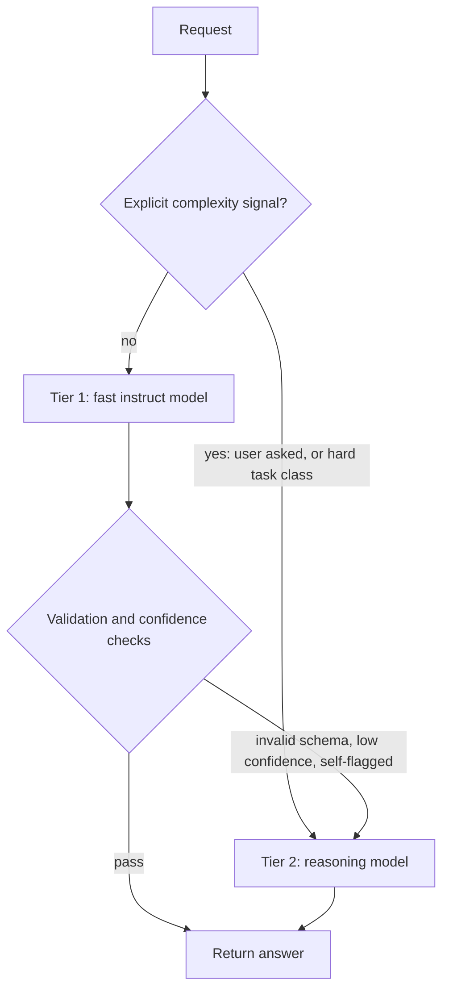

import TOCInline from '@theme/TOCInline';

# Reasoning Models & Test-Time Compute

<TOCInline toc={toc} minHeadingLevel={2} maxHeadingLevel={2} />

:::tip[In this guide]
A reasoning model is not a smarter chat model with a longer prompt. It is a
different compute profile: it buys accuracy with tokens you pay for and wait for.
This page covers the mechanism, the effort knob, when it is worth it, the cost
arithmetic, a routing cascade in code, and what breaks in production.
:::

## What Is It?

A reasoning model is trained to generate an extended internal reasoning trace
before committing to a final answer. The trace is ordinary tokens from ordinary
autoregressive decoding — no second engine, no search tree. The training differs.

The dominant recipe is reinforcement learning on **verifiable outcomes**: take
tasks a program can check — a maths answer that matches, unit tests that pass, a
constraint set satisfied — let the model generate long attempts, and reward the
ones that end correct. It learns behaviours that raise its hit rate: enumerating
cases, rechecking arithmetic, abandoning a dead end. Nobody specifies those; they
emerge because they correlate with being right.

Three consequences drive everything below:

- **Billed.** Reasoning tokens are output tokens on your invoice.
- **Serial.** Tokens come one at a time, so the trace is pure added latency
  before anything useful appears.
- **Not fully exposed.** Providers return a summary or a token count, not the raw
  trace, so you cannot debug it like a visible chain of thought.

Several failure modes below are decoding failures wearing a new hat, so read
[Decoding & Sampling](./05-decoding-and-sampling.mdx) first if you have not.

## Why Does It Matter?

Until this generation, the lever for "better at hard problems" was pretraining:
more parameters, more data, more compute — slow, capital-intensive, out of your
hands. Test-time compute moved part of that lever into the request: the same
weights give a weak answer or a strong one depending on how many tokens you let
the model spend. Capability becomes a **runtime decision with a price tag**.

| Scaling axis | Who controls it | Cost shape | Varies per request |
| --- | --- | --- | --- |
| Pretraining compute | Provider | Enormous, one-time, amortised | No |
| Post-training / RL | Provider | Large, one-time | No |
| Fine-tuning | You | Moderate, per model | No |
| Test-time compute | You | Linear, per request, forever | Yes |

Pretraining cost is amortised across every request ever served. Test-time compute
is amortised across nothing.

## The Spectrum, And Why Prompting Is Not The Same

| Level | What it is | Mechanism |
| --- | --- | --- |
| Standard instruct | Answers directly | Trained to be helpful and brief |
| CoT-prompted instruct | "Think step by step" in the prompt | Prompt steers decoding into a style seen in pretraining |
| Trained reasoning model | Trace generated by default | RL post-training makes the trace the policy |
| Reasoning model, high effort | Longer trace, more backtracking | Same policy, larger budget |

Rows two and three are the pair people conflate. Chain-of-thought prompting asks
a model to *imitate* reasoning text; it helps, often a lot, and is still right on
an instruct model — see
[Prompting Techniques](../04-prompt-engineering/02-prompting-techniques.mdx).
But that model was rewarded for plausible next tokens, never for reaching a
correct answer, so when it goes wrong it continues confidently. A trained
reasoning model was rewarded for the outcome, so self-correction is a learned
move, which is why its traces contain false starts and reversals that a
CoT-prompted instruct model almost never produces.

## Reasoning Effort Is The New Knob

Sampling parameters tune *how* the model picks among candidate tokens. Reasoning
effort tunes *how many tokens it may spend before answering*, exposed as a
discrete level, a thinking-token budget, or both. Names and ranges differ and
move fast, so learn the shape rather than the table.

| Effort | Trace length | Typical use |
| --- | --- | --- |
| Off / minimal | Near zero | Tasks that never needed it |
| Low | Short | Lightly multi-step, latency-sensitive |
| Medium | Moderate | Default for genuinely hard tasks |
| High | Long, with backtracking | Escalation, offline batch, hardest eval tier |

Two properties hold across providers. Cost and latency scale roughly with trace
length, which scales with effort. Accuracy gains are **sublinear and
task-dependent**: where there is headroom, low to medium is often most of the
win; where there is none, high effort burns tokens and changes nothing. Default
to the lowest effort that clears your bar on your own eval set.

## When To Use One

The signal is structural: does the task have a checkable answer that depends on
several dependent steps?

| Task shape | Example | Use it? | Why |
| --- | --- | --- | --- |
| Multi-step quantitative work | Unit-economics model, statistical check | Yes | Errors compound; steps are verifiable |
| Debugging dependent causes | Race condition, failing migration | Yes | Hypothesis then elimination |
| Constraint satisfaction | Scheduling, config under rules | Yes | Search plus checking, what RL rewarded |
| Planning with ordering | Agent plan, migration sequencing | Yes | Wrong order is silently wrong |
| Ambiguous requirement analysis | Contradictions in a spec | Yes | Enumerating cases, not recall |
| Classification into labels | Intent routing, triage | No | Pattern match; small model wins |
| Extraction, formatting, rewriting | JSON shaping, copy editing | No | Structure is the task |
| Summarisation | Meeting notes, digests | No | Compression, not deduction |
| Retrieval-grounded answering | Standard RAG over your docs | Mostly no | Quality dominated by retrieval |
| Interactive chat UX | Anything a human waits on per turn | No | The user pays the latency |

Heuristic: if a competent human would answer from recall in seconds, this is the
wrong tool; if they would reach for scratch paper, it is probably right.

Retrieval-shaped tasks tempt teams into escalating the generator when the defect
is upstream — no test-time compute invents a passage that was never retrieved.

## The Cost And Latency Arithmetic

Work the numbers once and the architecture decides itself. Take a 1,000-token
prompt and a 300-token visible answer, priced at 1 USD per million input tokens
and 4 USD per million output tokens on both tiers — which flatters the reasoning
model, since reasoning tiers usually cost more per token.

```text
                     input   reasoning   visible   billed output
Instruct             1,000           0       300             300
Reasoning (medium)   1,000       3,000       300           3,300   = 11x output

Instruct:  (1,000/1e6 * 1.00) + (300/1e6   * 4.00) = 0.0022 USD
Reasoning: (1,000/1e6 * 1.00) + (3,300/1e6 * 4.00) = 0.0142 USD   = 6.5x cost

At 200,000 requests/month: 440 USD vs 2,840 USD -> delta 2,400 USD/month
Latency at 60 tok/s, serial: 300/60 = 5.0 s vs 3,300/60 = 55.0 s
```

Those 50 seconds elapse before the first useful character appears, and the
multiplier is not constant: inflation runs from roughly 5x on easy items to 20x
or more on hard ones at high effort, which is what sets your p95. A reasoning
model on a task that does not need one is the single easiest way to multiply your
bill and tail latency for zero quality gain. More in
[Cost and Latency](../13-production-genai-and-llmops/08-cost-and-latency.mdx).

## Routing: The Two-Tier Cascade

The production pattern is not "pick a model". It is a cascade: serve everything
from a cheap fast model and escalate only on a trigger.



| Trigger | Signal | Notes |
| --- | --- | --- |
| Validation failure | Parse error, failing test, broken invariant | Strongest. Objective and cheap |
| Explicit user request | A "think harder" affordance | Users judge well, expectations set |
| Task class | Route by intent or endpoint | Coarse, effective |
| Low confidence | Mean token logprob under a threshold | Needs per-task calibration |

At a 10 percent escalation rate the blended cost is
`0.9 * 0.0022 + 0.1 * (0.0022 + 0.0142) = 0.0036` USD, about 1.6x instruct-only
rather than 6.5x, while the hard tail still gets the better model. Escalated
requests pay for both calls.

```python
import asyncio
import json

import httpx

URL = "https://api.example-provider.com/v1/chat/completions"


async def call(client, model, prompt, effort=None, max_tokens=4096):
    """Return (text, reasoning_tokens, finish_reason)."""
    payload = {
        "model": model,
        "messages": [{"role": "user", "content": prompt}],
        "max_tokens": max_tokens,  # this budget also covers reasoning tokens
    }
    if effort is None:
        payload["temperature"] = 0.0  # sampling knobs: instruct tier only
    else:
        payload["reasoning_effort"] = effort

    r = await client.post(URL, json=payload, timeout=180.0)
    r.raise_for_status()
    body = r.json()
    choice = body["choices"][0]
    used = body.get("usage", {}).get("completion_tokens_details", {})
    return (
        choice["message"]["content"],
        int(used.get("reasoning_tokens", 0)),
        choice.get("finish_reason", "none"),
    )


def validated(text):
    """Objective escalation trigger: does tier 1 satisfy the contract?"""
    try:
        out = json.loads(text)
    except json.JSONDecodeError:
        return None
    ok = isinstance(out, dict) and {"answer", "confidence"} <= out.keys()
    return out if ok else None


async def answer(prompt):
    async with httpx.AsyncClient() as client:
        text, _, finish = await call(client, "fast-instruct", prompt)
        out = validated(text) if finish != "length" else None
        if out is not None and float(out["confidence"]) >= 0.65:
            return out, "fast"

        text, rtok, finish = await call(
            client, "reasoning-tier", prompt, effort="medium", max_tokens=16384
        )
        if finish == "length":
            raise RuntimeError("budget exhausted inside the reasoning trace")
        print("escalated, reasoning tokens:", rtok)
        return json.loads(text), "reasoning"


asyncio.run(answer('Return JSON with "answer" and "confidence".'))
```

With more than two tiers or more than one provider, this belongs in a gateway
rather than in every service — see
[Model Gateway and Fallbacks](../13-production-genai-and-llmops/07-model-gateway-and-fallbacks.mdx).

## What Breaks

**`max_tokens` includes reasoning tokens.** The number-one surprise. A 1,024 cap
on a task that wants a 3,000-token trace returns empty or truncated `content`
with `finish_reason: length` — you paid for 1,024 tokens and got nothing. Cap
generously, always branch on `finish_reason`.

**Sampling parameters are ignored or harmful.** Reasoning tiers commonly reject
or silently drop `temperature` and `top_p`; where accepted, raising temperature
degrades the trace, since the trained behaviour was optimised near-greedy. A chat
preset of `temperature=0.7` carried over is a quiet accuracy regression. Stop
sequences are worse: a string like `"Answer:"` can match text generated while
thinking, ending the call before the answer exists.

**Streaming shows nothing for a long time.** The stream is silent through the
thinking phase, and a spinner for 40 seconds reads as a hang. Show an explicit
thinking state, stream any trace summary the provider gives, and raise client and
proxy timeouts — a 30-second gateway default cuts high-effort calls off mid-trace.

**Instruct-era scaffolding backfires.** Heavy CoT templates, "think carefully",
mandated output skeletons and long few-shot blocks fight the trained policy,
lengthen the trace, and can lower accuracy. Prompts tuned over months for an
instruct model are not portable here.

**Retries and attribution.** A timeout on a 50-second call retried twice costs
three traces, so bound retries. And reasoning tokens bill as output tokens:
without `reasoning_tokens` on a dashboard, a cost spike looks like traffic.

## How To Prompt One

The shift is from prescribing a procedure to specifying a goal. The trained
policy chooses its own steps better than your template does.

| Instruct habit | Reasoning version |
| --- | --- |
| "Let us think step by step." | Delete it. The trace is already there |
| Numbered procedure to follow | State goal and constraints |
| Six few-shot examples | Zero or one, for output format only |
| "Be thorough and careful" | Raise reasoning effort instead |
| Long role preamble | Drop it; state the task |

Include, in roughly this order: the goal stated once and unambiguously; hard
constraints and anything fixed; the success criteria, meaning how a correct
answer would be checked; the output format in plain words; and only the context
actually needed. Scaffolding beyond that is input cost and a chance to push the
trace off course.

```python
import asyncio

import httpx

URL = "https://api.example-provider.com/v1/chat/completions"

PROMPT = """Goal: find why this migration deadlocks under concurrent writes.

Constraints: Postgres 15, default isolation. No exclusive table lock; writes
continue throughout. You may add indexes, not change application code.

Success criteria: name the lock pair that deadlocks, and give a migration
sequence that provably avoids it.

Output: a short diagnosis, then the ordered migration steps.

SQL:
"""


async def diagnose(sql):
    payload = {
        "model": "reasoning-tier",
        "messages": [{"role": "user", "content": PROMPT + sql}],
        "reasoning_effort": "high",
        "max_tokens": 32768,  # headroom for the trace plus the answer
        # no temperature, no top_p, no stop sequences
    }
    async with httpx.AsyncClient(timeout=httpx.Timeout(600.0)) as client:
        r = await client.post(URL, json=payload)
        r.raise_for_status()

    choice = r.json()["choices"][0]
    if choice.get("finish_reason") == "length":
        raise RuntimeError("raise max_tokens: the trace consumed the budget")
    return choice["message"]["content"]


if __name__ == "__main__":
    asyncio.run(diagnose("ALTER TABLE orders ADD COLUMN status text;"))
```

## Distillation: Reasoning Without The Frontier Bill

Traces are training data. Generate them from a strong reasoning model on a
distribution you care about, filter to the ones that reached a verified correct
answer, and supervised-fine-tune a much smaller model on them. The R1 generation
made this public: small dense models trained on filtered traces picked up a large
share of the behaviour.

| Property | Distilled small model | Frontier reasoning tier |
| --- | --- | --- |
| Per-token cost | Low, or fixed if self-hosted | High |
| Latency | Lower and controllable | High and variable |
| Deployment | Your own hardware, your data boundary | API only |
| Breadth | Strong only on the distilled distribution | Broad |

The honest limit is breadth: distillation transfers behaviour on the distribution
you distilled, not general capability. Filtering on verified-correct traces is
what separates a useful distill from one that imitates confident wrongness. Start
from [When to Fine-Tune](../14-fine-tuning-and-model-adaptation/01-when-to-fine-tune.mdx), and check
the licence terms on trace generation first.

## Was It Worth It?

A reasoning model is never obviously right or wrong. Run both tiers over the same
frozen eval set and report four deltas together: accuracy with a confidence
interval, because a 2-point gain on 80 items is noise; cost per request with
reasoning tokens broken out; p95 latency rather than the mean, because the tail
is what users and SLOs feel; and escalation rate, which drives blended cost.

Stratify by difficulty. The aggregate hides the real finding, usually that the
easy 80 percent gains nothing and the hard 20 percent gains a lot — an argument
for routing, not for switching wholesale.

Then state the result as a business decision. "Three points of accuracy for 8x
cost and 6x p95" is a sentence a product owner can answer; "the reasoning model
is better" is not. Build the eval set first:
[Eval Datasets](../12-evaluation-testing-and-observability/02-eval-datasets.mdx) and
[Metrics](../12-evaluation-testing-and-observability/03-metrics.mdx).

## Common Mistakes

- Setting `max_tokens` from instruct habits and shipping empty answers with
  `finish_reason: length`.
- Routing all traffic to the reasoning tier on a benchmark you did not run.
- Keeping `temperature=0.7`, or stop sequences, from the shared client config.
- Streaming with a plain spinner, then fielding bug reports about hangs.
- Porting a heavy chain-of-thought template unchanged and losing accuracy to it.
- Escalating the generator when the real defect is retrieval.
- Reporting mean latency for a model whose whole problem is its tail.
- Using high effort as a default instead of measuring where the curve flattens.
- Treating the hidden trace as a faithful account of how the answer was reached.

## Interview Questions

- What is actually different about a reasoning model, at the training level?
- Explain test-time compute, and contrast it with pretraining scale as a lever.
- Why is prompting an instruct model with "think step by step" not equivalent to
  using a reasoning model?
- Given a 1,000-token prompt and a 300-token answer, estimate cost and latency
  for both tiers, and state your assumptions.
- Design a two-tier cascade. What triggers escalation, and how do you set the
  thresholds?
- A reasoning call returns an empty string. Walk through your diagnosis.
- Why might raising temperature hurt a reasoning model more than an instruct one?
- Name three task shapes where a reasoning model is the wrong choice, and why.

## Things to Remember

- The trace is tokens: billed, serial, usually hidden. Everything follows.
- Test-time compute is the one capability lever you control per request, and the
  only one that is never amortised.
- Effort is the primary knob. Use the lowest level that clears your bar.
- Good fit: verifiable answer, multiple dependent steps. Bad fit: retrieval,
  extraction, formatting, anything interactive.
- `max_tokens` covers reasoning tokens. Cap generously, check `finish_reason`.
- Sampling parameters are ignored at best, harmful at worst. Drop stop sequences.
- Prompt with goal, constraints and success criteria. Do not prescribe steps.
- Cascade rather than switch, and alarm on p95 rather than the mean.

## Mini Exercise

Pick 40 real items from production traffic and label each hard or easy by hand.
Run all 40 through your instruct model, and through a reasoning tier at low and
at medium effort, recording per run: correct or not, input tokens, output tokens,
reasoning tokens, wall-clock latency.

Produce three numbers — accuracy delta on the hard subset versus the easy subset,
cost ratio with reasoning tokens broken out, and p95 latency at each effort
level. Most teams find the easy subset gains nothing at any effort and that
medium buys little over low, which is the case for a cascade written in
measurements rather than opinion. Then set `max_tokens` to 512 on one hard item
and read the full response: an empty `content` beside a `length` finish reason
beats reading about it.

Next: [Context Engineering](../04-prompt-engineering/04-context-engineering.mdx).
