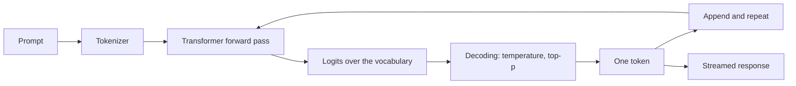

import TOCInline from '@theme/TOCInline';

# 03 · LLM Fundamentals

<ProgressToggle sectionId="03-llm-fundamentals" />

<TOCInline toc={toc} minHeadingLevel={2} maxHeadingLevel={2} />

:::tip[In this guide]
Get a model running on your own machine, then open it up: how text becomes
tokens, what attention actually computes, why generation happens one token at a
time, and what every sampling parameter does to the output. Everything after
this section assumes you can call a model and reason about what it returns.
:::

## Goal

Be able to call a model locally, explain what happens between your prompt and
the response, and set decoding parameters deliberately instead of copying them
from a blog post.

The test: you can say why a 4,000-token prompt costs time differently from a
4,000-token answer, and why `temperature=0` is not a determinism guarantee.

## Estimated Time

1–2 weeks.

## Prerequisites

- [02 · FastAPI](../02-fastapi/index.mdx) basics and [Python async](../01-python/01-core-python/04-professional-python.mdx#async-python).
- ~8GB free RAM for small models. No GPU needed for this section.

## What You Will Learn

### Running a model

1. [Install & Basics](./01-install-basics.mdx) — install Ollama, pull a model, chat in the terminal, and rough RAM requirements.
2. [Ollama API Usage](./02-ollama-api-usage.mdx) — the HTTP API, generate vs chat, streaming tokens, and calling it from async Python.

### How the model works

3. [LLM Fundamentals](./03-llm-fundamentals.mdx) — parameters, tokens and tokenization, context windows, how generation works, prefill vs decode, reasoning models, and model limitations.
4. [Transformer Architecture](./04-transformer-architecture.mdx) — self-attention through to decoder-only LLMs, and the questions asked about it most often.
5. [Decoding & Sampling](./05-decoding-and-sampling.mdx) — temperature, top-p, top-k, penalties, `max_tokens`, stop sequences, seeds and logprobs.
6. [Reasoning Models & Test-Time Compute](./06-reasoning-models.mdx) — what a reasoning model is, reasoning effort as the quality knob, when the extra cost and latency is worth it, the escalation cascade, and what breaks.

Pages 1–2 get you a working model. Pages 3–6 are the mental model everything
else in this roadmap builds on.

## Where This Fits

That loop is the whole thing. Prompt engineering changes what enters it,
retrieval changes what you put in the prompt, and serving changes how fast it
runs — but the loop never changes.

## Interview Relevance

This is the section interviewers use to find out whether you understand the
tool or just the API. Expect: what is a token, why does context length cost
quadratically in attention, what is the KV cache for, what does temperature do
to the distribution, is `temperature=0` deterministic, what is test-time compute
and when is a reasoning model worth the latency, and what can a model
fundamentally not do. Vague answers here undermine everything else you say.

## Done When

- [ ] Ollama is installed and you can chat with a model in the terminal.
- [ ] You can call the model from async Python and stream tokens.
- [ ] You can explain tokens, context windows, and prefill vs decode.
- [ ] You can describe what attention computes, without hand-waving.
- [ ] You can set temperature, top-p and `max_tokens` deliberately and say what each does.
- [ ] You can say when a reasoning model earns its cost, and when it is waste.
- [ ] You can name three things a model cannot do, and why.

Next: [04 · Prompt Engineering](../04-prompt-engineering/index.mdx).
