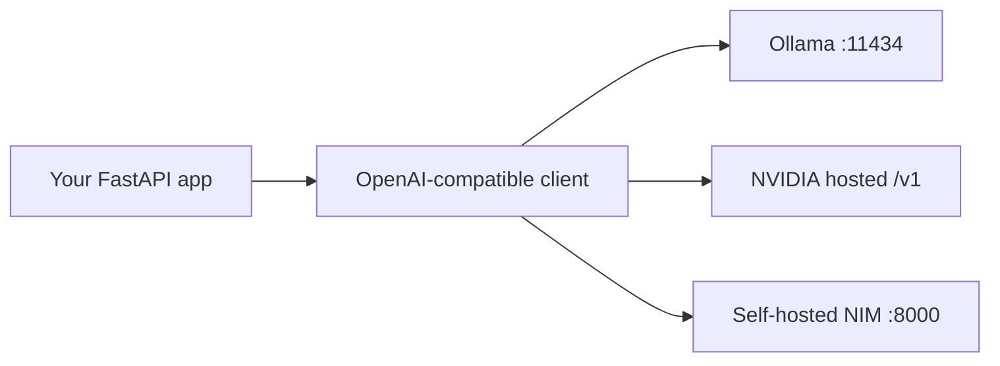

import TOCInline from '@theme/TOCInline';

# NVIDIA NIM & Hosted Endpoints

<TOCInline toc={toc} minHeadingLevel={2} maxHeadingLevel={2} />

:::tip[In this guide]
How to call a model that lives on someone else's GPU — or your own — through
NVIDIA NIM. You get working `curl`, `openai` SDK, and async `httpx` examples
for chat, streaming, embeddings and reranking, plus the `docker run` line for
self-hosting the same API locally.
:::

## What Is It?

**NIM** (NVIDIA Inference Microservices) is NVIDIA's packaging of model
inference as a container. Each NIM is a prebuilt, GPU-optimised image that
bundles a model, a serving engine (usually TensorRT-LLM or vLLM under the
hood), and an HTTP server that speaks the **OpenAI API shape**.

Two things matter about that definition:

- **Prebuilt** — you don't compile a TensorRT engine or tune batch sizes. The
  container picks a profile for the GPU it finds.
- **OpenAI-compatible** — the endpoints are `/v1/chat/completions`,
  `/v1/completions`, `/v1/embeddings`, `/v1/models`. Any OpenAI client works
  if you change the `base_url`.

You consume NIM in one of two ways:

| Mode | Endpoint | What you need |
| --- | --- | --- |
| Hosted API catalog | `https://integrate.api.nvidia.com/v1` | An `NVIDIA_API_KEY` from build.nvidia.com |
| Self-hosted container | `http://localhost:8000/v1` | An NVIDIA GPU, Docker, an NGC API key to pull the image |

The important part: **the client code is identical**. Only `base_url` and
`api_key` change.

## Why Does It Matter?

Ollama is perfect for a laptop. It falls over as soon as you have concurrent
users, a 70B model, or a latency budget. NIM gives you the same HTTP contract
with datacenter-grade serving behind it — so you can develop against Ollama
and deploy against a GPU without rewriting your application layer.

The hosted catalog also solves a very practical problem: trying a 70B or 405B
model before you own a GPU that can hold it.



## Getting an API Key

1. Sign in at `build.nvidia.com`.
2. Pick a model from the catalog and open its API tab.
3. Generate a key. It looks like `nvapi-...`.
4. Export it; never hardcode it.

```bash
export NVIDIA_API_KEY="nvapi-..."
```

:::warning
The hosted catalog is a *hosted* API. Your prompts leave your machine. If you
have data-residency or confidentiality constraints, self-host the NIM container
instead — the code below is the same either way.
:::

## Calling the Endpoint: curl

Start with `curl`, because it shows you the exact wire format with nothing
hiding it.

```bash
curl -s https://integrate.api.nvidia.com/v1/chat/completions \
  -H "Authorization: Bearer $NVIDIA_API_KEY" \
  -H "Content-Type: application/json" \
  -d '{
    "model": "meta/llama-3.1-8b-instruct",
    "messages": [
      {"role": "system", "content": "You are concise."},
      {"role": "user", "content": "What is RAG in one sentence?"}
    ],
    "temperature": 0.2,
    "max_tokens": 128,
    "stream": false
  }'
```

Response (trimmed):

```json
{
  "id": "chatcmpl-abc123",
  "object": "chat.completion",
  "model": "meta/llama-3.1-8b-instruct",
  "choices": [
    {
      "index": 0,
      "message": {
        "role": "assistant",
        "content": "RAG retrieves relevant documents and passes them to an LLM as context before it answers."
      },
      "finish_reason": "stop"
    }
  ],
  "usage": {
    "prompt_tokens": 28,
    "completion_tokens": 19,
    "total_tokens": 47
  }
}
```

Three things to notice, because your code will depend on all of them:

- `choices[0].message.content` is where the text lives — not `response`, as in
  Ollama's native API.
- `finish_reason` tells you whether you hit `stop` or ran into `length`. If it
  is `length`, your `max_tokens` truncated the answer.
- `usage` gives you token counts for free. Log them; this is your cost and
  latency attribution.

### Listing available models

```bash
curl -s https://integrate.api.nvidia.com/v1/models \
  -H "Authorization: Bearer $NVIDIA_API_KEY" | python -m json.tool
```

Do this instead of trusting a model ID you read in a blog post. More on that
in [Model IDs Drift](#model-ids-drift).

## Calling the Endpoint: openai SDK

Because the API is OpenAI-shaped, the official `openai` package works
unchanged. This is usually the fastest route to working code.

```bash
pip install openai
```

```python
import os
from openai import OpenAI

client = OpenAI(
    base_url="https://integrate.api.nvidia.com/v1",
    api_key=os.environ["NVIDIA_API_KEY"],
)

completion = client.chat.completions.create(
    model="meta/llama-3.1-8b-instruct",
    messages=[
        {"role": "system", "content": "You are concise."},
        {"role": "user", "content": "What is RAG in one sentence?"},
    ],
    temperature=0.2,
    max_tokens=128,
)

print(completion.choices[0].message.content)
print(completion.usage.total_tokens)
```

The async variant, which is what you want inside FastAPI:

```python
import os
from openai import AsyncOpenAI

client = AsyncOpenAI(
    base_url="https://integrate.api.nvidia.com/v1",
    api_key=os.environ["NVIDIA_API_KEY"],
    timeout=60.0,
    max_retries=2,
)

async def answer(question: str, model: str = "meta/llama-3.1-8b-instruct") -> str:
    completion = await client.chat.completions.create(
        model=model,
        messages=[{"role": "user", "content": question}],
        temperature=0.2,
    )
    return completion.choices[0].message.content or ""
```

Create the client **once** at application startup, not per request. It holds a
connection pool, and rebuilding it per call throws away keep-alive and adds a
TLS handshake to every request.

## Calling the Endpoint: async httpx

Sometimes you don't want the SDK — fewer dependencies, full control over the
payload, or you need to pass a vendor-specific field the SDK doesn't model.
`httpx` is the same tool you used for Ollama in
[Ollama API Usage](./02-ollama-api-usage.mdx).

```python
import os
from typing import Any

import httpx

NVIDIA_BASE_URL = "https://integrate.api.nvidia.com/v1"


class NimClient:
    """Thin async client over a NIM / OpenAI-compatible endpoint."""

    def __init__(self, base_url: str, api_key: str, model: str) -> None:
        self._model = model
        self._client = httpx.AsyncClient(
            base_url=base_url,
            headers={
                "Authorization": f"Bearer {api_key}",
                "Content-Type": "application/json",
            },
            timeout=httpx.Timeout(connect=5.0, read=120.0, write=10.0, pool=5.0),
        )

    async def chat(self, messages: list[dict[str, str]], **opts: Any) -> str:
        payload: dict[str, Any] = {
            "model": self._model,
            "messages": messages,
            "stream": False,
            **opts,
        }
        resp = await self._client.post("/chat/completions", json=payload)
        resp.raise_for_status()
        data = resp.json()
        return data["choices"][0]["message"]["content"]

    async def aclose(self) -> None:
        await self._client.aclose()
```

Usage:

```python
client = NimClient(
    base_url=NVIDIA_BASE_URL,
    api_key=os.environ["NVIDIA_API_KEY"],
    model="meta/llama-3.1-8b-instruct",
)
text = await client.chat([{"role": "user", "content": "Define KV cache."}])
```

Note the split timeout. A single `timeout=120` means a dead TCP connect also
waits two minutes. Connect should fail fast; read should be generous, because
a long generation legitimately takes a while.

## Streaming

Streaming matters for perceived latency. The user sees the first token in
under a second instead of staring at a spinner for fifteen.

The wire format is **SSE** (server-sent events): lines prefixed with `data: `,
each carrying a JSON chunk, terminated by a literal `data: [DONE]`.

```text
data: {"choices":[{"delta":{"role":"assistant","content":""},"index":0}]}

data: {"choices":[{"delta":{"content":"RAG"},"index":0}]}

data: {"choices":[{"delta":{"content":" retrieves"},"index":0}]}

data: [DONE]
```

Compare that to Ollama's native streaming, which is newline-delimited JSON
with no `data: ` prefix and no sentinel. If you are writing your own parser,
this difference will bite you.

### Streaming with the SDK

```python
async def stream_answer(question: str) -> None:
    stream = await client.chat.completions.create(
        model="meta/llama-3.1-8b-instruct",
        messages=[{"role": "user", "content": question}],
        stream=True,
    )
    async for chunk in stream:
        delta = chunk.choices[0].delta.content
        if delta:
            print(delta, end="", flush=True)
```

The SDK handles the `data: ` framing and the `[DONE]` sentinel. `delta.content`
is `None` on the first and last chunks, so the `if delta` guard is required,
not defensive padding.

### Streaming with raw httpx

```python
import json
from collections.abc import AsyncIterator

import httpx


async def stream_chat(
    http: httpx.AsyncClient,
    model: str,
    messages: list[dict[str, str]],
) -> AsyncIterator[str]:
    payload = {"model": model, "messages": messages, "stream": True}
    async with http.stream("POST", "/chat/completions", json=payload) as resp:
        resp.raise_for_status()
        async for line in resp.aiter_lines():
            if not line.startswith("data:"):
                continue
            data = line.removeprefix("data:").strip()
            if data == "[DONE]":
                return
            chunk = json.loads(data)
            delta = chunk["choices"][0]["delta"].get("content")
            if delta:
                yield delta
```

Use `http.stream(...)` as a context manager, not `await http.post(...)`. A
plain `post` buffers the whole body before returning, which defeats the point.

Three failure modes worth knowing:

- **Errors mid-stream.** The HTTP status is already `200` by the time
  generation starts. A backend failure arrives as an SSE chunk with an
  `error` field, or the stream simply ends early. Check `finish_reason` on the
  final chunk rather than assuming success.
- **Keep-alive comments.** Some proxies emit `:` comment lines. The
  `startswith("data:")` filter already drops them.
- **Buffering proxies.** An nginx or ALB in front of your app can buffer SSE
  and destroy the streaming behaviour. Disable response buffering on that route.

## Why OpenAI-Compatibility Matters

This is the whole architectural point, so it's worth stating plainly: the
OpenAI chat-completions shape has become the de facto interface for LLM
serving. Ollama exposes it at `/v1`, vLLM exposes it, TGI exposes a compatible
route, NIM exposes it, and most hosted vendors either speak it or offer a
shim.

That means one client and config-only switching:

```python
# Same client class, three backends.
BACKENDS = {
    "ollama": ("http://localhost:11434/v1", "ollama", "llama3.2"),
    "nim_hosted": (NVIDIA_BASE_URL, os.environ.get("NVIDIA_API_KEY", ""), "meta/llama-3.1-8b-instruct"),
    "nim_local": ("http://localhost:8000/v1", "not-used", "meta/llama-3.1-8b-instruct"),
}
```

Ollama ignores the API key but requires the header to be present, so pass a
dummy string rather than omitting it.

We build this properly — with settings, retries and a fallback chain — in
[One Client, Many Backends](./06-one-client-many-backends.mdx).

## Embeddings

NIM also serves embedding models at `/v1/embeddings`, again in the OpenAI
shape. This matters because it lets you keep one HTTP client for both halves
of a RAG pipeline.

```bash
curl -s https://integrate.api.nvidia.com/v1/embeddings \
  -H "Authorization: Bearer $NVIDIA_API_KEY" \
  -H "Content-Type: application/json" \
  -d '{
    "model": "nvidia/nv-embedqa-e5-v5",
    "input": ["RAG retrieves context before generating."],
    "input_type": "passage"
  }'
```

```json
{
  "object": "list",
  "data": [
    { "index": 0, "object": "embedding", "embedding": [0.0123, -0.0456, "..."] }
  ],
  "usage": { "prompt_tokens": 9, "total_tokens": 9 }
}
```

```python
async def embed(
    http: httpx.AsyncClient,
    texts: list[str],
    *,
    model: str = "nvidia/nv-embedqa-e5-v5",
    input_type: str = "passage",
) -> list[list[float]]:
    resp = await http.post(
        "/embeddings",
        json={"model": model, "input": texts, "input_type": input_type},
    )
    resp.raise_for_status()
    data = resp.json()["data"]
    return [row["embedding"] for row in sorted(data, key=lambda r: r["index"])]
```

Two details that cause real bugs:

- **Sort by `index`.** The spec says order is preserved, but sorting costs
  nothing and protects you if a batch comes back out of order.
- **`input_type` is asymmetric.** NVIDIA's QA embedding models are trained
  with separate prefixes for `"passage"` (documents at ingest) and `"query"`
  (search terms). Using `"passage"` for both degrades retrieval quality
  silently — the scores still look plausible. This is a NIM-specific field;
  OpenAI's endpoint has no equivalent.

Everything from [Embeddings](../04-embeddings-vector-db/01-embeddings.mdx)
applies: same model for documents and queries, record which model produced
each vector, re-embed the whole corpus if you switch.

### Reranking

NIM exposes reranking models too. A reranker is a cross-encoder: it reads the
query and the candidate document *together* and scores relevance directly.
Slower per pair than cosine similarity, much more accurate.

The standard two-stage pattern: retrieve 50 candidates by vector similarity,
rerank them, keep the top 5.

```python
async def rerank(
    http: httpx.AsyncClient,
    query: str,
    passages: list[str],
    *,
    model: str = "nvidia/nv-rerankqa-mistral-4b-v3",
    top_k: int = 5,
) -> list[tuple[int, float]]:
    """Return (original_index, score) pairs, best first."""
    resp = await http.post(
        "/ranking",
        json={
            "model": model,
            "query": {"text": query},
            "passages": [{"text": p} for p in passages],
        },
    )
    resp.raise_for_status()
    rankings = resp.json()["rankings"]
    return [(r["index"], r["logit"]) for r in rankings[:top_k]]
```

:::note
Reranking is the least standardised of these endpoints — the route and the
response field names differ between NIM versions and between vendors. Check
the model's page in the catalog for the exact shape rather than trusting this
snippet verbatim.
:::

## Self-Hosting a NIM Container

Same API, your GPU, your data. You need Docker with the NVIDIA Container
Toolkit installed, and an NGC API key.

```bash
export NGC_API_KEY="nvapi-..."
echo "$NGC_API_KEY" | docker login nvcr.io --username '$oauthtoken' --password-stdin
```

The username is the literal string `$oauthtoken` — single-quote it so your
shell doesn't expand it.

```bash
# Cache model weights outside the container so restarts don't re-download.
export LOCAL_NIM_CACHE=~/.cache/nim
mkdir -p "$LOCAL_NIM_CACHE"

docker run --rm --name nim-llama3 \
  --gpus all \
  --shm-size=16g \
  -e NGC_API_KEY \
  -v "$LOCAL_NIM_CACHE:/opt/nim/.cache" \
  -u "$(id -u)" \
  -p 8000:8000 \
  nvcr.io/nim/meta/llama-3.1-8b-instruct:latest
```

What each flag is doing, since every one of them is load-bearing:

| Flag | Why |
| --- | --- |
| `--gpus all` | Without it the container sees no GPU and either fails or falls back to something unusably slow |
| `--shm-size=16g` | Multi-GPU tensor parallelism uses shared memory; the Docker default of 64MB is far too small |
| `-v ...:/opt/nim/.cache` | Weights are tens of GB. Without a volume you re-download on every container start |
| `-u "$(id -u)"` | Keeps cache files owned by you, not root |
| `-p 8000:8000` | NIM serves HTTP on `8000` by default |

First start is slow — it downloads weights and selects/builds an engine
profile for your GPU. Wait for readiness instead of guessing:

```bash
# Readiness probe. Returns 200 only once the model is loaded.
until curl -sf http://localhost:8000/v1/health/ready; do sleep 5; done
curl -s http://localhost:8000/v1/models | python -m json.tool
```

Then point the exact same client at it:

```python
local = OpenAI(base_url="http://localhost:8000/v1", api_key="not-used")

completion = local.chat.completions.create(
    model="meta/llama-3.1-8b-instruct",
    messages=[{"role": "user", "content": "Define continuous batching."}],
)
print(completion.choices[0].message.content)
```

:::warning
A self-hosted NIM has **no authentication**. Bind it to `127.0.0.1` or keep it
on a private network, and put your authenticated FastAPI app in front of it.
Publishing port `8000` to the internet exposes an unmetered LLM to anyone who
finds it. See [Security](../02-fastapi/01-core-path/16-security.mdx).
:::

If the container won't see your GPU, check the toolkit first:

```bash
nvidia-smi                                            # host sees the GPU?
docker run --rm --gpus all nvidia/cuda:12.4.0-base-ubuntu22.04 nvidia-smi
```

If the host works and the container doesn't, your problem is the NVIDIA
Container Toolkit, not the NIM image. More on this in
[GPU Sizing & Quantization](./05-gpu-sizing-and-quantization.mdx).

## Tool Calling

NIM supports OpenAI-style function calling on models trained for it. Define
tools as JSON Schema; the model returns a `tool_calls` array instead of prose.

```python
TOOLS = [
    {
        "type": "function",
        "function": {
            "name": "search_docs",
            "description": "Search internal documentation.",
            "parameters": {
                "type": "object",
                "properties": {
                    "query": {"type": "string", "description": "Search terms"},
                    "top_k": {"type": "integer", "default": 5},
                },
                "required": ["query"],
            },
        },
    }
]

completion = client.chat.completions.create(
    model="meta/llama-3.1-8b-instruct",
    messages=[{"role": "user", "content": "What does our refund policy say?"}],
    tools=TOOLS,
    tool_choice="auto",
)

call = completion.choices[0].message.tool_calls[0]
print(call.function.name)       # "search_docs"
print(call.function.arguments)  # '{"query": "refund policy", "top_k": 5}'
```

`arguments` is a **JSON string**, not a dict, and the model generated it — so
it can be malformed or contain fields you never declared. Parse defensively
and validate with Pydantic before you act on it:

```python
import json
from pydantic import BaseModel, Field, ValidationError


class SearchDocsArgs(BaseModel):
    query: str = Field(min_length=1, max_length=400)
    top_k: int = Field(default=5, ge=1, le=50)


try:
    args = SearchDocsArgs.model_validate(json.loads(call.function.arguments))
except (json.JSONDecodeError, ValidationError) as exc:
    # Feed the error back to the model, or fail the turn. Never pass raw
    # model output into a query or a shell.
    ...
```

Tool-calling support is the single biggest place the "OpenAI-compatible" claim
leaks. Not every model on the catalog supports tools, and quality varies a lot
between those that do. Test the specific model you plan to ship.

## Hosted NIM vs Self-Hosted NIM vs Ollama

| Dimension | Hosted NIM | Self-hosted NIM | Ollama |
| --- | --- | --- | --- |
| Setup effort | Minutes — one API key | Hours — GPU, drivers, toolkit, image pull | Minutes — one installer |
| Cost model | Per token / credits | Fixed GPU cost, idle time wasted | Free (your hardware) |
| Data residency | Prompts leave your network | Fully in your control | Fully in your control |
| Throughput | Elastic, vendor-managed | High, bounded by your GPUs | Low — effectively one request at a time |
| Concurrency | Many | Many (continuous batching) | Poor |
| Model selection | Large catalog, incl. 70B+ | Models with a published NIM image | Anything in the Ollama library |
| Quantization control | None | Limited (engine profiles) | Full (GGUF q2–q8) |
| Offline | No | Yes, once cached | Yes |
| Best for | Evaluation, bursty traffic, big models | Production with privacy or volume needs | Local dev, prototyping, personal use |

The pragmatic path for most teams: develop against Ollama, evaluate model
quality against the hosted catalog, then self-host NIM or vLLM when traffic
or privacy requires it. Because all three speak the same API, that migration
is a config change, not a rewrite.

## Model IDs Drift

NVIDIA's catalog changes constantly. Models get added, renamed, versioned and
deprecated. A model ID you copy today may 404 in three months.

Two habits protect you:

**Never scatter model IDs through your code.** One config constant:

```python
from pydantic_settings import BaseSettings, SettingsConfigDict


class LlmSettings(BaseSettings):
    model_config = SettingsConfigDict(env_prefix="LLM_", env_file=".env")

    base_url: str = "https://integrate.api.nvidia.com/v1"
    api_key: str = ""
    chat_model: str = "meta/llama-3.1-8b-instruct"
    embed_model: str = "nvidia/nv-embedqa-e5-v5"
    rerank_model: str = "nvidia/nv-rerankqa-mistral-4b-v3"
```

See [Configuration & Environment](../02-fastapi/01-core-path/17-configuration-environment.mdx).

**Verify at startup.** Fail loudly on boot rather than mysteriously on the
first user request:

```python
async def assert_model_available(http: httpx.AsyncClient, model: str) -> None:
    resp = await http.get("/models")
    resp.raise_for_status()
    available = {m["id"] for m in resp.json()["data"]}
    if model not in available:
        raise RuntimeError(
            f"Model {model!r} not available. Found: {sorted(available)[:10]}"
        )
```

Treat the model IDs in this guide as illustrative. Check the catalog — or
`/v1/models` — for what is actually live.

## Common Mistakes

- Reading `data["response"]` (Ollama's field) instead of
  `data["choices"][0]["message"]["content"]`.
- Creating a new `AsyncOpenAI` or `httpx.AsyncClient` per request, discarding
  the connection pool.
- One flat `timeout` value, so a dead connection hangs as long as a long
  generation.
- Using `await client.post(...)` for streaming instead of `client.stream(...)`.
- Assuming HTTP `200` means the stream succeeded — failures arrive mid-stream.
- Using `input_type="passage"` for queries against NVIDIA QA embedding models.
- Running `docker run` without `--gpus all`, or without a cache volume, then
  re-downloading 40GB on every restart.
- Exposing a self-hosted NIM port publicly with no auth in front of it.
- Hardcoding model IDs across the codebase and discovering a rename in prod.
- Passing `tool_calls` arguments straight into a query without validating them.

## Interview Questions

- What does NIM actually package, and what does that save you versus running a
  serving engine yourself?
- Why does OpenAI API compatibility matter architecturally?
- Describe the SSE wire format for streaming chat completions. How does it
  differ from Ollama's native stream?
- How do you detect an error that occurs *after* streaming has started?
- Why do NVIDIA's QA embedding models need an `input_type`, and what breaks if
  you get it wrong?
- When would you self-host a NIM instead of using the hosted catalog?
- Why is `--shm-size` relevant to a multi-GPU inference container?
- Where does "OpenAI-compatible" stop being true?

## Things to Remember

- NIM = prebuilt GPU inference container with an OpenAI-shaped HTTP API.
- Hosted at `https://integrate.api.nvidia.com/v1`; self-hosted at `:8000/v1`.
- Only `base_url`, `api_key` and `model` differ between backends.
- Text lives at `choices[0].message.content`; token counts at `usage`.
- Streaming is SSE: `data:` lines plus a `[DONE]` sentinel.
- Self-hosted NIM has no auth — always put your own API in front.
- Model IDs move. Keep them in config and verify at startup.

## Mini Exercise

Get a key from build.nvidia.com and call `/v1/chat/completions` with `curl`.
Then write one async function that takes a `base_url`, `api_key` and `model`,
and run it twice — once against the hosted endpoint, once against Ollama's
`/v1` compatibility route on `http://localhost:11434/v1`. Same function, same
assertions, two backends. Finally, make the function stream and print tokens
as they arrive.

## Done When

- [ ] You can call a NIM chat endpoint with `curl`, the `openai` SDK, and raw `httpx`.
- [ ] You can stream a response and explain the `data:` / `[DONE]` framing.
- [ ] You can call `/v1/embeddings` and explain why `input_type` matters.
- [ ] You can state the `docker run` flags a self-hosted NIM needs and why.
- [ ] You can switch your client between Ollama and NIM by changing config only.
