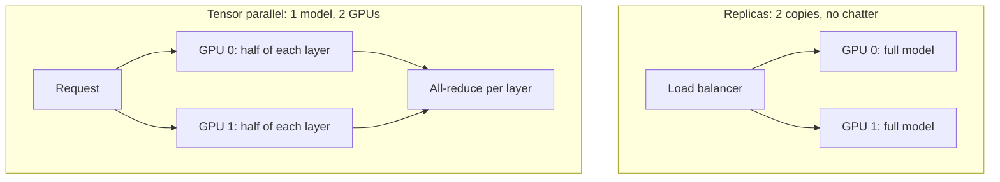

import TOCInline from '@theme/TOCInline';

# GPU Sizing & Quantization

<TOCInline toc={toc} minHeadingLevel={2} maxHeadingLevel={2} />

:::tip[In this guide]
The arithmetic that answers "will this model run on this GPU?" — weight
memory, KV cache growth, and the quantization formats that shrink both. Plus
`nvidia-smi` checks, a hardware decision table, and when multi-GPU is the
wrong answer.
:::

## What Is It?

GPU sizing is two sums and one judgement call.

```text
VRAM needed = weights + KV cache + activations + framework overhead
```

- **Weights** — fixed once you choose a model and a precision.
- **KV cache** — grows with context length times concurrency. This is the part
  people forget, and it is usually what OOMs you.
- **Activations and overhead** — CUDA context, workspace buffers, fragmentation.
  Budget 1–2GB and move on.

**Quantization** is how you shrink the first two: store numbers in fewer bits,
accept some quality loss, fit a bigger model or more concurrent users.

## Why Does It Matter?

"Out of memory" is the most common failure in self-hosted LLM serving, and it
usually arrives in production rather than in testing — because your test had
one user with a 200-token prompt and production has thirty users with
8000-token prompts. The weights fit all along. The cache did not.

Doing the math up front also tells you the cheapest hardware that works, which
is often two tiers below what you were about to buy.

:::warning
Every specific GPU model, price and VRAM number in this guide will be stale
within a year or two. The **method** is durable: count bytes for weights,
count bytes for cache, add overhead, compare to the card. Re-run the
arithmetic with current specs rather than trusting any table — including
these ones.
:::

## Weight Memory Math

```text
weight_bytes = parameter_count × bytes_per_parameter
```

| Precision | Bits | Bytes/param | Notes |
| --- | --- | --- | --- |
| FP32 | 32 | 4 | Training-era default; nobody serves at FP32 |
| FP16 / BF16 | 16 | 2 | The standard serving baseline |
| FP8 | 8 | 1 | Hardware-accelerated on Hopper and later |
| INT8 | 8 | 1 | Widely supported |
| 4-bit (AWQ/GPTQ/NF4/Q4) | ~4 | ~0.5 | Plus small per-group scale overhead |

So an 8B model at FP16: `8e9 × 2 = 16GB` of weights before anything else. That
is why an 8B model does not comfortably serve on a 16GB card.

```python
def weight_gb(params_billions: float, bits: int) -> float:
    """Rough weight footprint in GiB."""
    bytes_per_param = bits / 8
    return params_billions * 1e9 * bytes_per_param / (1024 ** 3)


for b in (8, 13, 34, 70):
    print(b, [round(weight_gb(b, bits), 1) for bits in (16, 8, 4)])
```

### Weights by model size and precision

| Model | FP16 | 8-bit | 4-bit |
| --- | --- | --- | --- |
| 7B / 8B | ~15GB | ~7.5GB | ~4GB |
| 13B | ~24GB | ~12GB | ~6.5GB |
| 34B | ~63GB | ~32GB | ~17GB |
| 70B | ~130GB | ~65GB | ~35GB |

Read across the 70B row: FP16 needs two 80GB cards, 8-bit fits on one 80GB
card, 4-bit fits on two 24GB consumer cards. Quantization is what makes large
models accessible, and the cost is covered below.

Add 10–20% to any of these in practice. Quantized formats carry scales and
zero-points, and frameworks allocate workspace.

## KV Cache Math

This is the number that catches people out.

```text
kv_bytes = 2 × layers × kv_heads × head_dim × seq_len × batch × bytes_per_element
```

The leading `2` is for keys *and* values. `kv_heads` is the key/value head
count, which on modern models using grouped-query attention (GQA) is much
smaller than the attention head count — a deliberate design choice precisely
to shrink this cache.

```python
def kv_cache_gb(
    layers: int,
    kv_heads: int,
    head_dim: int,
    seq_len: int,
    batch: int,
    bytes_per_element: int = 2,
) -> float:
    total = 2 * layers * kv_heads * head_dim * seq_len * batch * bytes_per_element
    return total / (1024 ** 3)


# Llama-3.1-8B shape: 32 layers, 8 KV heads (GQA), head_dim 128.
print(round(kv_cache_gb(32, 8, 128, 8192, 1), 2))    # ~0.5 GB for ONE request
print(round(kv_cache_gb(32, 8, 128, 8192, 32), 2))   # ~16 GB for 32 requests
```

Worked example, 8B at FP16 on one 24GB card:

| Item | VRAM |
| --- | --- |
| Weights (FP16) | ~15.0GB |
| Overhead (CUDA context, workspace) | ~1.5GB |
| Remaining for KV cache | ~7.5GB |
| Cache per request at 8k context | ~0.5GB |
| **Max concurrent 8k-context requests** | **~15** |

Now change one variable. At 32k context, each request needs ~2GB and you fit
three. Same model, same card, five times less concurrency — purely from
context length.

Three consequences worth internalising:

- **Context length is a capacity decision, not a feature flag.** Advertising
  128k context means provisioning for it.
- **`--max-model-len` is a throughput dial.** Engines reserve cache based on
  it. Setting it to the model's theoretical maximum starves your batch.
- **Quantizing the KV cache to FP8 halves it.** Many engines support this, and
  the quality impact is usually smaller than quantizing weights — often the
  best memory win available.

Older multi-head-attention models (no GQA) have `kv_heads == attention_heads`
and caches 4–8× larger. If a model seems to consume absurd cache, check
whether it uses GQA.

## Quantization Formats

Quantization maps high-precision weights to fewer bits, usually per small
group of values with a shared scale factor. Smaller groups preserve more
quality and cost slightly more memory.

| Format | Bits | Ecosystem | Needs calibration | Best for |
| --- | --- | --- | --- | --- |
| GGUF (Q2–Q8) | 2–8 | llama.cpp, Ollama | No | CPU, Apple Silicon, laptops |
| AWQ | 4 | vLLM, TGI | Yes (data) | 4-bit GPU serving, quality-first |
| GPTQ | 3–4 | vLLM, TGI | Yes (data) | 4-bit GPU serving, mature tooling |
| FP8 (E4M3) | 8 | TensorRT-LLM, vLLM | Optional | Hopper+ GPUs, near-lossless |
| INT8 (SmoothQuant) | 8 | TensorRT-LLM, vLLM | Yes | Pre-Hopper 8-bit |
| bitsandbytes NF4 | 4 | Transformers, PEFT | No | QLoRA fine-tuning, quick experiments |

What distinguishes them:

- **GGUF** is a container format with many quant levels (`Q4_K_M`, `Q5_K_M`,
  `Q8_0`). The `_K` variants use mixed precision — more bits for layers that
  are sensitive, fewer for layers that are not. Designed for CPU and
  unified-memory inference. This is what Ollama pulls.
- **AWQ** (activation-aware) protects the weight channels that activations
  depend on most. Generally the best 4-bit quality for GPU serving, and fast.
- **GPTQ** quantizes layer by layer, minimising output error against
  calibration data. Similar quality to AWQ; broader checkpoint availability.
- **FP8** keeps a floating-point representation (sign, exponent, mantissa)
  rather than integer buckets, so it handles outliers gracefully. On Hopper
  and later there is native tensor-core support, so it is fast *and*
  near-lossless. If your GPU supports it, this is usually the right default.
- **bitsandbytes NF4** quantizes on the fly at load time — no calibration, no
  prepared checkpoint. Convenient, slower than AWQ/GPTQ at inference, and the
  basis of QLoRA.

### The quality cost, and where the cliff is

| Level | Typical quality | Use it for |
| --- | --- | --- |
| FP16/BF16 | Baseline | Reference, quality-critical work |
| FP8 / INT8 | Essentially indistinguishable | Production default on capable hardware |
| 4-bit (AWQ/GPTQ/Q4_K_M) | Small but measurable loss | Production when memory-bound |
| 3-bit | Noticeable degradation | Rarely worth it |
| 2-bit | Severe degradation | Experiments only |

**The cliff is below 4 bits.** FP16 to 8-bit is nearly free. 8-bit to 4-bit
costs a little. 4-bit to 3-bit falls off hard, and 2-bit is usually broken for
real work.

Two things the benchmark table does not show:

- **Degradation is uneven.** Casual chat barely changes. Multi-step reasoning,
  long-context recall, code generation and strict structured-output adherence
  degrade first and most. If you rely on tool calling returning valid JSON,
  test that specifically.
- **A bigger quantized model usually beats a smaller full-precision one.** A
  70B at 4-bit (~35GB) generally outperforms a 13B at FP16 (~24GB). Spend your
  VRAM on parameters before precision — down to 4 bits, not below.

:::warning
Never compare two models at different quantization levels and call it a model
comparison. You are measuring the quantization. Hold precision constant, or
report both.
:::

## Checking Your Hardware

Start here before debugging anything else.

```bash
nvidia-smi
```

```text
+-----------------------------------------------------------------------------+
| NVIDIA-SMI 550.54.15     Driver Version: 550.54.15   CUDA Version: 12.4     |
|-------------------------------+----------------------+----------------------+
| GPU  Name                     | Memory-Usage         | GPU-Util  Compute M. |
|   0  NVIDIA A100-SXM4-80GB    | 42315MiB / 81920MiB  |     87%      Default |
+-------------------------------+----------------------+----------------------+
```

What to read:

- **CUDA Version** here is the maximum the *driver* supports, not what is
  installed. `nvcc --version` reports the installed toolkit. A driver newer
  than the toolkit is fine; the reverse is not.
- **Memory-Usage** is total allocated. Serving engines pre-allocate a pool, so
  high usage with an idle model is expected, not a leak.
- **GPU-Util** is the fraction of time *any* kernel was running — not how much
  of the GPU's capacity you are using. During decode this can read 100% while
  the compute units are mostly waiting on memory. It is a poor efficiency
  metric; use tokens/sec instead.

Useful variants:

```bash
# Live, scriptable, one row per second.
nvidia-smi --query-gpu=index,name,memory.used,memory.total,utilization.gpu,temperature.gpu \
  --format=csv --loop=1

# Which processes hold VRAM — find the notebook you forgot to shut down.
nvidia-smi --query-compute-apps=pid,process_name,used_memory --format=csv

# Topology: is it NVLink or PCIe between GPUs? Matters for tensor parallelism.
nvidia-smi topo -m
```

### What a container can see

A container sees nothing unless the NVIDIA Container Toolkit is installed and
you pass `--gpus`.

```bash
nvidia-smi                                                     # host
docker run --rm --gpus all nvidia/cuda:12.4.0-base-ubuntu22.04 nvidia-smi
```

If the host works and the container does not, the toolkit is your problem.
Also check:

```bash
docker run --rm --gpus '"device=0,1"' nvidia/cuda:12.4.0-base-ubuntu22.04 nvidia-smi -L
```

From Python:

```python
import torch

print(torch.cuda.is_available())
print(torch.cuda.device_count())
for i in range(torch.cuda.device_count()):
    props = torch.cuda.get_device_properties(i)
    print(i, props.name, round(props.total_memory / 1024 ** 3, 1), "GiB",
          f"sm_{props.major}{props.minor}")
```

The compute capability (`sm_90` for H100, `sm_89` for L40S/RTX 4090, `sm_80`
for A100) determines what you can use. FP8 tensor cores need `sm_89` or
higher. If an engine refuses an FP8 build, check this before anything else.

## Choosing Hardware

| Class | Example | VRAM | Good for | Watch out for |
| --- | --- | --- | --- | --- |
| Consumer | RTX 4090 / 5090 class | 24–32GB | 8B–13B FP16, 34B 4-bit, dev and small prod | No NVLink, licence terms for datacenter use, cooling and power in a rack |
| Pro workstation | L40S / RTX 6000 class | 48GB | 34B FP16, 70B 4-bit, mixed workloads | Lower memory bandwidth than SXM datacenter parts |
| Datacenter | A100 / H100 80GB | 80GB | 70B 8-bit solo, high concurrency | Expensive, usually rented not owned |
| Apple Silicon | M-series Max/Ultra | Unified, 32–192GB | Local dev at surprising model sizes | Much lower bandwidth and no CUDA — dev only |
| CPU only | Any server | System RAM | Tiny models, batch jobs, fallback | Slow, but it works |

Notes that outlast the specific part numbers:

- **Memory bandwidth, not FLOPs, sets your decode speed.** Decode is
  bandwidth-bound. An H100's advantage over an A100 is as much HBM3 bandwidth
  as compute. When comparing cards for inference, compare GB/s.
- **Apple Silicon's unified memory is genuinely useful for development.** A
  64GB Mac can hold a 70B 4-bit model that no single consumer GPU can. It will
  be slow — bandwidth is a fraction of an H100's — but it runs, which is
  exactly what Ollama is for. Do not plan to serve traffic from it.
- **Renting beats buying until utilisation is high.** A GPU idle 80% of the
  time is worse value than an hourly instance or a hosted endpoint. Compute
  your actual utilisation before buying.
- **Check consumer GPU licensing** if you are deploying commercially in a
  datacenter. NVIDIA's terms distinguish consumer from datacenter parts.

## Multi-GPU

Three strategies, frequently confused. Pick in this order.

| Strategy | How it splits | Communication | Use when |
| --- | --- | --- | --- |
| Separate replicas | Full model copy per GPU | None | **Model fits on one GPU** |
| Tensor parallel (TP) | Each layer's matrices across GPUs | All-reduce every layer | Model does not fit on one GPU |
| Pipeline parallel (PP) | Different layers on different GPUs | Activations between stages | Model does not fit even with TP, or GPUs are across nodes |



**Default to separate replicas.** If the model fits on one GPU, TP only adds
synchronisation overhead on every single layer. Two replicas of an 8B model
give you roughly double the throughput, independent failure domains, and
simpler debugging. Put a load balancer in front and you are done.

Use TP when the model genuinely does not fit. Then interconnect dominates:
NVLink-connected GPUs scale well, PCIe-connected ones noticeably less so. Set
`--shm-size` generously in containers; the Docker default of 64MB will fail.

Use PP mainly across nodes, or for very large models where TP alone is not
enough. PP introduces pipeline bubbles — stages idle waiting for upstream
work — so throughput scaling is worse than TP within a node.

## Decision Table

"I have X VRAM and want Y." Treat as a starting point, then verify with the
arithmetic above and your own benchmark.

| VRAM | Goal | Model size | Quantization | Engine |
| --- | --- | --- | --- | --- |
| 8GB | Local dev, any model | 3B–7B | GGUF Q4_K_M | Ollama |
| 16GB | Local dev, decent quality | 8B | GGUF Q4_K_M or Q5_K_M | Ollama |
| 24GB | Single-user quality | 8B | FP16 (tight) or 8-bit | Ollama or vLLM |
| 24GB | Concurrent serving, 8k ctx | 8B | AWQ/GPTQ 4-bit | vLLM |
| 24GB | Best quality on one card | 34B | AWQ 4-bit | vLLM |
| 48GB | Concurrent serving, long ctx | 8B–13B | FP8 or FP16 | vLLM / NIM |
| 48GB | Large model, modest traffic | 70B | AWQ 4-bit | vLLM |
| 80GB | Production, high concurrency | 8B–34B | FP8 | vLLM / NIM / TRT-LLM |
| 80GB | 70B serving | 70B | FP8 or 8-bit | vLLM / NIM |
| 2 × 80GB | 70B at full precision | 70B | FP16, TP=2 | vLLM / TRT-LLM |
| No GPU | Any of the above | Anything in the catalog | Vendor's choice | [Hosted NIM](./03-nvidia-nim-endpoints.mdx) |
| Apple M-series, 64GB | Local dev at scale | up to 70B | GGUF Q4_K_M | Ollama |

Engine details are in
[GPU Serving Engines](./04-gpu-serving-engines.mdx).

## Common Mistakes

- Sizing for weights only and OOM-ing in production on KV cache.
- Setting `--max-model-len` to 128k because the model supports it, then
  wondering why concurrency is three.
- Quantizing below 4 bits to fit a model that a smaller 4-bit model would have
  handled better.
- Comparing a Q4 model against an FP16 model and attributing the difference to
  the model.
- Reading `GPU-Util` at 100% and concluding the GPU is saturated during decode.
- Running `docker run` without `--gpus all` and silently falling back to CPU.
- Mismatched driver and CUDA toolkit versions.
- Tensor parallelism for a model that fits on one GPU.
- Forgetting `--shm-size` with multi-GPU in containers.
- Buying a GPU before measuring utilisation on a rented one.
- Leaving a dead notebook kernel holding 20GB of VRAM.
- Benchmarking with short prompts, deploying with long ones.

## Interview Questions

- How do you estimate VRAM for a 70B model at 4-bit?
- Write the KV cache formula and explain each term.
- Why does GQA reduce KV cache size so much?
- You have a 24GB card and an 8B FP16 model. How many concurrent 8k-context
  requests fit, and how would you double that?
- Compare AWQ, GPTQ, GGUF and FP8. When would you choose each?
- Where is the quantization quality cliff, and which capabilities degrade
  first?
- Would you rather run a 70B at 4-bit or a 13B at FP16 on 40GB? Why?
- Why is memory bandwidth more predictive of decode speed than FLOPs?
- When is tensor parallelism the wrong choice?
- Why is `GPU-Util` a misleading efficiency metric for LLM inference?

## Things to Remember

- `weights = params × bytes_per_param`. FP16 is 2 bytes; 4-bit is ~0.5.
- KV cache scales with context × concurrency, and it is what OOMs you.
- `2 × layers × kv_heads × head_dim × seq_len × batch × bytes` — know it.
- 8-bit is near-free; 4-bit costs a little; below 4-bit falls off a cliff.
- Bigger model at 4-bit usually beats smaller model at FP16.
- FP8 on Hopper+ is the best default when available.
- Replicas before tensor parallelism.
- Specific numbers age; the arithmetic does not.

## Mini Exercise

Pick a model you can read the config for (layers, KV heads, head dim — it is
in the `config.json` on Hugging Face). Compute its FP16 weight size and its KV
cache per request at 4k, 16k and 64k context. Then, for a 24GB card, work out
max concurrency at each context length. Load the model in Ollama or vLLM, watch
`nvidia-smi --query-gpu=memory.used --format=csv --loop=1` while you fire
concurrent requests, and compare measured usage to your prediction. Explain any
gap larger than 20%.

## Done When

- [ ] You can compute weight memory for any model at any precision.
- [ ] You can compute KV cache size and explain why long context limits
      concurrency.
- [ ] You can name the right quantization format for GPU serving vs a laptop.
- [ ] You can state where the quality cliff is and which capabilities go first.
- [ ] You can read `nvidia-smi` and verify a container sees your GPU.
- [ ] You can justify replicas versus tensor parallelism for a given model.
