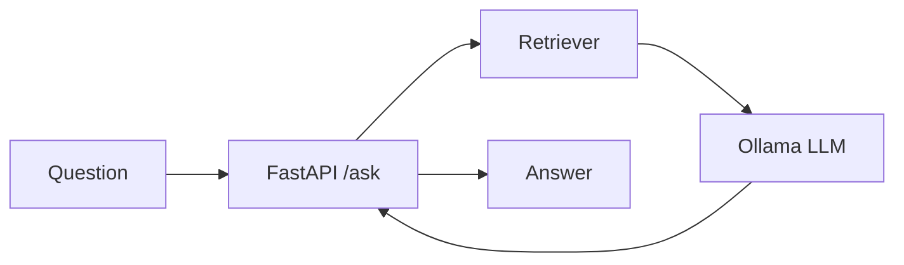

import TOCInline from '@theme/TOCInline';

# 03 · Local LLMs / Ollama

<ProgressToggle sectionId="03-local-llms-ollama" />

<TOCInline toc={toc} minHeadingLevel={2} maxHeadingLevel={2} />

:::tip[In this guide]
Run real models on your own machine with Ollama — no API keys, no bills — then
step up to GPU-served inference: NVIDIA NIM endpoints, vLLM and Triton, VRAM
and quantization math, and one client that talks to all of them. You finish
able to call a model from an endpoint whether it runs on your laptop, your
GPU, or someone else's.
:::

## Goal

Call an LLM from Python over HTTP — locally with Ollama, and on a GPU via an
OpenAI-compatible endpoint — and know how to size, serve and switch between
those backends.

## Estimated Time

1–2 weeks.

## Prerequisites

- [FastAPI](../02-fastapi/index.mdx) basics and [Python async](../01-python/01-core-python/04-professional-python.mdx#async-python).
- ~8GB free RAM (small models); more helps.
- An NVIDIA GPU is useful from page 4 onward, but not required — the hosted
  NVIDIA endpoint covers the examples if you don't have one.

## What You Will Learn

1. [Install & Basics](./01-install-basics.mdx) — install Ollama, pull a model, chat in the terminal, rough RAM needs.
2. [Ollama API Usage](./02-ollama-api-usage.mdx) — the HTTP API, generate vs chat, streaming, async `httpx`, wrapping it in a service class.
3. [NVIDIA NIM & Hosted Endpoints](./03-nvidia-nim-endpoints.mdx) — calling a GPU-served model from an endpoint: `curl`, the `openai` SDK, async `httpx`, SSE streaming, embeddings, reranking, tool calling, and self-hosting a NIM container.
4. [GPU Serving Engines](./04-gpu-serving-engines.mdx) — why Ollama stalls under concurrency, and how vLLM, TGI and TensorRT-LLM with Triton fix it; continuous batching, KV cache, prefill vs decode, honest benchmarking.
5. [GPU Sizing & Quantization](./05-gpu-sizing-and-quantization.mdx) — VRAM math for weights and KV cache, GGUF/AWQ/GPTQ/FP8 and their quality cost, `nvidia-smi`, hardware and multi-GPU choices.
6. [One Client, Many Backends](./06-one-client-many-backends.mdx) — one async `LlmClient` for Ollama, NIM, vLLM and hosted providers, with settings, dependency injection, retries, fallback and cost tracking.

Pages 1–2 are the local path. Pages 3–5 are the GPU and endpoint path. Page 6
ties them together so your application code doesn't care which one is running.

### How the models themselves work

Running a model and understanding it are different skills. These two go inside
the box, and they are what the "explain attention" class of interview question
is testing.

7. [LLM Fundamentals](./07-llm-fundamentals.mdx) — parameters, tokens and context, how generation actually works, streaming, performance metrics, reasoning models, and production reliability.
8. [Transformer Architecture](./08-transformer-architecture.mdx) — self-attention through to decoder-only LLMs, and the questions that come up most often.

## Where This Fits

Ollama is the **LLM** box in your RAG architecture. Later, retrieval feeds it
context; here you learn to talk to it directly. Once you reach page 6, that
box becomes swappable — Ollama in development, a NIM or vLLM endpoint in
production, chosen by config.

## Interview Relevance

"Local vs hosted models", cost and privacy tradeoffs, and streaming responses
are common discussion points for AI application roles. The serving material
goes further: continuous batching, KV cache sizing, quantization tradeoffs and
latency-versus-throughput come up in any conversation about running models in
production rather than calling someone else's API.

## Done When

- [ ] Ollama is installed and running.
- [ ] You can pull and chat with a model in the terminal.
- [ ] You can call the model from Python (generate + chat).
- [ ] You can stream tokens.
- [ ] You can call an OpenAI-compatible GPU endpoint (NIM or vLLM) with `curl`, the `openai` SDK, and raw `httpx`.
- [ ] You can explain continuous batching and why Ollama struggles with concurrent traffic.
- [ ] You can compute weight and KV cache VRAM for a given model, context length and concurrency.
- [ ] You can name the right quantization format for GPU serving versus a laptop.
- [ ] You can switch your app between Ollama and a GPU backend by changing configuration only.

Next: [04 · Embeddings / Vector DB](../04-embeddings-vector-db/index.mdx).
