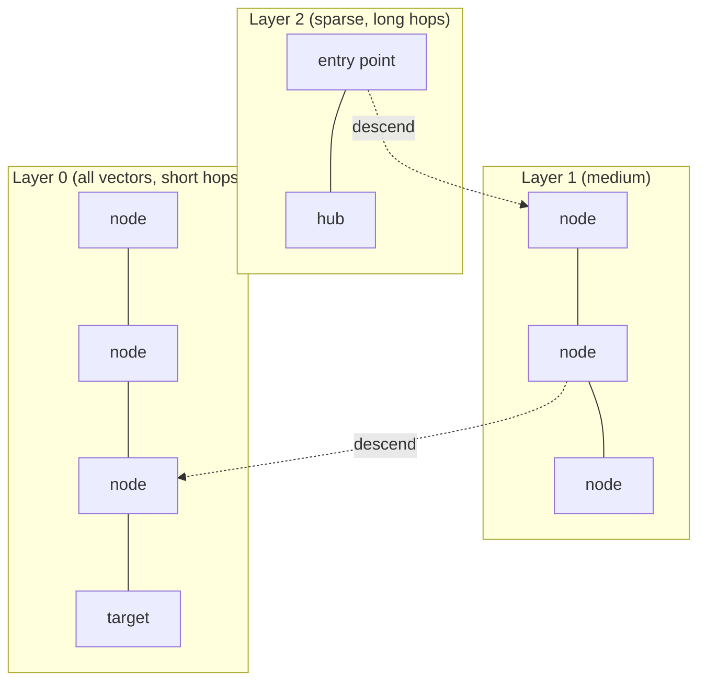
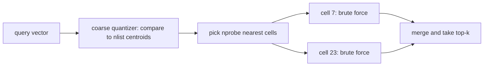
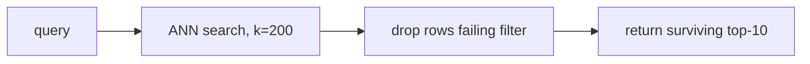

import TOCInline from '@theme/TOCInline';

# Vector Index Internals

<TOCInline toc={toc} minHeadingLevel={2} maxHeadingLevel={2} />

:::tip[In this guide]
The layer below "use HNSW and move on". What `M`, `ef_construction`,
`ef_search`, `nlist` and `nprobe` actually do to build time, memory and
recall. How to measure recall against a brute-force ground truth. And why
metadata filters quietly break approximate search.
:::

## What Is It?

A **vector index** is a data structure that answers "which stored vectors are
nearest to this query vector?" without comparing against all of them. Every
index is a different bet about which comparisons you can safely skip.

[Section 05 introduced the idea](../05-rag-fundamentals/06-vector-databases.mdx)
— brute force is O(n), ANN is sub-linear. This page is about what you have to
decide once that sentence stops being enough: which structure, which
parameters, and how you prove the result is still correct.

Three properties define every index:

| Property | What it means |
| --- | --- |
| **Recall** | Of the true top-k nearest neighbors, what fraction did the index return? |
| **Latency** | How long a single query takes at a given recall |
| **Footprint** | RAM and disk the index occupies beyond the raw vectors |

You cannot maximize all three. Every knob on every index trades one for
another, which is why "which index is best?" has no answer and "which index
hits recall@10 above 0.95 under 30 ms at 2 GB RAM?" does.

## Why Does It Matter?

Because the default parameters in your vector store were chosen by someone who
had never seen your data, and the failure mode is silent. An index with bad
recall does not error. It returns plausible-looking results that are quietly
missing the best chunk, your RAG answers get slightly worse, and nobody
notices for a month.

The second reason is cost. A 50M-vector corpus at 1536 dimensions is 300 GB of
raw float32. Whether that needs a 400 GB RAM machine or a 40 GB one is
entirely a question of which index and which quantization you picked.

## Flat / Brute Force

A flat index stores vectors contiguously and compares the query to every one
of them. No graph, no clustering, no training, no approximation.

```python
import numpy as np

def flat_search(
    corpus: np.ndarray,        # shape (n, d), L2-normalized float32
    query: np.ndarray,         # shape (d,), L2-normalized
    k: int = 10,
) -> tuple[np.ndarray, np.ndarray]:
    """Exact top-k by cosine similarity. Ground truth, by definition."""
    scores = corpus @ query                       # one matmul, (n,)
    top = np.argpartition(-scores, k)[:k]         # O(n) partial sort
    top = top[np.argsort(-scores[top])]
    return top, scores[top]
```

### Flat is right more often than people expect

Modern BLAS does a 100k × 768 matrix-vector product in a few milliseconds. The
whole thing is a single sequential memory scan, which is the access pattern
CPUs are best at. Meanwhile HNSW at the same scale does random pointer chasing
through a graph, which is cache-hostile.

Rough guidance on a single modern core, float32, cosine:

| Corpus size | Dimensions | Flat query latency | Verdict |
| --- | --- | --- | --- |
| 10k | 768 | under 1 ms | Flat. An ANN index here is pure complexity. |
| 100k | 768 | 3–15 ms | Flat is usually fine, especially if QPS is low. |
| 1M | 768 | 40–150 ms | Borderline. ANN starts earning its keep. |
| 10M | 768 | 0.5–2 s | ANN required. |

Choose flat when:

- You are under roughly 100k vectors and expect to stay there.
- Your query volume is low (an internal tool, a few QPS).
- You need exact recall for correctness or for evaluation ground truth.
- Your filters are aggressive — if `where` narrows 1M vectors to 2k, you are
  doing a 2k-vector brute force regardless of what index exists.

The real cost of flat is not latency, it is that every vector must be in RAM:
`n * d * 4` bytes. 1M × 768 × 4 = 3.07 GB. That is the number that eventually
forces your hand.

## HNSW

**Hierarchical Navigable Small World** is the default in Chroma, Qdrant,
Weaviate, pgvector and most others. It is a multi-layer proximity graph.

### The intuition

Think of an airline route map. The top layer has only hub airports with
long-haul routes. Lower layers add regional airports with shorter routes. The
bottom layer contains every airport.

To route from anywhere to anywhere, you start at the top layer, take long hops
until you cannot get closer, then drop a layer and take shorter hops. Each
layer refines the position of the previous one.



Every vector lives in layer 0. A vector is promoted to layer `l` with
probability that decays exponentially, so higher layers are exponentially
sparser. Search is greedy best-first per layer, keeping a candidate list.

### The three knobs

| Knob | Set at | What it controls | Raise it to |
| --- | --- | --- | --- |
| `M` | Build | Max neighbor links per node per layer | Improve reachability and max achievable recall |
| `ef_construction` | Build | Candidate list size while inserting | Build a better-connected graph |
| `ef_search` | Query | Candidate list size while searching | Trade latency for recall, per query |

**`M`** is the graph's connectivity. Low `M` (8) gives a sparse graph: small,
fast to build, but greedy search gets stuck in local minima and recall tops
out. High `M` (48–64) gives a dense graph that can reach high recall but costs
memory and build time. Layer 0 actually uses `2 * M` links.

**`ef_construction`** is how hard the builder works to find good neighbors for
each inserted node. It directly multiplies build time and does not affect
query latency or memory at all. It sets a ceiling on quality: a graph built
with `ef_construction=40` cannot be rescued by a high `ef_search`.

**`ef_search`** is the only knob you can change after the fact, per query. It
must be at least `k`. This is your runtime recall/latency dial, and the one
you should expose as a config value.

```python
import hnswlib
import numpy as np

d, n = 768, 200_000
corpus = np.random.rand(n, d).astype("float32")

index = hnswlib.Index(space="cosine", dim=d)
index.init_index(
    max_elements=n,
    M=16,                   # neighbors per node per layer
    ef_construction=200,    # build-time effort
)
index.add_items(corpus, np.arange(n))

index.set_ef(64)            # query-time effort; must be >= k
labels, distances = index.knn_query(corpus[:5], k=10)
```

### Build-time vs query-time cost

Build is roughly `O(n * log(n) * ef_construction * M)` distance computations.
In practice: 1M × 768 vectors with `M=16, ef_construction=200` takes on the
order of 10–30 minutes single-threaded, a few minutes with 16 threads. This is
a batch job, and it is why you do not rebuild an HNSW index on every deploy.

Query is roughly `O(log(n) * ef_search * M)`. Note `ef_search` is linear in
that expression — doubling it roughly doubles latency.

### Memory overhead

HNSW keeps the full-precision vectors plus the graph links. A good
approximation per vector:

```text
bytes_per_vector ≈ (d * 4)  +  (M * 2 * 4)
                    vectors     graph links (layer 0 dominates)

d=768,  M=16 → 3072 + 128  = 3200 bytes  (+4% over raw)
d=768,  M=64 → 3072 + 512  = 3584 bytes  (+17%)
d=1536, M=16 → 6144 + 128  = 6272 bytes  (+2%)
d=384,  M=64 → 1536 + 512  = 2048 bytes  (+33%)
```

The lesson: graph overhead is small relative to high-dimensional vectors, and
significant for low-dimensional ones. At 1536 dimensions, HNSW costs you
almost nothing beyond the vectors themselves — so the memory conversation is
really a conversation about quantization, not about the graph.

### Updates

HNSW supports inserts natively. Deletes are the problem: removing a node would
orphan parts of the graph, so almost every implementation does a **soft
delete** — mark the id as deleted, keep traversing through it, filter it out of
results. Consequences:

- Deleted vectors still consume memory.
- Deleted vectors still cost traversal time.
- A collection with 50% deletions is paying for 2× the vectors it serves.

The fix is a periodic rebuild or compaction. Budget for it.

## IVF

**Inverted File Index** partitions the space instead of building a graph.

1. **Train**: run k-means over a sample of your vectors to find `nlist`
   centroids. This is the *coarse quantizer*.
2. **Populate**: assign every vector to its nearest centroid's bucket.
3. **Search**: find the `nprobe` centroids nearest the query, brute-force only
   those buckets.



With `nlist=1024` and `nprobe=8`, you scan roughly `8/1024` of the corpus —
a 128× reduction in comparisons.

### The training step people forget

IVF is the one index family that **requires a training pass before it can hold
data**, and the one that silently misbehaves if you skip it or train it badly.

- Rule of thumb: `nlist ≈ sqrt(n)` for a starting point (1M vectors → ~1000
  cells). FAISS guidance goes up to `4 * sqrt(n)` for large corpora.
- You need roughly 30–256 training vectors per centroid. `nlist=4096` wants at
  least ~120k training vectors.
- Train on data drawn from the same distribution as the corpus. Training on
  10k random vectors and then inserting a million real embeddings produces
  wildly unbalanced cells and poor recall.

This is the root of the most common pgvector complaint: you create an
`ivfflat` index on an empty table, Postgres has nothing to cluster, and recall
is terrible forever. Covered in detail on the
[pgvector page](./05-pgvector-with-fastapi.mdx).

### IVF knobs

| Knob | Effect |
| --- | --- |
| `nlist` | More cells → fewer vectors scanned per probe, but a more expensive coarse step and more sensitivity to `nprobe` |
| `nprobe` | Query-time recall dial. `nprobe = nlist` degenerates to brute force with extra steps |

The failure mode unique to IVF is the **cell boundary problem**: if the true
nearest neighbor sits just across a boundary into a cell you did not probe,
you will never see it. Raising `nprobe` is the only cure, which is why IVF
typically needs more of the corpus scanned than HNSW to hit the same recall.

IVF's advantage is memory: no graph links at all, and it pairs naturally with
compression.

## Product Quantization and IVF-PQ

**Product quantization** compresses each vector into a short byte code.

Split a `d`-dimensional vector into `m` subvectors. For each subvector
position, train a codebook of 256 centroids via k-means. Now each subvector is
replaced by one byte — the index of its nearest centroid.

```text
d = 768, m = 96  →  each subvector is 8 dims
original:   768 floats × 4 bytes = 3072 bytes
PQ code:    96 bytes (one per subvector)
compression: 32×
```

Distances are computed from precomputed lookup tables (asymmetric distance
computation), so queries are fast as well as small.

**IVF-PQ** combines the two: IVF narrows the candidate cells, PQ compresses the
vectors inside them. This is how a billion-vector index fits on one machine.

### The honest cost

PQ is **lossy**. You are approximating each vector by a point on a coarse
grid, and that error compounds with IVF's cell-boundary error:

| Config (d=768, 1M vectors) | Memory | Typical recall@10 |
| --- | --- | --- |
| Flat float32 | 3.1 GB | 1.00 |
| HNSW `M=32` | 3.2 GB | 0.95–0.99 |
| IVF-Flat `nlist=1024, nprobe=16` | 3.1 GB | 0.90–0.97 |
| IVF-PQ `m=96` | ~0.2 GB | 0.70–0.85 |
| IVF-PQ `m=96` + rescore top-200 | ~0.2 GB + full vectors on disk | 0.92–0.97 |

Use PQ when memory is the binding constraint and you have verified the recall
loss on your own data. Do not use it at 1M vectors because it sounds
sophisticated — 3 GB of RAM costs less than an afternoon of debugging why
retrieval got worse.

## Scalar and Binary Quantization with Rescoring

PQ requires training. Scalar and binary quantization do not, which makes them
the better first move when memory gets tight.

| Scheme | Per value | Compression | Recall before rescoring |
| --- | --- | --- | --- |
| float32 | 4 bytes | 1× | 1.00 |
| float16 / `halfvec` | 2 bytes | 2× | ~0.999 |
| int8 scalar | 1 byte | 4× | 0.97–0.99 |
| binary (1 bit, sign) | 1 bit | 32× | 0.60–0.80 |

**Scalar quantization** maps each dimension's float range onto 0–255 using
per-dimension min/max. It is nearly free in accuracy at 4× savings, which is
why Qdrant and Weaviate both offer it as a one-line setting.

**Binary quantization** keeps only the sign of each dimension and compares with
Hamming distance — a XOR plus popcount, absurdly fast. On its own, recall is
too low to ship.

### Rescoring is what makes aggressive quantization work

Over-fetch with the cheap index, then re-rank the survivors with exact
distances on the full-precision vectors.

```python
import numpy as np

def search_with_rescore(
    binary_index,               # fast, low-recall, in RAM
    full_vectors: np.ndarray,   # float32, may live on disk / mmap
    query: np.ndarray,
    k: int = 10,
    oversample: int = 20,       # fetch k * oversample candidates
) -> list[tuple[int, float]]:
    candidate_ids, _ = binary_index.knn_query(query, k=k * oversample)
    candidate_ids = candidate_ids[0]

    exact = full_vectors[candidate_ids] @ query     # only k*oversample dot products
    order = np.argsort(-exact)[:k]
    return [(int(candidate_ids[i]), float(exact[i])) for i in order]
```

With `k=10` and `oversample=20` you do 200 exact comparisons instead of a
million, and recall typically climbs from 0.70 to 0.95+. This is the same
retrieve-then-rerank shape as
[cross-encoder reranking](../05-rag-fundamentals/11-reranking.mdx), applied one
layer lower in the stack.

Oversampling factor is a real knob: measure recall at 4×, 10×, 20×, and stop
when the curve flattens.

## Disk-Backed Indexes: DiskANN

When the corpus will not fit in RAM at any acceptable quantization, you move
the graph to SSD. **DiskANN** (and Microsoft's `Vamana` graph, plus pgvector's
`diskann`-style extensions and Qdrant's mmap mode) is built for this.

The design has two parts:

- **In RAM**: PQ-compressed vectors for every point. Small enough to hold the
  whole corpus. Used to decide where to walk.
- **On SSD**: the full-precision vectors and the adjacency lists, laid out so
  one node's data is one page read.

Search navigates using the compressed vectors, issues a bounded number of SSD
reads for the promising nodes, and rescores with full precision.

| Aspect | In-memory HNSW | DiskANN |
| --- | --- | --- |
| RAM per vector (d=768) | ~3.2 KB | ~100 bytes |
| Query latency | 1–10 ms | 5–50 ms (NVMe), much worse on network storage |
| Build cost | Minutes to hours | Hours, and more memory during build than serving |
| Updates | Native inserts, soft deletes | Harder; many implementations are build-once |

Reach for disk-backed indexes when raw vectors exceed roughly 2–3× your
available RAM and you have local NVMe. On network-attached storage the random
read latency destroys the design — check what your cloud instance actually
has.

## Index Comparison

| Index | Build time | Query latency | Memory | Recall ceiling | Updates | Needs training |
| --- | --- | --- | --- | --- | --- | --- |
| Flat | None | O(n), slow at scale | `n*d*4` | 1.00 exact | Trivial | No |
| HNSW | Slow | Fast | `n*d*4` + graph | 0.99+ | Inserts yes, deletes soft | No |
| IVF-Flat | Medium | Fast | `n*d*4` | 0.97 | Yes, cells drift | **Yes** |
| IVF-PQ | Medium | Very fast | `n*m` bytes | 0.85 alone, 0.95 rescored | Yes | **Yes** |
| Scalar-quantized HNSW | Slow | Fast | `n*d` + graph | 0.98 | Same as HNSW | No |
| Binary + rescore | Slow | Fastest | `n*d/8` + full vectors | 0.95 rescored | Same as HNSW | No |
| DiskANN | Very slow | Medium | `n*m` bytes RAM | 0.95 | Often rebuild-only | Yes (for PQ part) |

"Recall ceiling" assumes you tuned the query-time knob properly. Any of these
can be configured into uselessness.

## The Recall/Latency Tradeoff Curve

This is the single most useful thing on this page: stop guessing and plot the
curve for your data.

The method:

1. Build a **flat index** over your corpus. Its results are ground truth.
2. Hold out 200–1000 real query vectors. Real queries, not random vectors —
   random vectors have a different distance distribution and will mislead you.
3. Compute exact top-k for each query with the flat index.
4. Sweep the ANN index's query knob (`ef_search` or `nprobe`), recording recall
   and p95 latency at each setting.
5. Pick the knee of the curve.

```python
from __future__ import annotations

import time
from dataclasses import dataclass

import hnswlib
import numpy as np


@dataclass(slots=True)
class Measurement:
    knob: int
    recall_at_k: float
    p50_ms: float
    p95_ms: float


def exact_ground_truth(corpus: np.ndarray, queries: np.ndarray, k: int) -> np.ndarray:
    """Brute-force top-k ids per query. corpus and queries must be L2-normalized."""
    scores = queries @ corpus.T                       # (q, n)
    top = np.argpartition(-scores, k, axis=1)[:, :k]
    rows = np.arange(queries.shape[0])[:, None]
    order = np.argsort(-scores[rows, top], axis=1)
    return top[rows, order]


def recall_at_k(truth: np.ndarray, got: np.ndarray) -> float:
    """Mean fraction of true top-k ids that the ANN index also returned."""
    k = truth.shape[1]
    hits = [len(set(t.tolist()) & set(g.tolist())) for t, g in zip(truth, got)]
    return float(np.mean(hits) / k)


def sweep_ef_search(
    index: hnswlib.Index,
    queries: np.ndarray,
    truth: np.ndarray,
    k: int = 10,
    knobs: tuple[int, ...] = (10, 16, 24, 32, 48, 64, 96, 128, 256, 512),
) -> list[Measurement]:
    out: list[Measurement] = []
    for ef in knobs:
        if ef < k:
            continue
        index.set_ef(ef)
        latencies: list[float] = []
        got = np.empty((queries.shape[0], k), dtype=np.int64)
        for i, q in enumerate(queries):
            t0 = time.perf_counter()
            labels, _ = index.knn_query(q, k=k)
            latencies.append((time.perf_counter() - t0) * 1000)
            got[i] = labels[0]
        out.append(
            Measurement(
                knob=ef,
                recall_at_k=recall_at_k(truth, got),
                p50_ms=float(np.percentile(latencies, 50)),
                p95_ms=float(np.percentile(latencies, 95)),
            )
        )
    return out
```

Driving it:

```python
rng = np.random.default_rng(0)
d, n, k = 768, 200_000, 10

corpus = rng.standard_normal((n, d), dtype=np.float32)
corpus /= np.linalg.norm(corpus, axis=1, keepdims=True)
queries = corpus[rng.choice(n, 500, replace=False)]      # swap in real queries

truth = exact_ground_truth(corpus, queries, k)

index = hnswlib.Index(space="cosine", dim=d)
index.init_index(max_elements=n, M=16, ef_construction=200)
index.add_items(corpus, np.arange(n))

for m in sweep_ef_search(index, queries, truth, k=k):
    print(f"ef={m.knob:>4}  recall@10={m.recall_at_k:.4f}  p95={m.p95_ms:.2f}ms")
```

A typical shape:

```text
ef=  10  recall@10=0.8120  p95=0.41ms
ef=  16  recall@10=0.8914  p95=0.55ms
ef=  32  recall@10=0.9621  p95=0.93ms
ef=  64  recall@10=0.9873  p95=1.64ms      <-- the knee
ef= 128  recall@10=0.9961  p95=3.10ms
ef= 256  recall@10=0.9989  p95=6.02ms
ef= 512  recall@10=0.9998  p95=11.80ms
```

Read that table honestly. Going from `ef=64` to `ef=512` buys 1.2 points of
recall for 7× the latency. Going from `ef=10` to `ef=64` buys 17 points for 4×.
The knee is where you live.

### Recall@k is not the same as answer quality

Recall against flat ground truth measures whether your *index* is faithful to
your *embeddings*. It says nothing about whether the embeddings retrieve the
right chunks. Recall 0.99 on bad embeddings is still bad retrieval. Keep the
two evaluations separate:

| Question | Ground truth | Metric |
| --- | --- | --- |
| Is my index faithful? | Flat/exact search results | recall@k vs flat |
| Is my retrieval useful? | Human-labeled relevant chunks | recall@k, MRR, nDCG vs labels |

## Parameter Tuning Recipe

Start here, measure, change one knob.

**Step 0 — do you need an index?** Under 100k vectors with modest QPS, use
flat and skip this entire page.

**Step 1 — sane HNSW starting point.**

```text
M = 16
ef_construction = 200
ef_search = 64            (or 2 * k, whichever is larger)
metric = cosine on normalized vectors
```

**Step 2 — build the harness before you tune.** Flat ground truth, 500 real
queries, the sweep above. Without this you are changing numbers by vibe.

**Step 3 — sweep `ef_search` only.** It is free to change. If the knee hits
your recall and latency target, you are done. Most projects stop here.

**Step 4 — if recall plateaus below target, raise `ef_construction`** to 400,
rebuild, re-sweep. Costs build time, nothing else.

**Step 5 — if recall still plateaus, raise `M`** to 32 or 48, rebuild,
re-sweep. Costs memory and build time. `M` above 64 rarely helps text
embeddings.

**Step 6 — if latency is the problem, not recall**, in this order: lower
`ef_search` to the knee, then scalar-quantize with rescoring, then shard.

**Step 7 — if memory is the problem**, in this order: `halfvec`/float16, then
int8 scalar quantization with rescoring, then reduce embedding dimensions
(Matryoshka models let you truncate — see the
[embeddings page](./01-embeddings.mdx)), then PQ, then disk-backed.

Change one thing. Re-measure. Write the number down next to the config in your
repo, because in three months nobody will remember why `ef_search` is 72.

## Filtered Search and Why It Hurts

This is where ANN indexes are at their weakest, and where the gap between
"works in the demo" and "works in production" usually opens up. Section 05
covers [the `where` syntax and the pre/post distinction](../05-rag-fundamentals/09-metadata-filtering.mdx);
here is why the choice is hard.

An HNSW graph was built over *all* vectors. The paths between nodes run
through vectors that may not match your filter. Three strategies exist, and
all three have a sharp edge.

### Post-filter: search then discard

Retrieve top-`k * oversample` from the index, drop everything failing the
filter, return what survives.



Fast, and correct when the filter is permissive. Catastrophic when it is
selective: if `tenant_id = 'acme'` matches 0.1% of rows, your top 200 global
neighbors contain roughly zero Acme rows and you return an empty result. The
symptom is "search works for our big customers and returns nothing for small
ones".

### Pre-filter: narrow then brute force

Resolve the filter first, then exact-search the matching subset.

Always correct. Cost scales with the matching set, so it is excellent for
selective filters and terrible for permissive ones — a filter matching 80% of
10M rows means brute-forcing 8M vectors.

### Filtered index traversal

The real answer, implemented by Qdrant (filterable HNSW with extra links),
Weaviate, Milvus and pgvector's newer versions: push the filter *into* graph
traversal, visiting only matching nodes, with extra connectivity added so the
filtered subgraph stays navigable.

This is good but not free. Heavily filtered traversal visits more nodes to
collect `k` matches, so latency rises with filter selectivity, and recall can
degrade when the filtered subgraph fragments.

### Choosing

| Filter selectivity | Best strategy |
| --- | --- |
| Matches more than ~20% of rows | Post-filter with modest oversampling |
| Matches 1–20% | Filtered index traversal, or pre-filter if the store supports an indexed scalar lookup |
| Matches under ~1% | Pre-filter and brute force. It will be fast because the set is tiny. |
| Hard tenant isolation required | Separate collection/partition per tenant — do not rely on a filter |

That last row is a correctness point, not a performance one. A post-filter bug
in a multi-tenant system leaks another customer's documents. See
[Vector Store Operations](./06-vector-store-operations.mdx) for the isolation
patterns.

## Common Mistakes

- Reaching for HNSW at 20k vectors. Flat is faster, exact, and has no knobs.
- Tuning `ef_search` without a flat ground-truth harness, so "better" means "the one query I tried looked right".
- Benchmarking recall with random vectors instead of real query embeddings. Random high-dimensional vectors are all roughly equidistant and hide every problem.
- Creating an `ivfflat` index on an empty or nearly empty table, then wondering why recall is awful.
- Setting `ef_search` below `k` and getting fewer than `k` results back.
- Forgetting that HNSW deletes are soft — a collection that churns heavily keeps paying for vectors it no longer serves.
- Applying PQ for a corpus that fits in RAM comfortably, trading real recall for memory you were not short of.
- Measuring mean latency instead of p95/p99. ANN latency distributions have long tails, and your users live in the tail.
- Assuming a selective metadata filter composes cleanly with ANN search. It does not, and the failure is empty results, not an error.
- Changing `M`, `ef_construction` and the metric in one commit, then being unable to attribute the result.

## Interview Questions

- Why can brute-force search beat HNSW under 100k vectors, given HNSW is sub-linear?
- What do `M`, `ef_construction` and `ef_search` each control, and which can you change without rebuilding?
- Estimate the memory for 2M vectors at 1024 dimensions in an HNSW index with `M=32`.
- What is the training step in IVF, what does `nlist` control, and what happens if you build the index before loading data?
- Explain product quantization's compression ratio for `d=1024, m=128`, and where the recall loss comes from.
- How does rescoring let you use binary quantization in production?
- Describe how you would measure recall@10 for an ANN index, including what you use as ground truth.
- Why do metadata filters interact badly with graph-based ANN indexes? Compare pre-filter, post-filter and filtered traversal.
- Your p95 query latency is 200 ms at recall 0.99. Walk through what you would change first.
- When would you choose a disk-backed index, and what hardware assumption does it depend on?

## Things to Remember

- Flat is the correct default under ~100k vectors, and it is always your ground truth for evaluation.
- `ef_search` and `nprobe` are runtime dials; `M`, `ef_construction` and `nlist` require a rebuild. Expose the dials as config.
- HNSW graph overhead is small at high dimensions. Memory pressure is solved by quantization, not by lowering `M`.
- IVF needs training on representative data before it holds vectors. This is the most-skipped step in vector search.
- Aggressive quantization only works with oversampling plus exact rescoring.
- Measure recall against flat, with real query vectors, at p95 latency — then pick the knee of the curve.
- Selective metadata filters break ANN search. Pre-filter for narrow sets, separate partitions for tenant isolation.

## Mini Exercise

Take 50k real chunk embeddings from your own corpus (or generate 50k with
`sentence-transformers` over any text dataset). Build a flat index and an
HNSW index with `M=16, ef_construction=200`.

1. Compute exact top-10 for 300 held-out query embeddings.
2. Sweep `ef_search` over `(10, 16, 32, 64, 128, 256)` and print recall@10 with
   p50 and p95 latency, using the harness above.
3. Identify the knee. Write down the `ef_search` you would ship.
4. Rebuild with `M=4` and re-sweep. Observe that recall now plateaus well below
   1.0 no matter how high you push `ef_search` — that is the difference between
   a build-time ceiling and a query-time dial.

## Done When

- [ ] You can state the corpus size at which you would move off a flat index, and defend it.
- [ ] You can explain `M`, `ef_construction` and `ef_search` and which require a rebuild.
- [ ] You have measured recall@k against a flat ground truth with your own data and found the knee.
- [ ] You can estimate index memory for a given `n`, `d` and quantization scheme.
- [ ] You can explain why a selective metadata filter can return zero results from a post-filtered ANN search.
