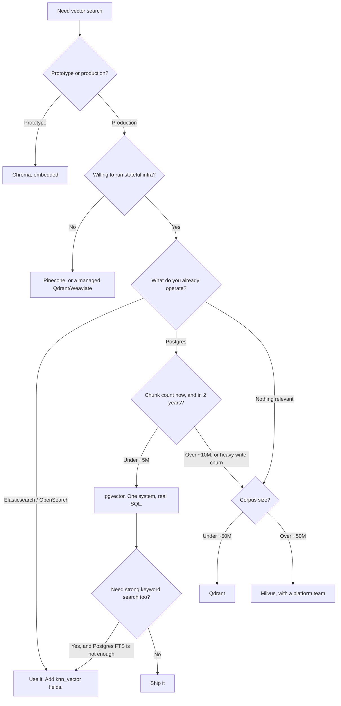

import TOCInline from '@theme/TOCInline';

# Choosing a Vector Store

<TOCInline toc={toc} minHeadingLevel={2} maxHeadingLevel={2} />

:::tip[In this guide]
The decision framework that actually predicts which store you should run,
which is mostly "what are you already operating?". Honest profiles of nine
options, a comparison table that includes operational burden, and a thin
`VectorStore` interface so the decision stays reversible.
:::

## What Is It?

Picking a vector store is an infrastructure decision wearing an algorithms
costume. Every option on the shortlist uses roughly the same HNSW
implementation and will hit roughly the same recall at roughly the same
latency on a 1M-vector corpus. [Section 05 surveyed the landscape](../05-rag-fundamentals/06-vector-databases.mdx);
this page is about committing to one and living with it.

## Why Does It Matter?

Because the thing that will hurt you is never query latency. It is one of:

- Nobody on the team knows how to back it up or restore it.
- The filtering semantics are subtly different from what you assumed, and you
  leak data across tenants.
- It cannot do hybrid search, and six months in you discover your users search
  by error code.
- The managed bill scales with stored vectors and your corpus tripled.
- Migrating off it means rewriting every call site.

So the real question is not "which is fastest". It is **"what else do I already
run, who operates it, and what will this cost me when the corpus is 20× bigger?"**

### The question to actually ask

| Bad question | Better question |
| --- | --- |
| Which has the best benchmark QPS? | Which can my team restore from backup at 2 a.m.? |
| Which supports the most index types? | Does it do hybrid search and filtered search correctly? |
| Which scales to a billion vectors? | What does it cost at my actual corpus size, and at 20×? |
| Which is most popular? | What is already in my `docker-compose.yml` and my runbooks? |

If you already run Postgres and your corpus is under a few million chunks, the
answer is probably pgvector and you can stop reading at
[that section](#postgres-is-probably-enough). The rest of this page is for
when it is not.

## The Options, Honestly

### Chroma

Embedded-first, Python-native, the lowest-friction way to get retrieval
working. Covered in depth on the [Chroma page](./02-vector-db-chroma.mdx).

```python
import chromadb

client = chromadb.PersistentClient(path="./chroma")
collection = client.get_or_create_collection(
    "docs", metadata={"hnsw:space": "cosine"}
)
collection.upsert(ids=["c1"], documents=["..."], metadatas=[{"tenant": "acme"}])
```

**Good**: zero infrastructure, great API ergonomics, fine up to a few hundred
thousand chunks, excellent for prototypes and single-machine tools.

**Honest downsides**: no built-in hybrid/BM25 search, limited horizontal
scale, the embedded mode means one writer process (so a multi-worker
`uvicorn --workers 4` deployment needs the server mode), and the project has
changed its storage format and APIs between versions. Backup is "copy the
directory", which works until you want point-in-time recovery.

**Choose it when**: you are learning, prototyping, or shipping an internal tool
with one process and a small corpus.

### pgvector (Postgres)

A Postgres extension adding a `vector` column type, distance operators, and
HNSW/IVFFlat indexes. Vectors live in the same transaction as your
application's rows.

```sql
CREATE EXTENSION IF NOT EXISTS vector;

CREATE TABLE chunks (
    id          bigserial PRIMARY KEY,
    document_id bigint NOT NULL REFERENCES documents(id) ON DELETE CASCADE,
    tenant_id   text   NOT NULL,
    content     text   NOT NULL,
    embedding   vector(768) NOT NULL
);

CREATE INDEX ON chunks USING hnsw (embedding vector_cosine_ops)
    WITH (m = 16, ef_construction = 200);
```

**Good**: one database to operate, back up, and reason about. Real SQL joins
between vectors and business data. ACID — a chunk and its parent document
commit together. Full-text search in the same engine, so hybrid search is a
`WITH` clause rather than a second system. Every Postgres skill your team has
already transfers.

**Honest downsides**: index builds are single-threaded-ish and memory-hungry,
and a big HNSW build can lock up `maintenance_work_mem` for a long time.
Vertical scaling only, in practice. Very large corpora (tens of millions of
high-dimensional vectors) strain shared buffers and the index does not
gracefully spill. Deleted rows leave bloat until `VACUUM`. See the
[pgvector page](./05-pgvector-with-fastapi.mdx) for the full treatment.

**Choose it when**: you already run Postgres and your chunk count is under
roughly 5–10M. This is most teams.

### Qdrant

A purpose-built vector database in Rust. The one most often chosen when
pgvector is outgrown.

```python
from qdrant_client import QdrantClient, models

client = QdrantClient(url="http://localhost:6333")
client.create_collection(
    collection_name="chunks",
    vectors_config=models.VectorParams(size=768, distance=models.Distance.COSINE),
    quantization_config=models.ScalarQuantization(
        scalar=models.ScalarQuantizationConfig(type=models.ScalarType.INT8, always_ram=True)
    ),
)
client.create_payload_index(
    collection_name="chunks",
    field_name="tenant_id",
    field_schema=models.PayloadSchemaType.KEYWORD,
)
```

**Good**: the best filtered-search story of the self-hosted options — payload
indexes plus filterable HNSW means a selective filter does not collapse recall
(see [index internals](./03-vector-index-internals.mdx)). Built-in scalar and
binary quantization. Snapshots as a first-class operation. Sparse vectors for
hybrid search. Good docs, sane defaults, light resource footprint.

**Honest downsides**: a second stateful system to operate, monitor and back up.
Distributed mode (sharding, replication) is real but is genuinely distributed
systems work. No SQL, so cross-referencing business data means two queries and
a join in Python.

**Choose it when**: you need hybrid search, strong multi-tenant filtering, or
quantization, and you are comfortable running one more service.

### Weaviate

A vector database with a schema/class model, built-in vectorizer modules, and
GraphQL plus REST APIs.

```python
import weaviate
import weaviate.classes.config as wc

client = weaviate.connect_to_local()
client.collections.create(
    name="Chunk",
    vectorizer_config=wc.Configure.Vectorizer.none(),
    vector_index_config=wc.Configure.VectorIndex.hnsw(
        distance_metric=wc.VectorDistances.COSINE,
        quantizer=wc.Configure.VectorIndex.Quantizer.bq(),
    ),
    properties=[
        wc.Property(name="content", data_type=wc.DataType.TEXT),
        wc.Property(name="tenant_id", data_type=wc.DataType.TEXT),
    ],
)
```

**Good**: native hybrid search with BM25 fused server-side (`alpha` blends
dense and sparse), real multi-tenancy as a built-in concept with per-tenant
isolation and offloading, and vectorizer modules that embed for you.

**Honest downsides**: the schema model and GraphQL layer are more concepts to
learn than Qdrant's. The Python client went through a large breaking rewrite
(v3 to v4), so older tutorials mislead. Memory-hungry by default. The module
system is powerful and also a source of version coupling.

**Choose it when**: you want hybrid search and genuine multi-tenancy out of
the box and are willing to adopt its data model.

### Milvus

A distributed vector database with a separated storage/compute architecture,
built for the largest corpora.

```python
from pymilvus import MilvusClient, DataType

client = MilvusClient(uri="http://localhost:19530")
schema = client.create_schema(auto_id=False)
schema.add_field("id", DataType.VARCHAR, is_primary=True, max_length=64)
schema.add_field("embedding", DataType.FLOAT_VECTOR, dim=768)
schema.add_field("tenant_id", DataType.VARCHAR, max_length=64)

index_params = client.prepare_index_params()
index_params.add_index(
    field_name="embedding", index_type="HNSW",
    metric_type="COSINE", params={"M": 16, "efConstruction": 200},
)
client.create_collection("chunks", schema=schema, index_params=index_params)
```

**Good**: the widest index selection (HNSW, IVF variants, DiskANN, GPU
indexes), proven at billions of vectors, independent scaling of query and
index nodes, partitions for tenant separation.

**Honest downsides**: the operational surface is large. A full deployment pulls
in etcd, object storage and multiple node types; Kubernetes is the expected
substrate. `milvus-lite` exists for local dev but is not the same system.
Significant overkill below ~50M vectors, and the complexity is not free even
when idle.

**Choose it when**: you are genuinely at tens of millions to billions of
vectors with a platform team to run it.

### FAISS

A library, not a database. This distinction is the whole point.

```python
import faiss
import numpy as np

d, n = 768, 1_000_000
quantizer = faiss.IndexFlatIP(d)
index = faiss.IndexIVFPQ(quantizer, d, nlist := 4096, 96, 8)

train = np.random.rand(200_000, d).astype("float32")
index.train(train)                      # required before add()
index.add(np.random.rand(n, d).astype("float32"))
index.nprobe = 16

faiss.write_index(index, "chunks.faiss")
```

**Good**: the reference implementation for most ANN algorithms, extremely fast,
GPU support, total control. Many vector databases use it internally.

**Honest downsides**: it gives you an index and nothing else. No persistence
beyond `write_index`, no metadata storage, no filtering, no deletes worth the
name, no concurrency control, no network layer, no durability. You are
building the database.

**Choose it when**: you are doing offline batch similarity work (dedup,
clustering, one-shot nearest-neighbor joins), or you are building a product
where the index is the product. Do not pick FAISS as the backing store for a
RAG API unless you intend to write the surrounding database yourself.

### Pinecone

Fully managed, serverless vector search. No instances to size.

```python
from pinecone import Pinecone, ServerlessSpec

pc = Pinecone(api_key="...")
pc.create_index(
    name="chunks",
    dimension=768,
    metric="cosine",
    spec=ServerlessSpec(cloud="aws", region="us-east-1"),
)
index = pc.Index("chunks")
index.upsert(
    vectors=[{"id": "c1", "values": [0.1] * 768, "metadata": {"tenant": "acme"}}],
    namespace="acme",
)
```

**Good**: genuinely no operations. Namespaces give clean per-tenant separation.
Scales without you thinking about it. Good filtering. The fastest path from
"we need vector search" to "vector search is in production" for a team with no
infra appetite.

**Honest downsides**: your corpus lives in someone else's account, which may be
a compliance conversation. Costs scale with stored vectors plus reads and
writes, and re-embedding a large corpus is a write-amplification event you
pay for. Metadata size per vector is capped. No local mode, so tests either
hit the network or mock. Vendor lock-in is the real one — the data model does
not map cleanly onto anything self-hosted.

**Choose it when**: you have no platform team, data residency is not a
constraint, and you would rather pay money than attention.

### Redis

Redis with the vector search module stores vectors in hashes or JSON and
indexes them with `FT.CREATE`.

```bash
redis-cli FT.CREATE idx:chunks ON HASH PREFIX 1 "chunk:" SCHEMA \
  tenant_id TAG \
  content TEXT \
  embedding VECTOR HNSW 6 TYPE FLOAT32 DIM 768 DISTANCE_METRIC COSINE
```

**Good**: if Redis is already in your stack, this is nearly free to adopt.
Very low latency. Combines well with the cache and queue you are already
running there. TAG and NUMERIC fields filter well.

**Honest downsides**: everything is in RAM, so cost per vector is the highest
of any option on this list. Persistence is RDB/AOF, which is not what you want
as the system of record for an expensive-to-rebuild index — though embeddings
are derived data, which softens this (see
[operations](./06-vector-store-operations.mdx)). Index build happens on load,
so restarts are slow at scale.

**Choose it when**: the corpus is small, latency matters a lot, and Redis is
already operated well in your environment.

### OpenSearch / Elasticsearch

A search engine that grew vector fields. `knn_vector` fields alongside normal
text fields.

```json
{
  "settings": { "index.knn": true },
  "mappings": {
    "properties": {
      "content":   { "type": "text" },
      "tenant_id": { "type": "keyword" },
      "embedding": {
        "type": "knn_vector",
        "dimension": 768,
        "method": {
          "name": "hnsw",
          "space_type": "cosinesimil",
          "engine": "lucene",
          "parameters": { "m": 16, "ef_construction": 200 }
        }
      }
    }
  }
}
```

**Good**: the best keyword search of anything on this list, by a wide margin —
it *is* BM25, with analyzers, synonyms, stemming and phrase queries. Hybrid
search is native. Mature operations: snapshots, rolling restarts, aliases,
index lifecycle management. Horizontal scale is a solved problem here.

**Honest downsides**: heavyweight. JVM heap tuning, shard sizing, and cluster
state are real work. Pure-vector recall and latency lag the purpose-built
stores somewhat. The Elasticsearch/OpenSearch license split means you need to
know which one you are on and what that permits.

**Choose it when**: you already run it, or keyword quality matters as much as
semantic quality. A team with an existing Elasticsearch cluster should
seriously consider not adding a vector database at all.

## Comparison Table

| Store | Deployment | Index types | Hybrid / sparse | Filter quality | Horizontal scale | Multi-tenancy | Ops burden | Cost shape |
| --- | --- | --- | --- | --- | --- | --- | --- | --- |
| Chroma | Embedded or single server | HNSW | None built in | Basic, post-filter leaning | No | Collection per tenant | Very low | Your disk |
| pgvector | Postgres extension | HNSW, IVFFlat | Yes, via `tsvector` in SQL | Excellent — real SQL `WHERE` | Read replicas; no sharding | Row-level via `WHERE` + RLS | Low if you run Postgres | Existing DB instance |
| Qdrant | Self-hosted or managed | HNSW + quantization | Yes, sparse vectors | Excellent — filterable HNSW | Yes, sharding + replication | Collections or payload filter | Medium | Instance + disk |
| Weaviate | Self-hosted or managed | HNSW, flat, dynamic | Yes, native BM25 fusion | Good | Yes | First-class tenants | Medium | Instance + RAM |
| Milvus | K8s cluster or managed | HNSW, IVF\*, DiskANN, GPU | Yes | Good | Yes, designed for it | Partitions / databases | High | Cluster + object storage |
| FAISS | In-process library | Everything | No | None | No | None | Low code, high "build it yourself" | Your compute |
| Pinecone | Managed only | Proprietary | Yes, sparse-dense | Good | Automatic | Namespaces | None | Per-vector stored + ops |
| Redis | Self-hosted or managed | HNSW, FLAT | Yes, with text fields | Good, TAG/NUMERIC | Cluster mode | Key prefix or index per tenant | Low if you run Redis | RAM, the expensive kind |
| OpenSearch | Self-hosted or managed | HNSW, IVF via engines | Best in class | Excellent | Yes, mature | Index per tenant or filter | High | Cluster + heap |

Read "ops burden" as the column that decides it, because it is the one you pay
every week rather than once.

## Decision Flow



Two paths deliberately do not appear: FAISS as a production API backend, and
"let us evaluate all nine". Pick from what you run, measure against your own
queries, move on.

## Postgres Is Probably Enough

If your team already runs Postgres, pgvector should be the default and the
burden of proof should sit on anything else.

**The argument:**

1. **One system to operate.** Backups, PITR, monitoring, connection pooling,
   access control, upgrades, on-call runbooks — all already exist. A dedicated
   vector database duplicates every one of those from zero.
2. **Transactional consistency.** A document, its chunks and its embeddings
   commit or roll back together. With a separate store you own a two-phase
   write and the reconciliation job that fixes it when it half-fails.
3. **Joins are free.** "Top 10 chunks from documents this user may read,
   published in the last 90 days, excluding archived projects" is one SQL
   statement. Across two systems it is a filter you cannot push down and a
   correctness bug waiting to happen.
4. **Hybrid search without a second engine.** `tsvector` plus `pgvector`,
   fused with RRF in SQL. Not as good as Lucene, good enough for most corpora.
5. **The scale is larger than people assume.** A few million chunks at 768
   dimensions is a handful of gigabytes. That is an ordinary Postgres instance.

**When it stops being enough:**

| Signal | Why pgvector struggles | Where to go |
| --- | --- | --- |
| Beyond ~10M high-dimensional vectors | Index must fit in shared buffers / RAM to stay fast; no sharding | Qdrant, Milvus |
| Index build times blocking releases | Builds are memory-bound and largely single-threaded | A store with background/parallel index building |
| Continuous high-rate upserts | Dead tuples and bloat; HNSW index churn; `VACUUM` pressure | Qdrant, Milvus |
| You need int8/binary quantization | Limited quantization support | Qdrant, Weaviate |
| Selective filters at scale with high QPS | Planner may choose a sequential scan or lose index recall | Qdrant's filterable HNSW |
| Keyword quality is a product requirement | `tsvector` has no synonyms-at-query-time, weak analyzers | OpenSearch |
| Your Postgres is already the bottleneck | Vector search competes for the same buffers as OLTP traffic | Anything separate — or a dedicated replica |

That last row has a cheap intermediate move worth knowing: put the vector
tables on a **dedicated Postgres replica or a separate instance**. You keep the
tooling and remove the resource contention, without adopting a new system.

## Embedded vs Server vs Managed

This choice changes your FastAPI deployment topology more than anything else
on the page.

| Mode | Example | Where the index lives | Implication for FastAPI |
| --- | --- | --- | --- |
| Embedded / in-process | Chroma `PersistentClient`, FAISS, `milvus-lite` | Inside your worker's memory and local disk | Each `uvicorn` worker has its own copy. Writes from multiple workers corrupt or diverge. Horizontal scale means duplicating the whole index per pod. |
| Server | Chroma server, Qdrant, Weaviate, Postgres | A separate process, usually a separate host | Stateless API workers, scale them freely. One network hop per query. Needs a connection pool and timeouts. |
| Managed | Pinecone, managed Qdrant/Weaviate | A vendor's infrastructure | Stateless workers, internet-latency hop, API key management, and your tests need a fake or a real index. |

### The embedded trap

This is the single most common production surprise:

```bash
# Works in dev
uvicorn app.main:app --reload

# Breaks in prod with an embedded store
uvicorn app.main:app --workers 4
```

Four workers, four independent in-process indexes over the same directory.
Reads may be stale, writes race, and the symptom is "a document shows up in
search on some requests and not others". Autoscaling makes it worse.

If you use an embedded store in production, accept one of these:

- Exactly one worker process, and vertical scale only.
- Read-only index, built by a separate batch job, shipped as an immutable
  artifact, and the API never writes.
- Switch to the server mode of the same product.

The read-only-artifact pattern is genuinely good when your corpus updates
daily rather than continuously: build the index in CI, bake it into the image
or pull it on startup, and your API has no stateful dependency at all.

### Server mode shapes your dependency wiring

```python
from collections.abc import AsyncIterator
from contextlib import asynccontextmanager

import httpx
from fastapi import FastAPI, Request


@asynccontextmanager
async def lifespan(app: FastAPI) -> AsyncIterator[None]:
    # One pooled client for the process, not one per request.
    app.state.vector_http = httpx.AsyncClient(
        base_url="http://qdrant:6333",
        timeout=httpx.Timeout(connect=2.0, read=5.0, write=5.0, pool=5.0),
        limits=httpx.Limits(max_connections=50, max_keepalive_connections=20),
    )
    try:
        yield
    finally:
        await app.state.vector_http.aclose()


app = FastAPI(lifespan=lifespan)


def get_vector_http(request: Request) -> httpx.AsyncClient:
    return request.app.state.vector_http
```

Two details that matter: a **read timeout**, because a slow vector query
should fail fast rather than hold a worker, and a **connection limit**, because
an unbounded pool under load will exhaust the store's connection budget before
yours.

## Keeping the Choice Reversible

Migration cost is dominated not by moving vectors but by how many places in
your code know which store you chose.

### What migration actually costs

| Cost | Detail |
| --- | --- |
| Re-embedding | Avoidable if you stored the vectors. Store them, or re-embedding is the whole bill. |
| Data transfer | 5M × 768 × 4 bytes is ~15 GB. A few hours of batched writes. |
| Index build | Hours for a large HNSW. Do it before cutover, not during. |
| Filter semantics | The real risk. `$in` on a missing field, null handling, nested field syntax and type coercion all differ. Rewrite and re-test every filter. |
| Score semantics | One store returns cosine distance, another cosine similarity, another negative inner product. Any hardcoded threshold silently inverts. |
| Call-site churn | Proportional to how leaky your abstraction was. This is the part you control today. |

Two mitigations, both cheap now and expensive later:

1. **Keep the embeddings in your own durable storage** (a Postgres table, or
   Parquet in object storage) alongside `chunk_id`, `content`, metadata, and
   the model version. Then any vector store is a rebuildable cache, and
   migration is a re-index, not a re-embed.
2. **Put one interface in front of it.**

### A thin `VectorStore` Protocol

Keep it narrow. The temptation is to model every store's full capability; the
result is an abstraction that leaks all of them. Model what your application
needs.

```python
from __future__ import annotations

from dataclasses import dataclass, field
from typing import Any, Protocol, runtime_checkable


@dataclass(frozen=True, slots=True)
class VectorRecord:
    id: str
    embedding: list[float]
    content: str
    metadata: dict[str, Any] = field(default_factory=dict)


@dataclass(frozen=True, slots=True)
class SearchHit:
    id: str
    content: str
    metadata: dict[str, Any]
    score: float          # always "higher is more similar", normalized by the adapter


@runtime_checkable
class VectorStore(Protocol):
    """The narrowest surface our application actually needs."""

    async def upsert(self, records: list[VectorRecord]) -> None: ...

    async def search(
        self,
        embedding: list[float],
        k: int,
        *,
        where: dict[str, Any] | None = None,
    ) -> list[SearchHit]: ...

    async def delete(self, ids: list[str]) -> None: ...

    async def count(self, *, where: dict[str, Any] | None = None) -> int: ...
```

Note the contract decision baked into `SearchHit.score`: **the adapter
normalizes score direction**. Each implementation converts whatever its backend
returns into "higher is better". Without that rule, a store swap inverts every
threshold in your ranking code and nothing errors.

Implementation one, Chroma:

```python
import asyncio
from typing import Any

import chromadb


class ChromaVectorStore:
    def __init__(self, path: str, collection: str) -> None:
        self._client = chromadb.PersistentClient(path=path)
        self._collection = self._client.get_or_create_collection(
            collection, metadata={"hnsw:space": "cosine"}
        )

    async def upsert(self, records: list[VectorRecord]) -> None:
        # chromadb's client is sync; keep the event loop free.
        await asyncio.to_thread(
            self._collection.upsert,
            ids=[r.id for r in records],
            embeddings=[r.embedding for r in records],
            documents=[r.content for r in records],
            metadatas=[r.metadata for r in records],
        )

    async def search(
        self,
        embedding: list[float],
        k: int,
        *,
        where: dict[str, Any] | None = None,
    ) -> list[SearchHit]:
        res = await asyncio.to_thread(
            self._collection.query,
            query_embeddings=[embedding],
            n_results=k,
            where=where,
        )
        hits: list[SearchHit] = []
        for id_, doc, meta, dist in zip(
            res["ids"][0], res["documents"][0], res["metadatas"][0], res["distances"][0]
        ):
            # Chroma returns cosine *distance*; invert to similarity.
            hits.append(
                SearchHit(id=id_, content=doc, metadata=meta or {}, score=1.0 - dist)
            )
        return hits

    async def delete(self, ids: list[str]) -> None:
        await asyncio.to_thread(self._collection.delete, ids=ids)

    async def count(self, *, where: dict[str, Any] | None = None) -> int:
        if where is None:
            return await asyncio.to_thread(self._collection.count)
        res = await asyncio.to_thread(self._collection.get, where=where, include=[])
        return len(res["ids"])
```

Implementation two, pgvector over SQLAlchemy 2.0 async:

```python
from typing import Any

from sqlalchemy import delete as sa_delete, func, select
from sqlalchemy.dialects.postgresql import insert as pg_insert
from sqlalchemy.ext.asyncio import AsyncSession, async_sessionmaker

from app.models import Chunk          # see the pgvector page for the model


class PgVectorStore:
    def __init__(self, session_factory: async_sessionmaker[AsyncSession]) -> None:
        self._session_factory = session_factory

    async def upsert(self, records: list[VectorRecord]) -> None:
        rows = [
            {
                "id": r.id,
                "embedding": r.embedding,
                "content": r.content,
                "metadata_": r.metadata,
            }
            for r in records
        ]
        stmt = pg_insert(Chunk).values(rows)
        stmt = stmt.on_conflict_do_update(
            index_elements=[Chunk.id],
            set_={
                "embedding": stmt.excluded.embedding,
                "content": stmt.excluded.content,
                "metadata_": stmt.excluded.metadata_,
            },
        )
        async with self._session_factory() as session, session.begin():
            await session.execute(stmt)

    async def search(
        self,
        embedding: list[float],
        k: int,
        *,
        where: dict[str, Any] | None = None,
    ) -> list[SearchHit]:
        # cosine_distance maps to the <=> operator, matching vector_cosine_ops.
        distance = Chunk.embedding.cosine_distance(embedding).label("distance")
        stmt = select(Chunk, distance).order_by(distance).limit(k)
        for key, value in (where or {}).items():
            stmt = stmt.where(Chunk.metadata_[key].astext == str(value))

        async with self._session_factory() as session:
            rows = (await session.execute(stmt)).all()

        return [
            SearchHit(
                id=chunk.id,
                content=chunk.content,
                metadata=chunk.metadata_ or {},
                score=1.0 - float(dist),
            )
            for chunk, dist in rows
        ]

    async def delete(self, ids: list[str]) -> None:
        async with self._session_factory() as session, session.begin():
            await session.execute(sa_delete(Chunk).where(Chunk.id.in_(ids)))

    async def count(self, *, where: dict[str, Any] | None = None) -> int:
        stmt = select(func.count()).select_from(Chunk)
        for key, value in (where or {}).items():
            stmt = stmt.where(Chunk.metadata_[key].astext == str(value))
        async with self._session_factory() as session:
            return int((await session.execute(stmt)).scalar_one())
```

Wiring either one into FastAPI without the rest of the app knowing which:

```python
from functools import lru_cache
from typing import Annotated

from fastapi import Depends, FastAPI
from pydantic import BaseModel, Field
from pydantic_settings import BaseSettings


class Settings(BaseSettings):
    vector_backend: str = "pgvector"      # or "chroma"
    chroma_path: str = "./chroma"


@lru_cache
def get_settings() -> Settings:
    return Settings()


def get_vector_store(
    settings: Annotated[Settings, Depends(get_settings)],
) -> VectorStore:
    if settings.vector_backend == "chroma":
        return ChromaVectorStore(path=settings.chroma_path, collection="chunks")
    return PgVectorStore(session_factory=session_factory)


class SearchRequest(BaseModel):
    query: str
    k: int = Field(default=5, ge=1, le=50)


app = FastAPI()


@app.post("/search")
async def search(
    body: SearchRequest,
    store: Annotated[VectorStore, Depends(get_vector_store)],
) -> list[SearchHit]:
    embedding = await embed_query(body.query)
    return await store.search(embedding, k=body.k)
```

The payoff is not that you will swap stores — most teams never do. It is that
you can run both in a shootout against your own queries, and that your test
suite can use an in-memory fake instead of a container.

### Where the abstraction should stop

Do not try to abstract these. Let the code that needs them be
backend-specific and clearly named:

- **Hybrid search.** Every store fuses differently. A `hybrid_search` method on
  the Protocol will fit exactly one backend.
- **Index creation and tuning.** DDL and index parameters are inherently
  backend-specific. Keep them in migrations or setup scripts.
- **Bulk reindexing.** Use the native fast path — `COPY` for Postgres, batch
  upsert APIs elsewhere.

A narrow Protocol for the hot path plus honest backend-specific modules for
everything else beats one leaky interface that pretends all stores are the
same.

## Common Mistakes

- Choosing on benchmark QPS when your corpus is 200k vectors and every option would answer in under 10 ms.
- Adding a vector database when you already run Postgres or Elasticsearch and have not tested whether they suffice.
- Running an embedded store behind multiple `uvicorn` workers.
- Not storing the embeddings anywhere but the vector store, making migration mean re-embedding the whole corpus.
- Letting `chromadb` or `qdrant_client` types appear in route handlers and service code, so the choice becomes permanent by accident.
- Assuming score semantics transfer. Distance versus similarity differs by store and silently inverts thresholds.
- Picking Pinecone before checking whether data residency is a compliance requirement.
- Picking Milvus at 2M vectors because the architecture diagram was impressive.
- Using FAISS as the backing store for a write-serving API, then reinventing persistence, metadata and deletes badly.
- Forgetting that a managed store's cost scales with stored vectors, and that re-embedding a corpus is a full rewrite you pay for.
- Evaluating with synthetic data, so filtering behavior and real distance distributions never get tested.

## Interview Questions

- You already run Postgres and have 3M chunks. Argue for and against adding a dedicated vector database.
- What breaks when an embedded vector store runs behind four `uvicorn` workers?
- Why is FAISS not a vector database, and what would you have to build around it?
- Which parts of a store migration are expensive, and which are cheap? How do you shift the expensive ones?
- Design a `VectorStore` interface. What do you deliberately leave out, and why?
- A store swap left your relevance thresholds inverted. What happened?
- When does Postgres stop being a reasonable vector store? Name three concrete signals.
- Compare collection-per-tenant against metadata-filter-per-tenant for isolation.
- What does "serverless" change about your cost model for a corpus you re-embed quarterly?
- You need strong keyword and strong semantic search. What do you pick and why?

## Things to Remember

- The deciding factor is what you already operate, not benchmark numbers.
- If you run Postgres and have under a few million chunks, pgvector is the default; make anything else justify itself.
- Embedded stores and multi-worker FastAPI do not mix. Choose one worker, a read-only artifact, or server mode.
- Keep embeddings in your own durable storage so the vector store is a rebuildable cache.
- A narrow `VectorStore` Protocol that normalizes score direction keeps the decision reversible for almost no cost.
- Do not abstract hybrid search, index DDL, or bulk reindexing. Those are honestly backend-specific.
- The expensive part of migration is filter and score semantics, not moving bytes.

## Mini Exercise

Implement the `VectorStore` Protocol above against two backends — Chroma and
either pgvector or Qdrant. Then:

1. Write one integration test suite that runs against both via a fixture
   parameterized over the implementations.
2. Include a test asserting `search` returns results ordered by descending
   `score`, and one asserting a metadata filter excludes non-matching rows.
3. Load 20k chunks into both and compare p95 latency and top-5 overlap for 50
   real queries. Where they disagree, work out which is right.
4. Write a short decision note: which would you ship, and what would have to
   change for you to switch.

## Done When

- [ ] You can name the store you would pick for your situation and give three concrete reasons that are not "it is fast".
- [ ] You can explain the embedded/server/managed tradeoff in terms of your FastAPI deployment topology.
- [ ] You have a `VectorStore` interface with at least two working implementations and a shared test suite.
- [ ] You can state three signals that pgvector has stopped being enough.
- [ ] Your embeddings exist somewhere outside the vector store, so a reindex never means a re-embed.
