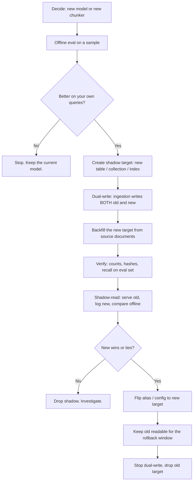
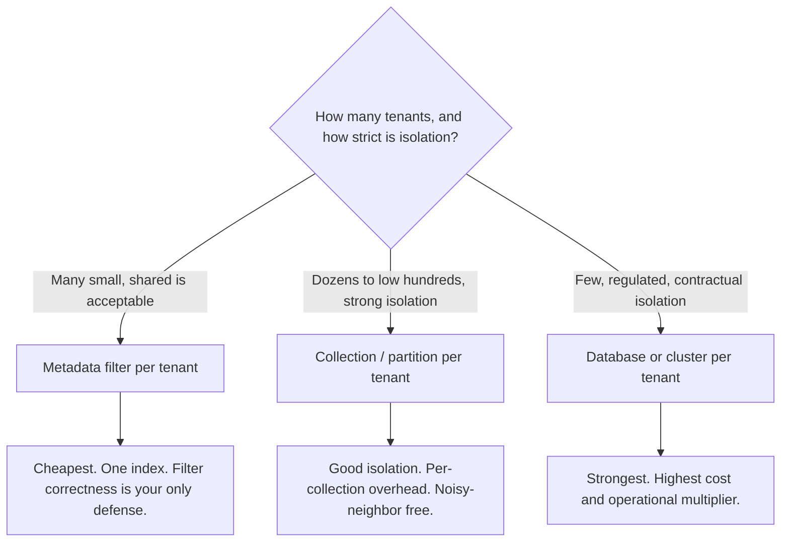

import TOCInline from '@theme/TOCInline';

# Vector Store Operations

<TOCInline toc={toc} minHeadingLevel={2} maxHeadingLevel={2} />

:::tip[In this guide]
The parts nobody writes down. Idempotent ingestion with content hashing and
stable ids, the zero-downtime playbook for changing embedding models,
multi-tenant isolation and the leak that happens when you get it wrong,
capacity and cost math for 1M and 50M chunks, and what to actually alarm on.
:::

## What Is It?

Everything between "retrieval works on my laptop" and "retrieval works for
every tenant, every day, while the corpus changes under it".

Vector stores have one property that shapes all of this: **the contents are
derived data**. Every vector can be recomputed from source documents plus a
model plus a chunker. That is simultaneously a huge operational relief
(backups are optional, in a sense) and the source of the hardest problems
(every input change invalidates the whole store).

## Why Does It Matter?

The failure modes are not the ones you expect from a database. They are quiet.

| Failure | What the user sees | How long until you notice |
| --- | --- | --- |
| Ingestion not idempotent | Duplicate chunks, repeated citations, diluted top-k | Weeks |
| Model changed, corpus half re-embedded | Answers got worse for some questions | Weeks |
| Tenant filter dropped on one code path | Another customer's documents in an answer | Until a customer tells you |
| Deleted document still indexed | The system cites a document that no longer exists | Until legal asks |
| Index not rebuilt after mass deletes | Latency crept up 3× | Months |
| Ingest pipeline stalled | New documents are not searchable | Until someone complains |

None of these throw an exception. Every one of them needs a deliberate design
decision and a monitor.

## Idempotent Ingestion

The ingestion pipeline will run again. On a cron, after a crash, when someone
replays a queue, when a backfill overlaps with live traffic. If running it
twice is not identical to running it once, you have duplicates.

### Content hashing at two levels

Hash the document to decide whether to do any work. Hash the chunk to build
its id.

```python
from __future__ import annotations

import hashlib
from dataclasses import dataclass


def sha256_hex(text: str) -> str:
    return hashlib.sha256(text.encode("utf-8")).hexdigest()


@dataclass(frozen=True, slots=True)
class IngestVersion:
    """Everything that affects the output vectors. Changing any of it
    invalidates previously ingested chunks."""

    embedding_model: str      # "all-mpnet-base-v2"
    model_version: str        # pinned revision / API model string
    chunker_version: str      # "recursive-v3"
    chunk_size: int
    chunk_overlap: int

    def fingerprint(self) -> str:
        parts = [
            self.embedding_model,
            self.model_version,
            self.chunker_version,
            str(self.chunk_size),
            str(self.chunk_overlap),
        ]
        return sha256_hex("|".join(parts))[:16]


def document_hash(raw_text: str, version: IngestVersion) -> str:
    """Changes when the content changes OR the pipeline config changes."""
    return sha256_hex(f"{version.fingerprint()}:{sha256_hex(raw_text)}")


def stable_chunk_id(document_id: str, chunk_index: int, chunk_text: str) -> str:
    """Deterministic, collision-resistant, and readable in logs."""
    return f"{document_id}:{chunk_index:05d}:{sha256_hex(chunk_text)[:16]}"
```

Two things this buys you:

- **Skip unchanged documents cheaply.** Compare the stored
  `content_hash` with the freshly computed one. Equal means skip, before you
  spend a single embedding call.
- **Config changes invalidate correctly.** Folding the pipeline fingerprint
  into the document hash means bumping `chunk_size` marks every document as
  changed, which is exactly right. A plain content hash would silently keep
  serving chunks built by the old chunker.

### Why chunk ids must not be positional alone

`f"{document_id}:{chunk_index}"` looks stable and is not. Insert a paragraph
at the top of a document and every subsequent chunk's content shifts while its
index stays the same. An upsert on positional ids overwrites each row with
different content, which happens to work, but you lose the ability to tell
what actually changed, and any downstream cache keyed on the id is now wrong.

Including the content hash makes the id change when the content changes. The
cost is that re-ingesting a changed document produces *new* ids rather than
updating old ones, so you must delete the orphans. That is the tradeoff, and
it is worth it because deletion is explicit instead of implicit.

### The sync algorithm

```python
from collections.abc import Sequence


async def ingest_document(
    repo: ChunkRepository,
    doc_repo: DocumentRepository,
    tenant_id: str,
    source_uri: str,
    raw_text: str,
    title: str,
    version: IngestVersion,
    embedder: Embedder,
) -> IngestResult:
    new_hash = document_hash(raw_text, version)

    existing = await doc_repo.get_by_source(tenant_id, source_uri)
    if existing is not None and existing.content_hash == new_hash:
        return IngestResult(status="unchanged", chunks_written=0, chunks_deleted=0)

    document = existing or await doc_repo.create(
        tenant_id=tenant_id, source_uri=source_uri, title=title
    )

    chunks = chunk_text(raw_text, version)
    chunk_ids = [
        stable_chunk_id(str(document.id), i, c.text) for i, c in enumerate(chunks)
    ]

    # Embed only what is not already stored under this exact id.
    known = await repo.existing_ids(chunk_ids)
    to_embed = [(cid, c) for cid, c in zip(chunk_ids, chunks) if cid not in known]
    vectors = await embedder.embed_batch([c.text for _, c in to_embed])

    rows = [
        {
            "id": cid,
            "document_id": document.id,
            "tenant_id": tenant_id,
            "chunk_index": i,
            "content": c.text,
            "token_count": c.token_count,
            "embedding": vec,
            "embedding_model": version.embedding_model,
            "model_version": version.model_version,
            "chunker_version": version.chunker_version,
        }
        for i, ((cid, c), vec) in enumerate(zip(to_embed, vectors))
    ]

    async with repo.transaction():
        written = await repo.upsert_chunks(rows)
        # Anything previously attached to this document but no longer
        # in the id set is an orphan from the old revision.
        deleted = await repo.delete_chunks_not_in(document.id, chunk_ids)
        await doc_repo.set_content_hash(document.id, new_hash)

    return IngestResult(
        status="updated", chunks_written=written, chunks_deleted=deleted
    )
```

The shape that matters: **upsert the new set, then delete anything attached to
this document that is not in the new id set, in one transaction.** Not
delete-all-then-insert, which leaves a window where the document is invisible
to search.

### Upsert semantics by store

| Store | Upsert | Delete-by-filter | Transactional with your app data |
| --- | --- | --- | --- |
| pgvector | `INSERT ... ON CONFLICT DO UPDATE` | Yes, `DELETE ... WHERE` | Yes |
| Chroma | `collection.upsert(ids=...)` | Yes, `delete(where=...)` | No |
| Qdrant | `upsert` with explicit point ids | Yes, filter-based delete | No |
| Pinecone | `upsert` by id | By id or by metadata filter | No |
| OpenSearch | `index` with explicit `_id` | `delete_by_query` | No |

Only pgvector lets the chunk write and the document bookkeeping commit
together. With everything else, a crash between the two leaves them
inconsistent, so you need a reconciliation job: walk documents, compare
expected chunk counts and hashes against the store, repair. Write it before
you need it.

### Handling deletions

Three kinds, and they are not the same:

| Kind | Trigger | Required behavior |
| --- | --- | --- |
| Chunk superseded | Document edited, chunk boundaries moved | Delete orphans in the same transaction as the upsert |
| Document deleted at source | File removed, record deleted | Delete all its chunks; detect via a full sync pass |
| Hard deletion request | GDPR erasure, legal hold release | Delete and verify, including from backups and any cached results |

The second one is the one people miss. An incremental pipeline that only
processes "documents changed since last run" never sees deletions, because a
deleted document does not appear in the change feed. You need either a
delete event stream or a periodic full reconciliation that diffs the source
id set against the store's id set.

```python
async def reconcile_deletions(
    repo: ChunkRepository,
    doc_repo: DocumentRepository,
    tenant_id: str,
    source_ids: set[str],          # the full current set at the source
) -> int:
    stored = await doc_repo.all_source_uris(tenant_id)
    gone = stored - source_ids
    if not gone:
        return 0
    # Guardrail: a bug upstream that returns an empty source set would
    # otherwise delete the entire tenant's corpus.
    if len(gone) > 0.2 * max(len(stored), 1):
        raise RuntimeError(
            f"refusing to delete {len(gone)} of {len(stored)} documents; "
            "suspected upstream failure"
        )
    return await doc_repo.delete_by_source_uris(tenant_id, gone)
```

That guardrail is not paranoia. "The source API returned an empty list and we
deleted everything" is a real, common incident.

## Re-Embedding Migrations

Changing the embedding model or the chunking strategy invalidates **every**
vector. Partially re-embedded corpora are broken in a specific way: vectors
from two models are not comparable, so similarity scores across the mixed set
are meaningless and ranking becomes arbitrary. Half-migrated is worse than
either end state.

### The playbook



### Step by step

**1. Evaluate before you commit.** Re-embedding 10M chunks costs real money
and days. Sample 20k chunks and 200 labeled queries, build both indexes, and
compare recall@k and MRR. Newer and larger is not automatically better on your
domain. See the [RAG evaluation page](../05-rag-fundamentals/14-rag-evaluation.mdx).

**2. Create a shadow target.** The physical form depends on the store:

| Store | Shadow mechanism |
| --- | --- |
| pgvector | New table `chunks_v2`, or the same table partitioned by `model_version`, plus a view you repoint |
| Chroma | New collection `chunks__mpnet_v2` |
| Qdrant | New collection, then `update_collection_aliases` to swap atomically |
| Weaviate | New class, alias swap |
| Pinecone | New index, or a new namespace |
| OpenSearch | New index plus an alias — the classic, best-supported version of this pattern |

An **alias** is what makes the cutover atomic. If your store has them, use
them. If not, put the target name in config and make the application read it
at request time, not at import time.

```sql
-- pgvector: a view as a poor man's alias.
CREATE VIEW chunks_active AS SELECT * FROM chunks_v1;

-- Cutover. Takes an access-exclusive lock on the view for milliseconds.
BEGIN;
CREATE OR REPLACE VIEW chunks_active AS SELECT * FROM chunks_v2;
COMMIT;
```

**3. Dual-write.** From the moment the backfill starts, every new or changed
document must land in both targets. Otherwise the backfill is chasing a moving
corpus and you can never prove it is complete.

```python
class DualWriteChunkStore:
    """Writes to both targets during a migration. Reads come from `primary`."""

    def __init__(
        self,
        primary: VectorStore,
        shadow: VectorStore,
        primary_version: IngestVersion,
        shadow_version: IngestVersion,
        embedder_for: dict[str, Embedder],
    ) -> None:
        self._primary = primary
        self._shadow = shadow
        self._primary_version = primary_version
        self._shadow_version = shadow_version
        self._embedder_for = embedder_for

    async def write_document(self, doc_id: str, chunks: list[str]) -> None:
        # Different chunkers mean different chunk sets; re-chunk per target.
        await self._write(self._primary, self._primary_version, doc_id, chunks)
        try:
            await self._write(self._shadow, self._shadow_version, doc_id, chunks)
        except Exception:
            # Shadow failures must never fail a user-facing write.
            # Record and let the backfill job repair it.
            logger.exception("shadow write failed", extra={"doc_id": doc_id})
            await self._mark_shadow_dirty(doc_id)

    async def search(self, embedding: list[float], k: int) -> list[SearchHit]:
        return await self._primary.search(embedding, k)
```

The important asymmetry: **shadow write failures must not fail the request.**
Log them, mark the document dirty, let the backfill fix it. Otherwise your
migration takes down production.

**4. Backfill from source, not from the old index.** Re-chunking means the old
chunk boundaries do not apply, so the old index is not a valid source. Read
the original documents. Make the backfill resumable with a cursor, rate-limit
it so it does not starve live traffic of embedding capacity, and record
progress durably.

**5. Verify before you flip.** Minimum checks:

```python
async def verify_shadow(
    primary: VectorStore, shadow: VectorStore, eval_set: list[EvalQuery]
) -> VerificationReport:
    # 1. No documents missing from the shadow.
    missing = await documents_in_primary_not_in_shadow(primary, shadow)

    # 2. Every shadow row carries the expected model version.
    wrong_version = await shadow.count(
        where={"model_version": {"$ne": SHADOW_VERSION.model_version}}
    )

    # 3. Retrieval quality on labeled queries, not just vibes.
    primary_recall = await recall_at_k(primary, eval_set, k=5)
    shadow_recall = await recall_at_k(shadow, eval_set, k=5)

    # 4. Latency at the ef_search / nprobe you intend to ship.
    shadow_p95 = await measure_p95(shadow, eval_set)

    return VerificationReport(
        missing_documents=missing,
        wrong_version_rows=wrong_version,
        primary_recall=primary_recall,
        shadow_recall=shadow_recall,
        shadow_p95_ms=shadow_p95,
        safe_to_flip=(
            not missing
            and wrong_version == 0
            and shadow_recall >= primary_recall - 0.01
        ),
    )
```

**6. Shadow-read before flipping, if you can afford it.** Serve from primary,
also query shadow, log both result sets, compare offline. This catches the
case where aggregate recall is fine but an important query class regressed.
Costs 2× query load; worth it for a large migration.

**7. Flip, then keep the old target for a rollback window.** A week is
typical. The storage is cheap relative to the cost of discovering a regression
with no way back.

**8. Only then drop dual-write and the old target.** In that order.

### The cheap alternative

If you can take a maintenance window and your corpus is small, do not build
any of this. Re-embed into a new collection overnight, flip in the morning.
The playbook above is for when downtime is not acceptable. Match the machinery
to the stakes.

## Versioning

Every row carries the provenance of how it was produced:

| Column | Example | Why it exists |
| --- | --- | --- |
| `embedding_model` | `all-mpnet-base-v2` | Identify rows to re-embed; refuse mixed-model queries |
| `model_version` | `v1.2.0`, or the pinned API model string | Models change under a stable name. This is the one people skip and regret. |
| `chunker_version` | `recursive-v3` | Chunking changes invalidate rows just as thoroughly as model changes |
| `dim` | `768` | Catch dimension mismatches at write time |
| `embedded_at` | timestamp | Find stale rows; correlate a quality drop with a deploy |
| `content_hash` | sha256 prefix | Detect whether the source text changed |
| `pipeline_fingerprint` | hash of the whole config | One column that answers "was this built by the current pipeline?" |

The payoff is that these questions become one query each:

```sql
-- How far along is the migration?
SELECT embedding_model, model_version, count(*)
FROM chunks
GROUP BY 1, 2
ORDER BY 3 DESC;

-- Is anything stale after the last pipeline change?
SELECT count(*) FROM chunks WHERE pipeline_fingerprint <> :current_fingerprint;

-- Did we accidentally mix models in one searchable set?
SELECT count(DISTINCT model_version) FROM chunks WHERE tenant_id = :tenant;
```

And one safety rule worth enforcing in code: **every search filters on the
current model version.** It costs one indexed predicate and makes a
half-migrated corpus degrade into "fewer results" rather than "nonsense
ranking".

```python
stmt = stmt.where(
    Chunk.embedding_model == settings.embedding_model,
    Chunk.model_version == settings.model_version,
)
```

Also: pin the model. `SentenceTransformer("all-mpnet-base-v2")` pulls whatever
revision the hub serves today. Pass an explicit `revision=`, or vendor the
weights. A silent upstream reupload that shifts the vector space is a very
unpleasant week.

## Multi-Tenancy

Three patterns, and the choice is about isolation strength versus cost.



### Comparison

| Dimension | Metadata filter | Collection per tenant | Database per tenant |
| --- | --- | --- | --- |
| Isolation | Logical only — a missing `WHERE` leaks data | Structural — wrong collection returns nothing | Physical |
| Cost at 10,000 tenants | One index. Cheap. | Thousands of HNSW graphs, each with fixed overhead. Expensive. | Not feasible |
| Cost at 20 tenants | Fine | Fine | Expensive but possible |
| Noisy neighbor | Yes — one huge tenant slows everyone | Mostly isolated | Isolated |
| Per-tenant delete | `DELETE WHERE tenant_id = ...`, then vacuum/compact | Drop the collection. Instant, clean. | Drop the database |
| Per-tenant backup/restore | Hard — must filter out of a global snapshot | Easy | Trivial |
| Recall under filtering | Degrades for small tenants in a big index | Unaffected | Unaffected |
| Ops burden | Lowest | Medium — collection lifecycle management | Highest |

### The recall trap for small tenants

This is the non-obvious reason collection-per-tenant is often right. In a
shared index of 50M vectors, a tenant with 500 chunks is 0.001% of the data. A
post-filtered ANN search over the global graph will return nothing useful —
see [index internals](./03-vector-index-internals.mdx) for the mechanism. You
end up oversampling by 1000×, which is slower than brute-forcing that tenant's
500 vectors would have been.

A good hybrid: **collection per large tenant, shared filtered collection for
the long tail.** Route in the repository layer based on chunk count.

### The data-leak failure mode

With metadata-filter tenancy, tenant isolation is a `WHERE` clause. Every
code path must include it. All of these have shipped to production somewhere:

- A new endpoint that forgot the filter.
- An admin/debug route that deliberately omits it, later reachable by
  non-admins.
- `tenant_id` read from the request body instead of the verified token.
- A post-filter that drops below `k` results, and someone "fixed" it by
  raising the oversample and relaxing the filter.
- A reranker that re-fetches chunks by id without re-checking the tenant.
- A cache keyed on the query text but not the tenant.

That last one is especially nasty: retrieval was correct, the cache leaked.

Defenses, in order of strength:

1. **Structural separation.** Collection per tenant. The wrong lookup returns
   empty rather than someone else's data. No code path can forget.
2. **Database-enforced.** Postgres row-level security, so a missing `WHERE`
   returns nothing instead of everything.

   ```sql
   ALTER TABLE chunks ENABLE ROW LEVEL SECURITY;

   CREATE POLICY chunks_tenant_isolation ON chunks
       USING (tenant_id = current_setting('app.tenant_id', true));
   ```

   Set `app.tenant_id` per transaction from the authenticated principal:

   ```python
   await session.execute(
       text("SELECT set_config('app.tenant_id', :tenant, true)"),
       {"tenant": authenticated_tenant_id},
   )
   ```

3. **One chokepoint in code.** All searches go through a repository method that
   takes `tenant_id` as a required, non-defaulted argument. No raw store
   access from route handlers.
4. **A test that proves it.** Seed two tenants, search as tenant A, assert
   zero results belong to tenant B. Run it on every code path, including the
   cache and the reranker.

Always include the cache key. `cache_key = f"{tenant_id}:{model_version}:{query_hash}"`.

## Backups and Disaster Recovery

The unusual thing about a vector store: **its contents are derived**. Given
source documents, the model and the chunker, you can rebuild everything. That
changes the DR calculation in a way most database runbooks do not account for.

### What is actually irreplaceable

| Data | Rebuildable? | Backup priority |
| --- | --- | --- |
| Source documents | No, if the store is the only copy | Critical |
| Document metadata, ACLs, tenant mapping | No | Critical |
| Chunk text and boundaries | Yes, from source + chunker version | Low |
| Embeddings | Yes, from chunk text + model | Low — but see cost below |
| ANN index structure | Yes, from embeddings | None. Never back up an index. |
| Eval sets and labeled relevance judgments | No. Hand-made. | Critical, and routinely forgotten |

So: back up the documents and the metadata rigorously. Treat the vector store
as a cache you can rebuild — but price the rebuild before you rely on that.

### Rebuild cost is your real RPO constraint

Rebuilding 10M chunks means 10M embedding calls. At hosted-API throughput that
can be 6–20 hours and a four-figure bill. At local GPU throughput, maybe
2–6 hours and no bill. Either way, "we can just rebuild" is not a 15-minute
RTO.

The cheap fix: **persist the embeddings outside the serving index**, in
Postgres or as Parquet in object storage, keyed by `chunk_id` with the version
columns. Then recovery is a bulk load plus an index build — hours of CPU, not
hours of inference and money.

| Strategy | RPO | RTO | Cost |
| --- | --- | --- | --- |
| Nothing; rebuild from source | Last source backup | Hours to days; full re-embed cost | Lowest storage, highest recovery |
| Embeddings archived to object storage | Last archive | Hours (load + index build) | Small storage, no re-embed |
| Native snapshots (Qdrant/OpenSearch/PITR) | Minutes | Minutes to an hour | Storage plus discipline |
| Replica or standby | Seconds | Minutes | Roughly 2× |

### Practical notes by store

- **pgvector**: you get Postgres DR for free. `pg_basebackup` plus WAL
  archiving for PITR, or a streaming replica. Note that `pg_dump` does not
  include the index, so a restore needs an index rebuild — budget for it and
  for the `maintenance_work_mem` it needs.
- **Qdrant**: `POST /collections/{name}/snapshots`, ship the snapshot to
  object storage. Snapshots include the index, so restore is fast.
- **Chroma**: copy the persist directory, with the process stopped or the
  filesystem snapshotted. A `tar` of a live directory is not a consistent
  backup.
- **OpenSearch**: snapshot repositories to S3. The most mature story here.
- **Pinecone**: collections (static snapshots) via the API. Your DR plan is
  partly the vendor's, so read their commitments.

And test the restore. An untested backup is a hypothesis.

## Capacity and Cost

### The formula

```text
raw vectors        = n * d * bytes_per_component
hnsw graph         = n * M * 2 * 4 bytes
chunk text         = n * avg_chunk_bytes
metadata           = n * avg_metadata_bytes

serving RAM        ≈ raw vectors + hnsw graph   (must be resident to be fast)
total disk         ≈ serving footprint + text + metadata + WAL/overhead
```

### Worked example: 1M chunks

Assume 768 dimensions, float32, `M=16`, ~600 bytes of chunk text, ~200 bytes
of metadata.

```text
raw vectors   = 1e6 * 768 * 4      = 3,072 MB   ≈ 3.0 GB
hnsw graph    = 1e6 * 16 * 2 * 4   =   128 MB   ≈ 0.13 GB
chunk text    = 1e6 * 600          =   600 MB   ≈ 0.6 GB
metadata      = 1e6 * 200          =   200 MB   ≈ 0.2 GB

serving RAM   ≈ 3.2 GB
total storage ≈ 4.0 GB  (before Postgres row overhead, ~25-30% more)
```

Verdict: a single 8 GB instance. pgvector on the database you already run.
This is the common case, and it is boring.

One-time embedding cost at 1M chunks × ~250 tokens = 250M tokens:

| Embedder | Rate | One-time cost | Wall clock |
| --- | --- | --- | --- |
| `text-embedding-3-small` | ~$0.02 / 1M tokens | ~$5 | 1–3 hours with concurrency |
| `text-embedding-3-large` | ~$0.13 / 1M tokens | ~$33 | 2–5 hours |
| Local MiniLM on CPU | free | $0 | 5–15 hours |
| Local MiniLM on one GPU | GPU-hours | ~$2–5 of instance time | 20–60 minutes |

Check current API pricing — it moves. The point is the shape: at 1M chunks,
embedding is nearly free and you should not architect around it.

### Worked example: 50M chunks

Same assumptions, 50×.

```text
raw vectors   = 5e7 * 768 * 4      = 153,600 MB  ≈ 150 GB
hnsw graph    = 5e7 * 16 * 2 * 4   =   6,400 MB  ≈   6 GB
chunk text    = 5e7 * 600          =  30,000 MB  ≈  29 GB
metadata      = 5e7 * 200          =  10,000 MB  ≈  10 GB

serving RAM (float32)  ≈ 156 GB
total storage          ≈ 195 GB
```

156 GB resident is a large, expensive machine, and pgvector has no sharding.
Now the levers from [index internals](./03-vector-index-internals.mdx) matter:

| Lever | Serving RAM | Recall impact |
| --- | --- | --- |
| float32 baseline | 156 GB | — |
| `halfvec` / float16 | 81 GB | negligible |
| int8 scalar quantization + rescore | 44 GB | ~0.01 |
| 768 → 384 dims (Matryoshka model) | 81 GB | 0.01–0.03 |
| `halfvec` + 384 dims | 44 GB | 0.01–0.03 |
| IVF-PQ `m=96` + rescore | ~11 GB | 0.03–0.05 |
| DiskANN on NVMe | ~11 GB RAM + 195 GB SSD | ~0.03, higher latency |

Stacking `halfvec` with 384 dimensions takes you from a 192 GB instance to a
64 GB one. Two config changes, roughly a third of the cost, and 1–3 points of
recall. That is usually a good trade, and it is the kind of decision that
should be made with a measured recall curve rather than a guess.

A rough managed-service comparison at 50M vectors: serverless vector stores
bill on stored vectors plus reads and writes, and a corpus this size typically
lands in the low thousands of dollars per month. Self-hosting on a 64 GB
instance is a few hundred. The managed premium buys you not having a platform
team. Run the numbers for your own case, including the cost of re-embedding
when you change models.

### Growth planning

Ask what the corpus looks like in 24 months, not today. Vector stores are
annoying to migrate and the index choice is hard to reverse. A system designed
for 1M that must serve 50M is a rewrite; a system designed for 50M that serves
1M is just slightly over-engineered. Lean toward the latter, once.

## Monitoring

Most vector store dashboards measure the wrong things. Ingest throughput and
collection size are status, not health.

### What to alarm on

| Signal | Why | Example threshold |
| --- | --- | --- |
| **p95 / p99 query latency** | The index degrades gradually: growth, bloat, soft deletes, cache eviction | p95 above 150 ms for 10 minutes |
| **Empty-result rate** | The single best proxy for a broken filter or a broken index. Should be near-constant. | Above 2× the 7-day baseline |
| **Recall drift** | Run 200 canary queries against stored expected ids on a schedule | recall@5 drops below 0.90 |
| **Ingest lag** | Time from document available at source to searchable | p95 above 30 minutes |
| **Mixed model versions** | A migration stalled, or a bad deploy | More than one `model_version` outside a migration window |
| **Index size vs row count** | Ratio drift means bloat or soft-delete accumulation | Index bytes per row up 50% from baseline |
| **Dead tuple percentage** (pgvector) | Re-embedding bloat | Above 20% on `chunks` |
| **Embedding call error rate / latency** | A degraded embedder breaks ingest and queries silently | Error rate above 1% |
| **Dimension mismatch errors** | A model config change escaped review | Any occurrence; page immediately |
| **Zero-vector or NaN embeddings** | Upstream embedder failing open and returning empty vectors | Any occurrence |

### The recall canary

The one that catches the problems nothing else does. A tiny scheduled job:

```python
from dataclasses import dataclass


@dataclass(frozen=True, slots=True)
class CanaryQuery:
    text: str
    expected_chunk_ids: frozenset[str]


async def run_recall_canary(
    store: VectorStore,
    embedder: Embedder,
    canaries: list[CanaryQuery],
    k: int = 5,
) -> float:
    hits = 0
    total = 0
    for canary in canaries:
        embedding = await embedder.embed(canary.text)
        got = {h.id for h in await store.search(embedding, k=k)}
        hits += len(got & canary.expected_chunk_ids)
        total += len(canary.expected_chunk_ids)
    return hits / total if total else 0.0
```

Build the canary set once from known-good retrievals, pin the expected ids,
run it every 15 minutes, and emit the number as a gauge. This catches a
quietly corrupted index, an accidental model swap, a filter regression and a
failed migration — none of which move any other metric.

Note the dependency: your canary ids must survive re-ingestion. Content-hash
ids change when content changes, so refresh the canary set as part of any
intentional migration, and treat an unexplained drop as a real alert.

### Structured logging for retrieval

Log enough to answer "why did this answer cite that chunk?" three weeks later.

```python
logger.info(
    "retrieval",
    extra={
        "tenant_id": tenant_id,
        "query_hash": sha256_hex(query)[:16],   # not the query text, for privacy
        "k": k,
        "ef_search": ef_search,
        "returned": len(hits),
        "top_score": hits[0].score if hits else None,
        "min_score": hits[-1].score if hits else None,
        "chunk_ids": [h.id for h in hits],
        "model_version": settings.model_version,
        "latency_ms": round(elapsed * 1000, 2),
        "filters": sorted(where or {}),
    },
)
```

`returned` and `top_score` are the two fields you will grep most. `returned`
below `k` means your filter or index is cutting results short; a top score
that drifts down over weeks means the corpus or the model changed.

## Freshness and Staleness

### How fresh does retrieval need to be?

Decide explicitly, because the answer drives the architecture.

| Requirement | Approach |
| --- | --- |
| Minutes to hours | Scheduled incremental ingestion. Simplest, covers most cases. |
| Seconds | Event-driven: a queue consumer embeds and upserts on document change |
| Immediate read-your-writes | Write-through on the request path, plus a query that unions the vector store with very recent rows |
| Daily | Batch rebuild into a new collection and swap. Simplest of all, and underrated. |

Incremental is the default. The thing to get right is the watermark: store the
last successfully processed timestamp or cursor **durably**, advance it only
after a successful commit, and overlap slightly (re-process the last few
minutes) because idempotent ingestion makes that free.

```python
# Overlap deliberately. Clock skew and in-flight writes mean a non-overlapping
# window drops documents. Idempotency makes reprocessing harmless.
since = last_watermark - timedelta(minutes=5)
```

### Soft deletes

Deleting from an HNSW graph is a soft delete in most implementations anyway
(see [index internals](./03-vector-index-internals.mdx)), so an
application-level soft delete is sometimes the honest choice:

```sql
ALTER TABLE chunks ADD COLUMN deleted_at timestamptz;
CREATE INDEX ix_chunks_live ON chunks (tenant_id) WHERE deleted_at IS NULL;
```

Pros: instant "deletion", trivially reversible, no index churn, and you keep
an audit trail. Cons: the row still costs storage and traversal, every query
must remember `WHERE deleted_at IS NULL`, and it is **not** compliant deletion
— a GDPR erasure request needs the bytes gone.

So: soft delete for ordinary churn, with a scheduled job that hard-deletes
after a retention window; hard delete immediately for erasure requests, with
verification.

### TTL

For corpora with a natural shelf life — support tickets, news, logs — expiry
keeps the index small and relevance high.

```sql
-- Nightly. Batch it so you do not take a long lock or bloat in one shot.
DELETE FROM chunks
WHERE id IN (
    SELECT id FROM chunks
    WHERE expires_at < now()
    LIMIT 10000
);
```

Qdrant, Weaviate and Pinecone have no universal TTL primitive; you run the
sweeper yourself. Redis does have native key expiry, which is one of the
genuine reasons to pick it.

### Staleness as a retrieval signal

Freshness is not only an ingestion concern. Old chunks can be actively
harmful — a two-year-old pricing page retrieved confidently is worse than no
result. Two moves:

- **Filter**: `WHERE published_at >= now() - interval '2 years'` where recency
  is required for correctness.
- **Boost**: blend a recency term into the final ranking after retrieval,
  rather than filtering, where older content is still valid but less
  preferred. This pairs naturally with
  [reranking](../05-rag-fundamentals/11-reranking.mdx).

Either way, return the document date with the chunk so the generation step can
say "as of March 2024".

## Pre-Production Checklist

Ingestion:

- [ ] Running the pipeline twice produces identical row counts.
- [ ] Unchanged documents are skipped without an embedding call.
- [ ] Editing a document deletes its orphaned chunks in the same transaction as the upsert.
- [ ] Deletions at the source are detected, with a guardrail against mass deletion.
- [ ] A reconciliation job exists and has been run at least once.

Versioning:

- [ ] `embedding_model`, `model_version`, `chunker_version` and `content_hash` are on every row.
- [ ] The embedding model is pinned to an explicit revision, not a floating tag.
- [ ] Every search filters on the current model version.

Isolation:

- [ ] Tenant id comes only from the authenticated principal.
- [ ] A cross-tenant leak test covers search, rerank and cache paths.
- [ ] Cache keys include tenant and model version.
- [ ] Row-level security or structural separation is in place, not just a `WHERE` clause.

Index:

- [ ] `EXPLAIN` or the store's equivalent proves the vector index is used.
- [ ] Recall@k has been measured against a flat ground truth with real queries.
- [ ] `ef_search` / `nprobe` is set deliberately and is configurable without a deploy.

Operations:

- [ ] A restore has been performed from backup into a scratch environment.
- [ ] Rebuild-from-source time and cost are written down.
- [ ] Embeddings are persisted outside the serving index.
- [ ] p95 latency, empty-result rate, ingest lag and a recall canary all alarm.
- [ ] The re-embedding runbook exists and names the alias or config flag to flip.
- [ ] Autovacuum / compaction settings are tuned for the churn you expect.

## Common Mistakes

- Positional chunk ids, so an edit near the top of a document silently rewrites every chunk.
- Delete-all-then-reinsert on re-ingestion, leaving a window where the document is unsearchable.
- An incremental pipeline that never sees deletions because deleted documents are absent from the change feed.
- No guardrail on bulk deletion, so an empty response from the source wipes a tenant's corpus.
- Re-embedding in place, mixing two models in one searchable set and making ranking meaningless.
- Backfilling a new chunker from the old index instead of from source documents.
- A shadow-write failure that fails the user's request.
- Flipping to a new index without a rollback window, then having nothing to roll back to.
- Trusting a model name without pinning a revision.
- Metadata-filter tenancy with no row-level security and no cross-tenant test.
- Cache keys without the tenant id. Retrieval was correct; the cache leaked.
- Backing up the ANN index instead of the data needed to rebuild it.
- Assuming "we can rebuild from source" is a fast recovery, having never timed or costed it.
- Monitoring ingest volume and collection size but not empty-result rate, recall or p95.
- Alarming on mean latency, when ANN latency lives in the tail.
- Collection-per-tenant at 10,000 tenants, paying fixed index overhead ten thousand times.
- Shared-index tenancy for a tenant with 500 chunks in a 50M-vector index, and wondering why their search returns nothing.
- Soft deletes with no hard-delete sweeper, so the index grows forever and erasure requests cannot be honored.

## Interview Questions

- Design an ingestion pipeline that is safe to run twice concurrently. What makes it idempotent?
- Why is a positional chunk id unsafe, and what do you use instead?
- Walk through changing your embedding model on a 10M-chunk corpus with no downtime.
- Why is a half-migrated corpus worse than either the old or the new state?
- Which columns do you store for provenance, and what question does each one answer?
- Compare the three multi-tenancy patterns on isolation, cost and recall.
- Give three concrete ways a tenant filter leaks data, and the defense for each.
- Embeddings are derived data. What does that change about your backup strategy, and where does that reasoning break down?
- Size serving RAM and total storage for 20M chunks at 1024 dimensions with `M=32`.
- You need to cut that memory in half. What do you change first, and what does it cost in recall?
- What would you alarm on, and why is empty-result rate more useful than ingest throughput?
- How do you detect that retrieval quality has silently degraded?
- When is a soft delete the right call, and when is it a compliance problem?

## Things to Remember

- Ingestion must be idempotent: content hash the document to skip work, content hash the chunk to build a stable id.
- Upsert the new chunk set and delete orphans in one transaction. Never delete-then-insert.
- Deletions need their own detection path, plus a guardrail against mass deletion.
- Never mix embedding models in one searchable set. Dual-write, backfill, verify, flip an alias, keep a rollback window.
- Store `embedding_model`, `model_version` and `chunker_version` on every row, and filter searches on the current version.
- Tenant isolation should be structural or database-enforced, not a `WHERE` clause you must remember.
- Embeddings are derived, so back up sources and metadata, not the index — but persist the embeddings somewhere so recovery is a load, not a re-embed.
- `halfvec` plus dimension reduction typically cuts memory 4× for 1–3 points of recall. Measure it.
- Alarm on p95 latency, empty-result rate, ingest lag and a scheduled recall canary.

## Mini Exercise

Build the ingestion and migration machinery for a small corpus (1k documents
is plenty).

1. Implement `document_hash`, `stable_chunk_id` and the sync algorithm. Run
   ingestion twice and assert the row count and every id are unchanged.
2. Edit one document by inserting a paragraph at the top. Assert that orphaned
   chunks are deleted and the total count matches the new chunk set exactly.
3. Delete a source document. Write the reconciliation pass that detects it,
   and prove the guardrail fires when you feed it an empty source set.
4. Change the embedding model. Build the shadow collection, dual-write,
   backfill, run `verify_shadow`, and flip via config. Then roll back.
5. Seed two tenants. Write a test that searches as tenant A and asserts zero
   tenant-B chunk ids appear — then deliberately remove the filter from one
   code path and watch the test catch it.
6. Build a 20-query recall canary, record the baseline, then corrupt the index
   (delete 30% of rows) and confirm the canary drops while row count alone
   would not have told you anything was wrong.

## Done When

- [ ] Your ingestion pipeline is idempotent and skips unchanged documents without embedding them.
- [ ] You can re-embed the corpus with a new model and no downtime, and roll back.
- [ ] Every row carries model, version and chunker provenance, and every query filters on it.
- [ ] You have chosen a multi-tenancy pattern deliberately and have a passing cross-tenant leak test.
- [ ] You have sized serving RAM and storage for your corpus at 20× its current size.
- [ ] A recall canary, p95 latency, empty-result rate and ingest lag are all alarmed.
- [ ] You have restored from a backup and written down the rebuild-from-source time and cost.
