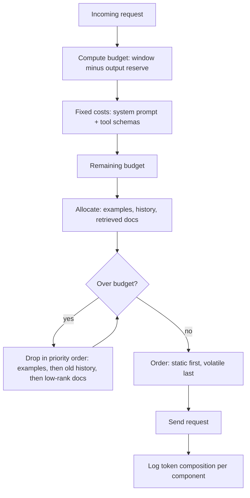
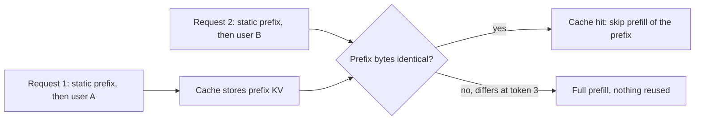

import TOCInline from '@theme/TOCInline';

# Context Engineering

<TOCInline toc={toc} minHeadingLevel={2} maxHeadingLevel={2} />

:::tip[In this guide]
Prompt engineering is about what you say. Context engineering is about deciding
what gets to occupy the window at all, in what order, and what gets dropped
when it does not fit. This page covers budget allocation, cache-friendly
ordering, history management, compaction, the honest long-context-versus-retrieval
comparison, and how to measure what is actually consuming your window.
:::

## What Is It?

**Context engineering** is the discipline of deciding what occupies the model's
input for a given request. Not how you phrase the instruction — what is
present, in what order, and what you sacrificed to make room.

The reframe that makes everything else follow: **context is a budget you
allocate, not a bucket you fill.** A 128k window is not 128k of free space. It
is a fixed resource with competing claimants, every token costs money and
latency, and quality does not increase monotonically as you add more.

What competes for it, on every single request:

| Claimant | Typical size | Volatility |
| --- | --- | --- |
| System prompt and policy | 200 – 2,000 tokens | Static |
| Tool / function definitions | 100 – 500 tokens **per tool** | Static |
| Few-shot examples | 200 – 3,000 tokens | Static |
| Retrieved documents | 1,000 – 20,000 tokens | Per-request |
| Conversation history | Unbounded by default | Grows every turn |
| User's current message | 10 – 2,000 tokens | Per-request |
| Scratch state, plans, tool results | 0 – 10,000 tokens | Per-step |
| **Room for the output** | 500 – 8,000 tokens | Reserved, not optional |

That last row is the one people forget. Output tokens come out of the same
window. If you fill 127k of a 128k window, the model has 1k to answer in, and
you get truncation that looks like the model trailing off.

RAG is one case of this discipline — the case where the retrieved-documents row
dominates. The discipline itself applies to agents, chat assistants, and
single-shot classifiers equally.

## Why Does It Matter?

| Failure | Root cause |
| --- | --- |
| Model ignores an instruction that is clearly in the prompt | Instruction buried mid-context, 40k tokens from the end |
| Answers degrade as the conversation goes on | History growing unbounded, diluting the signal |
| Cost per request triples over a session | Full history resent every turn, no caching |
| Latency climbs through a long chat | Prefill cost scales with input length |
| Agent forgets a commitment it made ten turns ago | Naive sliding window dropped it |
| Cache hit rate near zero despite a stable system prompt | A timestamp at the top of the prompt invalidating the prefix |
| Output truncated at the end of a long conversation | No reserved output budget |

Every one of those is an allocation and ordering problem, not a wording problem.
No amount of prompt rewriting fixes them.



## A Worked Budget

A realistic internal support assistant: 128k window model, but a **working
budget of 24k** because cost and latency matter and quality does not improve
past that point for this task. Capping below the window maximum is a deliberate
choice, and usually the right one.

| Component | Allocation | Priority | Dropped when over budget? |
| --- | --- | --- | --- |
| Output reserve | 2,000 | Fixed | Never — reserved first |
| System prompt + policy | 900 | Fixed | Never |
| Tool definitions (6 tools) | 1,800 | Fixed | Only by removing tools entirely |
| Output format spec / schema | 400 | Fixed | Never |
| Few-shot examples (3) | 1,200 | Medium | **First to go** — drop to 1 example, then 0 |
| Retrieved documents | 12,000 | High | Trim lowest-ranked chunks |
| Conversation history | 4,000 | Medium | Summarise oldest turns |
| Running session summary | 700 | High | Never — it is the compaction product |
| Current user message | 1,000 | Critical | Never — truncating the question is absurd |
| **Total** | **24,000** | | |

The cut order is the real content of that table, and it should be explicit in
code rather than emergent:

1. **Few-shot examples.** Highest token-per-unit-value once the model is
   performing. Three examples to one is often a free 800 tokens.
2. **Low-ranked retrieved chunks.** Rank 8 of 8 is rarely what made the answer
   correct. Trim from the bottom.
3. **Oldest conversation turns**, replaced by a summary — not deleted.
4. **Verbose tool results**, truncated with an explicit marker so the model
   knows something was cut.
5. **Tool definitions** for tools irrelevant to the current request.

Never cut: the current user message, the output reserve, the policy, or any
commitment the model has already made to the user.

## Position Effects

Models do not attend uniformly across the window. Two robust effects:

- **Primacy** — content at the start is weighted heavily. The system prompt
  position is powerful for this reason.
- **Recency** — content immediately before the generation point is weighted most
  heavily of all. This is the strongest effect, and it strengthens as contexts
  get longer.

The consequence is the **lost-in-the-middle** effect: a fact placed in the
middle of a long context is recalled substantially less reliably than the same
fact at either end. The RAG-specific derivation, with the token budget
arithmetic and the measured recall curves, is in
[Context Windows](../06-rag/13-context-windows.mdx) — read it there
rather than having it repeated here.

What matters for this page is the ordering rules that follow from it.

## Ordering Rules

| Rule | Reason |
| --- | --- |
| Static content first | Primacy, and it makes a cacheable prefix |
| Tool definitions immediately after the system prompt | Static, and they belong with the policy |
| Few-shot examples before dynamic content | Static, cacheable, and they frame what follows |
| Retrieved documents in the middle | They are bulk; the model scans rather than reasons over all of them |
| Highest-ranked document **last** among the documents | Recency within the block; the best chunk gets the best position |
| Conversation history after documents | More volatile than documents |
| Current user message last | Recency, and it is what the model must respond to |
| Critical instructions **repeated** at the very end | Over ~8k tokens of context, an instruction at the top gets diluted |

That last rule looks redundant and is not. For long contexts, restating the
output contract immediately before the generation point measurably improves
compliance:

```text
[system prompt and policy]
[tool definitions]
[examples]

--- RETRIEVED DOCUMENTS ---
[8] lowest ranked ...
...
[1] highest ranked ...

--- CONVERSATION ---
[history]

--- REMINDER ---
Answer only from the documents above. Cite every claim as [n].
If the documents do not contain the answer, say so and stop.

USER: [current message]
```

Keep the reminder short — two or three lines. A full restatement of the system
prompt wastes tokens and introduces the risk of the two copies disagreeing after
someone edits one of them.

## Prompt Caching

Providers cache the **key-value state for a prompt prefix**. If the first N
tokens of your request are byte-identical to a recent request, the server
reuses the computed state instead of running prefill over it again. Typical
effect: 50-90% lower cost on the cached portion and a large cut in
time-to-first-token.

The mechanism is a prefix match, and that single fact dictates your ordering:



The failure is binary and unforgiving. One changed byte at position 3 discards
the whole prefix, even if the next 4,000 tokens are identical.

**Do:**

```python
# Static prefix first, byte-stable across every request.
messages = [
    {"role": "system", "content": SYSTEM_PROMPT},      # constant string
    {"role": "system", "content": TOOL_POLICY},        # constant string
    *FEW_SHOT_MESSAGES,                                # constant list
    *history,                                          # grows by appending only
    {"role": "user", "content": user_message},         # volatile, last
]
```

**Don't:**

```python
# Every one of these kills the cache for every request.
system = f"""You are a support assistant.
Current time: {datetime.now().isoformat()}      # changes every request
Session id: {session_id}                        # changes every session
User tier: {user.tier}                          # changes per user
Previous answer: {last_answer}                  # changes every turn
"""
```

If the model genuinely needs the time, the session id or the user tier, put them
in a **volatile block near the end**, not in the system prompt:

```python
messages = [
    {"role": "system", "content": SYSTEM_PROMPT},   # cacheable
    *FEW_SHOT_MESSAGES,                             # cacheable
    *history,                                       # append-only, cacheable up to the tail
    {"role": "user", "content": (
        f"Session context: time={now_iso}, tier={user.tier}\n\n"
        f"{user_message}"
    )},
]
```

Additional rules worth knowing:

| Rule | Detail |
| --- | --- |
| Caches are short-lived | Minutes, typically. Low-traffic endpoints rarely hit them |
| Minimum prefix length applies | Often around 1,000 tokens; short prompts may not cache at all |
| Append-only history is cache-friendly | Each turn extends the prefix. **Re-summarising history invalidates it** |
| Reordering tool definitions is a full miss | Serialise tool schemas deterministically — sort keys, fixed order |
| Some providers need explicit cache markers | Check your provider; others cache automatically |

The history-summarisation interaction is a real tension. Compaction saves
tokens on the uncached portion but destroys the cached prefix, so a compaction
on every turn can cost more than it saves. Compact on a threshold, not
continuously.

## Conversation History Management

| Strategy | How it works | Failure mode |
| --- | --- | --- |
| Full buffer | Send everything, every turn | Hits the window; cost grows quadratically over a session; recency dilutes early instructions |
| Sliding window (last N turns) | Keep the most recent N | **Silently drops commitments and facts.** The user corrected a detail 12 turns ago and the model now contradicts it |
| Token-budgeted window | Keep turns until a token cap | Same as above, plus the cut point moves unpredictably, so the cache breaks at a different place each turn |
| Running summary | Summarise old turns, keep recent ones verbatim | Summarisation is lossy and compounds — a summary of a summary drifts. Invalidates the prefix cache |
| Structured handover | Maintain typed state (decisions, facts, open items) alongside recent turns | Needs schema design up front, and the extraction step can miss things |
| Retrieval over history | Embed turns, retrieve the relevant ones | Loses chronology; the model sees turn 3 and turn 40 with no sense of order |

The practical answer for most assistants is a **hybrid**: typed state that never
gets dropped, a verbatim window of the last few turns, and a prose summary of
everything older.

```python
from pydantic import BaseModel, Field


class SessionState(BaseModel):
    """Typed state that survives every compaction. Never summarised away."""

    user_facts: dict[str, str] = Field(default_factory=dict)
    decisions: list[str] = Field(default_factory=list)
    commitments: list[str] = Field(default_factory=list)
    open_questions: list[str] = Field(default_factory=list)
    corrections: list[str] = Field(default_factory=list)

    def render(self) -> str:
        parts: list[str] = []
        if self.user_facts:
            facts = "; ".join(f"{k}={v}" for k, v in sorted(self.user_facts.items()))
            parts.append(f"Known facts: {facts}")
        for label, items in (
            ("Decisions made", self.decisions),
            ("Commitments to the user", self.commitments),
            ("Open questions", self.open_questions),
            ("User corrections (authoritative)", self.corrections),
        ):
            if items:
                parts.append(f"{label}:\n" + "\n".join(f"- {i}" for i in items))
        return "\n\n".join(parts)
```

`corrections` is the field that earns its place. When a user says "no, the
deployment is in eu-west-1, not us-east-1", that correction must outlive every
compaction, and a prose summary will eventually lose it or soften it.

## Compaction

Compaction is summarising mid-session to reclaim budget. Done badly it is how
agents lose track of what they promised.

**When to compact:** on a threshold, not a schedule. Compact when history
exceeds its allocation, at a natural boundary (task completed, topic changed),
or before a step you know is context-hungry. Not on every turn — you destroy the
prefix cache for a gain you did not need yet.

**What must survive verbatim**, never paraphrased:

- Identifiers: IDs, file paths, URLs, version strings, error codes.
- Numbers the user supplied or the system computed.
- Explicit user corrections and preferences.
- Commitments the assistant made ("I will not modify the production config").
- Constraints and prohibitions.
- Unresolved questions, and who owes the answer.

```python
COMPACTION_PROMPT = """You are compacting a conversation to free up context.

Produce two sections.

SECTION 1 - PRESERVED VERBATIM
Copy these exactly as they appear. Do not rephrase, round, or shorten:
- every identifier (IDs, file paths, URLs, version strings, error codes)
- every number the user gave or the system computed
- every explicit user correction or stated preference
- every commitment the assistant made
- every stated constraint or prohibition
- every unresolved question, and who owes the answer

SECTION 2 - SUMMARY
Summarise the remaining narrative in under 200 words: what was attempted, what
worked, what failed and why. Omit pleasantries and restatements.

Rules:
- If you are unsure whether something belongs in Section 1, put it in Section 1.
- Never invent a resolution for an open question.
- Never soften a prohibition into a preference.

CONVERSATION TO COMPACT:
---
{conversation}
---"""
```

Three implementation notes that matter more than the prompt:

- **Extract typed state before summarising**, not after. Pull the identifiers and
  commitments into `SessionState` with a structured call, then summarise the
  prose. Reversing the order means you are extracting from already-lossy text.
- **Keep the last 2-4 turns verbatim** alongside the summary. The immediately
  preceding exchange is the highest-value context in the window and should never
  be summarised.
- **Log every compaction** with before and after token counts. When an agent
  loses the thread, the compaction boundary is the first place to look, and you
  cannot look if you did not log.

## Long Context vs Retrieval

Models with 200k-plus windows prompted the obvious question: can you skip
retrieval and paste everything in? Sometimes. Here is the honest comparison.

| Dimension | Stuff the long window | Retrieve then generate |
| --- | --- | --- |
| Cost per request | Linear in corpus size. 100k tokens every call is expensive | Flat and low — 2-10k tokens regardless of corpus size |
| Time to first token | Prefill over 100k tokens is seconds | Retrieval latency (10-100 ms) plus a small prefill |
| Accuracy, fact near either end | Very good | Very good |
| Accuracy, fact buried in the middle | Degrades — this is the core limitation | Good, because the chunk is promoted to a short context |
| Multi-hop reasoning across the corpus | Better — the model sees everything at once | Harder; needs decomposition or multiple rounds |
| Freshness | Re-send on every change | Re-index the changed document only |
| Scale ceiling | Hard — the window | Effectively unbounded |
| Cache behaviour | Excellent **if** the corpus is the stable prefix | Poor — retrieved docs differ per query |
| Engineering cost | Near zero | Chunking, embedding, index, reranking, evaluation |
| Attribution | Weak — hard to know which part was used | Strong — you know which chunks you supplied |

**Where stuffing the window genuinely wins:**

- The corpus is small and bounded — a 40-page contract, one codebase module, a
  single API spec. Below roughly 50k tokens, a retrieval pipeline is often more
  machinery than the problem deserves.
- The task needs global structure. "Summarise this document", "find
  inconsistencies between these two contracts" — retrieval fragments exactly
  what the task needs whole.
- The same corpus is reused across many queries, so prefix caching makes it cheap
  after the first call. This is the strongest case and the most underexploited.
- You are prototyping. Stuff first, measure, add retrieval when numbers force it.

**Where retrieval still wins:** large or growing corpora, frequently changing
content, strict latency budgets, per-user cost ceilings, and anywhere you need
to show which source produced a claim.

The pragmatic answer is usually both: retrieve generously into a large window
rather than retrieving three chunks into a small one. The compression and
context-assembly techniques for that are in
[Context Construction](../07-advanced-rag/06-context-construction.mdx).

## Tool Definitions Are Context Cost

Every tool schema is tokens on every call. The arithmetic is unforgiving:

| Tools exposed | Approx tokens per call | Per 100k calls at $3 per million input tokens |
| --- | --- | --- |
| 5 | ~1,200 | $360 |
| 15 | ~3,600 | $1,080 |
| 40 | ~9,600 | $2,880 |
| 40, with verbose descriptions and examples | ~20,000 | $6,000 |

And it is not only cost. Tool-selection accuracy degrades as the count rises —
the model is choosing from a longer list of similar-sounding options, and
descriptions start to overlap. Forty tools is both expensive and worse.

Mitigations, in order of effectiveness:

1. **Expose fewer tools.** Most agents need 5-10. Audit which ones were called
   in the last 10,000 requests; the long tail is usually dead weight.
2. **Filter by phase or intent.** A read-only research phase does not need the
   write tools in context.
3. **Consolidate.** Five near-identical search tools become one with a
   `source` enum.
4. **Trim descriptions.** Write the shortest description that disambiguates,
   then stop. Examples in tool descriptions are usually the fat.
5. **Tool search as a tool.** For genuinely large catalogues, expose a lookup
   tool that returns relevant schemas on demand.

Schema design, naming and description-writing are covered in
[Tool Design](../09-tool-calling-and-ai-agents/07-tool-design.mdx).

## Measuring It

You cannot allocate a budget you do not measure. Log the token composition of
every request, per component — not just the total.

```python
from pydantic import BaseModel, Field


class ContextBudget(BaseModel):
    """Per-request token accounting. Log this on every call."""

    window: int
    output_reserve: int
    components: dict[str, int] = Field(default_factory=dict)

    @property
    def used(self) -> int:
        return sum(self.components.values())

    @property
    def available(self) -> int:
        return self.window - self.output_reserve - self.used

    @property
    def utilisation(self) -> float:
        usable = self.window - self.output_reserve
        return self.used / usable if usable > 0 else 1.0

    def add(self, name: str, tokens: int) -> None:
        self.components[name] = self.components.get(name, 0) + tokens

    def over_budget(self) -> bool:
        return self.available < 0

    def report(self) -> str:
        lines = [
            f"window={self.window} reserve={self.output_reserve} "
            f"used={self.used} free={self.available} util={self.utilisation:.0%}"
        ]
        for name, tokens in sorted(
            self.components.items(), key=lambda kv: kv[1], reverse=True
        ):
            share = tokens / self.used if self.used else 0.0
            lines.append(f"  {name:<24} {tokens:>7} ({share:.0%})")
        return "\n".join(lines)


def count_tokens(text: str) -> int:
    """Use the real tokeniser for your model. len(text) // 4 is a rough
    fallback and will mislead you on code, JSON and non-English text."""
    import tiktoken

    return len(tiktoken.get_encoding("cl100k_base").encode(text))
```

What to put on a dashboard, and what each number tells you:

| Metric | Why it matters |
| --- | --- |
| p50 and p95 tokens per component | Finds the component that grew without anyone deciding it should |
| Utilisation distribution | p95 above ~85% means you are one long document from truncation |
| Rate of `finish_reason == "length"` | Your output reserve is too small. See [Decoding & Sampling](../03-llm-fundamentals/05-decoding-and-sampling.mdx) |
| Cache hit rate | A low rate with a stable system prompt means something volatile is in the prefix |
| Compaction frequency and token delta | Rising frequency means history allocation is too tight |
| Tokens dropped per request, by component | Tells you what the model never saw when it got an answer wrong |

The last one is the most valuable and the least often implemented. When you are
debugging a wrong answer, "we dropped chunks 5 through 8 and the second-oldest
turn" is the answer, and without that log you will spend an afternoon rewriting
a prompt that was never the problem.

## Context Engineering Checklist

- [ ] A declared working budget, which may be well below the window maximum.
- [ ] Output tokens reserved before anything else is allocated.
- [ ] An explicit, code-level priority order for what gets cut.
- [ ] Static content first; volatile content last.
- [ ] Tool schemas serialised deterministically, with sorted keys.
- [ ] No timestamps, session IDs or per-user values in the system prompt.
- [ ] Critical instructions restated near the end for contexts over ~8k tokens.
- [ ] Highest-ranked retrieved chunk placed last among the documents.
- [ ] Typed session state that survives compaction, including user corrections.
- [ ] Compaction on a threshold, not every turn.
- [ ] Last 2-4 turns kept verbatim, always.
- [ ] Per-component token composition logged on every request.
- [ ] An alert on `finish_reason == "length"` rate and on cache hit rate.
- [ ] A tool audit: every exposed tool was actually called recently.

## Common Mistakes

- Treating the window as free space and filling it because it is there.
- Forgetting to reserve output room, then debugging "the model trails off".
- Putting the current timestamp in the system prompt, destroying all caching.
- Re-serialising tool schemas with non-deterministic key order.
- Summarising history on every turn, paying more in lost cache than you save.
- A naive sliding window that silently drops a user correction.
- Burying the output-format instruction 40k tokens from the generation point.
- Placing the best retrieved chunk first, where recency does not help it.
- Exposing forty tools because they exist, and paying for them on every call.
- Logging only total token counts, so you cannot see which component grew.
- Measuring tokens with `len(text) // 4` and being 30% wrong on JSON and code.
- Compacting without preserving identifiers verbatim, then having the agent act
  on a hallucinated file path.

## Interview Questions

- Why is "context is a budget, not a bucket" a useful reframe?
- What order would you cut components in when a request is over budget, and why
  that order?
- How does prefix caching work, and what ordering rule does it imply?
- Give three things that must never appear in a system prompt if you care about
  caching.
- Why does summarising conversation history hurt your cache hit rate?
- Compare full buffer, sliding window and running summary, with the failure mode
  of each.
- What must survive a compaction verbatim, and why paraphrasing it is dangerous?
- When does stuffing a long context beat retrieval? Give two concrete cases.
- Why does exposing forty tools hurt accuracy as well as cost?
- What would you log to diagnose "the model ignored a document we definitely
  retrieved"?

## Things to Remember

- Context is an allocated budget. Declare it, reserve output room first, and
  write the cut order down in code.
- Static first, volatile last. That single rule serves primacy, recency and
  caching simultaneously.
- Prefix caching is a byte-exact match. One timestamp ruins it.
- Recency is the strongest position effect — restate critical instructions at
  the end of long contexts.
- Sliding windows drop commitments. Keep typed state that compaction cannot
  touch.
- Compact on a threshold, preserve identifiers verbatim, keep the last few turns
  as-is.
- Long context wins on small bounded corpora, global-structure tasks, and
  cached-and-reused documents. Retrieval wins on scale, freshness and
  attribution.
- Tool definitions are a per-call tax. Audit them.
- Log token composition per component, not just the total.

## Mini Exercise

Instrument one real endpoint with the `ContextBudget` helper above and log the
report for 200 real requests. Then answer three questions from the data: which
component has the widest p50-to-p95 gap, what your p95 utilisation is, and what
fraction of every request is tool definitions.

Most teams are surprised by at least one of the three. Fix the biggest surprise,
then put the per-component numbers on a dashboard so the next regression is
visible the day it ships rather than the week someone complains.

## Done When

- [ ] You can state your working budget and the output reserve for one endpoint.
- [ ] Your prompt assembly orders static content first, and nothing per-request
      appears in the system prompt.
- [ ] You log token composition per component and can name your largest consumer.
- [ ] You have typed session state that survives compaction.
- [ ] You can argue long context versus retrieval for your case with numbers.

Next: [Hallucination Detection](./05-hallucination-detection.mdx).
