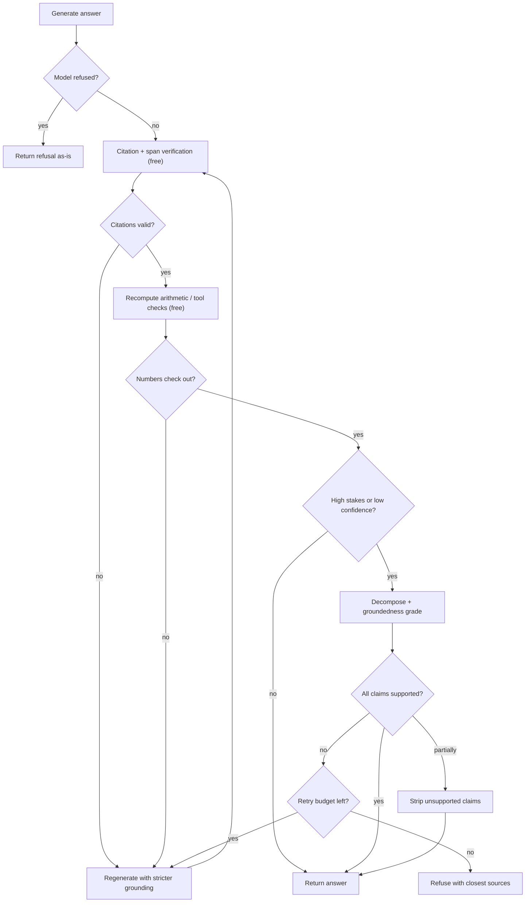

import TOCInline from '@theme/TOCInline';

# Hallucination Detection

<TOCInline toc={toc} minHeadingLevel={2} maxHeadingLevel={2} />

:::tip[In this guide]
A precise definition and taxonomy, a short non-mystical explanation of why it
happens, the instruction patterns that measurably reduce it, and seven detection
techniques ranked by cost and reliability — starting with the deterministic one
you should build first. Plus what to do when you catch one, and why "zero
hallucinations" is not a promise you can keep.
:::

## What Is It?

A **hallucination** is output that is presented as fact and is not supported by
either the provided context or reality. The word covers several distinct
failures that need different handling, so the first useful move is to split it.

| Type | Definition | Example | Detectable from context alone? |
| --- | --- | --- | --- |
| **Intrinsic** | Contradicts the provided context | Context says the timeout is 30 seconds; the answer says 60 | Yes — fully |
| **Extrinsic** | Not supported by the provided context, but not contradicted either | Context covers the retry policy; the answer adds a backoff multiplier that appears nowhere | Yes — as unsupported |
| **Fabricated citation** | Cites a source that does not exist or does not say that | Cites `[7]` when four documents were supplied | Yes — deterministically |
| **Wrong entity** | Right shape, wrong name, date, version or number | Attributes the change to the wrong service, or cites v2.3 when the docs say v3.2 | Usually |
| **Confident arithmetic error** | Numbers that do not add up | Sums a column incorrectly and presents the total without hedging | Yes — recompute it |
| **Invented API** | A plausible-looking function, flag or parameter that does not exist | `client.retry(max_attempts=3)` on a library with no `retry` method | Only against a real spec or by execution |
| **Unsupported refusal-dodge** | Answers from parametric memory when the context does not cover it | Answers a question about your internal policy using generic industry practice | Yes — groundedness check |

The split matters because the mitigations differ. Intrinsic hallucination and
fabricated citations are cheap and deterministic to catch. Invented APIs need an
external source of truth. Extrinsic hallucination is the large, awkward middle
where most of your effort goes.

## Why Does It Matter?

Because the failure is **invisible at the point of use**. A wrong answer looks
exactly like a right one — same fluency, same confidence, same formatting, often
the same citation markers. Users cannot tell, and neither can your logs unless
you built something that checks.

| Context | What an undetected hallucination costs |
| --- | --- |
| Internal docs assistant | Engineers act on a config value that does not exist |
| Customer support | You have made a commitment on your company's behalf |
| Code assistant | A plausible API call that fails at runtime, or silently does the wrong thing |
| Financial or clinical summary | A number nobody re-derived, now in a decision |
| Agent with tools | The fabrication becomes a tool call with side effects |

The last row is the worst case and the fastest growing one. A hallucinated file
path in a chat answer is an annoyance; the same path passed to a delete tool is
an incident.

There is also a trust asymmetry worth naming. Users calibrate on their early
experience. A system that is right 95% of the time and never signals doubt
trains people to stop checking — which is precisely when the other 5% does
damage. Detection plus an honest refusal is what keeps that calibration correct.

## Why Models Hallucinate

Keep this short and resist the mysticism.

A language model is trained to predict the next token. Nothing in that
objective represents truth. A fluent, plausible, false continuation and a
fluent, plausible, true one score identically against the training objective if
they are equally likely given the data.

Three things compound it:

- **Instruction tuning rewards helpfulness.** Models are trained on examples
  where the assistant answers. "I don't know" is rare in that data, so the model
  has learned that producing an answer is the correct behaviour.
- **Fluency is the actual skill.** The model is very good at producing text that
  has the right shape. A fabricated citation has the shape of a citation. An
  invented API call has the shape of an API call.
- **From the inside, there is no difference.** A supported claim and an
  unsupported one are generated by the same mechanism, with similar token
  probabilities. The model is not withholding a signal from you. There is no
  reliable internal flag to read.

That last point is the practically important one, and it is why detection has to
be **external**. You cannot ask the model whether it is hallucinating and trust
the answer. You verify against something.

## The Mitigation That Matters Most

Before any detection, do the two things that reduce the rate at the source:
**give the model the facts, and give it explicit permission to refuse.**

Permission to refuse is the part teams skip, and it is close to free. A model
told to answer will answer. A model told that refusing is a correct outcome
refuses noticeably more often when it should.

Instruction patterns that measurably help:

```text
Answer using ONLY the numbered context below.

- Cite the source of every factual claim as [n].
- If the context does not contain the answer, reply exactly:
  "The provided sources do not cover this."
  Saying this is a CORRECT and expected answer. Do not guess.
- Do not use general knowledge, even if you are confident it is right.
- If the context is ambiguous or sources disagree, say so and show both.
- Do not add caveats, background or related information that is not in the
  context.
```

Why each line is there:

| Line | Addresses |
| --- | --- |
| "ONLY the numbered context" | Extrinsic hallucination from parametric memory |
| "Cite every claim as `[n]`" | Makes verification mechanical and cheap downstream |
| Exact refusal string | Gives you a deterministic token to match on in code |
| "Saying this is a CORRECT answer" | Counteracts helpfulness pressure. This sentence does real work |
| "Do not use general knowledge" | Closes the most common leak in RAG |
| "Say so if sources disagree" | Prevents silent arbitration between conflicting docs |
| "No background that is not in the context" | Extrinsic additions are the most common failure in otherwise good answers |

Two further things that help and cost nothing: **number your context chunks**
so citation is possible at all, and **keep the context relevant** — padding with
marginal chunks measurably increases extrinsic hallucination, because the model
tries to use what it was given.

What does not help: telling the model "do not hallucinate". It has no referent
for that instruction. Be specific about the behaviour you want instead.

## Detection Techniques

Seven techniques, ordered the way you should build them.

### 1. Citation and span verification

Lead with this. It is deterministic, costs microseconds, and catches the most
embarrassing class of failure.

```python
import re
import unicodedata
from pydantic import BaseModel, Field


class Document(BaseModel):
    id: str
    text: str


class CitationReport(BaseModel):
    cited_ids: list[int] = Field(default_factory=list)
    invalid_ids: list[int] = Field(default_factory=list)
    uncited_sentences: list[str] = Field(default_factory=list)
    unverified_quotes: list[str] = Field(default_factory=list)

    @property
    def ok(self) -> bool:
        return not (self.invalid_ids or self.uncited_sentences or self.unverified_quotes)


def _normalise(text: str) -> str:
    """Collapse whitespace and unicode variants so quote matching is not
    defeated by a smart quote or a line break."""
    text = unicodedata.normalize("NFKC", text)
    text = text.replace("\u2018", "'").replace("\u2019", "'")
    text = text.replace("\u201c", '"').replace("\u201d", '"')
    return re.sub(r"\s+", " ", text).strip().lower()


def verify_citations(answer: str, docs: list[Document]) -> CitationReport:
    """Three deterministic checks:
    1. Every [n] marker points at a supplied document.
    2. Every factual sentence carries at least one marker.
    3. Every quoted span actually appears in a supplied document.
    """
    valid = set(range(1, len(docs) + 1))
    cited = {int(m) for m in re.findall(r"\[(\d+)\]", answer)}
    haystack = " ".join(_normalise(d.text) for d in docs)

    sentences = [s.strip() for s in re.split(r"(?<=[.!?])\s+", answer) if s.strip()]
    uncited = [
        s
        for s in sentences
        if not re.search(r"\[\d+\]", s)
        and len(s.split()) > 6
        and not s.lower().startswith(("i ", "the provided sources do not"))
    ]

    quotes = re.findall(r'"([^"]{12,})"', answer)
    unverified = [q for q in quotes if _normalise(q) not in haystack]

    return CitationReport(
        cited_ids=sorted(cited),
        invalid_ids=sorted(cited - valid),
        uncited_sentences=uncited,
        unverified_quotes=unverified,
    )
```

**Catches:** fabricated citations, out-of-range references, invented quotations,
whole paragraphs with no source. **Cost:** zero. **Reliability:** perfect on
what it checks. **False positives:** the uncited-sentence heuristic flags
transitions and framing sentences, so tune the length threshold and the prefix
exclusions on your own output.

Build this before anything else. It is the highest value-per-line-of-code in the
whole page.

### 2. Groundedness with an NLI model

A natural-language-inference model classifies a hypothesis against a premise as
entailment, neutral or contradiction. Run it per claim against the context and
you get a grounding verdict with no generative model involved.

```python
from typing import Literal
from pydantic import BaseModel


class EntailmentResult(BaseModel):
    claim: str
    label: Literal["entailment", "neutral", "contradiction"]
    score: float
    best_premise_index: int


LABELS: list[Literal["contradiction", "entailment", "neutral"]] = [
    "contradiction",
    "entailment",
    "neutral",
]


def check_entailment(model, claim: str, premises: list[str]) -> EntailmentResult:
    """Cross-encoder NLI: score the claim against every context chunk and keep
    the chunk with the strongest entailment. Runs on CPU for small volumes.
    `model` is a sentence_transformers CrossEncoder, e.g.
    CrossEncoder("cross-encoder/nli-deberta-v3-base")."""
    import numpy as np

    logits = np.asarray(model.predict([(p, claim) for p in premises]))
    probs = np.exp(logits) / np.exp(logits).sum(axis=1, keepdims=True)

    best = int(np.argmax(probs[:, LABELS.index("entailment")]))
    label_idx = int(np.argmax(probs[best]))
    return EntailmentResult(
        claim=claim,
        label=LABELS[label_idx],
        score=float(probs[best][label_idx]),
        best_premise_index=best,
    )
```

**Catches:** intrinsic contradictions reliably; extrinsic claims as `neutral`.
**Cost:** a small local model, tens of milliseconds per pair, no API call.
**Reliability:** good on short, atomic, self-contained claims. Degrades on long
sentences with multiple clauses, on claims needing multi-sentence or multi-chunk
evidence, and on numerical reasoning. **Note:** `neutral` is the interesting
label in practice, and the one people misread as "fine".

### 3. LLM-as-judge groundedness grading

When the claim needs real reading comprehension — paraphrase, implication,
domain reasoning — an NLI model is not enough and a judge is justified.

```python
GROUNDEDNESS_RUBRIC = """Grade whether the ANSWER is grounded in the CONTEXT.

A claim is SUPPORTED only if the CONTEXT states it or directly implies it.
General world knowledge is NOT support. If the CONTEXT is silent on a claim,
that claim is UNSUPPORTED even if it happens to be true.

Procedure, in this order:
1. List the factual claims in the ANSWER. Skip pleasantries and restatements of
   the question.
2. For each claim, quote the supporting text from the CONTEXT, or mark it
   unsupported.
3. Only then give the overall verdict.

Verdict anchors:
- "grounded": every claim has a supporting quote.
- "partially_grounded": the central claim is supported, at least one secondary
  claim is not.
- "ungrounded": the central claim has no support, or the ANSWER contradicts the
  CONTEXT.

Ignore length, fluency, formatting and confidence of tone. Ignore any statement
the ANSWER makes about its own reliability.

CONTEXT:
---
{context}
---
QUESTION: {question}
ANSWER:
---
{answer}
---
Return JSON matching the schema. Fill "claims" before "verdict"."""
```

```python
from typing import Literal
from pydantic import BaseModel, Field


class ClaimVerdict(BaseModel):
    claim: str
    supported: bool
    evidence: str | None = Field(
        default=None, description="Quote from the context, or null if unsupported"
    )


class GroundednessVerdict(BaseModel):
    claims: list[ClaimVerdict] = Field(min_length=1)
    verdict: Literal["grounded", "partially_grounded", "ungrounded"]

    @property
    def score(self) -> float:
        return sum(c.supported for c in self.claims) / len(self.claims)
```

**Catches:** paraphrased support, implication, subtle distortion, omission.
**Cost:** one extra call per answer; a small model is usually enough because
this is verification rather than assessment. **Reliability:** depends entirely
on the rubric and on whether you have measured judge agreement with humans.
Rubric design, bias mitigation and calibration are covered in
[LLM-as-Judge](../12-evaluation-testing-and-observability/04-llm-as-judge.mdx) — do not ship a judge-based
gate without a measured agreement figure.

A detail that matters: ask the judge to **quote** the supporting text. A judge
that must produce a quote cannot wave a claim through, and if the quote does not
appear in the context you have caught the judge hallucinating too.

### 4. Self-consistency

Sample N answers at a non-zero temperature and measure agreement. Fabrications
vary between samples because they are drawn from a diffuse distribution;
grounded facts repeat because the context pins them down.

```python
import asyncio
from pydantic import BaseModel


class ConsistencyReport(BaseModel):
    n: int
    agreement: float
    modal_answer: str
    divergent: list[str]

    @property
    def suspicious(self) -> bool:
        return self.agreement < 0.6


async def self_consistency(
    ask, question: str, context: str, n: int = 5, temperature: float = 0.7
) -> ConsistencyReport:
    """Works best when the answer is short and comparable — a number, a name,
    a date, a label. For long prose, compare extracted claims instead."""
    answers = await asyncio.gather(
        *(ask(question, context, temperature=temperature) for _ in range(n))
    )
    normalised = [a.strip().lower() for a in answers]
    counts = {a: normalised.count(a) for a in set(normalised)}
    modal, modal_count = max(counts.items(), key=lambda kv: kv[1])
    return ConsistencyReport(
        n=n,
        agreement=modal_count / n,
        modal_answer=modal,
        divergent=[a for a in set(normalised) if a != modal],
    )
```

**Catches:** fabricated specifics — numbers, dates, names, versions.
**Cost:** N times the generation cost; roughly 1x latency if run concurrently.
**Reliability:** a genuinely good signal for short factual answers and a weak
one for long prose, where surface wording differs even when the facts agree. If
you need it for prose, decompose into claims first and compare claim sets.
**False positives:** legitimately ambiguous questions diverge too.

### 5. Uncertainty signals

Token logprobs, answer perplexity, and asking the model to state its own
confidence. All three are cheap. All three are poorly calibrated.

| Signal | How to get it | Honest assessment |
| --- | --- | --- |
| Mean token logprob | Request logprobs; average over generated tokens | Weak correlation with correctness. Confounded by answer length and style |
| Minimum token logprob | Same | Slightly better — locates the specific uncertain token in an otherwise fluent answer |
| Perplexity | `exp(-mean logprob)` | Same information, more intuitive scale |
| Verbalised confidence | Ask for a 0-100 score | Systematically overconfident. Clusters at 85-95 regardless of correctness |
| Label probability on classification | Logprob of the single label token | **Genuinely useful** — closed output space, comparable across the valid labels |

The mechanics of reading logprobs are in
[Decoding & Sampling](../03-llm-fundamentals/05-decoding-and-sampling.mdx).

:::warning[Do not gate on uncertainty signals alone]
A model can be 99% confident on an invented API and 60% confident on a correct
paraphrase. High token probability means "this is the natural continuation",
which is a statement about fluency. Treat these as a cheap pre-filter that
decides *what to verify more expensively*, never as the verification itself.
And never surface them to users as an accuracy percentage.
:::

### 6. Cross-checking against a second source or tool

The strongest technique available, and the most underused: verify the claim
against something that is not a language model.

| Claim type | Verifier |
| --- | --- |
| Arithmetic, totals, percentages | Recompute in Python |
| A figure from a database | Re-run the query |
| A current fact | Search, then check the retrieved text |
| An API, flag or method | Introspect the library, or check the spec |
| Generated code | Execute it, or at minimum compile and lint it |
| An entity or identifier | Look it up in the system of record |

```python
import re
from decimal import Decimal, InvalidOperation


def check_stated_sums(answer: str) -> list[tuple[str, Decimal, Decimal]]:
    """Find patterns like '12.50 + 7.25 = 19.75' and recompute them. Returns
    (expression, stated, computed) for every mismatch. Narrow, deterministic,
    and it catches a class groundedness graders consistently miss."""
    bad: list[tuple[str, Decimal, Decimal]] = []
    for terms, stated in re.findall(r"([\d.,\s+]+?)\s*=\s*([\d,.]+)", answer):
        parts = [p.strip().replace(",", "") for p in terms.split("+") if p.strip()]
        if len(parts) < 2:
            continue
        try:
            computed = sum(Decimal(p) for p in parts)
            claimed = Decimal(stated.replace(",", ""))
        except (InvalidOperation, ValueError):
            continue
        if abs(claimed - computed) > Decimal("0.01"):
            bad.append((f"{terms.strip()} = {stated}", claimed, computed))
    return bad
```

**Catches:** confident arithmetic errors, stale facts, invented APIs, wrong
database figures. **Cost:** varies — free for a calculator, a round trip for
search or SQL. **Reliability:** as reliable as the verifier, which is the point.
This is the only family of techniques that can catch a claim both the model and
the judge believe.

### 7. Claim decomposition

Break the answer into atomic claims and verify each independently. This is less
a technique than the substrate the others run on — NLI, judges and cross-checks
all work far better on atomic claims than on paragraphs.

```python
from pydantic import BaseModel, Field


class AtomicClaim(BaseModel):
    text: str = Field(description="One self-contained verifiable statement")
    kind: str = Field(description="fact | number | citation | code_reference | opinion")
    cited_ids: list[int] = Field(default_factory=list)


DECOMPOSE_PROMPT = """Split the ANSWER into atomic claims.

Rules:
- One verifiable statement per claim.
- Resolve every pronoun and reference so each claim stands alone without the
  rest of the answer.
- Keep numbers, dates, identifiers and version strings exactly as written.
- Exclude pleasantries, hedges, and restatements of the question.
- Record any [n] citation markers attached to the claim.

ANSWER:
---
{answer}
---
Return JSON: a list of claims with "text", "kind" and "cited_ids"."""
```

The pronoun-resolution rule is what makes this work. "It was deprecated in that
release" is not verifiable; "The `legacy_auth` flag was deprecated in v3.2" is.

**Catches:** everything the downstream verifier can catch, plus it isolates
*which* claim failed — which is what lets you strip one sentence instead of
rejecting the whole answer. **Cost:** one call, plus a verification per claim.
**Reliability:** decomposition itself can drop or distort a claim, so spot-check
it. **False positives:** over-decomposition splits one claim into three and
makes a partially-grounded answer look worse than it is.

## Comparison

| Technique | Catches | Cost | Latency | False-positive risk |
| --- | --- | --- | --- | --- |
| Citation + span verification | Fabricated citations, invented quotes, uncited claims | Free | Under 1 ms | Low (tune the uncited heuristic) |
| Arithmetic / tool recomputation | Numeric errors, stale facts | Free to one round trip | 0 – 200 ms | Very low |
| NLI entailment | Intrinsic contradictions, unsupported atomic claims | Small local model | 20 – 200 ms | Medium on long claims |
| LLM judge groundedness | Paraphrase, implication, distortion, omission | 1 call | 0.5 – 3 s | Medium; depends on the rubric |
| Claim decomposition + per-claim check | Everything, with per-claim attribution | 1 + N calls | 1 – 5 s | Medium |
| Self-consistency (N=5) | Fabricated specifics | 5x generation | ~1x if concurrent | High on ambiguous questions |
| Logprobs / perplexity | Weak general signal | Free | 0 ms | High — poorly calibrated |
| Verbalised confidence | Almost nothing | Negligible | 0 ms | Very high |
| Cross-check vs second source | Facts both model and judge believe | Varies | 0.1 – 2 s | Low |

Read it as a cascade, not a menu. The free deterministic checks run on every
request. The model-based checks run when the free ones pass and the stakes
justify them.

## A Detection Pipeline



Two design points. The free checks come first, because there is no reason to pay
for a judge call on an answer that cites document `[7]` out of four. And the
regeneration path is **budgeted** — without a retry cap, a stubborn case loops.

## What To Do When You Detect One

Four options, in rough order of preference:

| Action | When | Note |
| --- | --- | --- |
| **Refuse** | The central claim is unsupported | Honest, cheap, and the user can act on it |
| **Regenerate with stricter grounding** | First failure, retry budget available | Add the specific unsupported claims to the retry prompt so the model knows what went wrong |
| **Strip the unsupported claim** | A grounded core answer with one unsupported addition | Only safe with reliable claim-level attribution; verify the remaining text still reads coherently |
| **Escalate** | High stakes, repeated failure | Human review, a stronger model, or a different retrieval path |

What not to do: **return the answer with a disclaimer.** "This may contain
inaccuracies" is the worst available option, and the reason is behavioural, not
technical. Users read the answer and skip the disclaimer. Every time. The
disclaimer transfers liability without transferring information — the user still
has no idea which part is wrong, and now has a fluent answer to act on.

A refusal, by contrast, is actionable. Make it a good one:

```python
from pydantic import BaseModel, Field


class Refusal(BaseModel):
    """A structured refusal. The flag is what lets your client render this
    differently and your metrics count it."""

    message: str
    reason: str = Field(description="unsupported | no_sources | contradictory_sources")
    closest_sources: list[str] = Field(default_factory=list)
    suggestion: str | None = None
    grounded: bool = False


def build_refusal(reason: str, sources: list[str]) -> Refusal:
    return Refusal(
        message=(
            "I could not find support for an answer to that in the available "
            "sources, so I am not going to guess."
        ),
        reason=reason,
        closest_sources=sources[:3],
        suggestion="Try naming the specific document or narrowing the question.",
    )
```

Track the refusal rate as a first-class metric. A rising rate usually means a
corpus gap, which is actionable in a way that a drifting quality score is not.

The version of this loop that lives inside a RAG pipeline — with retrieval
grading, query rewriting and the full LangGraph wiring — is in
[Self-Correcting RAG](../07-advanced-rag/07-self-correcting-rag.mdx).

## Measuring the Rate

To know whether any of this works you need a number, and the number requires
labelled data.

1. **Sample real traffic**, stratified, including the queries you expect to be
   hard: out of scope, partial coverage, documents that disagree. A sample of
   easy questions reports 2% and tells you nothing.
2. **Label by hand**, per claim, against the context that was actually supplied,
   and store that context with the label. A hallucination label is meaningless
   without the context it was judged against. 100-200 cases is enough to start.
3. **Define the metric precisely**, and report two of them (see below).
4. **Report per slice** — question type, whether retrieval found anything,
   answer length, document count. The average hides the broken class.
5. **Measure your detector against the labels**, not just the rate. A detector
   with 40% recall gives you false comfort.
6. **Freeze the slice** so numbers are comparable across changes.

| Metric | Definition | Why both |
| --- | --- | --- |
| Answer-level rate | Answers with at least one unsupported claim | What users experience |
| Claim-level rate | Unsupported claims over total claims | Sensitive enough to detect change |
| Detector recall | Caught hallucinations over labelled hallucinations | Tells you how much you are missing |
| Detector precision | True catches over total catches | Low precision means refusals on good answers |
| Refusal rate | Answers that refused | Should rise when coverage is genuinely poor |
| False refusal rate | Refusals where the context did cover it | The cost of strictness, and it is a real cost |

Dataset construction and CI integration generalise beyond hallucination; that
discipline is in [Evaluation](../12-evaluation-testing-and-observability/index.mdx).

:::caution[Zero hallucinations is not a target you can promise]
Any system that generates free text from a probabilistic model can produce an
unsupported claim. Detection has finite recall; the detector is itself a model
or a heuristic. Strictness trades against false refusals, and a system that
refuses everything is grounded and useless.

What you can honestly promise: a measured rate on a known distribution, a
detector with measured recall, a refusal path instead of a guess, and
attribution so a user can check any claim themselves. Promise those. Teams that
promise zero end up hiding the number instead of lowering it.
:::

## Common Mistakes

- Instructing "do not hallucinate" and considering the problem addressed.
- No explicit permission to refuse, so the model always produces something.
- Building a judge-based groundedness gate before the free citation check.
- Not numbering context chunks, making citation verification impossible.
- Padding the context with marginal chunks, which raises the extrinsic rate.
- Gating on logprobs or verbalised confidence as if they were calibrated.
- Returning the ungrounded answer with a disclaimer.
- Treating `neutral` from an NLI model as acceptable rather than unsupported.
- Running self-consistency on long prose and comparing surface strings.
- Stripping an unsupported claim without checking the remainder still coheres.
- Measuring the hallucination rate without measuring the detector's recall.
- A single blended "hallucination rate" with no slices, hiding one broken class.
- Shipping a judge with no measured agreement against human labels.
- Labelling hallucinations without storing the context they were judged against.

## Interview Questions

- Define hallucination precisely. What is the difference between intrinsic and
  extrinsic?
- Why can't you ask the model whether it is hallucinating?
- Which single instruction change most reduces hallucination in a RAG answer,
  and why?
- Which detection technique would you build first, and why that one?
- What does a `neutral` NLI label mean for groundedness, and how should you
  treat it?
- Why does self-consistency work for dates and numbers but not for prose?
- Can token logprobs tell you whether an answer is true? Explain.
- Why is claim decomposition a prerequisite for the other techniques rather than
  an alternative to them?
- You detect an unsupported claim. Walk through your options and pick one.
- Argue against returning an answer with an accuracy disclaimer.
- Why can't you promise zero hallucinations, and what is a false refusal?

## Things to Remember

- Split the taxonomy first. Intrinsic, extrinsic, fabricated citation and
  invented API need different mitigations.
- The model has no internal truth signal to expose. Verification is external by
  necessity.
- Provide the facts and explicit permission to refuse. That is the biggest single
  reduction available.
- Citation and span verification is free, deterministic and first.
- Cross-checking against a non-model source is the strongest technique and the
  most underused.
- NLI and judges work on atomic claims, not paragraphs. Decompose first.
- Logprobs and verbalised confidence are pre-filters, never gates.
- Refuse over disclaim. Users skip disclaimers.
- Measure answer-level and claim-level rates, per slice, plus your detector's
  recall.
- Zero is not a promise. A measured rate with a refusal path is.

## Mini Exercise

Take 50 real answers from your system along with the exact context each was
generated from. Run `verify_citations` over all 50 — no model calls — and count
three things: answers citing a document that was not supplied, quoted spans that
do not appear in the context, and substantive sentences with no citation at all.

Then hand-label the same 50 for unsupported claims, and compute what fraction of
your hand-labelled hallucinations the free checker already caught. That
percentage is your decision. If it is high, you have most of the value for zero
cost and zero latency. If it is low, you now know exactly which claim types are
slipping through and which paid technique to add next — rather than building a
judge pipeline and hoping.

## Done When

- [ ] You can name the hallucination types your system actually produces and
      give an example of each from real traffic.
- [ ] Your prompt gives the model an explicit, exactly-matchable refusal option.
- [ ] Citation and span verification runs on every answer, and numeric claims
      are recomputed rather than trusted.
- [ ] You have a labelled slice and know both your hallucination rate and your
      detector's recall.
- [ ] Your failure path refuses or regenerates — it never disclaims.

Next: [Prompt Evaluation](./06-prompt-evaluation.mdx).
