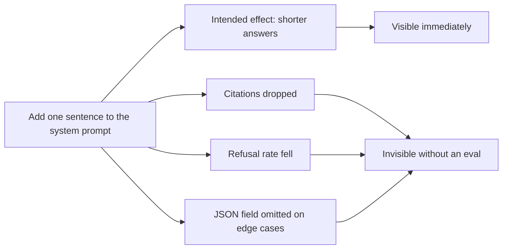

import TOCInline from '@theme/TOCInline';

# Prompt Evaluation

<TOCInline toc={toc} minHeadingLevel={2} maxHeadingLevel={2} />

:::tip[In this guide]
Scoped to prompts specifically: why a prompt edit is a code change that regresses
silently, the smallest harness worth building, how to compare two prompts without
fooling yourself, prompts as versioned artifacts, and cost and latency as metrics
that can veto a quality win.
:::

## What Is It?

**Prompt evaluation** is measuring whether a prompt change made your system
better, on cases you chose in advance, with a method that would have caught the
change making it worse.

This page is narrow on purpose. Dataset construction, metric design, judge
calibration and CI wiring are a broader discipline covered in
[Evaluation](../12-evaluation-testing-and-observability/index.mdx), with the pipeline mechanics in
[Eval in CI](../12-evaluation-testing-and-observability/05-eval-in-ci.mdx). What follows is the part
specific to prompts: versioning them, comparing two of them fairly, and
avoiding the mistakes people make when the artifact under test is a string.

## Why Does It Matter?

A prompt is code. It controls program behaviour, it is deployed, and it breaks
things when it changes. But it has none of the safety net code has:

| Code has | Prompts have |
| --- | --- |
| A compiler that rejects invalid syntax | Nothing. Any string is a valid prompt |
| A type system that catches contract changes | Nothing. The output contract is prose |
| Tests that fail loudly on regression | Whatever you built, or nothing |
| Deterministic behaviour you can diff | Sampling variance on top of behaviour change |
| Code review where a reviewer can reason about control flow | A reviewer reading English and guessing |

The consequence is that prompt regressions are **silent and lateral**. You add
"be concise" to fix verbose answers. It works. It also makes the model drop
citations, because citations are verbose. Nothing errors. Latency improves. Cost
drops. The dashboard looks great, and groundedness quietly fell six points.



Prompts are also **globally coupled**. A change to the system prompt affects
every request type at once. There is no module boundary and no blast-radius
limit. That is the specific reason eyeballing one example is not enough: the
example you checked is the one you were thinking about.

## A Minimum Viable Prompt Eval

You do not need a platform. You need 20-40 cases, a scorer, and a before/after
comparison. That is a couple of hours of work and it catches most of what
matters.

**Choosing the cases.** 20-40 is enough if they are chosen rather than sampled
at random:

| Case class | How many | Why |
| --- | --- | --- |
| Common happy path | 8 – 12 | Protects the behaviour you already have |
| Known past failures | 5 – 10 | Regression tests. Every bug you fixed becomes a case |
| Out of scope / unanswerable | 3 – 5 | Catches a prompt change that broke refusal |
| Adversarial or ambiguous input | 3 – 5 | Catches brittleness |
| Edge-shaped input: empty, huge, non-English, special characters | 3 – 5 | Catches the crashes |

**Prefer deterministic scorers.** Every assertion you can write in Python is a
check with zero variance, zero cost and zero calibration debt. Only reach for a
judge when no mechanical check exists.

```python
import asyncio
import statistics
import time
from typing import Awaitable, Callable, Protocol
from pydantic import BaseModel, Field


class Case(BaseModel):
    id: str
    inputs: dict[str, str]
    slice: str = "default"
    must_contain: list[str] = Field(default_factory=list)
    must_not_contain: list[str] = Field(default_factory=list)
    must_be_json: bool = False
    expect_refusal: bool = False
    max_words: int | None = None


class Scorer(Protocol):
    name: str

    def __call__(self, case: Case, output: str) -> bool: ...


class CaseResult(BaseModel):
    case_id: str
    slice: str
    output: str
    scores: dict[str, bool]
    latency_ms: float
    prompt_tokens: int
    completion_tokens: int

    @property
    def passed(self) -> bool:
        return all(self.scores.values())


def deterministic_scorers() -> list[Scorer]:
    """Every one of these is free, instant and has no variance.
    Exhaust this list before adding a judge."""

    def contains(case: Case, output: str) -> bool:
        low = output.lower()
        return all(s.lower() in low for s in case.must_contain)

    def excludes(case: Case, output: str) -> bool:
        low = output.lower()
        return all(s.lower() not in low for s in case.must_not_contain)

    def valid_json(case: Case, output: str) -> bool:
        if not case.must_be_json:
            return True
        import json

        try:
            json.loads(output)
        except (ValueError, TypeError):
            return False
        return True

    def refusal(case: Case, output: str) -> bool:
        refused = "do not cover this" in output.lower()
        return refused == case.expect_refusal

    def length(case: Case, output: str) -> bool:
        return case.max_words is None or len(output.split()) <= case.max_words

    scorers: list[Scorer] = []
    for fn, name in (
        (contains, "contains"),
        (excludes, "excludes"),
        (valid_json, "valid_json"),
        (refusal, "refusal"),
        (length, "length"),
    ):
        fn.name = name  # type: ignore[attr-defined]
        scorers.append(fn)  # type: ignore[arg-type]
    return scorers
```

The harness itself. Note that it records tokens and latency alongside
correctness — those are results, not telemetry.

```python
class RunReport(BaseModel):
    prompt_id: str
    prompt_version: str
    model: str
    params: dict[str, float]
    results: list[CaseResult]

    @property
    def pass_rate(self) -> float:
        return (
            sum(r.passed for r in self.results) / len(self.results)
            if self.results
            else 0.0
        )

    def pass_rate_by_slice(self) -> dict[str, float]:
        by_slice: dict[str, list[bool]] = {}
        for r in self.results:
            by_slice.setdefault(r.slice, []).append(r.passed)
        return {k: sum(v) / len(v) for k, v in sorted(by_slice.items())}

    def failures_by_scorer(self) -> dict[str, int]:
        counts: dict[str, int] = {}
        for r in self.results:
            for name, ok in r.scores.items():
                if not ok:
                    counts[name] = counts.get(name, 0) + 1
        return dict(sorted(counts.items(), key=lambda kv: -kv[1]))

    @property
    def p95_latency_ms(self) -> float:
        values = sorted(r.latency_ms for r in self.results)
        return values[int(0.95 * (len(values) - 1))] if values else 0.0

    @property
    def mean_prompt_tokens(self) -> float:
        return statistics.mean(r.prompt_tokens for r in self.results) if self.results else 0.0


async def run_eval(
    prompt_id: str,
    prompt_version: str,
    model: str,
    params: dict[str, float],
    render: Callable[[dict[str, str]], list[dict]],
    complete: Callable[..., Awaitable[tuple[str, int, int]]],
    cases: list[Case],
    scorers: list[Scorer],
    concurrency: int = 8,
) -> RunReport:
    """complete() returns (text, prompt_tokens, completion_tokens)."""
    semaphore = asyncio.Semaphore(concurrency)

    async def one(case: Case) -> CaseResult:
        async with semaphore:
            started = time.perf_counter()
            text, p_tok, c_tok = await complete(
                messages=render(case.inputs), model=model, **params
            )
            elapsed = (time.perf_counter() - started) * 1000
        return CaseResult(
            case_id=case.id,
            slice=case.slice,
            output=text,
            scores={s.name: s(case, text) for s in scorers},
            latency_ms=elapsed,
            prompt_tokens=p_tok,
            completion_tokens=c_tok,
        )

    results = await asyncio.gather(*(one(c) for c in cases))
    return RunReport(
        prompt_id=prompt_id,
        prompt_version=prompt_version,
        model=model,
        params=params,
        results=list(results),
    )
```

Run it against the current prompt, save the report, change the prompt, run
again, diff. The diff is the deliverable — not the absolute pass rate.

## Comparing Two Prompts Properly

Most prompt comparisons are invalid because something other than the prompt
changed. Hold these fixed:

| Must be identical | Why |
| --- | --- |
| Model, pinned to a dated version | A floating alias can change under you mid-comparison |
| All decoding parameters | Temperature 0.7 versus 0.2 dominates any prompt effect. See [Decoding & Sampling](../03-llm-fundamentals/05-decoding-and-sampling.mdx) |
| The case set, exactly | Adding two cases changes the denominator |
| The scorer and its version | A rubric edit between runs invalidates the comparison |
| Retrieved context, where applicable | Re-running retrieval introduces a second variable. Freeze the retrieved chunks |
| Time window, roughly | Provider-side changes happen |

Then two things people skip:

**Multiple samples per case.** One sample per case at non-zero temperature means
your diff includes sampling noise. With k samples you can separate the two:

```python
from pydantic import BaseModel


class CaseStability(BaseModel):
    case_id: str
    k: int
    pass_count: int

    @property
    def pass_rate(self) -> float:
        return self.pass_count / self.k

    @property
    def flaky(self) -> bool:
        """Neither reliably passing nor reliably failing. A flaky case cannot
        contribute to a before/after conclusion."""
        return 0 < self.pass_count < self.k
```

Run k=3 to k=5 at your production temperature. If a third of your cases are
flaky, your eval cannot resolve a small change and you need either more samples
or a lower temperature for the comparison.

**Pairwise, not absolute.** For anything scored by a judge, compare the two
outputs side by side rather than scoring each independently. A judge asked for an
absolute score does not hold a stable standard across runs; the same answer
scores 3 one call and 4 the next. Asked which of two concrete outputs is better,
it is far more stable. Swap positions and only count a win when both orderings
agree — the full comparator, with the position-bias mechanics, is in
[LLM-as-Judge](../12-evaluation-testing-and-observability/04-llm-as-judge.mdx).

The result you get from pairwise is relative: "candidate beats baseline on 68%
of decided cases". For a ship decision that is what you wanted anyway.

**How big a difference is real?** With 30 cases, a 2-case swing is 6.7% and is
inside the noise. Rough guidance: with fewer than 50 cases, do not act on
anything under a 10-point move. If you need to detect smaller changes, you need
more cases — there is no clever way around it.

## Prompts as Versioned Artifacts

The single highest-leverage practice on this page, and it has nothing to do with
scoring.

A prompt interpolated inline in a function body cannot be diagnosed. When
groundedness drops on Tuesday, the question is "which prompt produced this
answer" — and if the answer is "whatever was in `main` at the time", you are
reading git blame and guessing.

The three rules:

1. **Store prompts outside the code path.** Files, a database, or a config
   service. Versioned, reviewable, diffable on their own.
2. **Attach a version id to every request and every log line.** Not the commit
   SHA — a prompt version that changes only when the prompt changes.
3. **Record the model and parameters the version was validated against.** A
   prompt is only validated as a triple of prompt, model and decoding
   parameters. Moving it to a new model voids the validation.

```python
import hashlib
from datetime import date
from typing import Literal
from pydantic import BaseModel, Field, computed_field


class ValidatedAgainst(BaseModel):
    """A prompt is validated as a triple. Changing the model voids it."""

    model: str = Field(description="Pinned, dated model id — never a floating alias")
    temperature: float
    top_p: float = 1.0
    max_tokens: int
    eval_suite: str
    pass_rate: float
    validated_on: date


class PromptVersion(BaseModel):
    prompt_id: str = Field(description="Stable logical name, e.g. 'rag_answer'")
    version: str = Field(description="Monotonic, e.g. 'v7'")
    template: str
    input_variables: list[str]
    status: Literal["draft", "canary", "live", "retired"] = "draft"
    validated: ValidatedAgainst | None = None
    notes: str = ""

    @computed_field  # type: ignore[prop-decorator]
    @property
    def content_hash(self) -> str:
        """Catches the case where someone edits a template without bumping
        the version. Log this next to the version id."""
        return hashlib.sha256(self.template.encode()).hexdigest()[:12]

    @property
    def ref(self) -> str:
        return f"{self.prompt_id}@{self.version}#{self.content_hash}"

    def render(self, **kwargs: str) -> str:
        missing = set(self.input_variables) - set(kwargs)
        if missing:
            raise KeyError(f"{self.ref} missing variables: {sorted(missing)}")
        return self.template.format(**kwargs)


class PromptRegistry(BaseModel):
    versions: dict[str, PromptVersion] = Field(default_factory=dict)

    def add(self, version: PromptVersion) -> None:
        self.versions[f"{version.prompt_id}@{version.version}"] = version

    def live(self, prompt_id: str) -> PromptVersion:
        live = [
            v
            for v in self.versions.values()
            if v.prompt_id == prompt_id and v.status == "live"
        ]
        if len(live) != 1:
            raise LookupError(f"expected exactly one live {prompt_id}, found {len(live)}")
        return live[0]

    def promotable(self, version: PromptVersion, min_pass_rate: float = 0.9) -> bool:
        """Gate: a version cannot go live unvalidated."""
        return (
            version.validated is not None
            and version.validated.pass_rate >= min_pass_rate
        )
```

`content_hash` exists because of a real failure: someone edits a template, ships
it, and the version id still says `v7`. Now two different prompts are logged
under one id and your historical comparison is nonsense. Log the ref — id,
version and hash — on every request. `rag_answer@v7#3f9a1c2b4d8e` in a log line
is the difference between a ten-minute diagnosis and an afternoon.

## Per-Slice Reporting

An average is a summary that hides the thing you need to see. A prompt change
that improves the common case by 5 points and destroys the refusal case shows up
as a modest improvement.

```python
from pydantic import BaseModel


class SliceDelta(BaseModel):
    slice: str
    n: int
    baseline: float
    candidate: float

    @property
    def delta(self) -> float:
        return self.candidate - self.baseline

    @property
    def regression(self) -> bool:
        """Small slices move a lot on one case. Require both a meaningful
        delta and enough cases for it to mean something."""
        return self.delta < -0.05 and self.n >= 5


def compare_by_slice(baseline: RunReport, candidate: RunReport) -> list[SliceDelta]:
    base = baseline.pass_rate_by_slice()
    cand = candidate.pass_rate_by_slice()
    counts: dict[str, int] = {}
    for r in baseline.results:
        counts[r.slice] = counts.get(r.slice, 0) + 1
    return sorted(
        (
            SliceDelta(
                slice=s, n=counts.get(s, 0), baseline=base[s], candidate=cand.get(s, 0.0)
            )
            for s in base
        ),
        key=lambda d: d.delta,
    )
```

Slices worth having for prompt work specifically: question type, whether the
expected behaviour is a refusal, input length band, language, whether retrieval
returned anything, and output format required. The refusal slice is the one most
often missing, and it is the one most often broken by a prompt edit — because
every instruction you add to make the model more helpful makes it less willing
to decline.

**Rule: a regression on any slice blocks the change, even if the average
improved.** Then decide explicitly whether to accept the trade-off. The point is
that it is a decision rather than an accident.

## A/B Testing Prompts in Production

Offline evals tell you whether the prompt does what you specified. Production
A/B tells you whether users are better off. You need both, and the second is
harder than it looks for free-text output.

The variance problem: your offline scorer is a clean binary. Your production
signal is thumbs-up rate, conversation length, task completion, or escalation
rate — all of which are noisy, driven mostly by factors unrelated to your prompt,
and sparse. Thumbs are given by a small single-digit percentage of users, and
those users are not a random sample.

Rough sample-size intuition for a binary production metric: detecting a 2-point
absolute change on a 30% baseline takes **thousands of observations per arm**.
If your feedback rate is 3%, that is tens of thousands of sessions. Weeks, not
an afternoon.

| Signal | Usable for prompt A/B? | Caveat |
| --- | --- | --- |
| Explicit thumbs up/down | Weakly | Sparse and heavily self-selected |
| Thumbs-down rate | Better than thumbs-up | Negative feedback is less biased and more actionable |
| Task completion / conversion | Yes, if you have it | The best signal available, and usually the hardest to attribute |
| Escalation to human | Yes | Clear, costly, and reasonably attributable |
| Conversation length | Ambiguous | Longer is engagement or confusion; you cannot tell which |
| Regeneration / retry rate | Yes | Strong dissatisfaction proxy and cheap to collect |
| Copy / accept rate | Yes, for code and drafts | Good proxy where the surface supports it |
| Latency and cost per session | Yes | Deterministic. Measure these regardless |

What you can realistically conclude: large regressions show up quickly and
clearly — ship a broken prompt and the retry rate moves within hours. Small
improvements are usually not measurable at the traffic most teams have. Be
honest about that rather than running a two-week test and reading noise as a
result.

The practical sequencing:

1. Gate on the offline eval. No slice regressions.
2. Canary to a small share of traffic, watching **operational** signals only —
   error rate, truncation rate, latency, cost, schema-validation failures. These
   move fast and are unambiguous.
3. Then a proper split for quality signals, sized honestly, with the stop
   criterion written down before you start.
4. Keep the prompt version id in every event so the analysis is a group-by
   rather than a reconstruction.

## Overfitting to Your Eval Set

The failure mode of iterating on an eval is that you start optimising the eval.
After the twentieth edit, your prompt encodes the idiosyncrasies of 30 cases.

| Symptom | What it means |
| --- | --- |
| Pass rate climbing while production feedback is flat | You are fitting the eval |
| A prompt with case-specific hints in it | Direct overfit. Strings from your test cases should not appear in the prompt |
| Every edit improves the score | Suspicious. Real changes trade off |
| Pass rate near 100% for several versions | The set stopped discriminating; add harder cases |
| A new eval set scores much lower than the old one | Confirmation of overfit |

Defences:

- **Hold out a set you never iterate against.** Split your cases. Develop
  against the dev set; run the held-out set at the end, before shipping, and do
  not look at individual held-out failures while editing the prompt. If you do
  look, that case is burned — move it to dev and replace it.
- **Refresh from real traffic.** Add 10-20 new cases monthly, sampled from real
  inputs including recent failures. A static eval set rots as usage shifts.
- **Keep a few frozen canaries.** Cases that must never break. If one breaks,
  stop and understand why before anything else.
- **Report the gap.** Dev pass rate and held-out pass rate side by side. A
  widening gap is your overfit gauge, and it is two numbers.

A held-out set is only as good as your discipline about it. The temptation to
peek at a held-out failure is strong. Write down the rule and follow it.

## Cost and Latency Are Prompt Metrics

A prompt that scores two points higher and costs 40% more per request has not
obviously won. Make the trade-off visible in the comparison rather than arguing
about it after someone notices the bill.

```python
from pydantic import BaseModel


class PromptComparison(BaseModel):
    """Side-by-side including the numbers that can veto a quality win."""

    prompt_ref: str
    pass_rate: float
    worst_slice: str
    worst_slice_rate: float
    mean_prompt_tokens: float
    mean_completion_tokens: float
    p50_latency_ms: float
    p95_latency_ms: float
    input_price_per_mtok: float
    output_price_per_mtok: float

    @property
    def cost_per_1k_requests(self) -> float:
        return 1_000 * (
            self.mean_prompt_tokens / 1e6 * self.input_price_per_mtok
            + self.mean_completion_tokens / 1e6 * self.output_price_per_mtok
        )

    def row(self) -> str:
        return (
            f"{self.prompt_ref:<30} pass={self.pass_rate:.1%} "
            f"worst[{self.worst_slice}]={self.worst_slice_rate:.1%} "
            f"in={self.mean_prompt_tokens:.0f} out={self.mean_completion_tokens:.0f} "
            f"p95={self.p95_latency_ms:.0f}ms ${self.cost_per_1k_requests:.2f}/1k"
        )


def verdict(baseline: PromptComparison, candidate: PromptComparison) -> str:
    quality = candidate.pass_rate - baseline.pass_rate
    cost_ratio = (
        candidate.cost_per_1k_requests / baseline.cost_per_1k_requests
        if baseline.cost_per_1k_requests
        else 1.0
    )
    latency_ratio = (
        candidate.p95_latency_ms / baseline.p95_latency_ms
        if baseline.p95_latency_ms
        else 1.0
    )
    if candidate.worst_slice_rate < baseline.worst_slice_rate - 0.05:
        return f"BLOCK: slice regression on {candidate.worst_slice}"
    if quality < 0.0:
        return "BLOCK: quality regression"
    if quality < 0.02 and (cost_ratio > 1.2 or latency_ratio > 1.2):
        return f"REJECT: +{quality:.1%} quality for {cost_ratio:.2f}x cost"
    return f"SHIP: +{quality:.1%} quality at {cost_ratio:.2f}x cost"
```

Where prompt tokens quietly accumulate: few-shot examples added one at a time,
an output format spec restated three times, a long policy preamble that grew by
accretion, and tool definitions nobody audits. Each addition seemed free. The
input-token mean is where you see the total, and it is on every request forever.

The input side of this — budget allocation, cache-friendly ordering and
per-component accounting — is
[Context Engineering](./04-context-engineering.mdx). Prefix caching in
particular changes the cost arithmetic a lot, so measure cost with caching
enabled as it will run in production.

## Prompt-Change Checklist

Before shipping a prompt edit:

- [ ] The change is in a versioned artifact, not interpolated inline.
- [ ] The version id was bumped, and the content hash changed with it.
- [ ] The dev eval ran on both old and new, same model, same parameters, same
      cases, same scorer version.
- [ ] k samples per case at production temperature; flaky-case rate recorded.
- [ ] Per-slice deltas reviewed; no regression on any slice with n ≥ 5.
- [ ] The refusal slice specifically checked.
- [ ] The held-out set ran once, at the end, and the dev/held-out gap is noted.
- [ ] Mean prompt tokens, completion tokens, p95 latency and cost per 1k
      requests recorded for both.
- [ ] Structured-output schema validation still at 100%.
- [ ] Frozen canary cases all still pass.
- [ ] `validated_against` recorded: model, parameters, suite, pass rate, date.
- [ ] Rollback is a config change, not a deploy.

The last item is worth more than most of the others. If reverting a prompt
requires a code deploy, you will hesitate at 2am; if it is a registry status
flip, you will revert in thirty seconds and investigate calmly.

## Anti-Patterns

| Anti-pattern | Why it misleads | Do instead |
| --- | --- | --- |
| Eyeballing one example | You check the case you were already thinking about; lateral breakage is invisible | 20-40 chosen cases across slices |
| Changing model and prompt together | Two variables, one result; you cannot attribute the change | One variable at a time |
| Tuning on the test set | The score measures your fitting, not your prompt | Dev set for iteration, held-out set run once |
| Comparing at different temperatures | Decoding dominates the prompt effect | Pin all decoding parameters across runs |
| Ignoring token cost | A win that triples the bill is not obviously a win | Tokens and cost in every comparison |
| One sample per case | Sampling noise reads as a prompt effect | k=3-5 samples, track flakiness |
| Absolute judge scores across runs | The judge's standard drifts between calls | Pairwise with position swapping |
| Reporting only the average | A broken slice hides behind an improved mean | Per-slice deltas, blocking on any regression |
| No prompt version in logs | A production regression cannot be traced to a change | Log `id@version#hash` on every request |
| Editing a template without bumping the version | Two prompts share one id; history becomes meaningless | Content hash, checked in CI |
| Declaring a 2-case improvement on 30 cases a win | Inside the noise | Require a 10-point move below 50 cases |
| A two-week production A/B on thumbs-up rate | Underpowered; you will read noise as signal | Size it honestly, or use retry and escalation rates |
| Evaluating with retrieval live | Retrieval variance confounds the prompt comparison | Freeze the retrieved context per case |

## Common Mistakes

- Shipping a prompt change with no before/after measurement at all.
- Interpolating prompts inline, making production regressions untraceable.
- No version id in logs, so you cannot group outcomes by prompt.
- Moving a validated prompt to a new model and assuming the validation holds.
- An eval set of only happy-path cases.
- No refusal or out-of-scope cases, so strictness regressions go unnoticed.
- Running the held-out set repeatedly and treating it as held out.
- Comparing a candidate's absolute judge score against a baseline scored last
  month with a different rubric.
- Ignoring the flaky-case rate and drawing conclusions from a noisy diff.
- Reporting quality without tokens, latency and cost.
- Measuring cost without prefix caching enabled, then being surprised either way.
- Rollback that requires a deploy.

## Interview Questions

- Why does a prompt change need evaluation when a prose edit looks harmless?
- Give a concrete example of a prompt change with a lateral regression.
- What is the smallest useful prompt eval, and what case classes belong in it?
- What must be held constant when comparing two prompts?
- Why is pairwise comparison preferred over absolute scoring for prompts?
- How many samples per case, and how do you handle flaky cases?
- With 30 cases, how large a difference would you act on? Why?
- Why store prompts outside the code path, and what do you log per request?
- Why is a content hash useful when you already have a version id?
- What does it mean that a prompt is validated as a triple?
- How would you detect that you have overfit to your eval set?
- What production signals can you realistically use to A/B test a prompt, and
  how long would it take?
- When would you reject a prompt that scored higher?

## Things to Remember

- A prompt is a code change with no compiler and no type system. It regresses
  silently and laterally.
- 20-40 chosen cases plus a deterministic scorer beats a platform you never
  finish building.
- Exhaust deterministic checks before reaching for a judge.
- Hold the model, parameters, cases, scorer and retrieved context constant.
- Pairwise with position swapping; absolute judge scores drift.
- Prompts are versioned artifacts. Log `id@version#hash` on every request.
- A prompt is validated as a triple: prompt, model, decoding parameters.
- Report per slice and block on any slice regression, especially refusal.
- Keep a held-out set and report the dev/held-out gap.
- Tokens, latency and cost belong in the comparison and can veto a quality win.
- Production A/B on free-text quality needs far more traffic than you expect.
- Make rollback a config flip.

## Mini Exercise

Take the prompt you most recently changed by feel. Write 25 cases for it: 10
happy path, 5 from bugs you remember fixing, 5 that should produce a refusal, and
5 edge-shaped inputs. Tag each with a slice.

Run the harness against the version before your change and the version after,
same model, same parameters, k=3 samples. Record pass rate per slice, mean
prompt tokens and p95 latency for both.

Two outcomes, both useful. If the change was neutral or negative on some slice,
you have just learned that your intuition about prompts is worse than you
thought — which is the normal result and the reason this page exists. If it was a
clean improvement, you now have a regression suite, and the next change is
cheaper to validate than this one was.

## Done When

- [ ] Your prompts live outside the code path with a version id and a content
      hash, and every request and log line carries the ref.
- [ ] You have 20-40 sliced cases including refusal and edge cases.
- [ ] You can run a before/after comparison with all other variables pinned.
- [ ] Your comparison includes tokens, latency and cost, and you have a held-out
      set with a known dev/held-out gap.
- [ ] Rolling back a prompt does not require a deploy.
