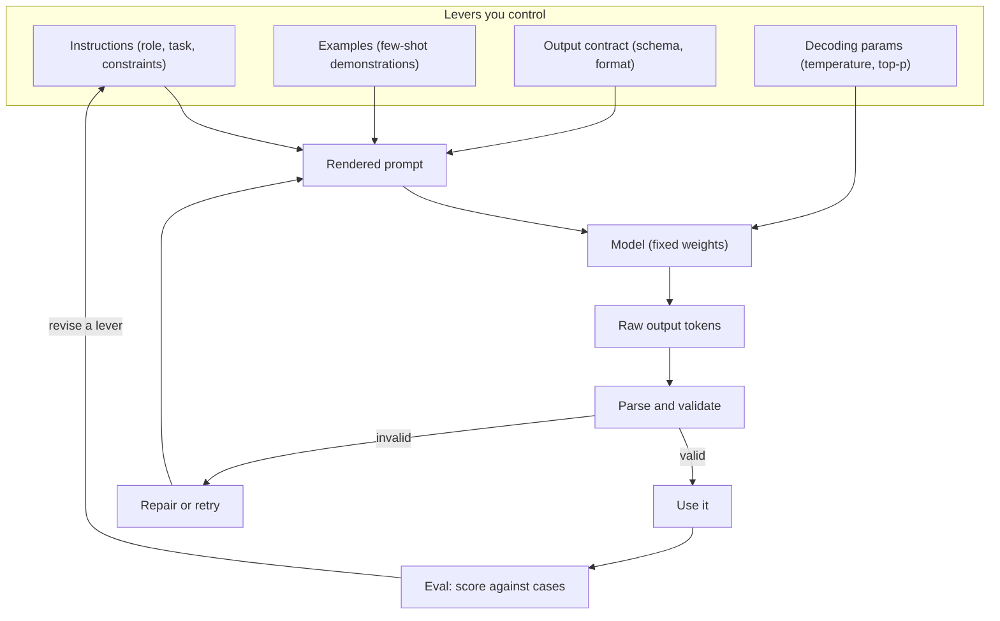

import TOCInline from '@theme/TOCInline';

# 04 · Prompt Engineering

<ProgressToggle sectionId="04-prompt-engineering" />

<TOCInline toc={toc} minHeadingLevel={2} maxHeadingLevel={2} />

:::tip[In this guide]
Prompting is the cheapest lever you have on model behaviour, and the easiest
one to cargo-cult. This section treats it as engineering: a prompt has an
anatomy, techniques have costs, output has a contract you can validate, and
every change gets measured instead of eyeballed.
:::

## Goal

Write prompts that are **reliable rather than lucky**. By the end you should be
able to take a vague task, turn it into a prompt with an explicit output
contract, parse the result in typed Python, pick the right technique for the
failure you are actually seeing, and prove a prompt change helped.

The thing that separates this from "prompt tips" lists: you will be able to say
*why* a prompt works and what it costs in tokens, latency, and money.

## Estimated Time

About 1 week. Pages 01–03 are the core and worth two or three sittings each.
Pages 04–07 are shorter but assume you have a model you can hammer with
requests.

## Prerequisites

- [03 · Local LLMs / Ollama](../03-llm-fundamentals/index.mdx) — you need a model you can actually call, locally or via an API. Everything here is empirical; reading without running is close to useless.
- [LLM Fundamentals](../03-llm-fundamentals/03-llm-fundamentals.mdx) — tokens, context, and how generation works. We build on that and do not repeat it.
- [Python](../01-python/index.mdx) — basic Python, type hints, and enough comfort with Pydantic v2 to define a model.

## What You Will Learn

1. [Prompting Fundamentals](./01-prompting-fundamentals.mdx) — a prompt as a program with a probabilistic interpreter: message roles, prompt anatomy, delimiters, ordering effects, and safe templating.
2. [Prompting Techniques](./02-prompting-techniques.mdx) — the catalog: zero-shot, few-shot, chain-of-thought, self-consistency, decomposition, step-back, priming, chaining, and when each is wasted effort.
3. [Structured Output](./03-structured-output.mdx) — getting JSON you can parse: prompt-only vs JSON mode vs constrained decoding, Pydantic v2 schemas, and a bounded repair loop.
4. [Context Engineering](./04-context-engineering.mdx) — deciding what goes into the window at all: selection, compaction, ordering, and state that survives long sessions.
5. [Hallucination Detection](./05-hallucination-detection.mdx) — why models make things up, and the practical signals for catching it before the user does.
6. [Prompt Evaluation](./06-prompt-evaluation.mdx) — turning "this feels better" into a number you can regress against in CI.
7. [Prompt Injection](./07-prompt-injection.mdx) — why instructions and data share one channel, the attack taxonomy, mitigations ranked by what actually holds, and insecure output handling.

Decoding parameters — temperature, top-p, `max_tokens` — are a property of the
model rather than the prompt, so they live in
[Decoding & Sampling](../03-llm-fundamentals/05-decoding-and-sampling.mdx).
Read that one alongside page 2; the two interact constantly.

Read 01 → 02 → 03 in order. The rest can be taken as needed, though 06 pays for
itself the moment you have two prompt variants and no way to choose, and 07 is
required reading before any prompt of yours touches untrusted text.

## The Loop and the Levers You Control

A prompt is one input to a system with exactly four knobs you own. Everything
in this section is about one of them.

Two things to read off that diagram. First, the **model weights are not a
lever** — you cannot prompt a 7B model into being a frontier model, and a lot
of wasted prompt iteration is really a model-choice problem. Second, the
**validate step is part of the prompt design**, not an afterthought. If you
cannot mechanically check the output, you cannot tell whether a prompt change
helped.

Everything outside those four levers belongs to other sections: retrieved
content is [RAG](../06-rag/index.mdx), tool schemas are
[agentic AI](../09-tool-calling-and-ai-agents/07-tool-design.mdx), and changing the weights is
[fine-tuning](../14-fine-tuning-and-model-adaptation/index.mdx).

## Interview Relevance

Prompting questions are a filter for whether you are **systematic or
superstitious**. Anyone can say "add few-shot examples." The signal is in the
follow-ups: what failure were you fixing, what did it cost in tokens, how did
you know it worked, and what did you try before that.

Expect to be asked:

- How do you get reliable JSON out of a model, and what do you do when it is invalid?
- When is chain-of-thought a waste of tokens?
- You changed a prompt and outputs "seem better." How do you prove it?
- `temperature=0` — is the output deterministic? Why not?
- A model is hallucinating product features. Walk through your options in order of cost.

The bad answer to all of these is a list of tricks. The good answer names the
symptom, picks the cheapest lever that targets it, and describes how it was
measured.

## Done When

- [ ] You can write a prompt with all six anatomy parts and explain what each one is doing.
- [ ] You can name the right technique for a given symptom, and one technique that is overrated.
- [ ] You get schema-valid structured output with a bounded repair loop, and you log the validity rate.
- [ ] You can explain what `temperature=0` does and does not guarantee.
- [ ] You never interpolate untrusted user input into a prompt with a bare f-string.
- [ ] You have a small eval set and can say whether your last prompt change was an improvement.
- [ ] You can explain why prompt injection has no complete fix, and name the mitigations that actually hold.

Next: [05 · Embeddings and Semantic Search](../05-embeddings-and-semantic-search/index.mdx).