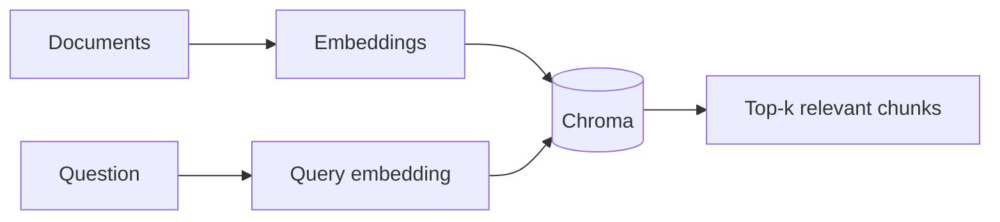

import TOCInline from '@theme/TOCInline';

# 05 · Embeddings and Semantic Search

<ProgressToggle sectionId="05-embeddings-and-semantic-search" />

<TOCInline toc={toc} minHeadingLevel={2} maxHeadingLevel={2} />

:::tip[In this guide]
The retrieval layer, end to end. Embeddings (meaning as vectors) and vector
search (fast nearest neighbors) come first. Then the engineering above them:
how ANN indexes actually work and how to tune them, how to choose a store you
can live with, how to run pgvector behind FastAPI, and how to operate any of
it once real data and real tenants show up.
:::

## Goal

Generate embeddings, store and query them, and make deliberate engineering
choices about the index, the store and the operational model — not just get a
demo working.

## Estimated Time

1–2 weeks.

## Prerequisites

- [Core AI concepts](../00-prerequisites/02-core-ai-concepts.mdx).
- [Local LLMs / Ollama](../03-llm-fundamentals/index.mdx) (we can embed with Ollama or `sentence-transformers`).
- For the pgvector page: [SQLAlchemy with FastAPI](../02-fastapi/02-deep-dives/03-sqlalchemy-with-fastapi.mdx) and the [PostgreSQL cheatsheet](../01-python/04-sql-and-databases/02-postgresql-cheatsheet-and-roadmap.mdx).

## What You Will Learn

1. [Embeddings](./01-embeddings.mdx) — what vectors capture, cosine similarity, generating them, picking a model.
2. [Vector DB with Chroma](./02-vector-db-chroma.mdx) — collections, adding documents, querying, metadata, persistence.
3. [Vector Index Internals](./03-vector-index-internals.mdx) — flat vs HNSW vs IVF vs PQ, what every tuning knob does, measuring the recall/latency curve.
4. [Choosing a Vector Store](./04-choosing-a-vector-store.mdx) — honest profiles of nine options, a decision flow, and a reversible repository interface.
5. [pgvector with FastAPI](./05-pgvector-with-fastapi.mdx) — SQLAlchemy 2.0 models, Alembic migrations, index DDL, operator matching, hybrid search in SQL.
6. [Vector Store Operations](./06-vector-store-operations.mdx) — idempotent ingestion, zero-downtime re-embedding, multi-tenancy, capacity sizing, monitoring.

Pages 1–2 are the concepts. Pages 3–6 are the engineering layer you need
before this goes anywhere near production.

## Where This Fits

## Interview Relevance

Embeddings, cosine similarity, and "how does a vector DB find neighbors?" are
core AI-engineering interview questions. The follow-ups separate candidates:
what `ef_search` controls, why a mismatched pgvector operator causes a
sequential scan, how you would re-embed a corpus without downtime, and how you
isolate tenants without leaking data.

## Done When

- [ ] You can generate embeddings for text.
- [ ] You understand cosine similarity intuitively.
- [ ] You can add and query documents in Chroma with metadata.
- [ ] You can explain HNSW's `M`, `ef_construction` and `ef_search`, and have measured recall@k against a flat ground truth.
- [ ] You can justify a vector store choice with reasons beyond "it is fast", and keep the choice reversible behind a thin interface.
- [ ] You can run pgvector behind FastAPI and prove via `EXPLAIN ANALYZE` that your query uses the index.
- [ ] Your ingestion is idempotent, your rows carry model provenance, and you know how you would re-embed the corpus with no downtime.

Next: [06 · RAG](../06-rag/index.mdx).