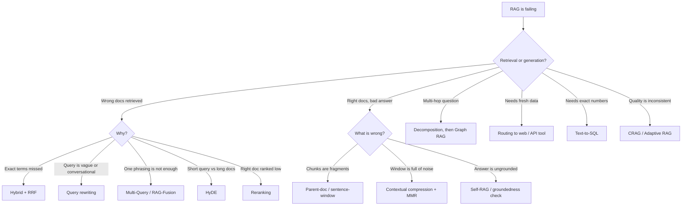

import TOCInline from '@theme/TOCInline';

# RAG Patterns: The Catalog

<TOCInline toc={toc} minHeadingLevel={2} maxHeadingLevel={2} />

:::tip[In this guide]
Every RAG pattern beyond the baseline buys accuracy with latency, money or
complexity. This page profiles the whole catalog, gives you one decision table
to pick from, a symptom-driven decision tree, and an explicit ordering of the
cheap wins to try before anything clever.
:::

## What Is It?

Baseline RAG is one shape: embed the question, fetch top-k, stuff it in a
prompt, generate. Everything called "advanced RAG" is a variation on that
shape — adding a step before retrieval, changing what gets indexed versus
what gets returned, or wrapping the whole thing in a loop.

A **RAG pattern** is a named architectural shape with a known cost. There are
maybe twenty of them in common use, and most teams need three or four.

## Why Does It Matter?

The spine of this whole page: **you are always trading something for accuracy.**

| You spend | To buy | Example patterns |
| --- | --- | --- |
| Extra LLM calls at query time | Better queries, better filtering | Multi-Query, HyDE, CRAG, reranking-by-LLM |
| Latency | Precision, recovery from bad retrieval | Reranking, self-correction loops, agentic retrieval |
| Index-time compute and storage | Query-time quality with no query-time cost | Contextual retrieval, parent-document, GraphRAG |
| Engineering complexity and ops burden | Access to question types vectors can't serve | Graph RAG, text-to-SQL, agentic RAG |
| Prompt tokens | Simplicity | Long-context "just stuff it" |

If you can't name which of those five you are spending and what you expect
back, you're not choosing a pattern — you're cargo-culting one. The most
common failure in RAG projects is adding a clever pattern to a pipeline whose
real problem was a 2,000-token chunk size.

---

## The Pattern Profiles

### Naive / baseline RAG

Embed query, vector search top-k, single prompt, single generation. One LLM
call total. This is your control group and you should keep it runnable
forever, because every pattern below has to beat it on an eval set to earn
its place.

**Use when:** always, first. **Cost:** nothing beyond the baseline.

### Hybrid RAG

Run BM25 and vector search in parallel, fuse the ranked lists with reciprocal
rank fusion. Covers the exact-term gap embeddings leave — part numbers, error
codes, rare acronyms. Mechanics are already covered in
[hybrid search](../05-rag-fundamentals/10-hybrid-search.mdx).

**Use when:** your corpus has identifiers, codes or proper nouns.
**Cost:** one extra index, no extra LLM calls, negligible latency.

### Query rewriting

One LLM call turns a messy or conversational question into a clean standalone
search query. The highest return-per-unit-effort pattern in this list for
chat-style products, because "what about the second one?" retrieves nothing
useful on its own.

**Use when:** you have multi-turn conversation, or users type keyword soup.
**Cost:** +1 LLM call, ~300-800 ms.

### Multi-Query expansion

Generate N paraphrases of the question, retrieve for each, union the results.
Compensates for the fact that one phrasing lands in one neighbourhood of
embedding space.

**Use when:** recall is the problem and you can afford fan-out.
**Cost:** +1 LLM call, N× retrieval calls.

### RAG-Fusion

Multi-Query plus RRF over the per-query result lists instead of a naive union,
so documents that several phrasings agree on rise to the top. Strictly better
ranking than plain Multi-Query for the same retrieval cost.

**Use when:** you're already doing Multi-Query. **Cost:** same as Multi-Query.

### HyDE (Hypothetical Document Embeddings)

Ask the LLM to *answer* the question from memory, then embed that fake answer
and search with it. Fixes query/document asymmetry: a short question and a
long explanatory passage live in different parts of embedding space, but a
fake answer looks like a real document.

**Use when:** short questions against prose-heavy corpora.
**Cost:** +1 generation (the expensive kind — it produces a paragraph).
**Fails when:** the model hallucinates in a plausible-but-wrong direction and
drags retrieval with it.

### Step-back prompting

Before retrieving, ask a more general version of the question ("what are the
principles of X?" before "does X apply in case Y?"), retrieve for both. Helps
when the specific question's terms don't appear anywhere but the background
concept does.

**Use when:** abstract, reasoning-heavy or multi-hop questions.
**Cost:** +1 LLM call, 2× retrieval.

### Query routing

Classify the query, then send it to the right backend: vector store, SQL,
web search, or straight to the model with no retrieval at all. The single
biggest accuracy win in systems with heterogeneous data.

**Use when:** you have more than one data source, or many queries need no
retrieval. **Cost:** +1 small classification call.

### Sentence-window retrieval

Index individual sentences for precision, but return each hit plus its
neighbouring sentences for context. Decouples retrieval granularity from
generation granularity.

**Use when:** dense factual prose where the answer is one sentence but needs
surrounding context to be interpretable. **Cost:** index-time only.

### Parent-document / small-to-big

Same idea at a coarser scale: embed small child chunks, return the larger
parent chunk or whole document that contained the hit.

**Use when:** your chunks are precise but too small to answer from.
**Cost:** index-time plus a document store lookup.

### Auto-merging / hierarchical retrieval

Build a chunk tree. If enough sibling leaves hit for the same parent, return
the parent instead of the fragments. Adaptive context size, for free at query
time.

**Use when:** structured long documents — manuals, specs, contracts.
**Cost:** more complex index, no extra LLM calls.

### Contextual retrieval

At index time, use an LLM to write a one-or-two-sentence document-level
summary of what each chunk is about, prepend it to the chunk, and embed the
combination. Chunks stop being orphaned fragments that say "it increased by
3%" with no subject.

**Use when:** chunks lose meaning out of context, which is most corpora.
**Cost:** one LLM call per chunk, once. Real money on a large corpus, but
zero query-time cost.

### Contextual compression

After retrieval, filter or summarise each chunk against the query, dropping
irrelevant sentences before they reach the prompt. Trades LLM calls for
prompt tokens and precision.

**Use when:** retrieved chunks are long and mostly off-target.
**Cost:** +1 call per chunk (or one batched call), notable latency.

### Reranking

Over-fetch, then re-score candidates with a cross-encoder and keep the best
few. Covered in depth in [reranking](../05-rag-fundamentals/11-reranking.mdx).
Still the best accuracy-per-millisecond upgrade available.

**Use when:** the right doc is retrieved but ranked 8th. **Cost:** 50-300 ms,
no LLM calls if you use a cross-encoder.

### Self-RAG

Add critique steps: is retrieval even needed, are these docs relevant, is the
answer grounded, is it useful? Originally a fine-tuned model emitting
reflection tokens; in practice people implement it as grader LLM calls.

**Use when:** correctness matters more than latency.
**Cost:** +3 to +6 LLM calls.

### Corrective RAG (CRAG)

Grade the retrieved documents. If they're good, generate. If they're bad,
rewrite the query or fall back to web search. If mixed, strip the bad ones.
The pragmatic member of the self-correcting family.

**Use when:** retrieval quality is inconsistent and you have a fallback source.
**Cost:** +2 calls on the happy path, considerably more when it corrects.

### Adaptive RAG

Route by question complexity: trivial questions get answered with no
retrieval, normal ones get single-shot RAG, hard ones get the iterative loop.
Keeps the median request fast while allowing the tail to be thorough.

**Use when:** your traffic mixes trivial and hard questions.
**Cost:** +1 classification call, variable thereafter.

### Graph RAG

Extract entities and relations into a knowledge graph, then retrieve by
traversal. The only pattern that genuinely handles multi-hop joins across
documents and global "what are the themes?" questions.

**Use when:** relationship and multi-hop questions dominate.
**Cost:** high — extraction over the whole corpus, plus a graph to maintain
and keep from going stale.

### Text-to-SQL / structured RAG

For questions about numbers, the answer isn't in prose — it's a query result.
Generate SQL against a known schema and run it read-only.

**Use when:** aggregations, counts, precise filters, time ranges.
**Cost:** +1 call, plus serious security work to do it safely.

### Agentic RAG

Give the model retrieval as a tool and let it decide whether, where and how
many times to search. Highest accuracy ceiling, worst predictability.

**Use when:** open-ended research questions where you can tolerate 10-30 s.
**Cost:** unbounded without explicit budgets.

### Multimodal RAG

Index images, tables and charts alongside text — either with a shared
embedding space (CLIP-style) or by generating text descriptions of non-text
assets and indexing those. The second approach is less elegant and usually
works better.

**Use when:** your source documents are slide decks, scanned PDFs or diagrams.
**Cost:** index-time captioning, plus a vision model at generation time.

### Long-context "just stuff it"

Skip retrieval. Put the whole document set in a 200k-1M token context window.
Often beats a mediocre RAG pipeline, which is the uncomfortable part.

**Use when:** the corpus is small and stable (a single contract, one codebase
module) and you'd rather not build a pipeline.
**Cost:** tokens, latency that scales with input size, and the
lost-in-the-middle degradation. Does not scale past a few hundred thousand
tokens of corpus.

### Cache-augmented generation

Precompute the KV cache for a fixed corpus once, reuse it on every request.
Long-context quality at a fraction of the per-request compute. Requires
provider or runtime support for cache reuse, and the corpus must be static.

**Use when:** a small, unchanging knowledge base serves high query volume.
**Cost:** infrastructure specificity; you're tied to a runtime that supports it.

---

## The Decision Table

| Pattern | Problem it solves | Extra LLM calls | Added latency | Impl. cost | Use when |
| --- | --- | --- | --- | --- | --- |
| Baseline RAG | — | 0 | — | Trivial | Always, as control |
| Hybrid + RRF | Exact terms missed | 0 | Low | Low | IDs, codes, names in corpus |
| Reranking | Right doc, wrong rank | 0 | Low-med | Low | Top-1 is often not best |
| Query rewriting | Messy/conversational queries | +1 | Low | Low | Multi-turn chat |
| Multi-Query | Low recall, one phrasing | +1 | Medium | Low | Recall is the bottleneck |
| RAG-Fusion | Ranking across phrasings | +1 | Medium | Low | Already multi-querying |
| HyDE | Query/doc asymmetry | +1 (long) | Medium | Low | Short queries, prose corpus |
| Step-back | Abstract / multi-hop | +1 | Medium | Low | Conceptual questions |
| Query routing | Mixed data sources | +1 (small) | Low | Medium | More than one backend |
| Sentence-window | Precision vs context | 0 | None | Low | Dense factual prose |
| Parent-document | Chunks too small | 0 | Low | Low-med | Precise but unusable chunks |
| Auto-merging | Variable answer size | 0 | Low | Medium | Structured long docs |
| Contextual retrieval | Orphaned chunks | 0 at query | None | Med (index) | Chunks lack context |
| Contextual compression | Noisy long chunks | +1..N | High | Medium | Window pressure |
| Self-RAG | Ungrounded answers | +3..6 | High | High | Correctness critical |
| CRAG | Inconsistent retrieval | +2..6 | High | Med-high | Have a fallback source |
| Adaptive RAG | Mixed difficulty traffic | +1..6 | Variable | High | Wide query distribution |
| Graph RAG | Multi-hop, global themes | +1..N | Med-high | Very high | Relationship questions |
| Text-to-SQL | Counts, aggregates, filters | +1 | Low-med | Med-high | Numeric/tabular truth |
| Agentic RAG | Open-ended research | 3-20+ | Very high | High | Depth over speed |
| Multimodal | Non-text sources | +N at index | Medium | High | Decks, scans, charts |
| Long-context stuffing | Pipeline complexity | 0 | High | None | Small static corpus |
| Cache-augmented | Repeated long context | 0 | Low | Med (infra) | Static KB, high volume |

Treat the latency and call columns as orders of magnitude, not benchmarks —
they depend entirely on your model and corpus.

---

## Diagnosing Before Patching

Do not pick a pattern from symptoms you haven't measured. Split every failure
into **retrieval** or **generation** first, using the methods in
[RAG evaluation](../05-rag-fundamentals/14-rag-evaluation.mdx).

The test is mechanical:

```python
def diagnose(question: str, gold_answer_text: str, pipeline) -> str:
    """Decide whether a failure is retrieval or generation."""
    chunks = pipeline.retrieve(question)
    context = "\n\n".join(c["text"] for c in chunks)

    # 1. Did the context even contain the answer?
    if not pipeline.judge_contains_answer(context, gold_answer_text):
        return "retrieval"          # fix the left half of the pipeline

    # 2. Context was fine. Did generation still get it wrong?
    answer = pipeline.generate(question, context)
    if not pipeline.judge_correct(answer, gold_answer_text):
        return "generation"         # fix the right half
    return "ok"
```

Run that over 30-50 real failures and count. Then:

| Diagnosis | Patterns that help | Patterns that won't |
| --- | --- | --- |
| Answer absent from context | Hybrid, Multi-Query, HyDE, routing, graph | Reranking, compression, bigger prompts |
| Answer present but ranked low | Reranking, RRF | Query transforms |
| Answer present, model ignored it | Reordering, compression, prompt work, smaller k | More retrieval |
| Answer spans several documents | Decomposition, graph, agentic | Bigger top-k |
| Answer needs a number or a count | Text-to-SQL | Any amount of vector search |
| Answer needs today's data | Routing to web/API search | Re-indexing more often |

---

## The Symptom Decision Tree



---

## The Ordering: Cheap Wins First

Work down this list. Measure after every step. Stop as soon as the eval
numbers are good enough, because each step costs more than the last.

1. **Fix your chunking.** Boring, and still the most common root cause. See
   [chunking strategies](../05-rag-fundamentals/05-chunking-strategies.mdx).
2. **Build an eval set.** Twenty questions with known-good sources. Without
   this, every step below is guesswork.
3. **Tune top-k.** Many pipelines retrieve 3 when they should retrieve 8, or
   20 when 5 would be cleaner.
4. **Add metadata filters.** A date or tenant filter beats any amount of
   semantic cleverness at excluding wrong-but-similar documents.
5. **Add hybrid search.** Cheap, no LLM calls, immediately fixes identifier
   queries.
6. **Add reranking.** Best accuracy-per-millisecond in the catalog.
7. **Add query rewriting** if you have conversation history.
8. **Fix chunk context** with parent-document or sentence-window retrieval.
9. **Add contextual retrieval** at index time if chunks are still orphaned.
10. **Add routing** once you have a second data source.
11. **Only now** consider Multi-Query, HyDE, CRAG, graph or agentic patterns.

Steps 1-6 cost almost nothing at query time and resolve the large majority of
RAG problems. Most teams that jump to step 11 first end up with a slow,
expensive pipeline that performs about the same as a well-tuned step 6.

---

## Where to Go Next

Each family has its own implementation page:

- [Query Transformation Patterns](./05-query-transformation.mdx) — everything
  before retrieval: rewriting, Multi-Query, RAG-Fusion, HyDE, step-back,
  decomposition, routing.
- [Context Construction Patterns](./06-context-construction.mdx) — sentence
  windows, parent documents, auto-merging, contextual retrieval and
  compression, dedup and MMR.
- [Self-Correcting RAG](./07-self-correcting-rag.mdx) — Self-RAG, CRAG,
  Adaptive RAG, with a full LangGraph loop and guardrails.
- [Graph & Structured RAG](./08-graph-and-structured-rag.mdx) — knowledge
  graphs, GraphRAG community summaries, text-to-SQL, self-query retrievers.
- [Agentic RAG](./09-agentic-rag.mdx) — retrieval as a tool, iterative
  research loops, budgets and circuit breakers.

## Common Mistakes

- Adopting a pattern you read about without diagnosing your actual failure mode.
- Stacking four patterns at once, so you can't attribute the improvement to any
  of them (or notice that one is actively hurting).
- Reaching for agentic or graph RAG while the chunk size is still untuned.
- Ignoring index-time patterns because query-time ones feel more sophisticated —
  index-time cost is paid once, query-time cost is paid forever.
- Letting the baseline pipeline rot so you no longer have anything to compare to.
- Not measuring p95 latency, only the mean, so a fan-out pattern's tail hides.
- Forgetting that every extra LLM call is another chance to fail, time out or
  get rate-limited.

## Interview Questions

- Walk me through how you'd decide whether a RAG failure is a retrieval problem
  or a generation problem.
- What's the difference between Multi-Query and RAG-Fusion?
- Why does HyDE help, and when does it backfire?
- When would you choose a graph over a vector store?
- You have a 2-second latency budget. Which advanced RAG patterns are off the
  table, and which still fit?
- Long-context models keep getting bigger. Does RAG become obsolete? Why not?
- Which patterns cost nothing at query time?

## Things to Remember

- Every pattern buys accuracy with latency, cost or complexity. Name the trade
  before you build.
- Diagnose first: retrieval failure and generation failure need opposite fixes.
- Chunking, eval, top-k, metadata, hybrid, reranking — in that order — solve
  most problems.
- Index-time patterns are usually better value than query-time ones.
- Keep the baseline runnable as a control forever.
- Long-context stuffing is a legitimate answer for small static corpora.

## Mini Exercise

Take 20 failing questions from your own system. Run the `diagnose` function
above on each and tally retrieval vs generation failures. Pick the single
pattern that the table says addresses your largest bucket, implement only
that, and re-measure. Write down the latency change alongside the quality
change — if you can't state both numbers, you don't yet know whether the
change was worth it.

## Done When

- [ ] You can classify a RAG failure as retrieval or generation with evidence.
- [ ] You can name the cost of each pattern you've adopted in LLM calls and latency.
- [ ] You can justify the order in which you tried things.
- [ ] You have a baseline pipeline you can still run for comparison.
- [ ] You can explain to someone else why you did *not* adopt agentic or graph RAG.

Next: [Query Transformation Patterns](./05-query-transformation.mdx).
