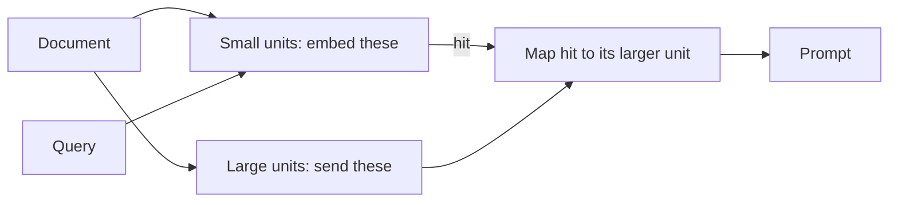

import TOCInline from '@theme/TOCInline';

# Context Construction Patterns

<TOCInline toc={toc} minHeadingLevel={2} maxHeadingLevel={2} />

:::tip[In this guide]
Retrieval gives you candidates; context construction decides what actually
reaches the prompt. This page covers the patterns that break the chunk-size
tradeoff — sentence windows, parent documents, auto-merging, contextual
retrieval and compression — plus deduplication and ordering.
:::

## What Is It?

Context construction is the step between "the retriever returned 20 things"
and "here is the prompt". It decides what gets expanded, merged, filtered,
deduplicated and in what order.

The naive pipeline skips this entirely: whatever the retriever returned, in
the order it returned it, concatenated. Every pattern on this page is a
reason not to do that.

## Why Does It Matter?

### The core tension

Chunk size is pulled in two directions at once:

| Small chunks | Large chunks |
| --- | --- |
| Precise embeddings — one topic per vector | Diluted embeddings — the vector averages several topics |
| High retrieval precision | Lower precision, more false positives |
| Fragments the model can't interpret | Enough context to actually answer |
| "It increased 3% year over year." What did? | Full section, clear subject |

Pick one size and you lose on the other axis. See
[chunking strategies](../05-rag-fundamentals/05-chunking-strategies.mdx) for
how to pick, but the real insight is that you don't have to:

:::note[The key move]
**Embed small, return large.** The thing you index and the thing you send to
the model do not have to be the same object. Every pattern in this file is a
variation on that decoupling.
:::



---

## Sentence-Window Retrieval

Index individual sentences. On a hit, return that sentence plus its `k`
neighbours on each side.

```python
from dataclasses import dataclass, field


@dataclass
class SentenceNode:
    doc_id: str
    index: int          # position within the document
    text: str
    metadata: dict = field(default_factory=dict)


def build_sentence_nodes(doc_id: str, sentences: list[str]) -> list[SentenceNode]:
    return [
        SentenceNode(doc_id=doc_id, index=i, text=s)
        for i, s in enumerate(sentences)
    ]


def expand_window(
    hit: SentenceNode,
    sentences_by_doc: dict[str, list[str]],
    window: int = 3,
) -> str:
    """Return the hit sentence with `window` neighbours on each side."""
    sentences = sentences_by_doc[hit.doc_id]
    start = max(0, hit.index - window)
    end = min(len(sentences), hit.index + window + 1)
    return " ".join(sentences[start:end])
```

Why this works: the embedding of a single sentence is sharp, because a
sentence is about one thing. But a single sentence is often unusable as
context — pronouns point outside it, and the qualifying clause is in the next
sentence. The window restores readability without blurring the vector.

Best fit: dense factual prose — reference docs, legal text, research papers,
anything where the answer is a sentence but the meaning depends on its
neighbours. Poor fit: lists, tables and code, where sentence boundaries are
meaningless.

Use `window=2` or `3` as a starting point. Larger windows start to overlap,
which pushes you toward deduplication (below).

---

## Parent-Document / Small-to-Big

Same idea, coarser granularity. Split each document twice: into large parent
chunks and small child chunks. Embed the children. On a hit, return the
parent.

```python
import uuid
from langchain_text_splitters import RecursiveCharacterTextSplitter
from langchain_core.documents import Document

parent_splitter = RecursiveCharacterTextSplitter(chunk_size=2000, chunk_overlap=0)
child_splitter = RecursiveCharacterTextSplitter(chunk_size=350, chunk_overlap=50)


def index_small_to_big(
    docs: list[Document], vectorstore, parent_store: dict[str, str]
) -> None:
    """Embed child chunks; keep parents in a plain key-value store."""
    children: list[Document] = []
    for doc in docs:
        for parent in parent_splitter.split_documents([doc]):
            parent_id = str(uuid.uuid4())
            parent_store[parent_id] = parent.page_content
            for child in child_splitter.split_documents([parent]):
                child.metadata = {**child.metadata, "parent_id": parent_id}
                children.append(child)
    vectorstore.add_documents(children)


def retrieve_parents(
    query: str, vectorstore, parent_store: dict[str, str], top_k: int = 4
) -> list[str]:
    hits = vectorstore.similarity_search(query, k=top_k * 3)
    seen: set[str] = set()
    parents: list[str] = []
    for hit in hits:
        parent_id = hit.metadata["parent_id"]
        if parent_id in seen:
            continue                      # several children, one parent
        seen.add(parent_id)
        parents.append(parent_store[parent_id])
        if len(parents) == top_k:
            break
    return parents
```

The over-fetch (`top_k * 3`) matters: several children frequently map to the
same parent, so you need headroom to end up with `top_k` *distinct* parents.
Without it you silently return two parents when you asked for four.

LangChain ships `ParentDocumentRetriever` which does this with a
`ByteStore`/`InMemoryStore` for parents. The hand-rolled version above makes
the mechanics obvious; the library version is what you'd actually ship. Check
current docs for the exact constructor — this API has moved between versions.

### Sentence-window vs parent-document

| | Sentence-window | Parent-document |
| --- | --- | --- |
| Indexed unit | One sentence | ~300-400 char chunk |
| Returned unit | Hit plus N neighbours | ~2000 char parent |
| Boundary respect | Ignores structure | Respects parent boundaries |
| Best for | Factual prose | Mixed documents, how-to guides |
| Context size | Tightly controlled | Fixed by parent size |

---

## Auto-Merging / Hierarchical Retrieval

Build a tree of chunks — large, medium, small — and link each node to its
parent. Retrieve over the leaves. Then: **if enough leaf siblings of the same
parent were retrieved, replace them with the parent.**

```python
from collections import defaultdict


def auto_merge(
    hits: list[dict],
    nodes_by_id: dict[str, dict],
    merge_threshold: float = 0.5,
) -> list[dict]:
    """Replace sibling leaf hits with their parent when enough siblings hit.

    hits: retrieved leaf nodes, each with {"id", "parent_id", "text"}
    nodes_by_id: every node, each with {"text", "child_ids", "parent_id"}
    """
    by_parent: dict[str, list[dict]] = defaultdict(list)
    orphans: list[dict] = []
    for hit in hits:
        parent_id = hit.get("parent_id")
        (by_parent[parent_id].append(hit) if parent_id else orphans.append(hit))

    merged: list[dict] = list(orphans)
    for parent_id, sibling_hits in by_parent.items():
        total_siblings = len(nodes_by_id[parent_id]["child_ids"])
        ratio = len(sibling_hits) / max(total_siblings, 1)
        if ratio >= merge_threshold:
            merged.append({"id": parent_id, **nodes_by_id[parent_id]})
        else:
            merged.extend(sibling_hits)
    return merged
```

Run it recursively if you have more than two levels — a merged parent can
itself trigger a merge with its siblings.

The appeal is **adaptive context size at zero query-time cost**. A narrow
question that hits one leaf gets one leaf. A broad question that hits five
leaves in the same section gets the whole section, coherently ordered, instead
of five fragments with gaps between them.

Best fit: documents with real hierarchy — API references, manuals,
specifications, legal agreements with nested clauses. For a flat pile of
unrelated support tickets the tree adds complexity for nothing.

LlamaIndex implements this as `AutoMergingRetriever` over a
`HierarchicalNodeParser`.

---

## Contextual Retrieval

The problem this solves is the single most common silent failure in RAG: a
chunk that is meaningless out of context.

```text
Chunk as stored:
  "Revenue increased 3% quarter over quarter, driven primarily by
   enterprise renewals."

What the embedding cannot know:
  which company, which quarter, which product line, which document
```

A query like "Acme Q3 2024 enterprise revenue" will not match that chunk,
because the chunk never says "Acme", "Q3" or "2024".

The fix: at index time, ask an LLM to write a short situating sentence for
each chunk given the whole document, prepend it, and embed the combination.

```python
import asyncio
from langchain_core.prompts import ChatPromptTemplate
from langchain_core.output_parsers import StrOutputParser

CONTEXTUALIZE = ChatPromptTemplate.from_template(
    "Here is a document:\n\n<document>\n{document}\n</document>\n\n"
    "Here is a chunk from that document:\n\n<chunk>\n{chunk}\n</chunk>\n\n"
    "Write one or two short sentences that situate this chunk within the "
    "document, naming the entities, time period and section it belongs to. "
    "Answer with only the situating sentences."
)

contextualizer = CONTEXTUALIZE | llm | StrOutputParser()


async def contextualize_chunks(
    document: str, chunks: list[str], concurrency: int = 8
) -> list[str]:
    sem = asyncio.Semaphore(concurrency)

    async def one(chunk: str) -> str:
        async with sem:
            context = await contextualizer.ainvoke(
                {"document": document, "chunk": chunk}
            )
        return f"{context.strip()}\n\n{chunk}"

    return await asyncio.gather(*(one(c) for c in chunks))
```

Store the contextualised text for embedding. You can show the model either
the contextualised version (slightly redundant but harmless) or the original
chunk at generation time — the context sentence exists mainly to fix the
*vector*.

:::note[Making it affordable with prompt caching]
The naive version re-sends the whole document with every chunk. For a 50-chunk
document that's 50× the document in input tokens. Providers that support
prompt caching (Anthropic, OpenAI, Google all offer some form) let you mark
the document prefix as cacheable, so the repeated portion is billed at a large
discount and processed faster. Order the prompt document-first so the cacheable
prefix is stable, process all chunks of a document together within the cache
TTL, and the cost drops by roughly an order of magnitude. Check your
provider's current caching API — the parameter names differ and have changed.
:::

Also worth doing: generate a BM25 index over the contextualised chunks too.
The added entity names and dates are exactly the kind of exact terms keyword
search is good at, so contextual retrieval and hybrid search compound.

This is an index-time pattern, which makes it unusually good value. You pay
once per chunk, forever, and query-time latency is unchanged.

---

## Contextual Compression

Candidates are often long and mostly irrelevant — one useful sentence in a
2,000-character chunk. Compression filters or rewrites them against the query
before prompting.

Three variants, in increasing cost:

```python
# 1. Embedding filter — no LLM calls. Drop chunks below a similarity floor,
#    or sentences within a chunk that are unrelated to the query.
import numpy as np


def filter_sentences(query_vec, sentences, sentence_vecs, threshold=0.25):
    sims = sentence_vecs @ query_vec / (
        np.linalg.norm(sentence_vecs, axis=1) * np.linalg.norm(query_vec)
    )
    return [s for s, sim in zip(sentences, sims) if sim >= threshold]
```

```python
# 2. LLM extraction — one call per chunk, pulls only relevant spans.
EXTRACT = ChatPromptTemplate.from_template(
    "Extract only the sentences from the passage that help answer the question. "
    "Copy them verbatim. If none are relevant, return the single word NONE.\n\n"
    "Question: {question}\n\nPassage:\n{passage}"
)

extractor = EXTRACT | llm | StrOutputParser()


async def compress(question: str, chunks: list[str]) -> list[str]:
    results = await asyncio.gather(
        *(extractor.ainvoke({"question": question, "passage": c}) for c in chunks)
    )
    return [r.strip() for r in results if r.strip() and r.strip() != "NONE"]
```

```python
# 3. LLM relevance gate — cheapest LLM option: a yes/no per chunk, batched
#    into one call, keeping only the chunks the model votes to keep.
```

Honest assessment: **compression is usually not worth it.** It adds an LLM
call per chunk on the critical path to save prompt tokens that are now cheap,
and verbatim-extraction prompts drop qualifying context surprisingly often
("processed within 5 days" survives, "unless submitted after 30 days" does
not). Reach for it only when you've measured that your window is genuinely
the bottleneck. The embedding filter in variant 1 captures most of the benefit
for none of the cost — start there.

---

## Late Chunking and Long-Context Embedding

A newer alternative worth knowing. Instead of chunking then embedding, embed
the *whole document* with a long-context embedding model, keep the token-level
output embeddings, and only then pool them into chunk vectors.

Each chunk's vector is computed with attention over the entire document, so it
carries document-level context without any LLM call — the same benefit as
contextual retrieval, at embedding cost instead of generation cost.

Constraints: you need an embedding model with a long context window (8k+) that
exposes token-level outputs, which rules out most hosted embedding APIs that
return only a pooled vector. Document length is still capped by the model's
window. The idea is sound and the tooling is immature — check what your
embedding stack actually supports before planning around it.

---

## Deduplication and Diversity

Over-fetching plus overlapping chunks plus Multi-Query fan-out reliably
produces near-duplicate context. Five copies of the same paragraph in the
window is strictly worse than one copy plus four different paragraphs.

### Exact and near-duplicate removal

```python
import hashlib
import re


def normalize(text: str) -> str:
    return re.sub(r"\s+", " ", text.strip().lower())


def dedupe_exact(chunks: list[dict]) -> list[dict]:
    seen: set[str] = set()
    out: list[dict] = []
    for chunk in chunks:
        digest = hashlib.sha256(normalize(chunk["text"]).encode()).hexdigest()
        if digest not in seen:
            seen.add(digest)
            out.append(chunk)
    return out


def dedupe_near(chunks: list[dict], vectors, threshold: float = 0.95) -> list[dict]:
    """Drop a chunk if it is near-identical to one already kept."""
    kept_idx: list[int] = []
    for i in range(len(chunks)):
        if all(
            float(vectors[i] @ vectors[j]
                  / (np.linalg.norm(vectors[i]) * np.linalg.norm(vectors[j])))
            < threshold
            for j in kept_idx
        ):
            kept_idx.append(i)
    return [chunks[i] for i in kept_idx]
```

### MMR (Maximal Marginal Relevance)

Dedup removes copies. MMR goes further: it actively rewards novelty, picking
each next chunk to maximise relevance to the query *minus* similarity to what
you've already chosen.

```python
def mmr_select(
    query_vec,
    candidate_vecs,
    candidates: list[dict],
    top_k: int = 5,
    lambda_mult: float = 0.6,
) -> list[dict]:
    """lambda_mult=1.0 is pure relevance; 0.0 is pure diversity."""

    def cos(a, b) -> float:
        return float(a @ b / (np.linalg.norm(a) * np.linalg.norm(b)))

    relevance = [cos(v, query_vec) for v in candidate_vecs]
    selected: list[int] = []
    remaining = list(range(len(candidates)))

    while remaining and len(selected) < top_k:
        best_i, best_score = None, -float("inf")
        for i in remaining:
            redundancy = max(
                (cos(candidate_vecs[i], candidate_vecs[j]) for j in selected),
                default=0.0,
            )
            score = lambda_mult * relevance[i] - (1 - lambda_mult) * redundancy
            if score > best_score:
                best_i, best_score = i, score
        selected.append(best_i)
        remaining.remove(best_i)

    return [candidates[i] for i in selected]
```

`lambda_mult` around 0.5-0.7 is a reasonable default. Push it lower only for
genuinely exploratory queries ("what are all the ways we handle auth?"); for
pointed factual questions, high diversity actively hurts by forcing in
irrelevant material.

Order matters here: dedupe exact duplicates, then rerank, then apply MMR, then
order for the prompt. MMR before reranking wastes the reranker on duplicates.

---

## Ordering in the Prompt

Models attend unevenly across a long context — strongest at the start and end,
weakest in the middle. That's the lost-in-the-middle effect, and it's covered
properly in [context windows](../05-rag-fundamentals/13-context-windows.mdx).

The practical consequence for context construction: after reranking, don't
concatenate in descending score order. Put your best chunks at the edges.

```python
def reorder_for_attention(chunks: list[dict]) -> list[dict]:
    """Best chunks at the start and end, weakest buried in the middle.

    Expects `chunks` sorted best-first.
    """
    head: list[dict] = []
    tail: list[dict] = []
    for i, chunk in enumerate(chunks):
        (head if i % 2 == 0 else tail).append(chunk)
    return head + tail[::-1]
```

And the simpler lever: send fewer chunks. Four well-chosen chunks beat twelve
mediocre ones, and there's no middle to get lost in.

---

## Cost Comparison

| Pattern | Index-time cost | Query-time cost | What it fixes |
| --- | --- | --- | --- |
| Sentence-window | Store sentence offsets | Negligible lookup | Fragments with dangling references |
| Parent-document | Second splitter, doc store | One store lookup per hit | Chunks too small to answer from |
| Auto-merging | Build chunk tree | Merge arithmetic, negligible | Fixed context size regardless of question |
| Contextual retrieval | 1 LLM call per chunk, once | None | Chunks with no subject or date |
| Late chunking | Long-context embedding pass | None | Same, without generation calls |
| Contextual compression | None | 1 LLM call per chunk | Noisy chunks, window pressure |
| Embedding filter | None | Vector math only | Obviously irrelevant candidates |
| Dedup | None | Hashing or vector math | Duplicate paragraphs in the window |
| MMR | None | Small matrix work | Five near-copies crowding out coverage |
| Reordering | None | None | Lost-in-the-middle |

The pattern in that table: the index-time rows have zero query-time cost and
are the best value in the file. The only query-time row worth adding by
default is dedup plus reordering, both of which are free.

A reasonable default stack: parent-document or sentence-window for context,
contextual retrieval if your chunks lack subjects, dedup and reorder always,
MMR when queries are broad, compression basically never.

## Common Mistakes

- Chunking once at one size and treating the tradeoff as unavoidable.
- Forgetting to over-fetch with parent-document retrieval, so distinct parents
  come back short.
- Returning both a parent and its children, duplicating text in the window.
- Running contextual retrieval without prompt caching and being shocked by the
  bill.
- Applying MMR before reranking, so the reranker scores duplicates.
- Compression that silently removes qualifying clauses and negations.
- Setting `lambda_mult` low on pointed factual queries and pulling in noise.
- Filling a 128k window because you can, then wondering why the answer missed
  the chunk you placed seventh.
- Sentence windows on tabular or code content, where sentence boundaries don't
  exist.

## Interview Questions

- Explain the chunk-size tradeoff and how small-to-big resolves it.
- What's the difference between sentence-window and parent-document retrieval?
- How does auto-merging decide when to return a parent?
- What exact problem does contextual retrieval solve, and why does prompt
  caching make it viable?
- Why is contextual compression usually a bad default?
- What does MMR optimise that plain top-k does not?
- Given a reranked list, in what order would you place chunks in the prompt,
  and why?
- Which context-construction patterns cost nothing at query time?

## Things to Remember

- Embed small, return large. The indexed unit and the sent unit are different
  objects.
- Index-time patterns beat query-time patterns on cost, every time.
- Over-fetch before mapping children to parents.
- Contextual retrieval fixes orphaned chunks; prompt caching makes it affordable.
- Dedup and reorder are free — do them always.
- MMR trades relevance for coverage. Tune `lambda_mult` per query type.
- Compression is almost always over-engineering; try an embedding filter first.
- Fewer, better chunks beat more chunks.

## Mini Exercise

Take a document where chunks lose their subject — a quarterly report, a
changelog, anything with "it" and "this release" in it. Index it three ways:
plain 400-char chunks, parent-document (400-char children into 2000-char
parents), and contextual retrieval over the 400-char chunks. Run the same
eight questions against all three and record recall@5. Then add dedup and
attention-reordering to the best one and see whether answer quality moves even
though retrieval didn't change.

## Done When

- [ ] You can explain why the indexed chunk and the prompted chunk should differ.
- [ ] You've implemented either sentence-window or parent-document retrieval.
- [ ] You can describe contextual retrieval and its one-time cost.
- [ ] Your pipeline dedupes candidates and reorders them for attention.
- [ ] You can state which patterns you rejected and why.

Next: [Self-Correcting RAG](./07-self-correcting-rag.mdx).
