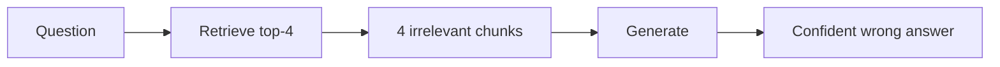
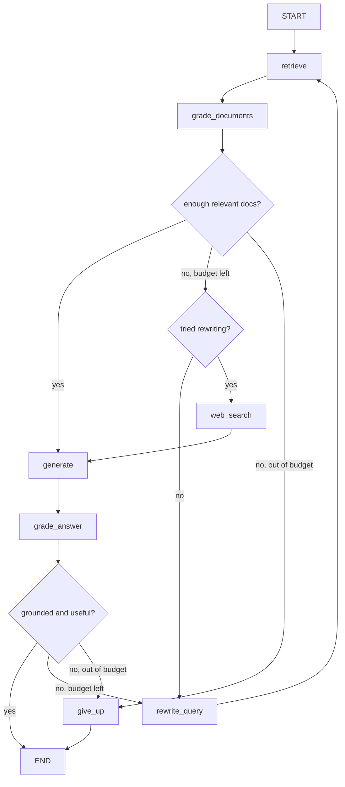

import TOCInline from '@theme/TOCInline';

# Self-Correcting RAG

<TOCInline toc={toc} minHeadingLevel={2} maxHeadingLevel={2} />

:::tip[In this guide]
A single-shot pipeline commits to whatever retrieval returned. This page covers
the loop-until-good-enough family — Self-RAG, CRAG and Adaptive RAG — with a
complete LangGraph implementation, the guardrails that stop it from running
away, and a clear statement of when it's over-engineering.
:::

## What Is It?

Self-correcting RAG adds **grading** and **branching** to the pipeline. Instead
of `retrieve → generate`, you get `retrieve → judge → maybe fix → generate →
judge → maybe retry`.

The judgments are made by LLM calls (graders) whose only job is to answer a
narrow yes/no question about an artefact the pipeline just produced.

## Why Does It Matter?

A single-shot pipeline has no recovery path. Trace what happens when retrieval
misses:



The generator receives four irrelevant chunks and does what generators do: it
produces fluent text. Either it hallucinates from parametric memory, or it
answers from the wrong documents, or — best case — it says "the context
doesn't cover this" and the user gets nothing.

Nothing in that pipeline *noticed*. The information needed to notice was
available: the chunks were visibly off-topic. A grader would have caught it.

That's the entire argument for this family. You're spending LLM calls to buy a
recovery path.

---

## Self-RAG

The original Self-RAG paper fine-tuned a model to emit special **reflection
tokens** inline during generation, deciding at each step whether to retrieve,
and labelling retrieved passages and its own output as relevant, supported and
useful.

You almost certainly don't want to fine-tune a model for this. The pragmatic
implementation keeps the four decisions and makes each a separate structured
LLM call:

| Self-RAG decision | Practical implementation |
| --- | --- |
| Retrieve or not? | A router call (see [query transformation](./05-query-transformation.mdx)) |
| Is this passage relevant? | Per-document relevance grader |
| Is the answer supported by the passages? | Groundedness grader |
| Is the answer useful for the question? | Usefulness grader |

```python
from pydantic import BaseModel, Field
from langchain_core.prompts import ChatPromptTemplate
from langchain_openai import ChatOpenAI

grader_llm = ChatOpenAI(model="gpt-4o-mini", temperature=0)


class RelevanceGrade(BaseModel):
    """Binary relevance check for one retrieved document."""
    relevant: bool = Field(
        description="True only if the document contains information that helps "
                    "answer the question. Topical similarity is not enough."
    )


relevance_prompt = ChatPromptTemplate.from_messages([
    ("system",
     "You grade whether a retrieved document is relevant to a question. "
     "Be strict: a document about the same general topic that does not help "
     "answer the specific question is NOT relevant."),
    ("human", "Question: {question}\n\nDocument:\n{document}"),
])

relevance_grader = relevance_prompt | grader_llm.with_structured_output(RelevanceGrade)


class GroundednessGrade(BaseModel):
    """Is every claim in the answer supported by the context?"""
    grounded: bool = Field(
        description="True only if every factual claim in the answer is "
                    "supported by the provided context."
    )
    unsupported_claims: list[str] = Field(
        default_factory=list,
        description="Claims that are not supported by the context.",
    )


class UsefulnessGrade(BaseModel):
    """Does the answer actually address the question?"""
    useful: bool = Field(
        description="True if the answer directly addresses what was asked."
    )
```

Two design notes that matter more than the prompts:

- **Binary, not scored.** A 1-10 relevance score sounds more informative but
  you then have to pick a threshold, and small models cluster scores around 7.
  A boolean with a strict definition is more reliable and easier to evaluate.
- **"Be strict" earns its place.** Default grader behaviour is far too
  generous — it marks anything topically related as relevant, which defeats the
  purpose.

---

## Corrective RAG (CRAG)

CRAG is the practical member of the family and the one to implement first. It
grades the retrieved documents and branches three ways:

| Grading outcome | Action |
| --- | --- |
| All documents relevant | Generate normally |
| Some relevant, some not | Drop the irrelevant ones, generate from the rest |
| None (or too few) relevant | Rewrite the query and retry, or fall back to web search |

```python
import asyncio


async def grade_documents(question: str, docs: list[dict]) -> tuple[list[dict], list[dict]]:
    """Grade all documents concurrently. Returns (kept, dropped)."""
    grades = await asyncio.gather(
        *(relevance_grader.ainvoke({"question": question, "document": d["text"]})
          for d in docs)
    )
    kept = [d for d, g in zip(docs, grades) if g.relevant]
    dropped = [d for d, g in zip(docs, grades) if not g.relevant]
    return kept, dropped
```

Grading concurrently is important. Serially grading eight documents with a
400 ms model adds 3.2 seconds; concurrently it adds 400 ms plus overhead. This
single change is the difference between CRAG being viable and not.

The fallback choice is where CRAG lives or dies. Options, in order of
preference:

1. **Rewrite the query and retry retrieval.** Cheap, no new dependency, fixes
   the common case where the question was phrased badly.
2. **Fall back to a different corpus or a web search tool.** Fixes the case
   where the information genuinely isn't in your index.
3. **Return "I don't know" with the reason.** Underrated. An honest refusal is
   a better product than a confident guess, and it's free.

If you have no fallback source and no rewrite path, CRAG degenerates into an
expensive way to detect failure. Useful for logging, not worth two extra calls
per request.

---

## Adaptive RAG

Adaptive RAG puts a complexity classifier in front and picks a strategy:

| Classification | Strategy | Calls |
| --- | --- | --- |
| No retrieval needed ("hi", "what's a vector?") | Answer directly | 1 + router |
| Simple factual lookup | Single-shot RAG | 1 + router |
| Complex, multi-hop, or ambiguous | CRAG loop or decomposition | 4-10 + router |

```python
from typing import Literal


class Complexity(BaseModel):
    """Routing decision for retrieval strategy."""
    strategy: Literal["direct", "single_shot", "iterative"] = Field(
        description=(
            "direct: greeting, chitchat, or general knowledge needing no lookup. "
            "single_shot: one specific fact that one retrieval should find. "
            "iterative: comparative, multi-hop, ambiguous, or likely to need "
            "several retrievals."
        )
    )


complexity_router = (
    ChatPromptTemplate.from_messages([
        ("system", "Classify how much retrieval effort this question needs."),
        ("human", "{question}"),
    ])
    | grader_llm.with_structured_output(Complexity)
)
```

The value here is distributional, not per-request. If 40% of your traffic is
"direct" and 50% is "single_shot", you've kept the median request at baseline
latency while letting the hard 10% take ten seconds. That's a much better
product than making every request slow — and much better than making the hard
10% fail.

---

## Answer-Level Reflection

Grading documents catches retrieval failure. Grading the answer catches
generation failure, which graders of documents cannot see.

Check two things before returning:

- **Groundedness** — is every claim in the answer supported by the context? If
  not, either regenerate with a stricter prompt or strip the unsupported
  claims.
- **Usefulness** — does it actually address the question? A grounded answer
  that answers a different question is still a failure.

Citation checking is the cheap, deterministic version of groundedness and you
should do it regardless of whether you build the full loop:

```python
import re


def validate_citations(answer: str, docs: list[dict]) -> tuple[bool, list[str]]:
    """Every [n] marker in the answer must point at a real document."""
    valid_ids = {str(i + 1) for i in range(len(docs))}
    cited = set(re.findall(r"\[(\d+)\]", answer))
    invalid = sorted(cited - valid_ids)
    has_citations = bool(cited)
    return (has_citations and not invalid), invalid
```

No LLM call, catches fabricated citations, runs in microseconds. If an answer
cites `[7]` when you supplied four documents, something is wrong and you know
it for free.

---

## Full LangGraph Implementation

### The graph



### The state

```python
from typing import Annotated, Literal, TypedDict
import operator
import time


class CragState(TypedDict):
    question: str                       # original user question
    search_query: str                   # current (possibly rewritten) query
    documents: list[dict]               # current candidate set
    answer: str
    # Budgets — the part people forget
    loops: int                          # retrieval attempts so far
    llm_calls: int                       # total grader + generator calls
    started_at: float                   # monotonic clock at entry
    used_web_search: bool
    trace: Annotated[list[str], operator.add]   # append-only decision log
    give_up_reason: str


MAX_LOOPS = 3
MAX_LLM_CALLS = 15
DEADLINE_SECONDS = 25.0
MIN_RELEVANT_DOCS = 2
```

`Annotated[list[str], operator.add]` makes `trace` an append-only reducer:
every node can add entries without clobbering earlier ones. Without that
annotation, LangGraph replaces the value and you lose the history.

### The nodes

```python
async def retrieve(state: CragState) -> dict:
    query = state.get("search_query") or state["question"]
    docs = await retriever.aretrieve(query, top_k=8)
    return {
        "documents": docs,
        "search_query": query,
        "loops": state["loops"] + 1,
        "trace": [f"retrieve(loop={state['loops'] + 1}) -> {len(docs)} docs"],
    }


async def grade_documents_node(state: CragState) -> dict:
    kept, dropped = await grade_documents(state["question"], state["documents"])
    return {
        "documents": kept,
        "llm_calls": state["llm_calls"] + len(state["documents"]),
        "trace": [f"grade_documents -> kept {len(kept)}, dropped {len(dropped)}"],
    }


async def rewrite_query(state: CragState) -> dict:
    prompt = ChatPromptTemplate.from_messages([
        ("system",
         "Retrieval failed for this query. Rewrite it to improve document "
         "retrieval: make implicit terms explicit, add likely synonyms, and "
         "keep all identifiers verbatim. Return only the new query."),
        ("human", "Original question: {question}\nFailed query: {failed}"),
    ])
    chain = prompt | grader_llm | StrOutputParser()
    new_query = await chain.ainvoke({
        "question": state["question"],
        "failed": state["search_query"],
    })
    return {
        "search_query": new_query.strip(),
        "llm_calls": state["llm_calls"] + 1,
        "trace": [f"rewrite_query -> {new_query.strip()!r}"],
    }


async def web_search(state: CragState) -> dict:
    """Fallback source. Swap in whichever search tool you use."""
    results = await web_search_tool.ainvoke(state["search_query"])
    docs = [{"id": f"web:{i}", "text": r["content"], "source": r["url"]}
            for i, r in enumerate(results)]
    return {
        "documents": [*state["documents"], *docs],
        "used_web_search": True,
        "trace": [f"web_search -> {len(docs)} docs"],
    }


async def generate(state: CragState) -> dict:
    context = "\n\n".join(
        f"[{i + 1}] {d['text']}" for i, d in enumerate(state["documents"])
    )
    prompt = ChatPromptTemplate.from_messages([
        ("system",
         "Answer using only the numbered context. Cite sources as [n]. "
         "If the context does not contain the answer, say so plainly."),
        ("human", "Context:\n{context}\n\nQuestion: {question}"),
    ])
    chain = prompt | llm | StrOutputParser()
    answer = await chain.ainvoke({
        "context": context,
        "question": state["question"],
    })
    return {
        "answer": answer,
        "llm_calls": state["llm_calls"] + 1,
        "trace": ["generate"],
    }


async def grade_answer_node(state: CragState) -> dict:
    # Free deterministic check first — no reason to pay for an LLM call
    # if the citations are already fabricated.
    citations_ok, invalid = validate_citations(state["answer"], state["documents"])
    if not citations_ok:
        return {
            "trace": [f"grade_answer -> bad citations {invalid}"],
            "answer": state["answer"],
        }

    grounded, useful = await asyncio.gather(
        groundedness_grader.ainvoke({
            "context": "\n\n".join(d["text"] for d in state["documents"]),
            "answer": state["answer"],
        }),
        usefulness_grader.ainvoke({
            "question": state["question"],
            "answer": state["answer"],
        }),
    )
    return {
        "llm_calls": state["llm_calls"] + 2,
        "trace": [f"grade_answer -> grounded={grounded.grounded} "
                  f"useful={useful.useful}"],
    }


def give_up(state: CragState) -> dict:
    sources = ", ".join(d.get("source", d["id"]) for d in state["documents"][:3])
    return {
        "answer": (
            "I could not find a well-supported answer to that in the available "
            f"sources. Closest material: {sources or 'none'}. "
            "Try narrowing the question or naming the document you have in mind."
        ),
        "give_up_reason": state.get("give_up_reason") or "budget exhausted",
        "trace": ["give_up"],
    }
```

### Budgets and conditional edges

The branching functions are where the guardrails live. Every one of them
checks the budget before it checks quality.

```python
def over_budget(state: CragState) -> str | None:
    if state["loops"] >= MAX_LOOPS:
        return f"loop cap {MAX_LOOPS} reached"
    if state["llm_calls"] >= MAX_LLM_CALLS:
        return f"LLM call budget {MAX_LLM_CALLS} exhausted"
    if time.monotonic() - state["started_at"] > DEADLINE_SECONDS:
        return f"deadline {DEADLINE_SECONDS}s exceeded"
    return None


def decide_after_grading(state: CragState) -> Literal["generate", "rewrite_query", "web_search", "give_up"]:
    if len(state["documents"]) >= MIN_RELEVANT_DOCS:
        return "generate"
    if over_budget(state):
        return "give_up"
    if state["loops"] == 1:
        return "rewrite_query"          # cheap fix first
    if not state["used_web_search"]:
        return "web_search"             # then widen the source
    if state["documents"]:
        return "generate"               # something beats nothing
    return "give_up"


def decide_after_answer(state: CragState) -> Literal["__end__", "rewrite_query", "give_up"]:
    last = state["trace"][-1]
    ok = "grounded=True" in last and "useful=True" in last
    if ok:
        return "__end__"
    if over_budget(state):
        return "give_up"
    return "rewrite_query"
```

### Wiring it up

```python
from langgraph.graph import StateGraph, START, END

builder = StateGraph(CragState)

builder.add_node("retrieve", retrieve)
builder.add_node("grade_documents", grade_documents_node)
builder.add_node("rewrite_query", rewrite_query)
builder.add_node("web_search", web_search)
builder.add_node("generate", generate)
builder.add_node("grade_answer", grade_answer_node)
builder.add_node("give_up", give_up)

builder.add_edge(START, "retrieve")
builder.add_edge("retrieve", "grade_documents")
builder.add_conditional_edges(
    "grade_documents",
    decide_after_grading,
    {
        "generate": "generate",
        "rewrite_query": "rewrite_query",
        "web_search": "web_search",
        "give_up": "give_up",
    },
)
builder.add_edge("rewrite_query", "retrieve")
builder.add_edge("web_search", "generate")
builder.add_edge("generate", "grade_answer")
builder.add_conditional_edges(
    "grade_answer",
    decide_after_answer,
    {"__end__": END, "rewrite_query": "rewrite_query", "give_up": "give_up"},
)
builder.add_edge("give_up", END)

crag = builder.compile()


async def ask(question: str) -> dict:
    return await crag.ainvoke(
        {
            "question": question,
            "search_query": "",
            "documents": [],
            "answer": "",
            "loops": 0,
            "llm_calls": 0,
            "started_at": time.monotonic(),
            "used_web_search": False,
            "trace": [],
            "give_up_reason": "",
        },
        config={"recursion_limit": 25},
    )
```

`recursion_limit` is LangGraph's own backstop — it caps total node executions
and raises if exceeded. Set it, but don't rely on it as your only guardrail:
it throws an exception rather than degrading gracefully, and your users get a
500 instead of an honest "I couldn't find that."

The `trace` field is what makes this debuggable. When a request takes nine
seconds, `trace` tells you it rewrote twice and fell back to web search, which
is information you cannot reconstruct from the answer alone. Log it on every
request.

---

## Guardrails That Actually Matter

Four, and you need all of them:

| Guardrail | Why | Typical value |
| --- | --- | --- |
| Max loops | Query rewriting can oscillate between two phrasings forever | 2-3 |
| LLM call budget | Document grading is per-document, so cost scales with retrieval width | 10-20 |
| Wall-clock deadline | Loops multiply the tail; p99 is where this pattern hurts | 20-30 s |
| Graceful give-up | An exception is a worse product than an honest refusal | always |

The give-up path deserves more thought than it usually gets. Return:

- A plain statement that you couldn't find a supported answer.
- The closest sources you did find, so the user can judge for themselves.
- A hint about how to rephrase.
- A structured flag in the response so your client can render it differently
  and your metrics can count it.

What not to do: return the ungrounded answer with a disclaimer. Users read the
answer and skip the disclaimer, every time.

Finally, **log the give-up rate as a first-class metric.** It's the most
useful signal this architecture produces. A rising give-up rate means your
corpus has a gap, and that's actionable in a way that a slowly drifting
quality score is not.

---

## Cost Analysis

Per request, with a small grader model and eight retrieved documents:

| Pipeline | LLM calls (typical) | LLM calls (worst case) | p50 latency | p95 latency |
| --- | --- | --- | --- | --- |
| Baseline RAG | 1 | 1 | 1-2 s | 3 s |
| Baseline + rerank | 1 | 1 | 1.5-2.5 s | 3.5 s |
| CRAG, docs are good | 11 (8 grades + gen + 2 answer grades) | 11 | 3-4 s | 6 s |
| CRAG, one rewrite | 20 | 20 | 6-8 s | 12 s |
| CRAG, rewrite + web | 22 | 22 | 9-12 s | 20 s |
| Adaptive, mixed traffic | 2-11 depending on route | 22 | 2-3 s | 14 s |

Read the "typical" column carefully: CRAG on the happy path is **eleven LLM
calls instead of one**. The grader model is cheap and the calls are concurrent,
so the latency hit is smaller than the call count suggests — but it's still
3-4× baseline latency and roughly 5-10× the cost even with a small grader.

Adaptive RAG is the only row with a tolerable p50, because most requests never
enter the loop. If you're building this family, build Adaptive.

---

## When This Is Over-Engineering

Be honest about this. Self-correcting RAG is over-engineering when:

- **Your retrieval is already good.** If document grading drops fewer than
  ~10% of retrieved chunks, you're paying eight grader calls to learn nothing.
  Measure that ratio offline before building the loop.
- **You haven't done the cheap work.** Hybrid search and reranking cost zero
  LLM calls and fix most of what CRAG detects. Doing CRAG first is spending
  10× to avoid tuning a chunk size.
- **Latency matters.** An interactive chat UI with a 2-second expectation
  cannot absorb this. A nightly report generator can.
- **You have no fallback source.** Grading that can only conclude "these docs
  are bad" with nothing to do about it is logging with extra steps.
- **Your graders aren't validated.** A grader that agrees with human judgment
  70% of the time will reject good retrievals and accept bad ones, and you've
  added a confident new failure mode. Check grader agreement on 50 labelled
  examples before trusting it to branch.

Where it genuinely earns its place: high-stakes domains where a wrong answer
costs more than a slow one — compliance, medical, legal, financial research —
and asynchronous workloads where nobody is watching a spinner.

A good intermediate position, and the one most teams should actually take:
**keep the groundedness check and the citation validator, drop the loop.** You
get the ability to detect and refuse bad answers for two extra calls and no
latency variance, and you skip the hardest part of the architecture.

## Common Mistakes

- Grading documents serially, turning a 400 ms step into 3 seconds.
- No loop cap, so a rewrite cycle oscillates until the recursion limit throws.
- Counting loops but not LLM calls, so a wide retrieval blows the budget
  inside a single loop.
- Lenient graders that mark anything topically related as relevant.
- Raising an exception on give-up instead of returning a usable refusal.
- Returning the ungrounded answer with a disclaimer attached.
- Not logging the trace, making latency spikes impossible to explain.
- Building the loop before measuring whether retrieval is actually the problem.
- Using a frontier model for graders, multiplying the cost by 20.

## Interview Questions

- Why can't a single-shot RAG pipeline recover from bad retrieval?
- What are the four decisions in Self-RAG, and how do you implement them
  without fine-tuning?
- Walk me through CRAG's three branches after document grading.
- What does Adaptive RAG optimise that CRAG does not?
- Name the guardrails you'd put on a self-correcting loop and what each one
  prevents.
- What should the system return when the loop gives up, and why not a
  disclaimed answer?
- How would you validate that your relevance grader is any good?
- Roughly how many LLM calls does CRAG make on the happy path, and why?

## Things to Remember

- You're spending LLM calls to buy a recovery path. Know the exchange rate.
- CRAG first, Adaptive second, full Self-RAG probably never.
- Grade documents concurrently or the latency is indefensible.
- Binary graders with strict instructions beat numeric scores.
- Four guardrails: loop cap, call budget, wall-clock deadline, graceful give-up.
- Citation validation is free — do it whether or not you build the loop.
- Log the trace and the give-up rate.
- The intermediate position — groundedness check without the loop — is right
  for most teams.

## Mini Exercise

Instrument your existing pipeline with the relevance grader only, logging
nothing but "retrieved N, relevant M" per request. Run it over 100 real
questions. If the drop rate is under 10%, you've just saved yourself from
building this whole architecture. If it's over 30%, build CRAG and measure the
p95 latency change alongside the quality change. Either way you'll have the
number that decides it.

## Done When

- [ ] You can explain why single-shot RAG cannot recover from bad retrieval.
- [ ] You've built a binary relevance grader and measured your drop rate.
- [ ] You can describe CRAG's branches and Adaptive RAG's routing.
- [ ] Your loop has a loop cap, a call budget, a deadline and a give-up path.
- [ ] You can state the latency and cost multiplier your loop adds.

Next: [Graph & Structured RAG](./08-graph-and-structured-rag.mdx).
