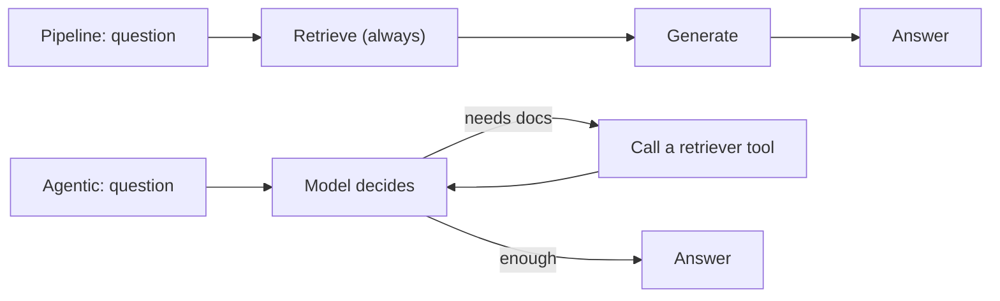
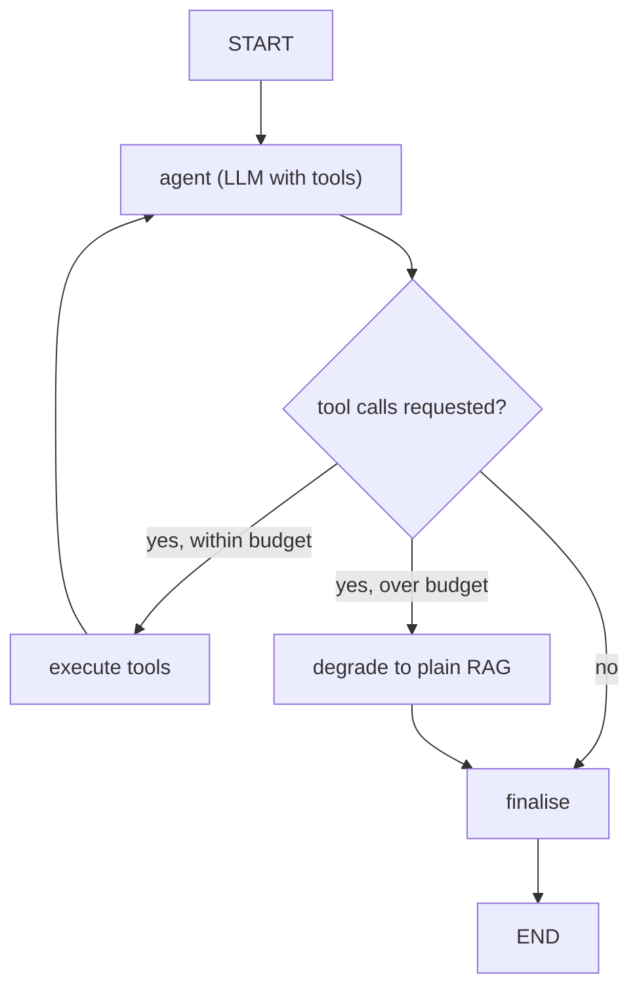

import TOCInline from '@theme/TOCInline';

# Agentic RAG

<TOCInline toc={toc} minHeadingLevel={2} maxHeadingLevel={2} />

:::tip[In this guide]
In pipeline RAG you decide how to retrieve before the request starts. In
agentic RAG the model decides at run time whether to retrieve, from where, and
how many times. This page covers retrieval-as-a-tool, iterative research
loops, a LangGraph implementation, and the budgets without which this pattern
is a liability.
:::

## What Is It?

Agentic RAG inverts control. Retrieval stops being a step in a pipeline and
becomes a **tool** the model can call, with the model deciding when to call it.



## Why Does It Matter?

### The shift in who decides

| Decision | Pipeline RAG | Agentic RAG |
| --- | --- | --- |
| Retrieve at all? | Always | Model decides per request |
| Which corpus? | Fixed, or a router at the front | Model picks a tool |
| How many retrievals? | Fixed (1, or N for Multi-Query) | Model decides, 0 to many |
| What query? | The question, or a transform of it | Model writes it, informed by what it read |
| When to stop? | After one pass | When the model judges it has enough |

The fourth row is the one that matters. In pipeline RAG every query is written
before any document has been read. An agent writes its second query **after
reading the results of the first** — which is the only way to answer a
question whose second step depends on the first step's answer.

Concretely: "What region is the person who shipped the audit-log feature based
in?" You cannot write a single query for that. You have to find out who
shipped it, then look up that person. A fixed pipeline retrieving for the
whole question gets documents about audit logs and documents about regions,
and the join never happens. An agent does it in two obvious steps.

This capability is real. So is the cost: you've traded a predictable pipeline
for a system whose latency, cost and behaviour vary per request.

---

## Retrieval as a Tool

The implementation is unremarkable. The tool **descriptions** are where the
engineering is.

```python
from langchain_core.tools import tool


@tool
async def search_engineering_docs(query: str) -> str:
    """Search internal engineering documentation: architecture decisions,
    API references, runbooks, design docs and postmortems.

    Use for questions about how our systems work, why they were built a
    certain way, or how to operate them. Do NOT use for customer data,
    contracts, or anything about people.

    Pass a focused search query, not the user's full question.
    """
    docs = await eng_retriever.aretrieve(query, top_k=5)
    return format_docs(docs)


@tool
async def search_support_tickets(query: str) -> str:
    """Search customer support tickets and their resolutions.

    Use for questions about reported bugs, customer complaints, known issues,
    or how a problem was resolved for a customer in the past. Contains
    customer-reported symptoms, not internal design rationale.
    """
    docs = await support_retriever.aretrieve(query, top_k=5)
    return format_docs(docs)


@tool
async def query_analytics(question: str) -> str:
    """Answer questions requiring counts, sums, averages or rankings over
    customers, subscriptions and tickets.

    Use this whenever the answer is a NUMBER rather than a passage of text —
    'how many', 'what percentage', 'which is the top', 'average time to'.
    Do not use it for conceptual or how-does-it-work questions.
    """
    rows = await text_to_sql(question, pool)
    return format_rows(rows)


def format_docs(docs: list[dict]) -> str:
    if not docs:
        return "No results found. Try different search terms."
    return "\n\n".join(
        f"[{d['id']}] source={d.get('source', 'unknown')}\n{d['text']}"
        for d in docs
    )


TOOLS = [search_engineering_docs, search_support_tickets, query_analytics]
```

Rules for tool descriptions, learned the hard way:

- **Say what the corpus contains, concretely.** "Searches documents" tells the
  model nothing. Name the document types.
- **Say what it is NOT for.** Negative guidance disambiguates overlapping
  tools better than positive description alone. This is the single highest-
  leverage edit you can make.
- **Give usage triggers in the user's vocabulary.** "'how many', 'what
  percentage'" works better than "aggregation queries".
- **Tell the model how to phrase the argument.** Left to itself it passes the
  user's entire question as the search query, which is usually worse than a
  focused one.
- **Return a useful empty result.** "No results found. Try different search
  terms." prompts a retry. An empty string prompts a hallucination.
- **Keep the tool count low.** Three to five retrieval tools route reliably.
  Past about eight, accuracy degrades and you want a hierarchical router
  instead.

Also worth including: a `no_retrieval_needed` escape hatch, or simply allow
the agent to answer directly. Forcing a tool call on "hi" wastes a round trip.

---

## Iterative Retrieval

The loop that makes this worth building. The agent reads, notices a gap,
searches again.

```text
User: What region is the person who shipped the audit-log feature based in?

turn 1  tool: search_engineering_docs("audit log feature shipped by")
        -> "The audit-log export feature was delivered by Priya Raman in the
            platform team (design doc PD-114)."

turn 2  tool: search_engineering_docs("Priya Raman team location region")
        -> "Platform team members: Priya Raman (Berlin), ..."

turn 3  answer: "Priya Raman shipped the audit-log feature and is based in
        Berlin (EU region). [PD-114, team-directory]"
```

Nothing in turn 2's query could have been written before turn 1's result came
back. That's the whole value proposition, and it's why query decomposition in
a fixed pipeline doesn't cover this case — decomposition writes all
sub-questions up front.

### Planner-first variant

For genuinely research-shaped questions, make the plan explicit before
gathering. It costs one call and makes the trajectory far easier to debug.

```python
from pydantic import BaseModel, Field


class ResearchPlan(BaseModel):
    """A plan for answering a complex question."""
    steps: list[str] = Field(
        description="2-5 information-gathering steps, in order. Each step "
                    "should name what to find out, not how to search for it."
    )
    sequential: bool = Field(
        description="True if later steps depend on earlier results."
    )


planner = (
    ChatPromptTemplate.from_messages([
        ("system",
         "Plan how to answer the question using document search and an "
         "analytics database. Keep the plan minimal — do not add steps that "
         "are not needed to answer exactly what was asked."),
        ("human", "{question}"),
    ])
    | llm.with_structured_output(ResearchPlan)
)
```

"Do not add steps that are not needed" matters. Planners pad. Left unguided
they turn a two-step question into a six-step research project, and you pay
for all six.

If `sequential` is false, run the steps concurrently with `asyncio.gather` and
you've reclaimed most of the latency. If it's true, you're stuck with serial
execution — which is exactly the case a pipeline can't handle, so it's the
cost of doing something pipelines can't.

---

## LangGraph Implementation

### The graph



### State and budgets

```python
from typing import Annotated, Literal, TypedDict
import operator
import time

from langchain_core.messages import (
    AnyMessage, HumanMessage, SystemMessage, ToolMessage,
)
from langgraph.graph import StateGraph, START, END
from langgraph.graph.message import add_messages


class AgentState(TypedDict):
    messages: Annotated[list[AnyMessage], add_messages]
    # Budgets
    tool_calls: int
    started_at: float
    degraded: bool
    trace: Annotated[list[str], operator.add]


MAX_TOOL_CALLS = 6
DEADLINE_SECONDS = 30.0
MAX_CONTEXT_CHARS = 60_000


SYSTEM = SystemMessage(content=(
    "You answer questions using the provided search tools.\n\n"
    "Rules:\n"
    "- Search before answering unless the question needs no lookup.\n"
    "- Pass focused search queries, not the user's whole question.\n"
    "- If a search returns nothing useful, try different terms ONCE, then "
    "move on or say you could not find it.\n"
    "- Cite sources by their bracketed id.\n"
    "- Stop searching as soon as you can answer. Do not gather extra context.\n"
    "- If you cannot answer from the tool results, say so plainly rather than "
    "guessing."
))
```

`add_messages` is LangGraph's reducer for message lists: it appends and handles
message-id deduplication, which plain `operator.add` does not.

Two lines in that system prompt are load-bearing. "Try different terms ONCE"
prevents the most common runaway: an agent re-searching the same empty corpus
with slight rephrasings, forever. "Stop searching as soon as you can answer"
counteracts the model's tendency to keep gathering because gathering feels
productive.

### Nodes

```python
llm_with_tools = llm.bind_tools(TOOLS)
TOOLS_BY_NAME = {t.name: t for t in TOOLS}


async def agent(state: AgentState) -> dict:
    response = await llm_with_tools.ainvoke([SYSTEM, *state["messages"]])
    requested = [tc["name"] for tc in (response.tool_calls or [])]
    return {
        "messages": [response],
        "trace": [f"agent -> tools={requested or 'none'}"],
    }


async def execute_tools(state: AgentState) -> dict:
    last = state["messages"][-1]
    calls = last.tool_calls or []

    async def run_one(call: dict) -> ToolMessage:
        tool = TOOLS_BY_NAME.get(call["name"])
        if tool is None:
            content = f"Unknown tool {call['name']}."
        else:
            try:
                content = await tool.ainvoke(call["args"])
            except Exception as exc:
                # Hand the error back to the model; do not crash the graph.
                content = f"Tool error: {type(exc).__name__}: {exc}"
        return ToolMessage(
            content=str(content)[:MAX_CONTEXT_CHARS // max(len(calls), 1)],
            tool_call_id=call["id"],
            name=call["name"],
        )

    results = await asyncio.gather(*(run_one(c) for c in calls))
    return {
        "messages": list(results),
        "tool_calls": state["tool_calls"] + len(calls),
        "trace": [f"execute_tools -> {len(calls)} call(s)"],
    }


async def degrade_to_plain_rag(state: AgentState) -> dict:
    """Budget blown. Fall back to one deterministic retrieval + generation."""
    question = next(
        m.content for m in state["messages"] if isinstance(m, HumanMessage)
    )
    docs = await eng_retriever.aretrieve(question, top_k=5)
    context = format_docs(docs)
    chain = (
        ChatPromptTemplate.from_messages([
            ("system",
             "Answer using only the context. Cite sources as [id]. Note that "
             "this answer was produced by a fallback path and may be "
             "incomplete. If the context is insufficient, say so."),
            ("human", "Context:\n{context}\n\nQuestion: {question}"),
        ])
        | llm
    )
    answer = await chain.ainvoke({"context": context, "question": question})
    return {
        "messages": [answer],
        "degraded": True,
        "trace": ["degrade_to_plain_rag"],
    }


def finalise(state: AgentState) -> dict:
    elapsed = time.monotonic() - state["started_at"]
    return {"trace": [
        f"finalise tool_calls={state['tool_calls']} "
        f"elapsed={elapsed:.1f}s degraded={state['degraded']}"
    ]}
```

Returning tool errors as `ToolMessage` content instead of raising is
deliberate. The agent can read "Tool error: TimeoutError" and try a different
tool, which is strictly better behaviour than a 500 to the user.

### Branching and assembly

```python
def over_budget(state: AgentState) -> str | None:
    if state["tool_calls"] >= MAX_TOOL_CALLS:
        return f"tool call cap {MAX_TOOL_CALLS} reached"
    if time.monotonic() - state["started_at"] > DEADLINE_SECONDS:
        return f"deadline {DEADLINE_SECONDS}s exceeded"
    total = sum(len(str(m.content)) for m in state["messages"])
    if total > MAX_CONTEXT_CHARS:
        return "context budget exhausted"
    return None


def route(state: AgentState) -> Literal["execute_tools", "degrade", "finalise"]:
    last = state["messages"][-1]
    wants_tools = bool(getattr(last, "tool_calls", None))
    if not wants_tools:
        return "finalise"
    if over_budget(state):
        return "degrade"
    return "execute_tools"


builder = StateGraph(AgentState)
builder.add_node("agent", agent)
builder.add_node("execute_tools", execute_tools)
builder.add_node("degrade", degrade_to_plain_rag)
builder.add_node("finalise", finalise)

builder.add_edge(START, "agent")
builder.add_conditional_edges(
    "agent",
    route,
    {"execute_tools": "execute_tools", "degrade": "degrade", "finalise": "finalise"},
)
builder.add_edge("execute_tools", "agent")
builder.add_edge("degrade", "finalise")
builder.add_edge("finalise", END)

agentic_rag = builder.compile()


async def ask(question: str) -> dict:
    return await agentic_rag.ainvoke(
        {
            "messages": [HumanMessage(content=question)],
            "tool_calls": 0,
            "started_at": time.monotonic(),
            "degraded": False,
            "trace": [],
        },
        config={"recursion_limit": 20},
    )
```

LangGraph ships `ToolNode` and `create_react_agent`, which collapse most of
this into a few lines. The explicit version above is what you want in
production anyway, because the budget checks and the degradation path are the
whole point and neither comes for free with the prebuilt helpers. Check
current LangGraph docs for the prebuilt API — it has moved between versions.

---

## The Hard Parts

Be clear-eyed about these. They are not implementation details you'll polish
away; they are properties of the architecture.

### Non-determinism

The same question can produce two tool calls on Monday and five on Tuesday,
with different answers. This breaks:

- **Caching.** There's no stable key, because the trajectory varies.
- **Regression testing.** A test that asserts an exact answer flakes. You have
  to assert properties — "cites a source", "mentions Berlin" — instead.
- **Incident debugging.** "It was wrong for this user" may not reproduce.

Mitigate with `temperature=0`, a locked model version, and logging the full
trajectory so you can at least read what happened after the fact.

### Latency variance

The distribution is the problem, not the mean.

```text
p50:   2.5 s   (one tool call, model answers)
p90:   9 s     (three tool calls)
p99:  28 s     (six calls, one retry, hits the deadline)
```

An 11× spread between p50 and p99 is normal here. If your product promises a
response in five seconds, a p99 of 28 seconds means roughly 1 in 100 users
gets a timeout. Design the UI for it — stream intermediate status ("searching
engineering docs...") so the wait is legible rather than blank.

### Runaway cost

Each loop iteration re-sends the entire message history, and the history grows
with every tool result. Six tool calls returning 5,000 characters each means
the final agent call reads 30,000 characters of tool output plus all prior
reasoning. Token cost grows roughly quadratically in the number of iterations.

```text
iteration 1: ~1k input tokens
iteration 2: ~3k   (question + 1 tool result + reasoning)
iteration 3: ~6k
iteration 4: ~10k
iteration 5: ~15k
iteration 6: ~21k
                     total ≈ 56k input tokens for one question
```

This is why `MAX_CONTEXT_CHARS` and truncated tool results are in the
implementation above, not an optimisation to add later.

### Infinite loops

The classic shapes: the agent searches, finds nothing, rephrases slightly,
searches again, forever. Or two tools each suggest the other is more
appropriate. Or the model calls the same tool with identical arguments
repeatedly. The hard cap catches all of these; nothing else reliably does.

Worth adding: detect repeated identical tool calls and return "You already
searched for exactly this and got no results. Try different terms or answer
from what you have." as the tool result. Cheap, and it breaks the most common
cycle directly.

### Evaluating a trajectory, not an answer

This is the genuinely hard one. In pipeline RAG you evaluate the answer. In
agentic RAG the answer can be right for the wrong reasons — the agent made
four unnecessary calls and got lucky — and that's a system you can't trust.

What to measure, in addition to answer quality:

| Metric | What it tells you |
| --- | --- |
| Tool calls per request (p50, p95) | Efficiency; a rising p95 means routing is degrading |
| Correct-tool rate | Did it pick the right corpus on the first try? |
| Redundant call rate | Same tool, same or near-identical args |
| Degradation rate | How often the budget blows |
| Answered-without-retrieval rate | Catches the agent skipping search and hallucinating |
| Trajectory length vs minimum | Did a two-step question take five steps? |

Label a set of 30-50 questions with their *minimum* viable trajectory and
compare. That's more work than answer-level eval, and there's no way around
it. Agent evaluation generally is covered further in
[agents fundamentals](../08-agentic-ai/01-agents-fundamentals.mdx).

---

## Budgets and Circuit Breakers

Non-negotiable, all five:

| Control | Value | What it prevents |
| --- | --- | --- |
| Max tool calls | 5-8 | Infinite loops, cost blowout |
| Wall-clock deadline | 20-30 s | A hung tool holding a request open |
| Context/token ceiling | 50-80k chars | Quadratic token growth |
| Per-tool timeout | 3-10 s | One slow backend stalling the loop |
| Graceful degradation | Always | Returning nothing at all |

Graceful degradation is the one people skip, and it's the one that determines
whether this is shippable. When the budget blows you have a half-finished
trajectory and no answer. The options:

1. **Fall back to plain RAG** on the original question — the
   `degrade_to_plain_rag` node above. Predictable, usually produces something
   reasonable, costs one more call.
2. **Answer from what you gathered**, flagged as possibly incomplete. Cheaper,
   but the gathered context is by definition the context that wasn't sufficient.
3. **Refuse, with the sources you found.** Honest. Correct for high-stakes
   domains.

Pick 1 as the default. And flag degraded responses in the API payload, not
just in prose — your client should be able to render them differently, and
your dashboard should count them.

```python
async def ask_with_budget(question: str) -> dict:
    """Outer timeout as the last line of defence."""
    try:
        state = await asyncio.wait_for(ask(question), timeout=DEADLINE_SECONDS + 5)
    except asyncio.TimeoutError:
        docs = await eng_retriever.aretrieve(question, top_k=5)
        return {
            "answer": await plain_rag_answer(question, docs),
            "degraded": True,
            "reason": "hard timeout",
        }
    return {
        "answer": state["messages"][-1].content,
        "degraded": state["degraded"],
        "tool_calls": state["tool_calls"],
        "trace": state["trace"],
    }
```

The in-graph deadline can be missed if a single tool call hangs past it, so
the outer `wait_for` is not redundant.

---

## Pipeline RAG vs Agentic RAG

| | Pipeline RAG | Agentic RAG |
| --- | --- | --- |
| p50 latency | 1-2 s | 2-5 s |
| p99 latency | 3-4 s | 20-40 s |
| Cost per request | 1 LLM call | 3-10 calls, growing context |
| Accuracy ceiling | Limited by the fixed strategy | Higher — can adapt and iterate |
| Accuracy floor | Predictable | Can be worse (wrong tool, skipped retrieval) |
| Multi-hop questions | Poor | Good |
| Debuggability | Read the logs, reproduce it | Read the trajectory, may not reproduce |
| Predictability | High | Low |
| Caching | Straightforward | Effectively not available |
| Eval effort | Answer-level | Trajectory-level, several times the work |
| Failure mode | Consistent and diagnosable | Varied and occasionally bizarre |

The row to dwell on: **the accuracy floor can be worse.** A fixed pipeline
always retrieves. An agent can decide not to, and answer from parametric
memory with complete confidence. That's a worse failure than a pipeline
returning mediocre context, because it looks identical to a good answer.

---

## The Verdict

**Worth it when:**

- Multi-hop questions where step two depends on step one's answer are a
  significant share of your traffic — not an edge case someone imagined.
- You have genuinely heterogeneous corpora that need different retrieval
  strategies, and routing from a fixed classifier isn't accurate enough.
- Users are doing research and will accept 10-30 seconds for a thorough
  answer. Internal analyst tools, not customer-facing chat.
- Async or batch workloads where nobody is watching a spinner.
- You have the eval infrastructure to measure trajectories. Without it you're
  shipping something you cannot reason about.

**A liability when:**

- Latency matters. A 20-second p99 is not acceptable in a chat UI.
- Costs are tight. 5-10× the token spend of pipeline RAG, with high variance.
- Your questions are mostly single-hop lookups — which, for most document QA
  products, they are. An agent adds variance and buys nothing.
- You need reproducibility for audit or compliance.
- You haven't exhausted [the cheap patterns](./04-rag-patterns.mdx). Hybrid
  search, reranking and routing cost a fraction of this and fix more.
- Nobody owns the eval harness.

**The middle path, which is usually right.** Route by complexity, as in
[Adaptive RAG](./07-self-correcting-rag.mdx): simple questions take the fast
pipeline, and only the small fraction classified as multi-hop enters the
agentic loop. You keep a 2-second p50 and gain the capability where it's
actually needed. One classification call buys you both.

If you take one thing from this page: agentic RAG is a capability upgrade and
a predictability downgrade, in roughly equal measure. Build it when you've
measured that you need the capability, and only after you've built something
predictable to fall back to.

## Common Mistakes

- Vague tool descriptions, so the agent picks the wrong corpus and nothing in
  the logs explains why.
- No negative guidance ("do NOT use for...") on overlapping tools.
- Returning an empty string from a tool with no results, inviting a
  hallucination.
- Letting the agent pass the user's entire question as the search query.
- No tool-call cap. This will cost you money, probably at 3 a.m.
- No deadline, so one hung backend holds a request open indefinitely.
- Unbounded tool output, so the message history grows until the context
  overflows mid-trajectory.
- Raising on tool errors instead of returning them to the model.
- No degradation path, so a blown budget returns nothing.
- Evaluating only the final answer, so you never notice the agent is taking
  five steps for two-step questions.
- Reaching for agentic RAG before hybrid search and reranking.
- Not logging the trajectory, making non-reproducible failures unanalysable.

## Interview Questions

- What can an agent do that query decomposition in a fixed pipeline cannot?
- Why does token cost grow faster than linearly with loop iterations?
- What goes in a retrieval tool's description, and why does negative guidance
  help?
- Name the circuit breakers you'd put on an agentic RAG loop.
- Why is the accuracy *floor* potentially worse than pipeline RAG?
- How would you evaluate an agentic RAG system beyond answer correctness?
- What should happen when the tool-call budget is exhausted mid-trajectory?
- Why is caching largely unavailable in agentic RAG?

## Things to Remember

- The shift: the agent decides whether and how often to retrieve, at run time.
- Writing query N+1 after reading result N is the capability you're buying.
- Tool descriptions are the routing logic. Include what the tool is not for.
- Five controls: tool-call cap, deadline, context ceiling, per-tool timeout,
  graceful degradation.
- Return tool errors to the model; don't raise.
- p99 latency is roughly 10× p50. Design the UI for it.
- Evaluate trajectories, not just answers.
- Route by complexity so only hard questions pay the agentic cost.
- Exhaust hybrid search, reranking and routing first.

## Mini Exercise

Build two retrieval tools over two genuinely different corpora, with
deliberately vague one-line descriptions. Run 15 questions and record how
often the agent picks the right tool first. Then rewrite the descriptions with
concrete contents and explicit "do NOT use for" guidance, and re-run the same
15. Log tool calls per request both times. Finally, set `MAX_TOOL_CALLS = 2`
and confirm your degradation path returns a usable answer rather than an
exception.

## Done When

- [ ] You can explain what agentic RAG does that a fixed pipeline cannot.
- [ ] You've written tool descriptions with positive and negative guidance.
- [ ] Your loop has a call cap, a deadline, a context ceiling and a fallback.
- [ ] You log the full trajectory and can read it after a bad answer.
- [ ] You can state, with a number, what share of your traffic actually needs
      this.

Next: [07 · LangChain / LCEL](../07-langchain-lcel/index.mdx).
