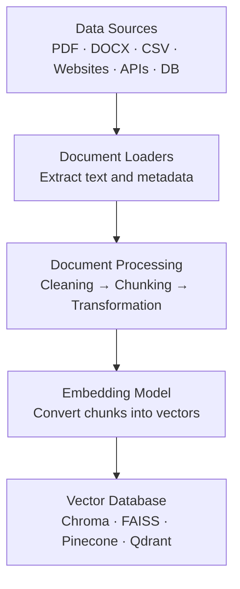
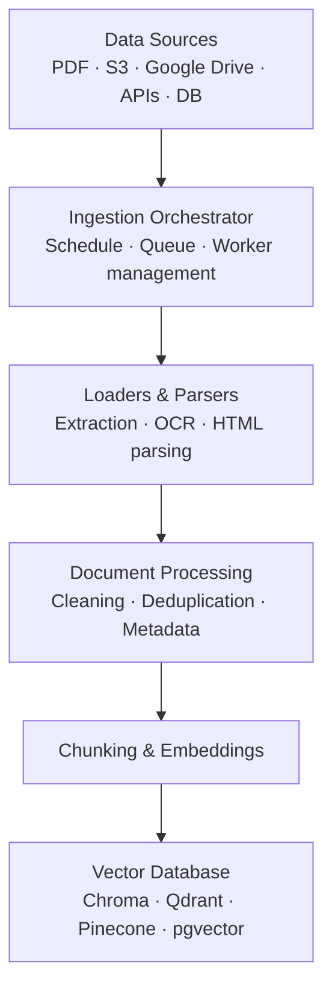

# RAG Loaders

In RAG (Retrieval-Augmented Generation), **Document Loaders** bring external data into your pipeline so an LLM can understand and retrieve relevant information from it. Think of loaders as the **data ingestion layer** of your RAG application.

For example, imagine you're building a ChatGPT-like application where users upload:

- PDF documents
- Word documents
- Excel and CSV files
- Websites and URLs
- YouTube videos
- Notion pages
- Database records
- Source code repositories

You need loaders to extract data from all of these sources.

---

## Table of Contents

1. [Where Loaders Fit in RAG](#1-where-loaders-fit-in-rag)
2. [Types of Document Loaders](#2-types-of-document-loaders)
   - [A. File-based loaders](#a-file-based-loaders)
   - [B. Web-based loaders](#b-web-based-loaders)
   - [C. Database loaders](#c-database-loaders)
   - [D. SaaS / Cloud loaders](#d-saas--cloud-loaders)
   - [E. Multimedia loaders](#e-multimedia-loaders)
3. [How to Choose the Right Loader](#3-how-to-choose-the-right-loader)
4. [What a Loader Returns](#4-what-a-loader-returns)
5. [Practical Implementation with LangChain](#5-practical-implementation-with-langchain)
6. [Loading vs Lazy Loading vs Async Loading](#6-loading-vs-lazy-loading-vs-async-loading)
7. [Custom Document Loaders](#7-custom-document-loaders)
8. [Production-Level Loader Architecture](#8-production-level-loader-architecture)
9. [LangChain vs LlamaIndex](#9-langchain-vs-llamaindex)
10. [Learning Roadmap](#10-learning-roadmap)
11. [Capstone Project](#11-capstone-project)
12. [Interview Questions](#12-interview-questions)
13. [Official Resources](#13-official-resources)

---

## 1. Where Loaders Fit in RAG

### RAG ingestion pipeline



### Important distinction

| Component | Responsibility |
| --- | --- |
| **Loader** | Extracts data |
| **Splitter** | Breaks data into chunks |
| **Embedding** | Converts text into vectors |
| **Vector DB** | Stores vectors and metadata |
| **Retriever** | Finds relevant chunks |

> A loader does **not** perform semantic search. Its primary responsibility is ingestion.

---

## 2. Types of Document Loaders

Loaders can be categorized by their data source.

### A. File-based loaders

These load files from local storage or uploaded documents.

| Loader | What it does | Use cases | LangChain |
| --- | --- | --- | --- |
| **PDF** | Extracts text from PDF files | Research papers, invoices, reports, manuals | `PyPDFLoader`, `PDFPlumberLoader` |
| **Word** | Extracts text from DOCX files | Company policies, documentation, contracts | `Docx2txtLoader` |
| **CSV / Excel** | Reads tabular data | Sales reports, customer records, product catalogs | `CSVLoader`, `UnstructuredExcelLoader` |
| **JSON** | Loads structured JSON data | API responses, configuration files, product data | `JSONLoader` |
| **Text / Code** | Loads TXT, Markdown, Python, JavaScript and other source files | Codebase RAG, technical documentation | `TextLoader`, `DirectoryLoader` |

### B. Web-based loaders

These extract content from online sources.

| Loader | What it loads | When to use |
| --- | --- | --- |
| `WebBaseLoader` | Web pages | Documentation websites |
| `SitemapLoader` | Website sitemap URLs | Crawl documentation |
| `RecursiveUrlLoader` | Linked pages recursively | Website knowledge base |
| `AsyncHtmlLoader` | HTML asynchronously | Large-scale web ingestion |
| `PlaywrightURLLoader` | Browser-rendered pages | JavaScript-heavy websites |

**Example:** To build a RAG application over React documentation, load the documentation URLs, clean the HTML, split the text, and store embeddings.

### C. Database loaders

These load data from databases.

| Loader | Source | Use case |
| --- | --- | --- |
| `SQLDatabase` | SQL databases | Query relational data |
| MongoDB loader | MongoDB | Document collections |
| Elasticsearch loader | Elasticsearch | Search indexes |
| PostgreSQL integrations | PostgreSQL | Business records |

> **Note:** For frequently changing database data, you generally need **incremental ingestion** rather than repeatedly loading everything.

### D. SaaS / Cloud loaders

These connect your RAG pipeline to third-party applications. Use them when building an enterprise knowledge assistant.

| Loader | Data source |
| --- | --- |
| `NotionLoader` | Notion |
| `GoogleDriveLoader` | Google Drive |
| `SlackLoader` | Slack messages |
| `ConfluenceLoader` | Confluence |
| `S3FileLoader` | AWS S3 |
| `GitHubLoader` | GitHub repositories |

### E. Multimedia loaders

Modern RAG isn't limited to text.

| Loader | Input | Output |
| --- | --- | --- |
| `YoutubeLoader` | YouTube video | Transcript |
| Unstructured audio loaders | Audio | Extracted/transcribed content |
| Image loaders | Images | Image content or descriptions |
| Video processing pipelines | Video | Frames, timestamps, transcripts |

> For scanned PDFs, ordinary text extraction may fail. Use OCR-capable tools such as **Tesseract** or document processing services.

---

## 3. How to Choose the Right Loader

This is the most important part for real-world development.

| Your requirement | Recommended approach |
| --- | --- |
| Simple text PDF | `PyPDFLoader` |
| Complex PDF with tables | Docling / Unstructured |
| Scanned PDF | OCR / Document Intelligence |
| DOCX | `Docx2txtLoader` / Unstructured |
| CSV | `CSVLoader` |
| JSON | `JSONLoader` |
| Multiple local files | `DirectoryLoader` |
| JavaScript-rendered website | Playwright-based loader |
| Website documentation | `SitemapLoader` / crawler |
| YouTube video | `YoutubeLoader` |
| GitHub repository | GitHub loader or custom ingestion |
| Google Drive | Google Drive connector |
| Frequently changing SQL data | Incremental/custom SQL ingestion |

### Key decisions

- Prefer **simple, deterministic parsers** when documents are straightforward.
- Use **layout-aware parsers** when tables, columns, headings and reading order matter.
- Use **OCR** when the PDF contains scanned images rather than selectable text.
- Use **asynchronous ingestion** when loading many remote documents.
- Use **custom loaders** when you need specific business logic or access control.

LangChain has a large integration ecosystem, and LlamaIndex calls its equivalent abstractions *data connectors* or *readers*.

---

## 4. What a Loader Returns

Most LangChain loaders return a list of `Document` objects. A document generally contains two important properties:

```python
Document(
    page_content="This is the extracted text...",
    metadata={
        "source": "employee-handbook.pdf",
        "page": 2
    }
)
```

### Why is metadata important?

Imagine a user asks: *"What's the company's leave policy?"* Your RAG application retrieves a chunk and should ideally know:

- Which document did it come from?
- Which page?
- Which department?
- Who has permission to access it?

Metadata enables **filtering, citations, source tracking and access-control enforcement**.

---

## 5. Practical Implementation with LangChain

Let's build a basic PDF ingestion pipeline.

### Step 1: Install dependencies

```bash
pip install langchain langchain-community pypdf
```

### Step 2: Load a PDF

```python
from langchain_community.document_loaders import PyPDFLoader

loader = PyPDFLoader("employee-handbook.pdf")
documents = loader.load()

print(len(documents))
print(documents[0].page_content)
print(documents[0].metadata)
```

### Step 3: Load multiple files

```python
from langchain_community.document_loaders import DirectoryLoader
from langchain_community.document_loaders import PyPDFLoader

loader = DirectoryLoader(
    "./documents",
    glob="**/*.pdf",
    loader_cls=PyPDFLoader
)

documents = loader.load()
print(f"Loaded {len(documents)} documents")
```

### Step 4: Load CSV

```python
from langchain_community.document_loaders import CSVLoader

loader = CSVLoader(file_path="employees.csv")
documents = loader.load()

for doc in documents[:2]:
    print(doc.page_content)
```

> **Remember:** `CSVLoader` typically creates one document per row, which is useful for retrieving individual records.

---

## 6. Loading vs Lazy Loading vs Async Loading

These are important concepts for interviews and production systems.

| Method | Meaning | When to use |
| --- | --- | --- |
| `load()` | Loads all documents | Small datasets |
| `lazy_load()` | Yields documents incrementally | Large datasets |
| `aload()` | Asynchronously loads documents | Async applications |
| `alazy_load()` | Asynchronous incremental loading | Large async ingestion |

```python
from langchain_community.document_loaders import PyPDFLoader

loader = PyPDFLoader("large-report.pdf")

# Normal loading
documents = loader.load()

# Lazy loading
for document in loader.lazy_load():
    print(document.page_content)
```

### Why does lazy loading matter?

Imagine processing 50,000 documents. Loading all of them into memory at once can consume substantial RAM. Lazy loading lets you process documents incrementally.

For remote sources, asynchronous loading can improve throughput, especially when many independent I/O operations are involved.

---

## 7. Custom Document Loaders

In production, you will sometimes have data that doesn't fit an existing loader. For example, suppose your company has an internal API:

```http
GET /api/knowledge
```

You want to ingest its response into your RAG pipeline by creating a custom loader:

```python
from langchain_core.document_loaders import BaseLoader
from langchain_core.documents import Document
import requests


class CustomAPILoader(BaseLoader):
    def __init__(self, url):
        self.url = url

    def lazy_load(self):
        response = requests.get(self.url)
        response.raise_for_status()
        data = response.json()

        for item in data:
            yield Document(
                page_content=item["content"],
                metadata={
                    "id": item["id"],
                    "source": self.url
                }
            )


loader = CustomAPILoader("https://example.com/api/knowledge")
documents = list(loader.lazy_load())
```

This is useful when:

- Your company has internal APIs.
- You need custom authentication.
- You need to transform API responses.
- You need custom metadata.
- You need incremental ingestion.

> **Production note:** add pagination, retries, timeouts, authentication, rate limiting and error handling.

---

## 8. Production-Level Loader Architecture

For a real-world RAG application, simply calling `loader.load()` is not enough. You need a proper ingestion architecture.

### Production ingestion architecture



### Production concepts you should learn

| Concept | Why it matters |
| --- | --- |
| Incremental ingestion | Process only new or modified documents |
| Deduplication | Avoid storing duplicate content |
| Checkpointing | Resume failed ingestion jobs |
| Metadata extraction | Preserve document context |
| Document versioning | Track document updates |
| Error handling | Handle corrupted or inaccessible files |
| Access control | Prevent unauthorized document retrieval |
| Batch processing | Process large datasets efficiently |
| Async processing | Improve I/O throughput |
| Change detection | Detect deleted and updated documents |

> **Very important:** If a document is updated, you need to remove or replace its old chunks in the vector database. Otherwise, your RAG application might retrieve outdated information.

---

## 9. LangChain vs LlamaIndex

| | LangChain | LlamaIndex |
| --- | --- | --- |
| **Strength** | Building LLM applications, agents, chains, integrations and retrieval pipelines | Data ingestion, indexing, document parsing and retrieval-focused applications |
| **Loader abstraction** | `BaseLoader` | Readers / Data Connectors |

**Recommendation:** Learn LangChain loaders first, then understand LlamaIndex readers. The underlying concepts are transferable.

---

## 10. Learning Roadmap

Here is the recommended order for mastering loaders, from beginner to production engineer.

### Suggested 10-day learning plan

| Day | Focus | Level |
| --- | --- | --- |
| 1 | Fundamentals | Beginner |
| 2 | File loaders | Beginner |
| 3 | Advanced document parsing | Intermediate |
| 4 | Web loaders | Intermediate |
| 5 | External data sources | Intermediate |
| 6 | Loading strategies | Intermediate |
| 7 | Custom loaders | Advanced |
| 8 | Production ingestion | Advanced |
| 9 | RAG integration | Advanced |
| 10 | End-to-end project | Capstone |

**Your progress: 0%** — tick the boxes below as you go.

### Day 1: Fundamentals

- [ ] Understand `Document` and metadata
- [ ] Understand loaders vs parsers vs splitters
- [ ] Build a `TextLoader` example

### Day 2: File loaders

- [ ] `PyPDFLoader`
- [ ] `CSVLoader` and `JSONLoader`
- [ ] DOCX and Excel loaders

### Day 3: Advanced document parsing

- [ ] Unstructured
- [ ] Docling
- [ ] OCR and scanned PDFs
- [ ] PDF tables and layouts

### Day 4: Web loaders

- [ ] `WebBaseLoader`
- [ ] `SitemapLoader`
- [ ] Playwright and JavaScript-rendered pages

### Day 5: External data sources

- [ ] Google Drive and Notion
- [ ] GitHub and Slack
- [ ] SQL and MongoDB loaders

### Day 6: Loading strategies

- [ ] `load` vs `lazy_load`
- [ ] `aload` vs `alazy_load`
- [ ] Async and batch ingestion

### Day 7: Custom loaders

- [ ] Create a custom API loader
- [ ] Pagination and authentication
- [ ] Metadata extraction

### Day 8: Production ingestion

- [ ] Incremental ingestion
- [ ] Deduplication and versioning
- [ ] Retries and checkpoints

### Day 9: RAG integration

- [ ] Connect loaders to chunkers
- [ ] Generate embeddings
- [ ] Store in Chroma or Qdrant

### Day 10: End-to-end project

- [ ] Build multi-format document ingestion
- [ ] Add document updates and deletion
- [ ] Build a question-answering API

---

## 11. Capstone Project

### Multi-format RAG ingestion system

Build a **FastAPI** application that accepts:

- PDF
- DOCX
- CSV
- TXT
- JSON
- Website URLs

### Suggested tech stack

| Component | Technology |
| --- | --- |
| Backend | FastAPI |
| Loaders | LangChain |
| Complex parsing | Docling |
| Chunking | `RecursiveCharacterTextSplitter` |
| Embeddings | Ollama |
| Vector DB | Chroma |
| LLM | Ollama |
| Frontend | React |
| Metadata | Chroma + document IDs |

### Features to implement

1. Upload multiple document formats.
2. Automatically select the correct loader.
3. Extract text and metadata.
4. Split documents into chunks.
5. Generate embeddings.
6. Store embeddings in Chroma.
7. Ask questions across uploaded documents.
8. Return answers with source document and page number.
9. Support document updates and deletion.

---

## 12. Interview Questions

1. What is a document loader in RAG?
2. What is the difference between a loader and a text splitter?
3. What is LangChain's `Document` object?
4. What is the difference between `load()` and `lazy_load()`?
5. Why do we need metadata?
6. How would you load 100,000 PDF documents?
7. How do you process scanned PDFs?
8. How do you handle frequently changing documents?
9. How would you build a custom document loader?
10. How do you prevent duplicate document ingestion?
11. How do you handle corrupted files?
12. How would you implement incremental ingestion?

---

## 13. Official Resources

Worth bookmarking:

- LangChain: Document Loader Integrations
- LangChain: Document Loader API Reference
- LlamaIndex: Data Connectors
- LlamaIndex: Loading Data
