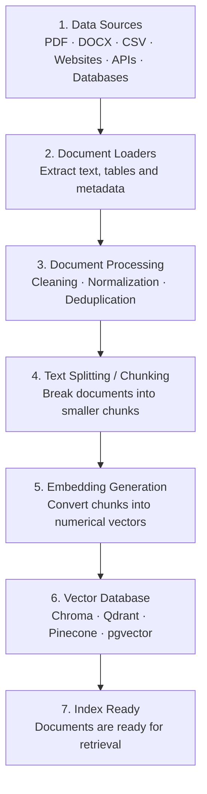
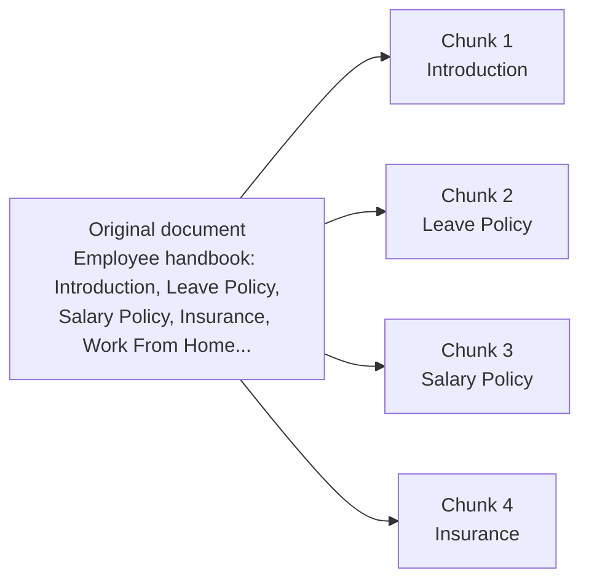
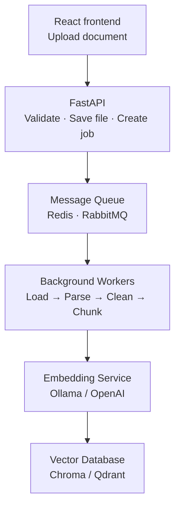
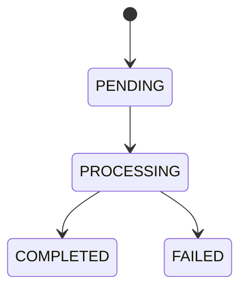

# RAG Ingestion Pipeline

An **ingestion pipeline** in RAG is the process of collecting data from different sources, extracting useful content, processing it, converting it into embeddings, and storing it in a vector database.

In simple terms:

> **Ingestion = taking raw data and making it searchable by an LLM.**

For example, imagine you're building your own ChatGPT-style application where users upload PDFs, Word documents, Excel files, CSVs or website URLs. Before users can ask questions about those documents, you need an ingestion pipeline.

---

## Table of Contents

1. [Complete RAG Ingestion Architecture](#1-complete-rag-ingestion-architecture)
2. [Stage-by-Stage Explanation](#2-stage-by-stage-explanation)
   - [Stage 1: Data Sources](#stage-1-data-sources)
   - [Stage 2: Document Loaders](#stage-2-document-loaders)
   - [Stage 3: Document Processing](#stage-3-document-processing)
   - [Stage 4: Chunking](#stage-4-chunking)
   - [Stage 5: Embedding Generation](#stage-5-embedding-generation)
   - [Stage 6: Vector Database Storage](#stage-6-vector-database-storage)
   - [Stage 7: Index Ready](#stage-7-index-ready)
3. [Complete Ingestion Pipeline: Code](#3-complete-ingestion-pipeline-code)
4. [Production Ingestion Pipeline: What Changes?](#4-production-ingestion-pipeline-what-changes)
5. [Important Production Concepts](#5-important-production-concepts)
6. [Suggested Database Design](#6-suggested-database-design)
7. [API Design Using FastAPI](#7-api-design-using-fastapi)
8. [Recommended Project: Document AI](#8-recommended-project-document-ai)
9. [Learning Roadmap](#9-learning-roadmap)
10. [Ingestion vs Retrieval vs Generation](#10-ingestion-vs-retrieval-vs-generation)

---

## 1. Complete RAG Ingestion Architecture

### RAG ingestion workflow



Let's understand every stage.

---

## 2. Stage-by-Stage Explanation

### Stage 1: Data Sources

First, collect data from different sources.

| Source | Example |
| --- | --- |
| Files | PDF, DOCX, CSV |
| Websites | URLs, documentation |
| Cloud | Google Drive, S3 |
| Databases | PostgreSQL, MongoDB |
| Communication | Slack, Notion |
| Code | GitHub repositories |

In production, you may have multiple ingestion methods:

- Manual upload
- Scheduled ingestion
- Webhooks
- Database change streams
- API integrations

### Stage 2: Document Loaders

Loaders extract content from the sources.

```python
from langchain_community.document_loaders import PyPDFLoader

loader = PyPDFLoader("company-policy.pdf")
documents = loader.load()

print(documents[0].page_content)
print(documents[0].metadata)
```

Output:

```python
Document(
    page_content="Employees are entitled to 20 days...",
    metadata={
        "source": "company-policy.pdf",
        "page": 0
    }
)
```

The output is generally a collection of `Document` objects.

### Stage 3: Document Processing

Raw extracted text is not always clean. You may encounter:

- Extra whitespace
- HTML tags
- Duplicate content
- Headers and footers
- Irrelevant characters
- Broken formatting

You clean and normalize the content:

```python
import re

clean_text = lambda text: re.sub(r"\s+", " ", text).strip()

for doc in documents:
    doc.page_content = clean_text(doc.page_content)
```

> **Production tip:** don't blindly remove all formatting. Preserve meaningful headings, tables, lists and paragraph boundaries.

### Stage 4: Chunking

**Why do we need chunking?** Suppose a PDF has 100 pages and contains 50,000 words. You generally don't want to embed the entire document as one vector. Instead, split it into smaller chunks.



Example using LangChain:

```python
from langchain_text_splitters import RecursiveCharacterTextSplitter

splitter = RecursiveCharacterTextSplitter(
    chunk_size=1000,
    chunk_overlap=200
)

chunks = splitter.split_documents(documents)
print(len(chunks))
```

Important concepts to explore separately:

- Chunk size
- Chunk overlap
- Recursive splitting
- Semantic chunking
- Parent-child chunking

### Stage 5: Embedding Generation

Now we convert each chunk into a numerical vector using an embedding model.

```text
"Employees get 20 annual leaves"
              |
              v
       Embedding Model
              |
              v
[0.12, 0.45, 0.89, 0.23, ...]
```

These vectors represent the **semantic meaning** of the text. Common options:

| Model | Usage |
| --- | --- |
| Ollama `nomic-embed-text` | Local embedding |
| Ollama `mxbai-embed-large` | Local embedding |
| OpenAI embeddings | Hosted embedding API |
| BGE models | Open-source embeddings |
| E5 models | Open-source embeddings |

Example with Ollama and LangChain:

```bash
pip install langchain-ollama
```

```python
from langchain_ollama import OllamaEmbeddings

embeddings = OllamaEmbeddings(model="nomic-embed-text")

vector = embeddings.embed_query("What is the leave policy?")
print(len(vector))
print(vector[:5])
```

> **Important:** use the same compatible embedding model and vector dimensions for indexing and querying. If you change embedding models, you generally need to re-embed your existing data.

### Stage 6: Vector Database Storage

Now store the embeddings along with their original text and metadata.

| Database | Best use case |
| --- | --- |
| Chroma | Local development and prototypes |
| FAISS | Local similarity search |
| Qdrant | Production vector search |
| Pinecone | Managed vector database |
| Weaviate | Advanced vector search |
| pgvector | PostgreSQL-based applications |

Example using Chroma:

```bash
pip install langchain-chroma
```

```python
from langchain_chroma import Chroma

vectorstore = Chroma.from_documents(
    documents=chunks,
    embedding=embeddings,
    collection_name="company_docs",
    persist_directory="./chroma_db"
)
```

Your documents are now indexed and ready for retrieval.

### Stage 7: Index Ready

Your vector database now contains records similar to:

```json
{
  "id": "chunk_001",
  "document": "Employees are entitled to 20 annual leaves...",
  "metadata": {
    "source": "company-policy.pdf",
    "page": 2,
    "chunk_index": 1
  },
  "embedding": [0.12, 0.45, 0.89]
}
```

The actual vector database stores the embedding as a vector, not necessarily in this exact JSON representation.

Now when the user asks *"What is the annual leave policy?"*, the retrieval pipeline can search for semantically similar chunks.

---

## 3. Complete Ingestion Pipeline: Code

Let's combine everything into one Python implementation using LangChain, `PyPDFLoader`, `RecursiveCharacterTextSplitter`, Ollama embeddings and ChromaDB.

```python
from langchain_community.document_loaders import PyPDFLoader
from langchain_text_splitters import RecursiveCharacterTextSplitter
from langchain_ollama import OllamaEmbeddings
from langchain_chroma import Chroma

# 1. Load documents
loader = PyPDFLoader("company-policy.pdf")
documents = loader.load()

# 2. Clean extracted text
for doc in documents:
    doc.page_content = doc.page_content.strip()

# 3. Split documents into chunks
splitter = RecursiveCharacterTextSplitter(
    chunk_size=1000,
    chunk_overlap=200
)
chunks = splitter.split_documents(documents)

# 4. Generate embeddings
embeddings = OllamaEmbeddings(model="nomic-embed-text")

# 5. Store in Chroma
vectorstore = Chroma.from_documents(
    documents=chunks,
    embedding=embeddings,
    collection_name="company_docs",
    persist_directory="./chroma_db"
)

print(f"Indexed {len(chunks)} chunks")
```

Ensure Ollama is running and the embedding model has been pulled:

```bash
ollama pull nomic-embed-text
```

> This is a basic ingestion implementation. A production application needs document IDs, deduplication, update handling, error handling and background processing.

---

## 4. Production Ingestion Pipeline: What Changes?

In a real application, ingestion should **not** happen synchronously inside your upload API request.

Imagine 100 users uploading large PDFs simultaneously. If your FastAPI endpoint loads, chunks and embeds every document before returning a response, requests become slow and consume significant resources. Instead, use **asynchronous background processing**.

### Production architecture



A separate relational database can maintain document and ingestion-job status:

| Document ID | Status |
| --- | --- |
| `doc_001` | Completed |
| `doc_002` | Processing |
| `doc_003` | Failed |
| `doc_004` | Pending |

Useful status transitions:



The frontend can poll a job-status endpoint or receive updates through WebSockets or Server-Sent Events.

---

## 5. Important Production Concepts

These are the concepts that separate a basic RAG developer from someone who can build production ingestion systems.

| Concept | Problem it solves |
| --- | --- |
| Incremental ingestion | Avoid reprocessing unchanged documents |
| Deduplication | Prevent duplicate chunks |
| Content hashing | Detect document changes |
| Versioning | Maintain document versions |
| Checkpointing | Resume interrupted jobs |
| Batch embeddings | Process multiple chunks efficiently |
| Retry mechanism | Recover from temporary failures |
| Metadata filtering | Filter by source, user or department |
| Document deletion | Remove obsolete chunks |
| OCR | Extract text from scanned documents |
| Access control | Ensure users retrieve only authorized documents |

### Incremental ingestion example

Suppose a user uploads `policy.pdf` today. Tomorrow, the user uploads an updated version. You should:

1. Calculate the file's SHA-256 hash.
2. Compare it with the previously stored hash.
3. If unchanged, skip ingestion.
4. If changed, extract and process the new version.
5. Generate new embeddings.
6. Replace the old chunks.
7. Update document metadata and status.

This avoids unnecessary embedding costs.

---

## 6. Suggested Database Design

For a production application, separate document management from vector storage.

### Documents table

| Field | Description |
| --- | --- |
| `id` | Document ID |
| `user_id` | Owner |
| `filename` | Original filename |
| `file_hash` | SHA-256 hash |
| `status` | Processing status |
| `version` | Document version |
| `created_at` | Upload timestamp |

### Ingestion Jobs table

| Field | Description |
| --- | --- |
| `id` | Job ID |
| `document_id` | Related document |
| `status` | Pending / Processing / Completed / Failed |
| `error` | Error details |
| `started_at` | Job start |
| `completed_at` | Job completion |

### Vector collection

- `chunk_id`
- `document_id`
- `chunk_index`
- `page_number`
- `content`
- `embedding`
- `metadata`

---

## 7. API Design Using FastAPI

Suggested endpoints:

| Method | Endpoint | Responsibility |
| --- | --- | --- |
| `POST` | `/documents/upload` | Upload document |
| `GET` | `/documents` | List documents |
| `GET` | `/documents/{id}` | Document details |
| `GET` | `/ingestion/jobs/{id}` | Check ingestion status |
| `DELETE` | `/documents/{id}` | Delete document and chunks |
| `POST` | `/documents/{id}/reindex` | Reprocess document |

Example upload endpoint:

```python
from fastapi import FastAPI, UploadFile, File
from uuid import uuid4

app = FastAPI()


@app.post("/documents/upload")
async def upload_document(file: UploadFile = File(...)):
    document_id = str(uuid4())

    # 1. Validate file
    # 2. Save file to storage
    # 3. Create document record
    # 4. Create ingestion job
    # 5. Push job to queue

    return {
        "document_id": document_id,
        "status": "PENDING"
    }
```

The worker processes the job independently.

---

## 8. Recommended Project: Document AI

If your learning stack includes FastAPI, Ollama, Chroma and React, build a mini **document intelligence platform** as a portfolio project.

### Features

- Upload PDF, DOCX, CSV and TXT.
- Automatically identify the loader.
- Process documents in background workers.
- Track ingestion progress.
- Store embeddings in Chroma.
- Ask questions about uploaded documents.
- Show citations with page numbers.
- Update and delete documents.
- Support multiple users with isolated data.

### Technology stack

| Layer | Technology |
| --- | --- |
| Frontend | React |
| API | FastAPI |
| RAG framework | LangChain |
| Models | Ollama |
| Vector DB | ChromaDB |
| Queue | Redis |
| Relational DB | PostgreSQL |
| Deployment | Docker |

---

## 9. Learning Roadmap

Don't jump directly into agents or advanced RAG. Understand the entire ingestion and retrieval lifecycle first.

### RAG learning roadmap

| Step | Topic | Focus |
| --- | --- | --- |
| 1 | Loaders | **Current topic.** Extract data from PDF, DOCX, CSV, websites and databases |
| 2 | Document processing | Cleaning, normalization, metadata extraction, deduplication |
| 3 | Text splitters | Recursive, semantic, token-based and parent-child chunking |
| 4 | Embeddings | Models, dimensions, similarity, vector representations |
| 5 | Vector databases | Chroma, Qdrant, FAISS, pgvector, indexing |
| 6 | Retrieval strategies | Similarity search, MMR, hybrid search, metadata filtering |
| 7 | Reranking | Cross-encoders and relevance scoring |
| 8 | Advanced RAG | Query rewriting, multi-query retrieval, contextual compression |
| 9 | Evaluation | Recall@K, Precision@K, MRR, faithfulness, answer relevance |
| 10 | Production RAG | Background ingestion, monitoring, scaling, security, evaluation |

**Your progress: 0%** — tick the boxes below as you go.

### Step 1: Loaders *(current topic)*

- [ ] Extract data from PDF files
- [ ] Extract data from DOCX and CSV files
- [ ] Extract data from websites
- [ ] Extract data from databases

### Step 2: Document processing

- [ ] Cleaning and normalization
- [ ] Metadata extraction
- [ ] Deduplication

### Step 3: Text splitters

- [ ] Recursive splitting
- [ ] Semantic chunking
- [ ] Token-based splitting
- [ ] Parent-child chunking

### Step 4: Embeddings

- [ ] Embedding models and dimensions
- [ ] Similarity measures
- [ ] Vector representations

### Step 5: Vector databases

- [ ] Chroma
- [ ] Qdrant
- [ ] FAISS
- [ ] pgvector
- [ ] Indexing

### Step 6: Retrieval strategies

- [ ] Similarity search
- [ ] MMR
- [ ] Hybrid search
- [ ] Metadata filtering

### Step 7: Reranking

- [ ] Cross-encoders
- [ ] Relevance scoring

### Step 8: Advanced RAG

- [ ] Query rewriting
- [ ] Multi-query retrieval
- [ ] Contextual compression

### Step 9: Evaluation

- [ ] Recall@K and Precision@K
- [ ] MRR
- [ ] Faithfulness
- [ ] Answer relevance

### Step 10: Production RAG

- [ ] Background ingestion
- [ ] Monitoring
- [ ] Scaling
- [ ] Security
- [ ] Evaluation in production

---

## 10. Ingestion vs Retrieval vs Generation

One important distinction to remember for interviews:

| Pipeline | Responsibility |
| --- | --- |
| **Ingestion** | Prepares and indexes your knowledge |
| **Retrieval** | Finds relevant knowledge |
| **Generation** | Uses retrieved knowledge to produce an answer |

Master these three pipelines and you'll have a strong foundation in RAG architecture.
