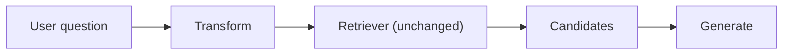

import TOCInline from '@theme/TOCInline';

# Query Transformation Patterns

<TOCInline toc={toc} minHeadingLevel={2} maxHeadingLevel={2} />

:::tip[In this guide]
The user's question is rarely a good search query. This page covers every
transform you can apply before retrieval — rewriting, expansion, HyDE,
step-back, decomposition and routing — with working code, honest cost numbers,
and how to parallelise them so the latency doesn't stack.
:::

## What Is It?

Query transformation is any step that sits between "user typed something" and
"we call the retriever". It changes, expands, abstracts, splits or redirects
the query. The retriever and the index stay exactly the same.



That's why these patterns are attractive: they're additive. You can bolt one
on without re-indexing anything.

## Why Does It Matter?

Vector search is only as good as the query vector. Three concrete gaps:

| Gap | Example | Why retrieval fails |
| --- | --- | --- |
| Conversational reference | "what about the second one?" | The query vector carries no topic at all |
| Phrasing mismatch | "why is it slow" vs docs saying "latency regression causes" | Lands in a different neighbourhood of the space |
| Asymmetry | 6-word question vs 400-word document | Questions and answers have different shapes; the nearest document to a question is often another question |

Transforms close those gaps. The cost is always at least one extra LLM call,
which means latency, money and one more thing that can fail.

---

## Query Rewriting

### Normalisation

The cheapest useful transform. Turn keyword soup or a typo-laden sentence
into a clean search query.

```python
from langchain_core.prompts import ChatPromptTemplate
from langchain_core.output_parsers import StrOutputParser
from langchain_openai import ChatOpenAI

llm = ChatOpenAI(model="gpt-4o-mini", temperature=0)

rewrite_prompt = ChatPromptTemplate.from_messages([
    ("system",
     "Rewrite the user's input as a single, self-contained search query. "
     "Keep all proper nouns, identifiers and numbers exactly as written. "
     "Do not answer the question. Return only the query."),
    ("human", "{question}"),
])

rewriter = rewrite_prompt | llm | StrOutputParser()

rewriter.invoke({"question": "refund polcy how long wait"})
# -> "How long does the refund policy take to process?"
```

Two things matter in that system prompt. **Keep identifiers verbatim** — an
LLM that "cleans up" `ERR_504` into "error 504" has just broken your keyword
index. And **do not answer** — rewriters drift into answering constantly.

### Conversational rewriting

This is the one that actually earns its keep. In multi-turn chat, the latest
message is usually unretrievable on its own.

```python
from langchain_core.prompts import ChatPromptTemplate

condense_prompt = ChatPromptTemplate.from_messages([
    ("system",
     "Given a conversation and a follow-up message, rewrite the follow-up as a "
     "standalone question that can be understood without the conversation. "
     "Resolve all pronouns and references like 'it', 'that one', 'the second'. "
     "If the follow-up is already standalone, return it unchanged."),
    ("human", "Conversation:\n{history}\n\nFollow-up: {question}\n\nStandalone question:"),
])

condenser = condense_prompt | llm | StrOutputParser()


def format_history(messages: list[dict], max_turns: int = 6) -> str:
    recent = messages[-max_turns * 2:]
    return "\n".join(f"{m['role']}: {m['content']}" for m in recent)


history = [
    {"role": "user", "content": "Which plans support SSO?"},
    {"role": "assistant", "content": "Business and Enterprise both support SAML SSO."},
]
condenser.invoke({
    "history": format_history(history),
    "question": "what about the second one, does it do SCIM too?",
})
# -> "Does the Enterprise plan support SCIM provisioning?"
```

Practical notes from running this in production:

- Cap the history you pass in. Six turns is plenty and keeps the call fast.
- Add a cheap guard: if the follow-up is longer than ~12 words and contains a
  proper noun, it's probably already standalone — skip the call.
- Log the rewrite alongside the original. When retrieval goes wrong in chat,
  the rewrite is the first place to look, and you'll be blind without it.
- Use `temperature=0`. You want this deterministic.

---

## Multi-Query Expansion

Generate several phrasings, retrieve for each, merge. One phrasing samples one
point in embedding space; N phrasings sample a neighbourhood.

```python
import asyncio
from langchain_core.prompts import ChatPromptTemplate
from langchain_core.output_parsers import StrOutputParser

multi_query_prompt = ChatPromptTemplate.from_template(
    "Generate {n} different search queries for the question below. "
    "Vary the vocabulary and specificity. One query per line, no numbering.\n\n"
    "Question: {question}"
)

query_gen = multi_query_prompt | llm | StrOutputParser()


async def generate_queries(question: str, n: int = 4) -> list[str]:
    raw = await query_gen.ainvoke({"question": question, "n": n})
    queries = [q.strip() for q in raw.splitlines() if q.strip()]
    return [question, *queries]        # always keep the original
```

Keeping the original query in the list is not optional. The generated
paraphrases can all drift in the same wrong direction; the original is your
anchor.

---

## RAG-Fusion

Multi-Query plus RRF instead of a naive union. Documents that several
independent phrasings agree on get promoted — which is a much better
relevance signal than any single score. RRF mechanics are covered in
[hybrid search](../06-rag/10-hybrid-search.mdx); here it fuses
per-query lists rather than per-retriever lists.

```python
import asyncio
from collections import defaultdict


def reciprocal_rank_fusion(
    rankings: list[list[str]], k: int = 60
) -> list[tuple[str, float]]:
    scores: dict[str, float] = defaultdict(float)
    for ranking in rankings:
        for rank, doc_id in enumerate(ranking):
            scores[doc_id] += 1.0 / (k + rank + 1)
    return sorted(scores.items(), key=lambda kv: kv[1], reverse=True)


async def rag_fusion(question: str, retriever, n: int = 4, top_k: int = 6):
    queries = await generate_queries(question, n=n)

    # Fan out all retrievals concurrently — this is what keeps latency sane.
    result_sets = await asyncio.gather(
        *(retriever.aretrieve(q, top_k=20) for q in queries)
    )

    by_id = {d["id"]: d for docs in result_sets for d in docs}
    rankings = [[d["id"] for d in docs] for docs in result_sets]
    fused = reciprocal_rank_fusion(rankings)
    return [by_id[doc_id] for doc_id, _ in fused[:top_k]]
```

:::warning[RAG-Fusion multiplies your retrieval bill]
With `n=4` you issue 5 queries. That's 5 embedding calls and 5 vector searches
per user request, and 5× the read load on your vector database. If you're on
a hosted vector DB priced per query, this is the pattern that shows up on the
invoice. It also returns up to 100 candidates, so your reranker now has 5×
the work. Measure whether recall actually improved before shipping it — on
well-chunked corpora with hybrid search already in place, the lift is often
small.
:::

---

## HyDE

Generate a *hypothetical answer* to the question, then embed that instead of
(or alongside) the question.

### Why it helps

This is query/document asymmetry, concretely. Your index contains passages
that look like:

```text
"Refund requests are processed within 5-7 business days. Requests submitted
after 30 days from purchase require manager approval and may be declined..."
```

Your query looks like `"how long for refund"`. Embedding models place short
interrogative fragments and long declarative passages in different regions —
not because they're about different things, but because they have different
*shape*. The nearest neighbour to a question is frequently another question.

HyDE sidesteps that by making the query look like a document:

```python
hyde_prompt = ChatPromptTemplate.from_template(
    "Write a short, factual passage (3-4 sentences) that would answer this "
    "question, as if excerpted from internal documentation. Be specific and "
    "use plausible domain vocabulary. Do not hedge or mention uncertainty.\n\n"
    "Question: {question}\n\nPassage:"
)

hyde_chain = hyde_prompt | llm | StrOutputParser()


async def hyde_retrieve(question: str, retriever, top_k: int = 6):
    hypothetical = await hyde_chain.ainvoke({"question": question})
    # Search with both: the fake answer for shape, the real question as anchor.
    doc_sets = await asyncio.gather(
        retriever.aretrieve(hypothetical, top_k=20),
        retriever.aretrieve(question, top_k=20),
    )
    by_id = {d["id"]: d for docs in doc_sets for d in docs}
    rankings = [[d["id"] for d in docs] for docs in doc_sets]
    fused = reciprocal_rank_fusion(rankings)
    return [by_id[doc_id] for doc_id, _ in fused[:top_k]]
```

The point is not that the hypothetical answer is correct. It's that it's
*shaped* like a document and uses the right vocabulary, so it lands near real
documents on the topic.

### When it hurts

- **Niche or proprietary domains.** The model has no knowledge of your
  internal systems, so it invents confident nonsense with plausible-sounding
  but wrong vocabulary, and retrieval follows it off a cliff.
- **Entity-specific questions.** "What is Acme Corp's contract end date?"
  produces a hallucinated date that pollutes the query vector.
- **Short factual lookups.** Nothing to gain; you've added a full generation
  to answer "what's the SSO toggle called?".

Always fuse with the original query, as above. It limits the damage when the
hypothetical goes wrong.

---

## Step-Back Prompting

Ask a more general question first, retrieve for both the specific and the
general, and give the model both sets. Useful when the specific question's
terms appear nowhere but the governing concept is well documented.

```python
step_back_prompt = ChatPromptTemplate.from_messages([
    ("system",
     "Given a specific question, write one more general question about the "
     "underlying concept or principle involved. Return only that question."),
    ("human", "{question}"),
])

step_back = step_back_prompt | llm | StrOutputParser()

# "Does our retention policy let us keep EU user logs for 18 months?"
#   -> "What are the data retention rules for EU user data?"


async def step_back_retrieve(question: str, retriever, top_k: int = 8):
    general = await step_back.ainvoke({"question": question})
    specific_docs, general_docs = await asyncio.gather(
        retriever.aretrieve(question, top_k=top_k // 2),
        retriever.aretrieve(general, top_k=top_k // 2),
    )
    seen, merged = set(), []
    for doc in [*specific_docs, *general_docs]:
        if doc["id"] not in seen:
            seen.add(doc["id"])
            merged.append(doc)
    return merged
```

Step-back shines on "does rule X apply to case Y" questions, where case Y
isn't in the docs but rule X is. It does nothing for lookup questions.

---

## Query Decomposition

Comparative and multi-part questions need multiple retrievals and a synthesis
step. "How does our pricing compare to our SLA commitments for enterprise?"
is two questions wearing one coat.

```python
from pydantic import BaseModel, Field


class SubQuestions(BaseModel):
    """Decomposition of a complex question."""
    needs_decomposition: bool = Field(
        description="False if the question is already atomic."
    )
    sub_questions: list[str] = Field(
        default_factory=list,
        description="2-4 atomic sub-questions, each independently answerable.",
    )


decompose_prompt = ChatPromptTemplate.from_messages([
    ("system",
     "Break the question into atomic sub-questions only if it genuinely asks "
     "about multiple things or requires multiple lookups. Otherwise set "
     "needs_decomposition to false and return an empty list."),
    ("human", "{question}"),
])

decomposer = decompose_prompt | llm.with_structured_output(SubQuestions)


async def answer_with_decomposition(question: str, retriever, rag_chain) -> str:
    plan = await decomposer.ainvoke({"question": question})
    if not plan.needs_decomposition:
        return await rag_chain.ainvoke(question)

    # Answer each sub-question concurrently, then synthesise.
    answers = await asyncio.gather(
        *(rag_chain.ainvoke(sq) for sq in plan.sub_questions)
    )
    notes = "\n\n".join(
        f"Q: {q}\nA: {a}" for q, a in zip(plan.sub_questions, answers)
    )
    synthesis_prompt = ChatPromptTemplate.from_template(
        "Answer the original question using only the sub-answers below. "
        "If the sub-answers conflict, say so explicitly.\n\n"
        "Original question: {question}\n\nSub-answers:\n{notes}"
    )
    chain = synthesis_prompt | llm | StrOutputParser()
    return await chain.ainvoke({"question": question, "notes": notes})
```

Two traps. First, the sub-answers are summaries, so the synthesis step is
working from lossy input — errors compound. Second, if your sub-questions are
sequentially dependent ("who shipped feature X?" then "what region is that
person in?") you cannot run them in parallel, and latency goes up linearly.
That sequential case is where [agentic RAG](./09-agentic-rag.mdx) starts to
make more sense than a fixed pipeline.

---

## Query Routing

Classify the query, then pick a backend. This is the transform with the
highest accuracy payoff per LLM call, because sending a "how many customers
churned last quarter" question to a vector store is unrecoverable no matter
how good your retriever is.

```python
from typing import Literal
from pydantic import BaseModel, Field


class Route(BaseModel):
    """Which backend should answer this question."""
    destination: Literal["vectorstore", "sql", "web_search", "direct"] = Field(
        description=(
            "vectorstore: conceptual questions about internal docs, policies, "
            "how-to guides. "
            "sql: counts, sums, averages, rankings, anything about rows in the "
            "analytics database or a specific time range. "
            "web_search: current events, prices, anything after the training "
            "cutoff, or about third-party products. "
            "direct: greetings, chitchat, general knowledge needing no lookup."
        )
    )
    reasoning: str = Field(description="One sentence justification.")


router_prompt = ChatPromptTemplate.from_messages([
    ("system", "Route the user's question to exactly one backend."),
    ("human", "{question}"),
])

router = router_prompt | llm.with_structured_output(Route)


async def route_and_answer(question: str, backends: dict) -> str:
    route = await router.ainvoke({"question": question})
    handler = backends.get(route.destination, backends["direct"])
    return await handler(question)
```

Routing notes:

- Put the routing logic in the **field description**, not the system prompt.
  Structured-output models attend to field descriptions closely, and it keeps
  the routing rules in one place.
- Always include a `direct` route. A surprising share of real traffic needs no
  retrieval, and answering those without a vector search is both faster and
  more accurate.
- Use your smallest model. Classification does not need a frontier model, and
  this call is on the critical path for every request.
- Log every routing decision with its reasoning. Routing errors are silent —
  you get a confident answer from the wrong source.
- Consider a semantic-similarity router (embed the query, compare to centroid
  embeddings of each route's example questions) if you need sub-50 ms routing.
  No LLM call at all, slightly worse accuracy.

---

## Latency Budgeting

Each transform's cost, roughly, with a small fast model:

| Transform | Extra LLM calls | Output size | Typical added latency | Parallelisable |
| --- | --- | --- | --- | --- |
| Normalisation rewrite | 1 | ~20 tokens | 200-500 ms | With nothing |
| Conversational rewrite | 1 | ~25 tokens | 250-600 ms | No, blocks retrieval |
| Multi-Query generation | 1 | ~60 tokens | 400-800 ms | Retrievals, yes |
| RAG-Fusion | 1 + N retrievals | ~60 tokens | 500 ms-1.2 s | Retrievals, yes |
| HyDE | 1 | ~120 tokens | 700 ms-1.5 s | With the plain retrieval |
| Step-back | 1 | ~20 tokens | 250-600 ms | Both retrievals, yes |
| Decomposition | 1 + N RAG runs | ~80 tokens | 2-6 s | If sub-questions are independent |
| Routing | 1 | ~30 tokens | 200-500 ms | No, blocks everything |

The structural rule: **generation latency is driven by output tokens, not
input tokens.** That's why HyDE is the slow one — it writes a paragraph — and
why routing and rewriting are cheap even though they read the whole question.

### Parallelising

Transforms that don't depend on each other should run together.

```python
async def transform_and_retrieve(question: str, retriever, top_k: int = 8):
    # Independent transforms: fire them all at once.
    hypothetical, general, queries = await asyncio.gather(
        hyde_chain.ainvoke({"question": question}),
        step_back.ainvoke({"question": question}),
        generate_queries(question, n=3),
    )

    all_queries = [question, hypothetical, general, *queries]
    result_sets = await asyncio.gather(
        *(retriever.aretrieve(q, top_k=15) for q in all_queries)
    )

    by_id = {d["id"]: d for docs in result_sets for d in docs}
    fused = reciprocal_rank_fusion([[d["id"] for d in docs] for docs in result_sets])
    return [by_id[doc_id] for doc_id, _ in fused[:top_k]]
```

Wall-clock cost is now the *slowest* transform (HyDE, ~1.2 s) rather than the
sum (~2.5 s). Token cost is unchanged — you still pay for all of it.

Two caveats. Sequential dependencies can't be flattened: routing must finish
before you know which retriever to call, and conversational rewriting must
finish before any retrieval. And `asyncio.gather` with no concurrency limit
will happily open 20 connections and trip your provider's rate limit. Wrap
the calls in a `Semaphore` if the fan-out is wide.

```python
import asyncio

sem = asyncio.Semaphore(5)

async def limited(coro):
    async with sem:
        return await coro
```

---

## When to Skip All of This

Query transformation is the most over-applied family in the catalog. Skip it
when:

- **Your users type full, standalone questions.** Search-box traffic from
  technically literate users often needs no rewriting at all.
- **Your corpus is small.** Under a few thousand chunks, top-k with hybrid
  search sees most of the relevant material anyway.
- **You haven't added hybrid search and reranking yet.** Those cost no LLM
  calls and almost always beat a query transform on the same eval set.
- **Your latency budget is under a second.** One transform burns half of it.
- **The failure is on the generation side.** No query transform fixes a model
  that ignores its context. Diagnose first, per
  [RAG patterns](./04-rag-patterns.mdx).

The honest default: add conversational rewriting if you have chat, add routing
if you have more than one data source, and leave the rest alone until an eval
set tells you otherwise.

## Common Mistakes

- Letting the rewriter normalise identifiers, breaking exact-match retrieval.
- Dropping the original query from a Multi-Query or HyDE fan-out, so one bad
  generation destroys retrieval entirely.
- Running transforms sequentially when they're independent.
- Using a large model for routing and classification.
- Not logging the transformed query, making chat retrieval bugs undebuggable.
- Non-zero temperature on transforms, so the same question retrieves
  differently on each attempt.
- Decomposing questions that were already atomic — check first, then split.
- Stacking HyDE, Multi-Query and step-back together and calling the resulting
  4-second p95 acceptable.

## Interview Questions

- Why does the nearest neighbour to a question often turn out to be another
  question rather than its answer?
- Explain the difference between Multi-Query and RAG-Fusion.
- When does HyDE actively make retrieval worse?
- How would you resolve "what about the second one?" into a searchable query?
- Which query transforms can you run in parallel and which cannot?
- You have a 1-second p95 budget. Which transforms fit?
- Why put routing rules in a Pydantic field description rather than the system
  prompt?

## Things to Remember

- The user's question is an input to search, not the search query itself.
- Conversational rewriting and routing are the two transforms that reliably
  pay for themselves.
- Always fuse transformed queries with the original.
- `temperature=0` everywhere in this file.
- Latency comes from output tokens — HyDE is slow because it writes a paragraph.
- Fan out with `asyncio.gather`, bound it with a `Semaphore`.
- Hybrid search and reranking cost zero LLM calls. Exhaust them first.

## Mini Exercise

Take ten real questions from your logs, including at least three
conversational follow-ups. Run plain retrieval, then rewriting, then HyDE, and
record recall@5 plus wall-clock latency for each. Then run HyDE and Multi-Query
concurrently with `asyncio.gather` and confirm the wall-clock time is close to
the slower of the two rather than the sum. Write down which transform you'd
actually ship, and why.

## Done When

- [ ] You can rewrite a conversational follow-up into a standalone query.
- [ ] You can implement RAG-Fusion with RRF over multiple generated queries.
- [ ] You can explain query/document asymmetry and how HyDE addresses it.
- [ ] You have a router with structured output and a `direct` no-retrieval route.
- [ ] You can state the added latency of each transform in your pipeline.

Next: [Context Construction Patterns](./06-context-construction.mdx).
