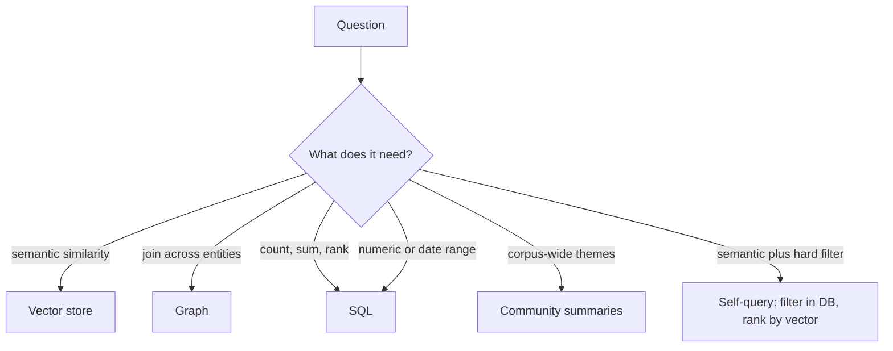
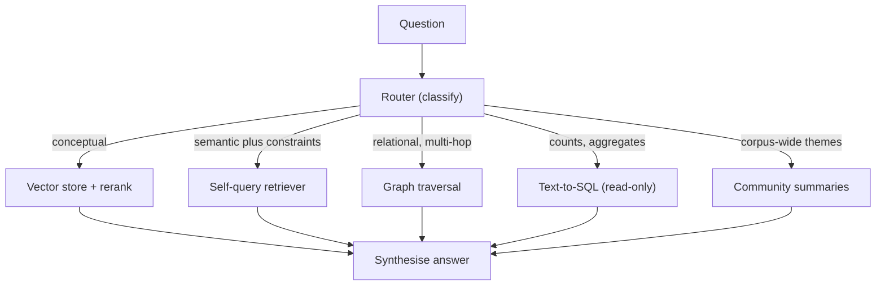

import TOCInline from '@theme/TOCInline';

# Graph & Structured RAG

<TOCInline toc={toc} minHeadingLevel={2} maxHeadingLevel={2} />

:::tip[In this guide]
Some questions are structurally unanswerable by vector search — multi-hop
joins, aggregations, precise numeric and date filters. This page covers
knowledge-graph retrieval, GraphRAG community summaries, text-to-SQL done
safely, and self-query retrievers, plus an honest look at the maintenance cost.
:::

## What Is It?

Graph and structured RAG replace or supplement the vector index with a
retrieval backend that has **structure**: a graph of entities and relations, or
a relational database with a schema. Retrieval becomes traversal or query
execution rather than nearest-neighbour search.

## Why Does It Matter?

### The failure mode

Three question shapes where vector search doesn't just underperform — it
cannot work in principle.

**Multi-hop joins.** "Which of our EU customers use the feature Alice
shipped?" The answer exists nowhere as text. It requires: find Alice, find
what she shipped, find who uses that, filter by region. Four hops across four
documents. Embedding that question produces a vector near documents about
Alice *or* about EU customers *or* about features — it has no way to represent
a join.

**Aggregations.** "How many support tickets mentioned the billing bug last
month?" The number 47 is not written in any document. Vector search can only
retrieve documents; counting is a computation over all of them, and top-k by
definition doesn't look at all of them.

**Precise numeric and temporal filters.** "Contracts expiring between March
and June with value over 50k." Embeddings represent numbers as tokens with no
ordering. `$50,000` and `$5,000` embed close together. `March 2024` and
`March 2023` embed close together. The comparison operator doesn't exist in
the vector space.



The honest framing: these aren't cases where you should tune your retriever.
They're cases where you need a different retriever.

---

## Knowledge-Graph RAG

### Extraction

Build the graph by running an LLM over your corpus to pull out entities and
the relations between them. Structured output is essential here — free-text
extraction produces unusable variation.

```python
from typing import Literal
from pydantic import BaseModel, Field
from langchain_core.prompts import ChatPromptTemplate
from langchain_openai import ChatOpenAI

llm = ChatOpenAI(model="gpt-4o-mini", temperature=0)


class Entity(BaseModel):
    name: str = Field(description="Canonical name, as written in the text.")
    type: Literal["Person", "Company", "Product", "Feature", "Region", "Event"]


class Relation(BaseModel):
    source: str = Field(description="Name of the source entity.")
    target: str = Field(description="Name of the target entity.")
    predicate: Literal[
        "WORKS_AT", "SHIPPED", "USES", "LOCATED_IN", "ACQUIRED",
        "DEPENDS_ON", "REPORTS_TO", "MENTIONED_IN",
    ]
    evidence: str = Field(description="The sentence supporting this relation.")


class Extraction(BaseModel):
    entities: list[Entity]
    relations: list[Relation]


EXTRACT = ChatPromptTemplate.from_messages([
    ("system",
     "Extract entities and relations from the text. Use ONLY the allowed types "
     "and predicates. Do not infer relations that are not stated. Every "
     "relation must quote the sentence that supports it. Use the entity name "
     "exactly as it appears in the text; do not expand abbreviations."),
    ("human", "{text}"),
])

extractor = EXTRACT | llm.with_structured_output(Extraction)
```

Three things in that prompt are doing real work:

- **A closed predicate set.** Let the model invent predicates and you get
  `USES`, `uses`, `IS_USING` and `UTILIZES` as four separate edge types, and
  no traversal ever matches.
- **"Do not infer."** Extractors hallucinate relations enthusiastically. An
  invented edge is worse than a missing one because traversal will follow it
  confidently.
- **Required evidence.** Gives you an audit trail and makes the model more
  conservative. It also means you can cite the source sentence in the answer.

### Entity resolution

The hardest part, and the part that gets skipped. "Alice Chen", "A. Chen",
"alice@example.com" and "Alice" are one person. If they're four nodes, every
multi-hop query silently returns partial results.

```python
import re
import unicodedata


def canonical_key(name: str) -> str:
    """Cheap normalisation. Not sufficient alone, but catches the easy cases."""
    text = unicodedata.normalize("NFKD", name).encode("ascii", "ignore").decode()
    text = re.sub(r"[^\w\s]", "", text).lower().strip()
    return re.sub(r"\s+", " ", text)
```

Beyond normalisation you need embedding similarity on entity names, blocking
by entity type, and — realistically — a human-reviewed alias table for your
important entities. Budget for this. It's not a weekend task on a real corpus.

### Retrieval by traversal

With Neo4j, the pattern is: find seed entities mentioned in the question, then
traverse outward.

```python
from neo4j import AsyncGraphDatabase

driver = AsyncGraphDatabase.driver(
    "bolt://localhost:7687", auth=("neo4j", password)
)

NEIGHBOURHOOD = """
MATCH (seed:Entity)
WHERE seed.key IN $seed_keys
MATCH path = (seed)-[r*1..2]-(related:Entity)
RETURN seed.name AS seed,
       [rel IN relationships(path) | {type: type(rel), evidence: rel.evidence}]
         AS hops,
       related.name AS related,
       related.type AS related_type
LIMIT $limit
"""


async def graph_retrieve(seed_keys: list[str], limit: int = 50) -> list[dict]:
    async with driver.session() as session:
        result = await session.run(
            NEIGHBOURHOOD, seed_keys=seed_keys, limit=limit
        )
        return [record.data() async for record in result]
```

The `*1..2` bounds the hop count. Leave it unbounded on a dense graph and you
will traverse most of it. Two hops answers the large majority of real multi-hop
questions; three is occasionally needed; beyond that you're doing graph
analytics, not retrieval.

:::note[Use parameters, never string interpolation]
`$seed_keys` is a Cypher parameter. Building the query by formatting entity
names into the string is Cypher injection — same class of bug as SQL
injection, and the entity names came from an LLM reading untrusted documents.
:::

For a small graph, `networkx` avoids the infrastructure entirely:

```python
import networkx as nx


def build_graph(extractions: list[Extraction]) -> nx.MultiDiGraph:
    graph = nx.MultiDiGraph()
    for extraction in extractions:
        for entity in extraction.entities:
            graph.add_node(canonical_key(entity.name),
                           name=entity.name, type=entity.type)
        for rel in extraction.relations:
            graph.add_edge(
                canonical_key(rel.source),
                canonical_key(rel.target),
                predicate=rel.predicate,
                evidence=rel.evidence,
            )
    return graph


def neighbourhood_text(graph: nx.MultiDiGraph, seeds: list[str], hops: int = 2) -> str:
    """Flatten the n-hop neighbourhood into facts an LLM can read."""
    nodes: set[str] = set()
    for seed in seeds:
        if seed in graph:
            nodes |= set(nx.ego_graph(graph.to_undirected(), seed, radius=hops).nodes)

    lines: list[str] = []
    for source, target, data in graph.edges(nodes, data=True):
        if source in nodes and target in nodes:
            lines.append(
                f"{graph.nodes[source]['name']} --{data['predicate']}--> "
                f"{graph.nodes[target]['name']}  ({data['evidence']})"
            )
    return "\n".join(sorted(set(lines)))
```

Then the generation prompt gets a list of facts rather than prose chunks,
which is a notably easier reasoning task for the model.

Seeding matters: identify which entities the question is about before you
traverse. A small LLM call extracting entity mentions from the question works
well; so does fuzzy-matching question tokens against your entity index.

---

## GraphRAG and Community Summaries

Microsoft's GraphRAG adds one significant idea on top of graph retrieval:
**hierarchical community summaries**.

The pipeline: extract the graph, run community detection (Leiden) to find
clusters of densely connected entities, then have an LLM write a summary of
each community, and summaries of groups of communities, up the hierarchy.

This answers a question class nothing else handles: **global, corpus-wide
questions.**

| Question | Local retrieval | Community summaries |
| --- | --- | --- |
| "What did Alice ship?" | Works — traverse from Alice | Overkill |
| "What are the main themes in these 10,000 tickets?" | Fails — top-k sees 10 tickets | Works — read the summaries |
| "What risks recur across our contracts?" | Fails | Works |

Top-k retrieval is structurally incapable of a "what are the themes" question,
because the answer is a property of the whole corpus and top-k looks at ten
documents. Community summaries pre-compute the aggregation.

Two query modes:

- **Local search** — start from entities in the question, traverse, include
  their community's summary for context.
- **Global search** — map over community summaries to produce partial answers,
  then reduce them into one. This is map-reduce over your corpus structure.

:::warning[The indexing cost is the headline, not a footnote]
GraphRAG indexing runs an LLM over every chunk for extraction, then again for
every community summary at every level of the hierarchy. On a corpus of a few
thousand documents this is commonly **hundreds of dollars and many hours**,
and it is not incremental — adding documents can shift community boundaries,
which invalidates summaries above them. Teams routinely build it once,
discover re-indexing is painful, and let it go stale.

Before committing: pull 20 real questions from your logs and count how many
actually need global reasoning. If the answer is two, build community
summaries over a curated subset of your corpus, not all of it.
:::

---

## Text-to-SQL as Retrieval

When the question is about numbers, retrieval means running a query.

### Schema-aware prompting

The model needs the schema, and nothing but the schema it's allowed to touch.

```python
ALLOWED_TABLES = {"customers", "subscriptions", "tickets", "features"}

SCHEMA_DOC = """
Tables you may query (read-only):

customers(id, name, region, created_at, plan)
  region is one of: 'EU', 'US', 'APAC'
  plan is one of: 'free', 'business', 'enterprise'

subscriptions(id, customer_id, feature_id, started_at, ended_at)
  ended_at IS NULL means currently active

tickets(id, customer_id, subject, body, created_at, status)
  status is one of: 'open', 'closed', 'escalated'

features(id, name, shipped_by, shipped_at)

Rules:
- Use only these tables and columns.
- Always include a LIMIT clause of at most 200.
- Never use INSERT, UPDATE, DELETE, DROP, ALTER, CREATE, GRANT or COPY.
- Prefer explicit JOIN ... ON over implicit joins.
"""


class SqlQuery(BaseModel):
    sql: str = Field(description="A single read-only SELECT statement.")
    explanation: str = Field(description="One sentence on what it returns.")


sql_writer = (
    ChatPromptTemplate.from_messages([
        ("system", "You write PostgreSQL queries.\n\n{schema}"),
        ("human", "{question}"),
    ])
    | llm.with_structured_output(SqlQuery)
)
```

Hand-write the schema document rather than dumping `information_schema`. The
value-enumeration lines (`region is one of 'EU', 'US', 'APAC'`) prevent the
model guessing `'Europe'` and silently returning zero rows — which is the most
common text-to-SQL failure and the hardest to notice, because an empty result
set looks like a legitimate answer.

### Containment

:::danger[Treat generated SQL as hostile input]
Prompt text can arrive from a user, and schema or table content can arrive
from documents you ingested. An attacker who controls either can attempt to
make the model write a query that exfiltrates data or mutates it. Prompt
instructions are not a security boundary — the database must be.
:::

Defence in depth, in order of importance:

**1. A read-only database role.** This is the only control that actually
holds. Everything else is best-effort.

```sql
-- Dedicated role for the text-to-SQL path. Nothing else uses it.
CREATE ROLE rag_reader LOGIN PASSWORD 'redacted';
REVOKE ALL ON ALL TABLES IN SCHEMA public FROM rag_reader;
GRANT USAGE ON SCHEMA public TO rag_reader;
GRANT SELECT ON customers, subscriptions, tickets, features TO rag_reader;

-- Hard server-side limits for this role.
ALTER ROLE rag_reader SET statement_timeout = '5s';
ALTER ROLE rag_reader SET default_transaction_read_only = on;
ALTER ROLE rag_reader SET work_mem = '32MB';
```

If the table isn't granted, no generated query can read it, regardless of what
the prompt says. Row-level security belongs here too if you're multi-tenant.

**2. Validate before executing.**

```python
import re

FORBIDDEN = re.compile(
    r"\b(insert|update|delete|drop|alter|create|grant|revoke|truncate|copy|"
    r"pg_read_file|pg_sleep|dblink|vacuum)\b",
    re.IGNORECASE,
)


def validate_sql(sql: str, allowed_tables: set[str]) -> str:
    stripped = sql.strip().rstrip(";")

    if ";" in stripped:
        raise ValueError("multiple statements are not allowed")
    if not re.match(r"^\s*(select|with)\b", stripped, re.IGNORECASE):
        raise ValueError("only SELECT or WITH queries are allowed")
    if FORBIDDEN.search(stripped):
        raise ValueError("forbidden keyword in query")

    referenced = set(re.findall(
        r"\b(?:from|join)\s+([a-zA-Z_][\w.]*)", stripped, re.IGNORECASE
    ))
    # Strip CTE names, which are legitimate non-table references.
    cte_names = set(re.findall(r"(\w+)\s+AS\s*\(", stripped, re.IGNORECASE))
    unknown = {t.split(".")[-1].lower() for t in referenced} - allowed_tables - {
        c.lower() for c in cte_names
    }
    if unknown:
        raise ValueError(f"query references disallowed tables: {sorted(unknown)}")

    if not re.search(r"\blimit\s+\d+", stripped, re.IGNORECASE):
        stripped += " LIMIT 200"
    return stripped
```

Regex validation is a speed bump, not a wall. SQL is not a regular language
and a determined attacker gets past this. It exists to catch the model doing
something dumb, not to replace control 1.

**3. `EXPLAIN` before you run it.** Catches syntax errors, nonexistent
columns, and queries that would scan a billion rows — without executing them.

```python
import asyncpg


async def safe_execute(
    pool: asyncpg.Pool, sql: str, max_cost: float = 1_000_000.0
) -> list[dict]:
    checked = validate_sql(sql, ALLOWED_TABLES)

    async with pool.acquire() as conn:
        async with conn.transaction(readonly=True):
            # Plan it first: validates identifiers and estimates the work.
            plan_rows = await conn.fetch(f"EXPLAIN (FORMAT JSON) {checked}")
            plan = plan_rows[0]["QUERY PLAN"][0]["Plan"]
            if plan["Total Cost"] > max_cost:
                raise ValueError(
                    f"query too expensive (estimated cost {plan['Total Cost']:.0f})"
                )

            records = await conn.fetch(checked)

    if len(records) > 200:
        records = records[:200]
    return [dict(r) for r in records]
```

**4. Cap the result size and the response.** A query returning 50,000 rows is
both a context-window problem and a data-exfiltration vector. Cap rows, cap
total bytes, and never echo raw result sets into logs that are less protected
than the database.

**5. Log everything.** Question, generated SQL, validation outcome, row count,
latency. The generated SQL is the only artefact that explains a wrong number.

### Retry on error

SQL generation fails on first attempt reasonably often. Feed the error back:

```python
async def text_to_sql(question: str, pool, max_attempts: int = 2) -> list[dict]:
    error: str | None = None
    for attempt in range(max_attempts):
        suffix = f"\n\nYour previous attempt failed with: {error}" if error else ""
        query = await sql_writer.ainvoke({
            "schema": SCHEMA_DOC,
            "question": question + suffix,
        })
        try:
            return await safe_execute(pool, query.sql)
        except Exception as exc:          # validation or database error
            error = str(exc)[:300]
    raise RuntimeError(f"could not produce a valid query: {error}")
```

Cap the attempts. An unbounded retry loop against a database is a bad place to
discover you forgot a limit.

---

## Self-Query: Hybrid Structured and Semantic

The most useful pattern in this file, and the cheapest. Most real questions
are *semantic with hard constraints*: "security incidents in the EU last
quarter". The semantic part is "security incidents"; `region = 'EU'` and a
date range are constraints the database should **enforce**, not the embedding
space approximate.

```python
from typing import Literal
from pydantic import BaseModel, Field


class StructuredQuery(BaseModel):
    """A semantic query plus hard metadata filters."""
    semantic_query: str = Field(
        description="The topical part of the question, with constraints removed."
    )
    region: Literal["EU", "US", "APAC"] | None = None
    doc_type: Literal["incident", "contract", "ticket", "policy"] | None = None
    date_from: str | None = Field(
        default=None, description="Inclusive ISO date (YYYY-MM-DD)."
    )
    date_to: str | None = Field(
        default=None, description="Inclusive ISO date (YYYY-MM-DD)."
    )
    min_value: float | None = None


self_query = (
    ChatPromptTemplate.from_messages([
        ("system",
         "Split the question into a semantic query and metadata filters. "
         "Today is {today}. Resolve relative dates like 'last quarter' into "
         "explicit ISO dates. Leave a filter null if the question does not "
         "constrain it. Remove constraint words from semantic_query."),
        ("human", "{question}"),
    ])
    | llm.with_structured_output(StructuredQuery)
)


async def self_query_retrieve(question: str, vectorstore, today: str, top_k: int = 6):
    parsed = await self_query.ainvoke({"question": question, "today": today})

    where: dict = {}
    if parsed.region:
        where["region"] = parsed.region
    if parsed.doc_type:
        where["doc_type"] = parsed.doc_type
    if parsed.date_from or parsed.date_to:
        bounds: dict[str, str] = {}
        if parsed.date_from:
            bounds["$gte"] = parsed.date_from
        if parsed.date_to:
            bounds["$lte"] = parsed.date_to
        where["date"] = bounds
    if parsed.min_value is not None:
        where["value"] = {"$gte": parsed.min_value}

    return await vectorstore.asimilarity_search(
        parsed.semantic_query, k=top_k, filter=where or None
    )
```

Why this is the pattern to reach for first: the constraint is enforced by the
database, so a document from the wrong region **cannot** be returned, no
matter how semantically similar it is. Compare that to putting "EU" in the
query text and hoping the embedding respects it — which it frequently doesn't.
See [metadata filtering](../06-rag/09-metadata-filtering.mdx) for
the filter mechanics.

Two practical notes. The `Literal` types in the model constrain the output to
values that exist in your metadata, which prevents the model inventing
`'Europe'`. And passing `today` in is necessary — the model has no reliable
sense of the current date, so "last quarter" is otherwise a guess.

LangChain's `SelfQueryRetriever` packages this with per-store filter
translation. Check current docs for the metadata-attribute API; it has changed
across versions.

---

## One Router, Three Backends

Put the [query router](./05-query-transformation.mdx) in front and dispatch.



Operational advice from running this shape:

- **Normalise every backend's output** to the same shape — a list of items
  with `text`, `source` and optional `evidence` — so the generation prompt is
  identical regardless of route. Otherwise you end up with four prompts to
  maintain and four sets of citation bugs.
- **Allow multi-route fan-out** for a minority of questions ("how many EU
  customers churned and why?" needs SQL for the count and vectors for the
  why). Keep it explicit and bounded; two routes, not all five.
- **Default to the vector store** when routing confidence is low. It's the
  cheapest and least likely to be catastrophically wrong.
- **Monitor per-route accuracy separately.** An aggregate quality number hides
  a text-to-SQL path that's wrong 40% of the time.

---

## Question Type → Right Tool

| Question type | Wrong tool | Right tool | Why |
| --- | --- | --- | --- |
| "How does our auth flow work?" | SQL | Vector store | Conceptual; the answer is prose |
| "How many tickets last month?" | Vector store | SQL | Counting needs all rows, not top-k |
| "Contracts over 50k expiring in Q2" | Vector store | Self-query or SQL | Numeric and date comparison |
| "Which EU customers use Alice's feature?" | Vector store | Graph | Four-hop join across documents |
| "What are the recurring themes in support?" | Vector store | Community summaries | Corpus-wide aggregation |
| "Who reports to whom in the platform team?" | Vector store | Graph | Relations are the answer |
| "Summarise the Acme contract" | SQL | Vector store, filtered to that doc | Prose summarisation |
| "Average resolution time by region" | Graph | SQL | Aggregation with grouping |
| "What changed between v2 and v3?" | Graph | Vector store with doc filters | Comparison of two prose docs |
| "Is Acme affected by CVE-2024-1234?" | Vector store alone | Self-query plus graph | Exact identifier plus dependency hops |

The pattern: prose questions go to vectors, questions whose answer is a number
go to SQL, questions whose answer is a relationship go to the graph.

---

## Cost and Maintenance Reality

This is the part that decides whether you should build any of it.

| | Vector store | Knowledge graph | GraphRAG summaries | Text-to-SQL |
| --- | --- | --- | --- | --- |
| Index build | Embed each chunk | 1+ LLM call per chunk, plus entity resolution | Extraction plus summaries at every level | None — the DB exists |
| Incremental updates | Trivial, per document | Doable, but resolution against existing nodes | Poor — communities shift | Free |
| Ongoing maintenance | Re-embed on model change | Schema drift, alias curation, orphan cleanup | Periodic full rebuild | Schema doc drifts from reality |
| Query cost | 1 embedding call | 1 extraction call plus traversal | Map-reduce over summaries | 1 LLM call |
| Fails by | Returning wrong docs | Returning *incomplete* results, silently | Being stale | Returning wrong numbers confidently |

Two failure modes deserve emphasis because they're quiet:

**Graphs go stale and lie by omission.** When extraction misses a relation,
traversal returns fewer results — not an error. "Which EU customers use this
feature?" returns three when the answer is seven, and nothing anywhere
indicates a problem. Vector search degrades visibly (the wrong documents show
up); graph retrieval degrades invisibly.

**The schema document drifts.** Someone renames a column, your hand-written
`SCHEMA_DOC` still says the old name, and text-to-SQL starts failing. Add a
test that asserts every table and column named in the schema doc exists:

```python
async def test_schema_doc_matches_database(pool) -> None:
    named = set(re.findall(r"^(\w+)\(", SCHEMA_DOC, re.MULTILINE))
    rows = await pool.fetch(
        "SELECT table_name FROM information_schema.tables "
        "WHERE table_schema = 'public'"
    )
    actual = {r["table_name"] for r in rows}
    assert named <= actual, f"schema doc names missing tables: {named - actual}"
```

**The recommendation, plainly stated.** In order:

1. Add a self-query retriever. One LLM call, big accuracy win on constrained
   questions, almost no maintenance.
2. Add text-to-SQL if numeric questions are a real share of traffic. The
   security work is a day; the schema doc is the ongoing cost.
3. Build a knowledge graph only if multi-hop relational questions are a
   *primary* use case, not an occasional one, and you have someone who will
   own entity resolution.
4. Build GraphRAG community summaries only if global "what are the themes"
   questions are a named product requirement, and build them over a curated
   subset.

Most teams need 1, some need 2, few need 3, and almost nobody needs 4.

## Common Mistakes

- Letting the extractor invent predicates, producing four spellings of one
  edge type and traversals that match nothing.
- Skipping entity resolution, so every multi-hop query is silently incomplete.
- Unbounded hop counts on a dense graph.
- String-formatting entity names into Cypher instead of using parameters.
- Relying on prompt instructions to keep generated SQL read-only, instead of a
  read-only role.
- Dumping `information_schema` into the prompt instead of a curated schema doc
  with enumerated values.
- No `statement_timeout`, no `LIMIT`, no cost check — one generated cross join
  takes the database down.
- Returning 10,000 rows into the context window.
- Putting "EU" in the semantic query and hoping the embedding enforces it.
- Building GraphRAG before counting how many questions actually need it.
- Monitoring aggregate quality and missing that one route is broken.

## Interview Questions

- Why can't vector search answer "how many tickets mentioned X last month?"
- Explain why `$50,000` and `$5,000` can embed close together, and what that
  means for filtering.
- What is entity resolution and what happens when you skip it?
- How would you secure a text-to-SQL feature? Name the controls in order of
  importance.
- Why is `EXPLAIN` useful before executing generated SQL?
- What problem do GraphRAG community summaries solve that local retrieval
  cannot?
- What's the difference between putting a constraint in the query text and
  putting it in a metadata filter?
- How does graph retrieval fail differently from vector retrieval, and why is
  that worse?

## Things to Remember

- Multi-hop joins, aggregations and numeric filters are not retriever tuning
  problems. They need a different backend.
- Self-query first: constraints enforced by the database, ranking by the vector.
- Closed predicate sets and required evidence make extraction usable.
- Entity resolution is the hard part of graph RAG, and it's ongoing work.
- Bound your hops. Two is usually enough.
- A read-only role is the only real security control for text-to-SQL. Everything
  else is defence in depth.
- Graphs fail by omission, silently. Vector search fails visibly.
- GraphRAG indexing is expensive and not incremental. Count your global
  questions first.

## Mini Exercise

Pull 30 real questions from your logs and label each by the table above: prose,
numeric, relational, global, or semantic-with-constraints. Count them. Then
implement a self-query retriever with two or three metadata filters that match
your actual metadata, and measure precision on the constrained subset against
plain vector search. Compare the count of truly relational questions against
the effort a graph would take — then write down your decision and the number
that justified it.

## Done When

- [ ] You can explain why embeddings can't express joins, counts or comparisons.
- [ ] You've built a self-query retriever that enforces filters in the database.
- [ ] You can name the five text-to-SQL safety controls and rank them.
- [ ] You can describe entity resolution and why graphs fail silently without it.
- [ ] You've counted how many of your real questions need a graph, and decided
      against it with evidence if they don't.

Next: [Agentic RAG](./09-agentic-rag.mdx).
