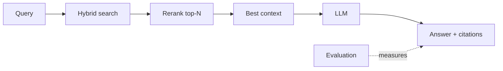

import TOCInline from '@theme/TOCInline';

# 07 · Advanced RAG

<ProgressToggle sectionId="07-advanced-rag" />

<TOCInline toc={toc} minHeadingLevel={2} maxHeadingLevel={2} />

:::tip[In this guide]
Baseline RAG is easy; good RAG is engineering. This section upgrades your
[first project](../06-rag/03-first-project.mdx) with the tuning
work that moves answer quality, then walks the full catalog of RAG
architectures — query transformation, context construction, self-correcting
loops, graph and structured retrieval, and agentic RAG. The spine throughout:
every pattern buys accuracy with latency, cost or complexity, so know the
trade before you build.
:::

## Goal

Measurably improve your RAG system's answer quality and reliability, and be
able to pick the right architectural pattern for an observed failure instead
of guessing.

## Estimated Time

2–3 weeks.

## Prerequisites

- A working [RAG project](../06-rag/03-first-project.mdx).
- The [RAG fundamentals](../06-rag/index.mdx) section — chunking,
  hybrid search, reranking and evaluation are assumed here, not re-taught.

## What You Will Learn

**Tuning the pipeline you already have**

1. [Chunking Experiments](./01-chunking-experiments.mdx) — strategies, sizes, overlap, structure-aware splitting, metadata.
2. [Reranking & Hybrid Search](./02-reranking-hybrid-search.mdx) — combine keyword + vector search, then rerank.
3. [Evaluation](./03-evaluation.mdx) — measure retrieval and answer quality so changes are data-driven.

**The map of the territory**

4. [RAG Patterns: The Catalog](./04-rag-patterns.mdx) — every major pattern profiled with its cost, one decision table, a symptom-driven decision tree, and the order to try things in. Start here.

**Implementations, by family**

5. [Query Transformation Patterns](./05-query-transformation.mdx) — rewriting, conversational resolution, Multi-Query, RAG-Fusion, HyDE, step-back, decomposition, routing, and latency budgeting.
6. [Context Construction Patterns](./06-context-construction.mdx) — sentence windows, parent-document, auto-merging, contextual retrieval and compression, dedup and MMR.
7. [Self-Correcting RAG](./07-self-correcting-rag.mdx) — Self-RAG, CRAG and Adaptive RAG with a full LangGraph loop and the guardrails it needs.
8. [Graph & Structured RAG](./08-graph-and-structured-rag.mdx) — knowledge graphs, GraphRAG community summaries, safe text-to-SQL, self-query retrievers.
9. [Agentic RAG](./09-agentic-rag.mdx) — retrieval as a tool, iterative research loops, budgets, circuit breakers, and when it's a liability.

## How Each Piece Helps

Pages 1–3 tune that pipeline. Pages 4–9 change its shape: adding steps before
retrieval, decoupling what you index from what you send, wrapping it in a
correction loop, swapping the backend, or handing control to an agent.

## Interview Relevance

Chunking tradeoffs, hybrid search, reranking, and "how do you evaluate a RAG
system?" separate people who've *built* RAG from those who've only read about
it. The pattern catalog goes further: being able to diagnose a failure as
retrieval or generation, name the pattern that fixes it, and state its cost in
LLM calls and latency is what a senior answer sounds like. "When would you
*not* use agentic RAG?" is a question people fail routinely.

## Done When

- [ ] You can justify a chunking strategy with evidence.
- [ ] You use hybrid search + reranking.
- [ ] You return citations.
- [ ] You measure quality with an eval set.
- [ ] You can classify a RAG failure as retrieval or generation, with evidence.
- [ ] You can name any pattern's cost in extra LLM calls and added latency.
- [ ] You've implemented at least one query transform and one context-construction pattern.
- [ ] You can explain when self-correcting, graph and agentic RAG are over-engineering.
- [ ] Any loop you build has a call cap, a deadline and a graceful fallback.

Next: [08 · LLM Application Development](../08-llm-application-development/index.mdx).