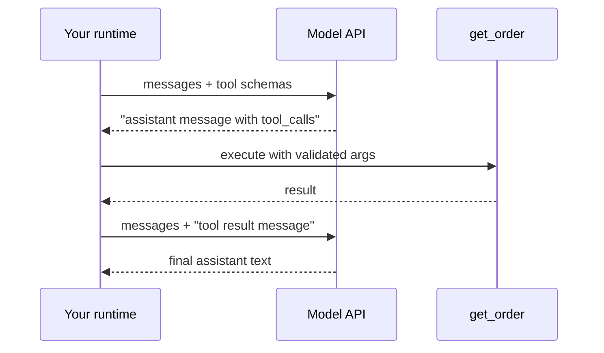

import TOCInline from '@theme/TOCInline';

# Tool Design & Function Calling

<TOCInline toc={toc} minHeadingLevel={2} maxHeadingLevel={2} />

:::tip[In this guide]
Tool design is the highest-leverage skill in agent building. Most "the model is
dumb" bugs are actually schema bugs, description bugs, or giant-blob bugs. This
page covers the wire protocol, writing schemas the model can act on, and the
failure modes that show up once real traffic hits.
:::

## What Is It?

A **tool** is a function you expose to a model as a JSON Schema. The model never
executes anything. It emits a structured request — tool name plus arguments —
and *your* runtime decides whether and how to run it, then feeds the result back
as another message.

The [fundamentals page](./01-agents-fundamentals.mdx) introduced this. Here we
go down a level: what actually crosses the wire, and what makes a tool layer
reliable instead of flaky.

## Why Does It Matter?

An agent's ceiling is set by its tools. Given a vague schema the model guesses;
given a tool that returns 40,000 characters of JSON it drowns; given twelve
overlapping tools it picks the wrong one. You cannot prompt your way out of a
bad tool layer, and you cannot fine-tune your way out either.

Concretely, the tool layer is where you control three things the prompt cannot:
what the model is *allowed* to do, what it *sees* as a result, and what happens
when a call fails.

## How Tool Calling Works on the Wire

Three HTTP round trips happen for one tool-using turn. Nothing is magic and
nothing is stateful — you resend the whole message list each time.



**Step 1 — you send schemas.** Alongside the messages you send a list of tool
definitions. Each is a name, a description, and a JSON Schema for the arguments:

```json
{
  "type": "function",
  "function": {
    "name": "get_order",
    "description": "Look up a single order by its ID. Returns status, line items and shipping state. Use when the user names or implies a specific order.",
    "parameters": {
      "type": "object",
      "properties": {
        "order_id": {
          "type": "string",
          "description": "Order ID like 'ORD-10492'. Never invent one; ask the user if unknown."
        }
      },
      "required": ["order_id"]
    }
  }
}
```

**Step 2 — the model returns a call, not prose.** The assistant message has
empty content and a populated `tool_calls` array, each entry carrying an `id`,
the tool name, and arguments as a JSON *string* (which you must parse — models
do occasionally emit malformed JSON).

**Step 3 — you execute and reply with a tool message.** The result goes back as
a message whose role is `tool`, carrying the matching `tool_call_id`. Mismatched
or missing IDs are a hard API error on most providers, not a soft failure.

```python
import json

messages = [{"role": "user", "content": "Where is ORD-10492?"}]

resp = client.chat.completions.create(model=MODEL, messages=messages, tools=TOOLS)
assistant = resp.choices[0].message
messages.append(assistant)

for call in assistant.tool_calls or []:
    args = json.loads(call.function.arguments)
    result = REGISTRY[call.function.name](**args)
    messages.append({
        "role": "tool",
        "tool_call_id": call.id,          # must match
        "content": json.dumps(result),    # string, always
    })

final = client.chat.completions.create(model=MODEL, messages=messages, tools=TOOLS)
```

The loop in [Building Agents](./03-building-agents.mdx) is exactly this, with
`ToolNode` doing the middle block for you.

:::note[API drift]
Field names vary by provider and move between SDK versions (`tool_calls` vs
`function_call`, content blocks vs flat strings). Check your provider's current
reference for exact shapes; the three-step structure is stable, the field names
are not.
:::

## Writing Schemas With Pydantic v2

Hand-writing JSON Schema is miserable. Define a Pydantic v2 model and generate
it.

```python
from typing import Literal
from pydantic import BaseModel, Field

class SearchOrdersArgs(BaseModel):
    """Search orders by customer and status. Returns at most `limit` summaries,
    newest first. Use this when the user has no specific order ID."""

    customer_email: str = Field(
        description="Exact customer email. Must come from the conversation, "
                    "not guessed."
    )
    status: Literal["pending", "shipped", "delivered", "cancelled"] | None = Field(
        default=None,
        description="Filter to one status. Omit to search all statuses.",
    )
    limit: int = Field(default=10, ge=1, le=50, description="Max results, 1-50.")

SearchOrdersArgs.model_json_schema()   # feed this as `parameters`
```

Three things earn their keep here:

- `Literal` becomes a schema `enum`, which collapses a whole class of invalid-value errors. Prefer it over free-text strings everywhere you can.
- `ge` / `le` bound numbers so the model cannot ask for 10,000 rows.
- `| None` with a default marks the field optional, so the model is not forced to invent a value.

### The description is prompt engineering

This is the part people get wrong. The description is not documentation for a
future maintainer — it is **the only instruction the model gets about when to
reach for this tool**. Write it for a competent new hire who has read nothing
else.

A good description answers four questions: what it does, when to use it, when
*not* to use it, and what it returns.

| Weak description | Better |
| --- | --- |
| "Searches the database." | "Search the product catalogue by free-text query. Returns name, SKU and price for up to 20 matches. Use for 'do you sell X' questions. Not for order status — use `get_order`." |
| "Gets user data." | "Fetch the signed-in user's profile and plan tier. Takes no arguments; always acts on the current user. Use before quoting plan limits." |
| "Runs a SQL query." | "Run a read-only SELECT against the analytics warehouse. Only the `events` and `users` tables are visible. Returns up to 200 rows as JSON. Prefer `get_metric` for standard metrics." |

Negative guidance ("not for X — use Y") does more work than any amount of
positive description once you have more than three tools.

## Granularity: Broad vs Narrow Tools

There is no universally right answer, but the failure modes are predictable.

| Approach | Example | Fails by |
| --- | --- | --- |
| Few broad tools | one `query_database(sql)` | Model writes wrong or unsafe queries; you cannot validate intent; errors are opaque |
| Many narrow tools | `get_order`, `get_refund`, `list_shipments`, ... | Selection accuracy drops as count grows; descriptions start overlapping; schema tokens balloon |

Practical rules that hold up:

- One tool per *user-visible intent*, not per database table or per HTTP endpoint.
- Keep an agent under roughly 10–15 tools. Past that, selection accuracy degrades noticeably on most models.
- If two tools are chosen interchangeably in traces, they should probably be one tool with a parameter.
- If one tool is called with wildly different argument shapes depending on intent, split it.
- Never expose a raw escape hatch (`run_sql`, `http_request`, `shell`) next to safe specific tools. The model will reach for the general one and you lose all validation.

## Returning Errors the Model Can Recover From

A raised exception kills the run. A returned error string is an *observation* —
the model reads it and tries something else. That difference is most of an
agent's apparent robustness.

```python
from pydantic import ValidationError

async def call_tool(name: str, raw_args: str) -> str:
    spec = REGISTRY.get(name)
    if spec is None:
        return f"Error: unknown tool '{name}'. Available: {', '.join(REGISTRY)}."

    try:
        args = spec.args_model.model_validate_json(raw_args)
    except ValidationError as e:
        return f"Error: invalid arguments. {e.errors()}. Fix and call again."

    try:
        return await spec.fn(args)
    except NotFoundError as e:
        return f"Error: {e}. Check the ID, or use search_orders to find it."
    except PermissionError:
        return "Error: not permitted for this user. Do not retry; tell the user."
    except TimeoutError:
        return "Error: timed out. Safe to retry once with a narrower query."
    except Exception:
        log.exception("tool_failed", extra={"tool": name})
        return "Error: internal failure. Do not retry. Report to the user."
```

Every message says what went wrong **and what to do next**, including "do not
retry" where retrying is pointless. Without that, agents happily call the same
failing tool six times.

Keep real stack traces and internal identifiers in your logs, not in the model
context. They waste tokens and occasionally leak infrastructure detail into
user-visible answers.

## Validating Arguments Before Execution

Treat every argument as attacker-controlled. It is: it was generated by a model
that just read a web page, a support ticket, or a retrieved document. Schema
validation proves the *shape* is right, never that the *value* is safe.

```python
from pathlib import Path

WORKSPACE = Path("/srv/workspace").resolve()

def resolve_in_workspace(user_path: str) -> Path:
    candidate = (WORKSPACE / user_path).resolve()
    if not candidate.is_relative_to(WORKSPACE):     # 3.9+
        raise PermissionError(f"path escapes workspace: {user_path}")
    return candidate
```

The same discipline applies to each dangerous class:

| Model-supplied value | Required check |
| --- | --- |
| File path | Resolve, then confirm it is inside the allowed root. Reject symlinks that escape. |
| Record / tenant ID | Re-check ownership server-side against the session's user. Never trust the ID as authorisation. |
| SQL | Parameterised queries, or a parsed allow-list of tables and statement types. String interpolation is out. |
| Shell command | Allow-list of binaries, arguments as a list (never `shell=True`), no user-supplied flags. |
| URL | Scheme allow-list, resolved-IP check against private ranges to block SSRF. |

An agent that can read a tenant ID from a document and pass it to
`get_customer` without a server-side ownership check is a cross-tenant data
leak waiting for a prompt injection. More on that in
[Agent Safety](./11-agent-safety.mdx).

## Managing Result Size

Context is the scarcest resource an agent has. A tool that returns everything it
knows is a tool that ends the run.

Four techniques, roughly in order of preference:

**Project, don't dump.** Return the five fields the model needs, not the full
row. This single change often cuts tool output by an order of magnitude.

**Paginate explicitly.** Return a page plus a cursor, and say so in the result
so the model knows more exists.

```python
def search_orders(args: SearchOrdersArgs) -> dict:
    rows = db.search(args.customer_email, args.status, limit=args.limit + 1)
    page, more = rows[: args.limit], len(rows) > args.limit
    return {
        "orders": [{"id": r.id, "status": r.status, "total": r.total} for r in page],
        "has_more": more,
        "next_cursor": page[-1].id if more and page else None,
    }
```

**Truncate loudly.** Silent truncation makes the model confidently wrong about
what it saw.

```python
MAX_CHARS = 4_000

def clamp(text: str) -> str:
    if len(text) <= MAX_CHARS:
        return text
    return (
        text[:MAX_CHARS]
        + f"\n\n[truncated: {len(text) - MAX_CHARS} more chars. "
          "Narrow the query or request a specific section.]"
    )
```

**Return a handle, not the payload.** For big artifacts — a 200-page PDF, a
query result set, a generated image — store the object and return an ID plus a
summary. Give the model a second tool that reads a slice of it by ID. This keeps
large data out of context entirely while leaving it reachable.

```python
def run_report(args: ReportArgs) -> dict:
    result_id = blob_store.put(expensive_report(args))     # not in context
    return {
        "result_id": result_id,
        "row_count": 48_201,
        "columns": ["date", "region", "revenue"],
        "note": "Use read_result(result_id, offset, limit) to inspect rows.",
    }
```

## Parallel Calls, Idempotency and Confirmation

Most current models can emit several tool calls in one assistant message. If
they are independent, run them concurrently — three sequential 400 ms calls
become one.

```python
import asyncio

async def run_calls(calls: list[ToolCall]) -> list[str]:
    results = await asyncio.gather(
        *(call_tool(c.name, c.arguments) for c in calls),
        return_exceptions=True,
    )
    return [
        r if isinstance(r, str) else f"Error: {type(r).__name__}: {r}"
        for r in results
    ]
```

Two caveats that bite in production:

- `return_exceptions=True` matters. Without it one failure cancels the siblings and you lose their results plus the matching tool messages, which can leave the message list structurally invalid.
- Order the returned tool messages to match the `tool_call_id`s, and return one message per call. A missing tool result for an emitted call is an API error.

**Idempotency.** Agents retry — on timeout, on a model's second guess, on a
resumed checkpoint. Any tool with side effects needs an idempotency key so a
duplicate call is a no-op rather than a second charge.

```python
async def issue_refund(args: RefundArgs) -> str:
    key = f"refund:{args.order_id}:{args.amount_cents}"
    if existing := await refunds.get_by_key(key):
        return f"Already refunded (idempotency hit): {existing.id}"
    return (await payments.refund(args, idempotency_key=key)).id
```

**Confirmation.** Separate reads from writes and gate the writes. Mark each tool
with the effect it has, and require human approval for the destructive ones
rather than trusting the model's judgement:

```python
class ToolSpec(BaseModel):
    name: str
    effect: Literal["read", "write", "destructive"]
    requires_approval: bool = False
```

The interrupt-and-confirm mechanics live in
[Agent Safety & Sandboxing](./11-agent-safety.mdx).

## Fixing Tool Selection Failures

When the model keeps picking wrong, the instinct is to rewrite the system
prompt. Fix the tool layer instead.

- **Too many tools.** Route first: a cheap classifier or a small router model picks a *tool group*, and only that group's schemas are bound for the turn. Sub-agents with narrow toolsets are the same idea — see [Multi-Agent Systems](./04-multi-agent-systems.mdx).
- **Overlapping descriptions.** Put the boundary in the text. `search_docs` says "internal handbook and policies, not code"; `search_code` says "repository source files, not prose docs".
- **Namespacing.** Prefix by domain (`orders_get`, `orders_search`, `billing_refund`). It helps the model group related tools and makes traces readable.
- **Stateful preconditions.** If tool B only works after tool A, say so in B's description — and have B return a recoverable error naming A when the precondition is missing.

## Tool-Design Smells and Fixes

| Smell | Why it hurts | Fix |
| --- | --- | --- |
| Description under ten words | Model guesses when to use it | Say what, when, when-not, returns |
| Free-text field with four valid values | Invalid values, retries | `Literal` / enum |
| Tool returns a full DB row or raw HTML | Context blowout, lost signal | Project fields; strip markup |
| No `limit`, or an unbounded one | One call fills the window | Default plus `le` cap |
| Exceptions propagate out of tools | Run dies on a recoverable error | Return error strings with next steps |
| Error text is a stack trace | Tokens wasted, no guidance | Short cause plus instruction |
| `run_sql` sitting beside typed tools | Model takes the escape hatch | Remove it, or isolate behind a sub-agent |
| Same ten-second call repeated per turn | Latency and cost | Cache by argument hash |
| Write tool with no idempotency key | Duplicate charges on retry | Deterministic key |
| 25 tools bound every turn | Selection accuracy collapses | Route to tool groups |
| Tool name like `tool_3` or `do_it` | Name is also a prompt | Verb-noun, domain-prefixed |

## Common Mistakes

- Writing descriptions for humans instead of for the model.
- Trusting schema validation as a security boundary.
- Raising exceptions instead of returning recoverable observations.
- Returning unbounded results and blaming the context window.
- Adding tools to fix behaviour rather than sharpening the ones you have.
- Letting the model supply a tenant or user ID that your code then trusts.
- Parallelising side-effecting calls that are not safe to interleave.
- Changing a tool's schema without replaying your eval suite.

## Interview Questions

- Walk through the message sequence for one tool-using turn. What does the model return, and what do you send back?
- Why is a tool description prompt engineering rather than documentation?
- Few broad tools or many narrow ones? Describe the failure mode of each.
- Why return errors as tool results instead of raising?
- A tool returns 50k characters of JSON. What do you do?
- How do you make a side-effecting tool safe to retry?
- An agent with 20 tools picks the wrong one half the time. How do you diagnose and fix it?
- Where is the authorisation boundary for an argument the model supplied?

## Things to Remember

- You send schemas, the model returns a structured call, you execute and return a tool message. That is the whole protocol.
- The description decides whether the tool gets used correctly. Write it last and hardest.
- Errors are observations. Say what failed and what to do next.
- Cap every result. Return handles for anything large.
- Validate arguments as untrusted input, always server-side.
- Fewer, sharper tools beat more tools.

## Mini Exercise

Take the `search_docs` tool from [Building Agents](./03-building-agents.mdx) and
harden it. Define a Pydantic v2 args model with a bounded `top_k` and a
`Literal` source filter. Rewrite the description to cover when-not-to-use.
Truncate results to 4,000 characters with a visible marker. Return a
recoverable error string for an empty result set. Then ask the agent something
your docs do not cover, and confirm from the trace that it stops instead of
retrying the same query.

## Done When

- [ ] You can write out the three-message tool-calling sequence from memory.
- [ ] Your tools generate schemas from Pydantic v2 models with bounded, enumerated fields.
- [ ] Every tool returns recoverable error strings instead of raising.
- [ ] Every tool has a hard output cap, with handles for large payloads.
- [ ] Each side-effecting tool has an idempotency key and an approval flag.

Next: [Agent Memory Architectures](./08-agent-memory.mdx).
