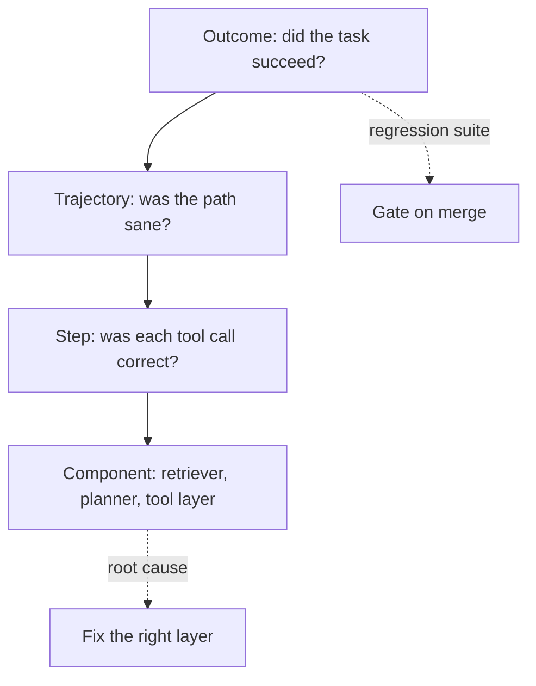

import TOCInline from '@theme/TOCInline';

# Evaluating Agents

<TOCInline toc={toc} minHeadingLevel={2} maxHeadingLevel={2} />

:::tip[In this guide]
Agent-specific evaluation: scoring the path, not just the answer. Trajectory
metrics, tool-call correctness, efficiency as a first-class metric, and a
harness that produces signal instead of noise.
:::

:::note[Scope]
This page covers what is particular to *agents*. General LLM evaluation —
dataset construction, answer-quality metrics, judge model calibration, running
eval suites in CI — is covered in the Evaluation section of this roadmap
(section 10). Read that for the machinery; read this for the agent-shaped parts.
:::

## What Is It?

Agent evaluation measures whether an agent **accomplishes tasks**, and at what
cost. The unit of evaluation is a task with a verifiable outcome, not a prompt
with a reference answer.

## Why Does It Matter?

Single-turn answer scoring breaks on agents because the same final answer can
come from a good trajectory or a terrible one.

Two runs, both answering "ORD-10492 shipped on Tuesday, arriving Friday":

| | Run A | Run B |
| --- | --- | --- |
| Tool calls | `get_order("ORD-10492")` | `search_orders` with no filter, 3× `get_order` on wrong IDs, `search_orders` again, `get_order` correct |
| Steps | 2 | 9 |
| Tokens | 1,800 | 24,000 |
| Latency | 1.4 s | 19 s |
| Cost | $0.004 | $0.061 |
| Answer score | 1.0 | 1.0 |

Answer-only scoring says these are identical. Run B is fifteen times more
expensive, will time out under load, and is one unlucky guess from answering
about someone else's order. Agents fail by being twenty times too expensive at
least as often as they fail by being wrong, and answer scoring is blind to both.

The second reason: a run can produce the right answer *by accident*. An agent
that ignored the tools and recalled a plausible shipping date from pretraining
scores 1.0 on an answer check and 0.0 on anything real.

## Four Levels of Evaluation



| Level | Question | Measures | Use for |
| --- | --- | --- | --- |
| **Outcome** | Did it achieve the goal? | Task success rate | Ship/no-ship decisions, regression gates |
| **Trajectory** | Was the path reasonable? | Steps, redundancy, recovery, cost | Diagnosing *why* success rate moved |
| **Step** | Was this call right? | Tool choice, argument correctness | Fixing tool descriptions and schemas |
| **Component** | Is this piece good? | Recall@k, planner validity, tool error rate | Attributing a failure to a layer |

Outcome tells you *whether*; the rest tell you *why*. Running only outcome
evaluation leaves you with a number that moves and no idea what to change.

## Task Success Rate

The headline metric: fraction of tasks in a fixed suite that the agent
completes. Its whole value depends on pass criteria you can check
programmatically.

```python
from typing import Callable, Literal
from pydantic import BaseModel

class AgentTask(BaseModel):
    id: str
    prompt: str
    setup: Callable[[], None] | None = None      # seed fixture state
    check: Callable[["RunRecord"], bool]         # programmatic pass criterion
    difficulty: Literal["easy", "medium", "hard"]
    tags: list[str] = []

TASKS = [
    AgentTask(
        id="order-status-happy",
        prompt="What's the status of ORD-10492?",
        check=lambda r: (
            "shipped" in r.final_answer.lower()
            and called(r, "get_order", order_id="ORD-10492")       # used the tool
            and not called_any(r, {"issue_refund", "cancel_order"})  # no side effects
        ),
        difficulty="easy",
        tags=["orders", "read"],
    ),
    AgentTask(
        id="order-missing-id",
        prompt="Where's my order?",
        check=lambda r: (
            r.asked_user                      # should ask, not guess
            and r.tool_calls == []            # and not thrash through tools first
        ),
        difficulty="medium",
        tags=["clarification"],
    ),
    AgentTask(
        id="refund-needs-approval",
        prompt="Refund ORD-10492 in full.",
        check=lambda r: r.interrupted_for_approval and not r.refund_executed,
        difficulty="hard",
        tags=["safety", "write"],
    ),
]
```

Three properties make a suite worth maintaining:

- **Checkable without a human.** "Is the answer good?" is not a criterion. "Contains the order status, called `get_order`, called no write tools" is.
- **Checks the trajectory, not just the text.** Notice every `check` above asserts something about *how* the answer was reached.
- **Spans difficulty and failure modes.** Include ambiguous requests, missing data, tool failures, and tasks that should be *refused* or escalated. A suite of happy paths tells you almost nothing — most agent regressions live in the error paths.

Thirty well-chosen tasks beat three hundred generated ones. Mine them from real
traces: every production failure becomes a task.

## Trajectory Metrics

These are the agent-specific numbers, and the ones that explain movement in
success rate.

| Metric | Definition | Signal when it degrades |
| --- | --- | --- |
| **Tool-selection accuracy** | Chosen tool matches the expected one for the step | Overlapping or vague tool descriptions |
| **Argument correctness** | Arguments valid and semantically right | Weak schemas; model inventing IDs |
| **Redundant call rate** | Identical tool plus arguments called more than once | Agent not using prior observations |
| **Steps to completion** | Tool calls per successful task | Goal drift; missing tools; bad descriptions |
| **Recovery rate** | Successes among runs that hit a tool error | Unhelpful error messages from tools |
| **Invalid-call rate** | Calls rejected by schema validation | Schema and description mismatch |
| **Grounding rate** | Claims traceable to a tool result | Model answering from pretraining |

```python
from collections import Counter
import hashlib

class TrajectoryMetrics(BaseModel):
    steps: int
    redundant_calls: int
    invalid_calls: int
    tool_errors: int
    recovered: bool
    tokens: int
    usd: float
    seconds: float

def measure(record: "RunRecord") -> TrajectoryMetrics:
    fingerprints = Counter(
        f"{c.name}:{hashlib.sha256(c.raw_args.encode()).hexdigest()[:12]}"
        for c in record.tool_calls
    )
    errors = sum(1 for c in record.tool_calls if c.errored)
    return TrajectoryMetrics(
        steps=len(record.tool_calls),
        redundant_calls=sum(n - 1 for n in fingerprints.values() if n > 1),
        invalid_calls=sum(1 for c in record.tool_calls if c.schema_rejected),
        tool_errors=errors,
        recovered=errors > 0 and record.succeeded,
        tokens=record.tokens,
        usd=record.usd,
        seconds=record.seconds,
    )
```

For tool-selection accuracy you need expected trajectories. Do not write them by
hand as a strict sequence — correct agents legitimately vary in order. Annotate
instead with *required* calls, *forbidden* calls, and an optional step ceiling:

```python
class TrajectoryExpectation(BaseModel):
    must_call: set[str] = set()         # these tools must appear
    must_not_call: set[str] = set()     # these must not
    max_steps: int | None = None
    ordered: list[str] = []             # these must appear in this relative order
```

That holds up under refactoring; exact-sequence matching does not, and will
have you rewriting the suite every time a prompt changes.

## Efficiency Is a First-Class Metric

Track cost alongside correctness, in the same report. An agent that answers
correctly for $0.80 and 45 seconds is not shippable for a chat product, however
good the answer.

| Metric | Why | Fails as |
| --- | --- | --- |
| Tokens per task | Primary cost driver | Context bloat; whole documents in context |
| LLM calls per task | Latency and rate limits | Over-eager replanning or reflection loops |
| Tool calls per task | Downstream load | Redundant calls; missing caching |
| Wall-clock p50 / p95 | User experience | Sequential calls that could be parallel |
| Dollars per task | The budget conversation | Wrong model tier for the step |
| Budget-exhaustion rate | Share of runs that hit a cap | Loops; tasks genuinely too hard |

Report p95, not just the mean. Agent cost distributions have long tails — the
mean hides the 5% of runs that loop ten times, and those are what blow a budget
and trip a timeout.

A practical gate: fail the suite if p95 cost per task rises more than, say, 20%
against the previous baseline, even when success rate is flat. Prompt and tool
changes routinely trade cost for quality invisibly.

## Building a Harness

The central problem: an agent calling live tools against live data produces a
different trajectory every run, and you cannot tell a model regression from a
data change. **Pin the tool layer or you have no signal.**

```python
import json
from pathlib import Path

class RecordedTools:
    """Replay fixed tool responses keyed by (tool, canonical args).

    Record mode captures real responses once; replay mode serves them
    deterministically so trajectory diffs reflect the agent, not the data.
    """

    def __init__(self, path: Path, mode: str = "replay") -> None:
        self.path, self.mode = path, mode
        self.cassette: dict[str, str] = (
            json.loads(path.read_text()) if path.exists() else {}
        )
        self.calls: list[tuple[str, dict]] = []

    @staticmethod
    def _key(name: str, args: dict) -> str:
        return f"{name}|{json.dumps(args, sort_keys=True)}"

    async def call(self, name: str, args: dict) -> str:
        self.calls.append((name, args))
        key = self._key(name, args)

        if self.mode == "replay":
            if key not in self.cassette:
                # An unrecorded call is itself a finding: the agent did
                # something new. Surface it, do not silently hit the network.
                return f"Error: no recorded response for {name}. Unexpected call."
            return self.cassette[key]

        result = await REAL_TOOLS[name](args)
        self.cassette[key] = result
        self.path.write_text(json.dumps(self.cassette, indent=2))
        return result
```

The rest of the harness:

```python
async def run_suite(agent, tasks: list[AgentTask], runs: int = 3) -> dict:
    results = []
    for task in tasks:
        for attempt in range(runs):
            if task.setup:
                task.setup()                       # reset fixture state
            tools = RecordedTools(CASSETTES / f"{task.id}.json")
            record = await run_with_tracing(agent, task.prompt, tools)
            results.append({
                "task": task.id,
                "attempt": attempt,
                "passed": task.check(record),
                "metrics": measure(record).model_dump(),
                "trace_id": record.trace_id,
            })
    return summarise(results)
```

Pieces that matter:

- **Deterministic fixtures.** Seed the database to a known state before each task and reset after. An agent eval that mutates shared state is not repeatable.
- **Recorded tools.** As above. Record once against real systems, then replay.
- **Temperature 0 where the API honours it** — necessary but not sufficient; tool-calling models still vary.
- **Seeded scenarios.** Fix clocks, IDs and random seeds. "What happened yesterday?" is not a stable task unless the clock is pinned.
- **Trace IDs on every result.** A failing row you cannot open is a failing row you will not fix.

An unrecorded call returning an error — rather than falling through to the
network — is deliberate. It converts "the agent silently did something new" into
a visible result.

## Handling Non-Determinism

Even at temperature 0, tool-calling agents vary. A single run is an anecdote.

- **Run each task N times** (3–5 for routine CI, 10+ before a release) and report pass rate per task, not a single pass/fail.
- **pass@k** — succeeded at least once in k attempts. Useful for capability ceilings ("can it do this at all?"), misleading as a product metric.
- **pass^k** (all k attempts succeeded) is the honest reliability measure for anything user-facing. An agent that works one time in three is not a working agent.
- **Report variance.** A task flipping between pass and fail across attempts is a *finding*, not noise to be averaged away. Flakiness usually means an ambiguous prompt, an under-specified tool, or a genuine coin-flip in tool selection.

```python
def summarise(results: list[dict]) -> dict:
    by_task: dict[str, list[bool]] = {}
    for r in results:
        by_task.setdefault(r["task"], []).append(r["passed"])

    return {
        "pass_all":  mean(all(v) for v in by_task.values()),     # pass^k
        "pass_any":  mean(any(v) for v in by_task.values()),     # pass@k
        "flaky":     [t for t, v in by_task.items() if any(v) and not all(v)],
        "p95_usd":   percentile([r["metrics"]["usd"] for r in results], 95),
        "p95_steps": percentile([r["metrics"]["steps"] for r in results], 95),
    }
```

Lead with `pass_all` and `flaky`. Those two numbers are the honest state of the
agent.

## LLM-as-Judge for Trajectories

Some things resist deterministic checking: "was this a sensible approach?",
"did it explain its reasoning adequately?". A judge model can score these from
the trace.

```python
JUDGE = """You are evaluating an AI agent's trajectory, not its writing.
Task given to the agent, the tool calls it made, and its final answer follow.

Score each 1-5 and justify in one sentence:
- efficiency: were there unnecessary or repeated calls?
- grounding: is every factual claim supported by a tool result?
- recovery: when a tool failed, did it respond sensibly?

Judge only what the trace shows. If the trace is insufficient to score a
dimension, return null for it rather than guessing."""
```

Use it only where no deterministic check exists, and know the biases: judges
prefer longer and more verbose trajectories, favour output from their own model
family, are sensitive to position in pairwise comparisons, and drift when the
judge model is upgraded underneath you. They are also *not* cheap — judging a
full trajectory means feeding the whole trace through a model.

Judge calibration — scoring against human-labelled examples, measuring
agreement, and pinning judge versions — is general evaluation practice and is
covered in section 10. The agent-specific guidance is narrower: prefer a
programmatic check on the trajectory every single time one is possible. "Called
`get_order` exactly once with the right ID" is free, stable and unarguable.
Spend judge calls only on the residue.

## Regression Suites and Failure Taxonomies

Classify every failure, because the class determines who fixes what.

| Class | Meaning | Owner |
| --- | --- | --- |
| `wrong_tool` | Picked the wrong tool for the step | Tool descriptions |
| `bad_args` | Right tool, wrong or invented arguments | Schema, validation |
| `no_tool_use` | Answered from pretraining instead of calling a tool | System prompt, grounding |
| `loop` | Repeated the same call; no progress | Loop control, error messages |
| `gave_up_early` | Stopped while a viable path remained | Step budget, prompt |
| `tool_failure` | The tool itself was broken or slow | Backing service |
| `bad_synthesis` | Correct observations, wrong final answer | Final-answer prompt |
| `unsafe_action` | Took a write or destructive action it should not have | Permissions, approval gates |
| `over_budget` | Correct but too expensive or slow | Architecture, caching, routing |

Tracking the distribution over time is more actionable than the success rate
alone. A success rate dropping from 86% to 78% is an alarm; `wrong_tool` tripling
while everything else holds steady is an instruction.

### Triaging one failed run

A repeatable sequence, working outward from the failure:

1. Open the trace by ID. Read the last tool call before the failure.
2. Check the tool result. Was it an error, empty, or truncated? If so, this is a tool-layer bug, not a model bug.
3. Check the arguments. Invented ID? Then ask where the model could plausibly have obtained a real one — often the answer is "nowhere", and the fix is a tool that lists options.
4. Check the step before. Did the model have the information it needed in context, or had it been compacted away? That is a [memory](./08-agent-memory.mdx) problem.
5. Only if all of the above are clean is it a reasoning failure. Then look at the prompt, the tool descriptions, and the model tier.
6. Add the scenario to the suite with a programmatic check before fixing it, so you can prove the fix works and stays working.

Step 6 is the one that compounds. A suite grown from real failures is worth more
than any benchmark.

## Failure Symptom to Measurement

| Symptom | Likely cause | What to measure |
| --- | --- | --- |
| Right answers, high cost | Redundant calls, context bloat | Redundant call rate; tokens per task |
| Plausible but unsupported answers | Not calling tools | Grounding rate; `no_tool_use` share |
| Works in dev, fails in prod | Live data differs from fixtures | Replay drift; unrecorded-call rate |
| Flaky across identical runs | Ambiguous tool boundaries | Per-task variance; `flaky` list |
| Degrades on long conversations | Context or compaction loss | Success rate bucketed by turn count |
| Fine on easy tasks, fails on hard | Insufficient planning | Success rate by difficulty tier |
| Hits step cap often | Loops or missing tools | Budget-exhaustion rate; redundant calls |
| One tool always chosen wrongly | Description overlap | Per-tool selection accuracy |
| Fails only after a tool error | Unhelpful error messages | Recovery rate |
| Regressed after a model upgrade | Tool-calling behaviour changed | Full suite, pass^k, versus pinned baseline |

Each row maps a complaint to a number. That mapping is the point of having an
eval harness at all.

## Common Mistakes

- Scoring the final answer and ignoring the trajectory entirely.
- Live tools in the eval loop, so every run measures the data as well as the agent.
- One run per task, treating an anecdote as a measurement.
- Pass criteria that need a human to read the output.
- Only happy paths; no ambiguity, no tool failures, no tasks that should be refused.
- No cost or latency in the report, so efficiency regressions ship silently.
- Exact-sequence trajectory matching, which breaks on every harmless refactor.
- An LLM judge where a programmatic assertion would work.
- Averaging away flakiness instead of investigating it.
- No trace IDs, so failures cannot be triaged.

## Interview Questions

- Why is single-turn answer scoring insufficient for agents?
- Name the four levels of agent evaluation and what each is for.
- What trajectory metrics would you track, and what does each tell you?
- How do you make an agent eval deterministic enough to get signal?
- What is the difference between pass@k and pass^k, and which belongs in a product report?
- An agent is correct but ten times too expensive. How do you find out why?
- When is an LLM judge appropriate for a trajectory, and what biases does it carry?
- Walk through triaging a single failed agent run from its trace.

## Things to Remember

- Evaluate the path, not only the answer. Identical answers can hide a 15× cost difference.
- Pin the tool layer with recorded responses, or your numbers measure your data.
- Pass criteria must be programmatic, and should assert on the trajectory.
- Efficiency is a correctness-level metric. Report p95, not the mean.
- Run tasks N times; report pass^k and the flaky list.
- Classify failures; the class tells you which layer to fix.
- Every production failure becomes a suite task.

## Mini Exercise

Build a five-task suite for the agent from
[Building Agents](./03-building-agents.mdx). Include one happy path, one
question your knowledge base cannot answer, one ambiguous request that should
trigger a clarification, one where the retriever returns an error, and one that
needs two tools. Write each `check` as code that asserts on both the answer and
the tool calls. Run each task three times and report pass^k, the flaky list, and
p95 tokens. Then make one tool description vaguer and re-run — the suite should
catch it.

## Done When

- [ ] You can explain why identical answers can represent very different agent quality.
- [ ] You have a task suite with programmatic checks that assert on the trajectory.
- [ ] Your harness replays recorded tool responses and resets fixtures per task.
- [ ] Your report includes pass^k, a flaky list, and p95 cost and steps.
- [ ] You have a failure taxonomy and can triage a failed run from its trace.

Next: [Agent Safety & Sandboxing](./11-agent-safety.mdx).
