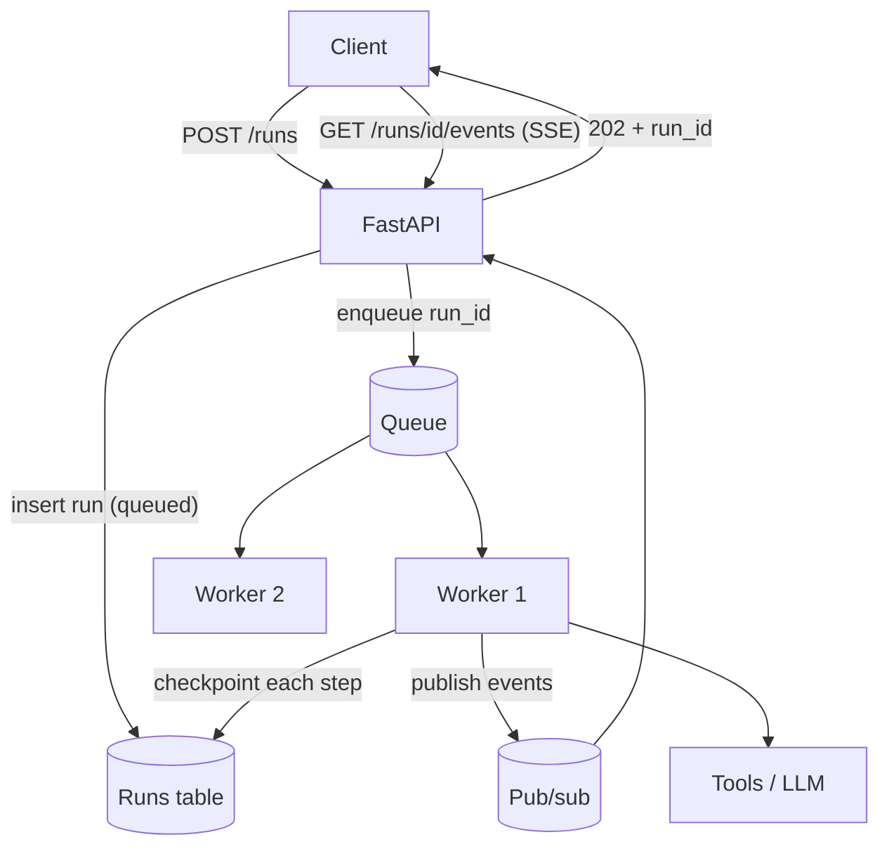

import TOCInline from '@theme/TOCInline';

# Agents in Production

<TOCInline toc={toc} minHeadingLevel={2} maxHeadingLevel={2} />

:::tip[In this guide]
The operational layer: how to run something that takes two minutes and holds
state inside infrastructure built for 200 ms stateless requests. Execution
models, durability, event streaming, cancellation, tracing, caching and
deployment.
:::

## What Is It?

Everything between "the agent works on my laptop" and "the agent serves
traffic". None of it is about model quality, and all of it is where agent
projects stall.

## Why Does It Matter?

There is a structural mismatch. An agent run is **long** (seconds to minutes),
**stateful** (a growing message list), **non-deterministic in duration**
(3 steps or 30), and **side-effecting** (money moves, files change). An HTTP
request is short, stateless, and expected to be retryable.

| Property | HTTP request | Agent run |
| --- | --- | --- |
| Duration | 50–500 ms | 2 s – 10 min |
| State | Stateless | Accumulating context |
| Duration predictability | Tight | Order-of-magnitude spread |
| Retry safety | Usually idempotent | Side effects already applied |
| Failure cost | Retry it | Lost work, duplicated effects |

Ignore the mismatch and you get the standard set of production failures: load
balancer kills the connection at 60 seconds, a deploy loses every in-flight
run, a retry issues a second refund, one user's agent exhausts the connection
pool for everyone.

## Execution Models

Four shapes. Pick deliberately; most teams drift into the first and then
discover its limits under load.

| Model | How | Max duration | Survives deploy | Complexity | Use when |
| --- | --- | --- | --- | --- | --- |
| **Synchronous** | Run inside the request | ~30 s realistically | No | Lowest | Short, bounded, interactive |
| **Background + poll** | Return a run ID; client polls | Minutes | Only with checkpointing | Low | Simple async, no streaming needed |
| **Queue + worker** | Enqueue; workers consume | Hours | Yes, with checkpointing | Medium | Default for production |
| **Durable execution** | Workflow engine persists each step | Days | Yes, by design | Highest | Multi-day, high-value, exactly-once |

Synchronous is fine for a 3-step agent behind an internal API. It stops being
fine the moment a tool is slow, the step count varies, or a deploy rolls.



The queue-worker shape is the default because it decouples the three things that
need different scaling: accepting requests (cheap, spiky), executing runs
(expensive, slow), and streaming progress (long-lived connections). It also
gives you backpressure for free — queue depth is a number you can alarm on.

```python
from fastapi import FastAPI, HTTPException
from pydantic import BaseModel

app = FastAPI()

class RunRequest(BaseModel):
    prompt: str
    idempotency_key: str | None = None

class RunAccepted(BaseModel):
    run_id: str
    status: str
    events_url: str

@app.post("/runs", status_code=202, response_model=RunAccepted)
async def create_run(req: RunRequest, principal: Principal = Depends(auth)) -> RunAccepted:
    await preflight(principal, LIMITS)        # spend, rate, kill switch

    if req.idempotency_key:
        if existing := await runs.find_by_key(principal.user_id, req.idempotency_key):
            return RunAccepted(run_id=existing.id, status=existing.status,
                               events_url=f"/runs/{existing.id}/events")

    run_id = await runs.create(
        user_id=principal.user_id, tenant_id=principal.tenant_id,
        prompt=req.prompt, status="queued",
        idempotency_key=req.idempotency_key,
        agent_version=AGENT_VERSION,          # pinned at enqueue time
    )
    await queue.enqueue("run_agent", run_id=run_id)
    return RunAccepted(run_id=run_id, status="queued",
                       events_url=f"/runs/{run_id}/events")
```

Pinning `agent_version` at enqueue is a small line with a large payoff — a run
executes against the prompt and tool definitions it was created with, even if
the queue drains after a deploy.

## Durability and Resumability

A worker will be killed mid-run — deploys, spot reclaims, OOM, rolling restarts.
Without checkpointing, that run is lost along with whatever it already spent.
With it, another worker continues.

LangGraph's checkpointer (see [Agent Memory](./08-agent-memory.mdx)) gives you
this when the store is a real database:

```python
from langgraph.checkpoint.postgres.aio import AsyncPostgresSaver

async def execute_run(run_id: str) -> None:
    run = await runs.get(run_id)
    config = {"configurable": {"thread_id": f"run:{run_id}"}}

    async with AsyncPostgresSaver.from_conn_string(DSN) as cp:
        graph = build_graph(version=run.agent_version).compile(checkpointer=cp)
        await runs.mark(run_id, "running", worker=WORKER_ID)

        try:
            # On a retry, state is already in the checkpointer: passing None
            # resumes from the last checkpoint rather than restarting.
            resume = await cp.aget(config) is not None
            payload = None if resume else {"messages": [("user", run.prompt)]}

            async for event in graph.astream(payload, config, stream_mode="updates"):
                await events.publish(run_id, to_event(event))

            await runs.mark(run_id, "completed")
        except asyncio.CancelledError:
            await runs.mark(run_id, "cancelled")
            raise
        except Exception as e:
            await runs.mark(run_id, "failed", error=repr(e))
            raise                                  # let the queue retry
```

**Idempotent steps.** Resumption only works if replaying a step is safe.
LangGraph checkpoints after a node completes, so a crash *during* a node means
that node runs again. A node that charged a card and then crashed before the
checkpoint will charge again on resume. Every side-effecting step needs a
deterministic idempotency key, derived from the run and step rather than from
time or a random value:

```python
def step_key(run_id: str, step: int, tool: str) -> str:
    return f"{run_id}:{step}:{tool}"            # stable across retries
```

**Exactly-once side effects** do not exist at the transport level. What you can
build is at-least-once delivery plus idempotent receivers — the key above, a
uniqueness constraint in the database, or the provider's idempotency header.
Record the effect and its key in the same transaction as the step result where
the storage allows it; where it does not (an external API), write an intent
record first, call, then mark it done, so a crash leaves a recoverable
in-flight marker rather than an unknown state.

**Checkpoint hygiene.** Checkpoints grow fast — one row per node per run, each
containing the message list. Set a retention policy, and store large tool
outputs as handles rather than inline, or your checkpoint table becomes your
largest table.

Durable execution engines (Temporal and similar) make this the default: steps
are replayed deterministically, timers and retries are first-class. The cost is
a new runtime and programming model. Worth it for multi-day workflows with real
money attached; overkill for a two-minute research agent.

## Streaming Progress to a UI

Streaming tokens is table stakes for chat. It is not enough for agents: during a
12-second tool call there are no tokens, and a silent UI reads as broken. Stream
**events**, with tokens as one event type.

```python
from typing import Literal
from pydantic import BaseModel

class AgentEvent(BaseModel):
    run_id: str
    seq: int                       # monotonic, lets clients resume and dedupe
    ts: datetime
    type: Literal[
        "run_started", "step_started", "thinking",
        "tool_call_started", "tool_call_finished",
        "token", "approval_required",
        "run_completed", "run_failed", "run_cancelled",
    ]
    step: int | None = None
    tool: str | None = None
    summary: str | None = None     # human-readable, safe to display
    data: dict | None = None       # redacted payload
    usage: dict | None = None      # tokens and cost so far
```

Three things make this schema work in practice. `seq` lets a client that
reconnects ask for everything after the last event it saw. `summary` is a
display string the UI can render without understanding the event type. And
`data` is redacted — never put raw tool arguments or results on a channel the
client reads.

The SSE endpoint:

```python
import json
from fastapi import Request
from fastapi.responses import StreamingResponse

@app.get("/runs/{run_id}/events")
async def stream_events(run_id: str, request: Request, last_seq: int = 0,
                        principal: Principal = Depends(auth)) -> StreamingResponse:
    run = await runs.get(run_id)
    if run is None or run.user_id != principal.user_id:
        raise HTTPException(404)                 # never leak another user's run

    async def generator():
        # Replay what the client missed, then follow live.
        for event in await events.since(run_id, last_seq):
            yield f"id: {event.seq}\ndata: {event.model_dump_json()}\n\n"

        async for event in events.subscribe(run_id, after=last_seq):
            if await request.is_disconnected():
                break
            yield f"id: {event.seq}\ndata: {event.model_dump_json()}\n\n"
            if event.type in {"run_completed", "run_failed", "run_cancelled"}:
                break

    return StreamingResponse(
        generator(),
        media_type="text/event-stream",
        headers={
            "Cache-Control": "no-cache",
            "X-Accel-Buffering": "no",          # stop nginx buffering the stream
            "Connection": "keep-alive",
        },
    )
```

Operational notes that are not obvious until something breaks:

- **Replay then follow.** A client reconnecting mid-run must not miss events. Persist events; do not rely on an in-memory bus alone.
- **Heartbeat.** Emit a comment line (`: ping`) every 15–30 seconds, or proxies and load balancers will close an idle stream.
- **Disable proxy buffering.** The `X-Accel-Buffering` header above, plus the equivalent in your ingress. Otherwise events arrive in one batch at the end and streaming appears not to work.
- **Authorise the stream.** It is a separate request from the one that created the run; check ownership again.
- **SSE over WebSockets** unless you need client-to-server messages mid-run. SSE is one-directional, survives proxies better, and reconnects natively.

## Cancellation, Timeouts and Cleanup

Users close tabs. Agents hang. Both need to actually stop — a cancelled run that
keeps burning tokens is a bill with no customer.

```python
@app.post("/runs/{run_id}/cancel", status_code=202)
async def cancel(run_id: str, principal: Principal = Depends(auth)) -> dict:
    run = await runs.get(run_id)
    if run is None or run.user_id != principal.user_id:
        raise HTTPException(404)
    await runs.request_cancel(run_id)       # cooperative flag
    await cancel_bus.publish(run_id)        # nudge the worker now
    return {"status": "cancelling"}
```

Cancellation is cooperative: the worker checks the flag between steps and at
each tool boundary. Two levels matter. Between steps is cheap and always safe.
Mid-tool needs care — cancelling a half-completed write is how you get
inconsistent state, so finish or roll back the current side effect, then stop.

```python
async def guarded_step(run_id: str, step: Callable) -> Any:
    if await runs.cancel_requested(run_id):
        raise asyncio.CancelledError
    return await asyncio.wait_for(step(), timeout=PER_STEP_TIMEOUT)
```

Layer timeouts rather than relying on one: per LLM call, per tool call, per step,
per run. A single run-level timeout tells you nothing about what hung.

Cleanup on any terminal path — completed, failed, cancelled — needs to run in a
`finally`: destroy the sandbox container, delete the ephemeral workspace,
release the DB connection, emit a terminal event so streams close, record final
cost. Partial work gets an explicit decision: discard it, or persist it as a
partial result the user can see. Silently abandoning it is the option that
generates support tickets.

## Concurrency and Backpressure

Agent runs are long and fan out into LLM and tool calls. Without limits, one
busy tenant starves everyone.

| Control | Why |
| --- | --- |
| Worker pool size | Caps total concurrent runs per worker process |
| Per-tenant concurrency cap | Stops one tenant consuming the fleet |
| Per-provider semaphore | Keeps you under the LLM rate limit, globally |
| DB connection pool | A run holds a connection for minutes; size for runs, not requests |
| Queue depth alarm | The earliest honest signal that you are underprovisioned |
| Shed load at the door | Reject with 429 rather than queueing an hour of work |

```python
PROVIDER = asyncio.Semaphore(20)          # concurrent LLM calls, process-wide

async def call_llm(*args, **kwargs):
    async with PROVIDER:
        return await llm.ainvoke(*args, **kwargs)
```

Queue depth plus oldest-message age is the pair to alarm on. Depth alone is
ambiguous — 500 queued runs draining in 30 seconds is healthy, 20 queued for
ten minutes is not.

Rejecting work is a feature. A queue that has grown to an hour deep is serving
nobody; a 429 with a retry hint is a better product.

## Observability

Agents are the hardest systems to debug by log reading, because the interesting
part is a sequence of decisions. You need traces.

Structure: **one trace per run, one span per step**, with LLM calls and tool
calls as child spans.

```python
from opentelemetry import trace

tracer = trace.get_tracer("agent")

async def traced_tool(run_id: str, name: str, args: dict) -> str:
    with tracer.start_as_current_span(f"tool.{name}") as span:
        span.set_attribute("agent.run_id", run_id)
        span.set_attribute("agent.tool", name)
        span.set_attribute("agent.args_digest", digest(args))   # not the args
        result = await gate.call(principal, name, args, run_id)
        span.set_attribute("agent.result_bytes", len(result))
        span.set_attribute("agent.errored", result.startswith("Error:"))
        return result
```

A good agent trace lets you answer, without opening a log file: how many steps,
which tools in what order, how long each took, which failed, how many tokens
each LLM call consumed, what the total cost was, and where the time went.

Attributes worth carrying on every span: `run_id`, `trace_id`, `user_id`,
`tenant_id`, `agent_version`, `model`, `step`, `tokens_in`, `tokens_out`,
`usd`, `stop_reason`.

Cost attribution matters more than it sounds. Tag spend with tenant, agent
version and model, and you can answer "which customer costs us money?" and "did
last week's prompt change raise cost per run?". Without it, you get one monthly
invoice and no way to decompose it.

Dashboards that earn their space: task success rate, p50/p95 steps, p50/p95 cost
per run, tool error rate by tool, budget-exhaustion rate, cancellation rate,
queue depth and age, and approval rate. The metric definitions come from
[Evaluating Agents](./10-agent-evaluation.mdx) — production monitoring and
offline evaluation should use the same ones, or you cannot compare them.

Log prompts and responses with care. They contain user data, they are large, and
they are useful. Sample them, redact them, and give them a shorter retention
than your metrics.

## Caching

Caching cuts cost and latency. It also introduces the subtlest correctness bugs
an agent can have.

| Cache | Keyed on | Saves | Breaks when |
| --- | --- | --- | --- |
| **Prompt cache** (provider-side) | Stable prefix of the request | Input token cost, latency | Prefix changes; cache window expires |
| **Tool result cache** | Tool plus canonical arguments | Tool latency and downstream load | Underlying data changed |
| **Embedding cache** | Content hash | Embedding calls | Never, if keyed on content |
| **Full response cache** | Normalised user prompt | Everything | Almost always — see below |

Prompt caching is nearly free value: keep the system prompt and tool schemas at
the *front* of the message list, byte-stable, and the provider can reuse the
prefix across turns. The practical implication is a design rule — never
interpolate a timestamp, a request ID or a shuffled tool order into the system
prompt. One changing byte at the front invalidates the whole prefix.

Tool result caching needs a per-tool TTL, not a global one:

```python
CACHE_TTL: dict[str, int | None] = {
    "search_docs":   300,     # corpus changes slowly
    "get_exchange_rate": 60,
    "get_order":     None,    # never cache: status changes and is the question
    "list_schema":   3600,
    "issue_refund":  None,    # never cache a side effect
}
```

Three rules keep caching from making the agent wrong:

- **Never cache a write.** A cached side effect is a side effect that silently did not happen.
- **Never cache per-user data on a shared key.** Include `tenant_id` and `user_id` in the key, or you have built a cross-tenant data leak with good p99 latency.
- **Never cache what the user is asking about.** Order status, inventory, balances, "current" anything. A 5-minute TTL on `get_order` means telling a customer their order has not shipped when it has, which is exactly the failure the agent existed to prevent.

Full-response caching for agents is almost always wrong: the same prompt from a
different user, in a different conversation, at a different time, is a different
question.

## Deployment

**Version prompts and tool definitions together.** The agent's behaviour is the
joint product of system prompt, tool schemas, tool descriptions, graph structure
and model version. Changing a tool description is a behavioural change as real
as changing code. Bundle them:

```python
class AgentVersion(BaseModel):
    version: str                   # "2026-03-14.3"
    model: str
    system_prompt_sha: str
    tool_schemas_sha: str
    graph_sha: str
    eval_summary: dict             # pass^k and p95 cost at release
```

Store the version on every run, every trace and every eval result. Then "which
version regressed?" is a query rather than an archaeology project.

**Canary and shadow.** Route a small share of traffic to a new version and
compare success rate *and* cost before promoting. Shadow runs — execute the new
version alongside the old with its write tools disabled, compare trajectories,
discard the output — are the safest way to evaluate a change on real traffic.
They cost double on the canary slice and are usually worth it.

**Rollback.** Keep the previous version deployable and selectable per request.
Agent rollback has one wrinkle a stateless service does not: in-flight runs
checkpointed under the old version. Options are to drain them on the old
version (preferred — this is why `agent_version` is pinned at enqueue), or fail
them explicitly. Resuming an old checkpoint under new tool definitions produces
tool calls that no longer validate, which looks like a model failure and is not.

**Rollout order** that avoids the common self-inflicted outage: deploy new tool
*implementations* first, backward-compatible, and only then the prompt and
schemas that use them. The reverse order means the model calls tools that do not
exist yet.

## Production-Readiness Checklist

Execution and durability:

- [ ] Execution model chosen deliberately; long runs are not inside the HTTP request.
- [ ] State checkpointed to a real database; a killed worker resumes rather than restarting.
- [ ] Every side-effecting step has a deterministic idempotency key; run creation accepts one too.
- [ ] `agent_version` pinned at enqueue, so queued runs survive a deploy.
- [ ] Checkpoint retention policy set; large payloads stored as handles.

Interface:

- [ ] Progress streamed as typed events, not only tokens.
- [ ] Events persisted with a sequence number; reconnect replays the gap.
- [ ] Heartbeats, disabled proxy buffering, and ownership re-checked on the stream.
- [ ] Cancellation endpoint the worker checks between steps.
- [ ] Layered timeouts: LLM call, tool call, step, run.
- [ ] Cleanup in `finally`: sandbox, workspace, connections, terminal event, final cost.

Scale and visibility:

- [ ] Per-tenant concurrency caps and a provider-level semaphore.
- [ ] Connection pool sized for long-held connections.
- [ ] Queue depth *and* age alarms; load shed with 429 at the door.
- [ ] One trace per run, one span per step, with token and cost attributes.
- [ ] Spend attributed by tenant, version and model.
- [ ] Dashboards share metric definitions with the offline eval suite.
- [ ] Prompt and response logging sampled, redacted and short-retention.

Change management:

- [ ] Prompt, tool schemas, graph and model versioned as one unit.
- [ ] Caching rules reviewed: no cached writes, no shared keys for user data, no cached "current" state.
- [ ] Canary or shadow comparison on success rate and cost before promotion.
- [ ] Rollback path tested, including the in-flight run story.
- [ ] Tool implementations deployed before the schemas that call them.

## Common Mistakes

- Running a multi-minute agent inside an HTTP request, then meeting the 60-second proxy timeout in production.
- No checkpointing, so every deploy silently discards in-flight work.
- Retrying a failed run whose side effects already applied.
- Streaming only tokens, so the UI looks frozen during tool calls.
- An in-memory event bus, or proxy buffering left on, so streaming appears broken.
- Cancellation that marks the row but never stops the worker.
- No per-tenant limits, so one user's agent drains the connection pool.
- Logs instead of traces, making multi-step debugging guesswork.
- A timestamp in the system prompt, destroying prompt-cache hit rate.
- Caching `get_order` and telling customers stale order status.
- Shipping a prompt change without the matching tool deploy, or without a cost comparison.
- Resuming old checkpoints under new tool definitions.

## Interview Questions

- Why are agents a bad fit for a plain HTTP request/response model?
- Compare synchronous, background-poll, queue-worker and durable execution.
- How do you make an agent run survive a worker restart?
- Why is exactly-once impossible, and what do you build instead?
- Why stream events rather than tokens, and what does the event schema need?
- How do you implement cancellation that actually stops work?
- What does a good agent trace let you answer?
- Which caches are safe for an agent and which make it incorrect?
- Why must prompts and tool definitions be versioned together?
- What happens to in-flight runs during a rollback?

## Things to Remember

- Agents are long and stateful; HTTP is short and stateless. Pick an execution model that accepts that.
- Queue plus worker plus checkpointer is the default production shape.
- Checkpoint for resumability; idempotency keys for safe replay.
- Stream typed events with sequence numbers, not just tokens.
- Cancellation is cooperative, and cleanup belongs in `finally`.
- Trace per run, span per step, cost attributed per tenant and version.
- Cache reads with per-tool TTLs; never cache writes or "current" state.
- Version prompt, tools, graph and model as one artifact. Canary on cost as well as quality.

## Mini Exercise

Take your agent and put it behind the queue-worker shape. `POST /runs` returns
202 with a run ID, a worker executes it with a Postgres checkpointer, and
`GET /runs/{id}/events` streams typed events over SSE with a sequence number.
Then kill the worker mid-run and restart it: confirm the run resumes from its
last checkpoint, the client reconnects and replays the events it missed, and the
run completes exactly once.

## Done When

- [ ] Long runs execute outside the request, with state checkpointed to a database.
- [ ] A killed worker resumes a run without duplicating side effects.
- [ ] Your UI receives typed, sequenced events and survives a reconnect.
- [ ] Cancellation stops the worker and cleanup runs on every terminal path.
- [ ] One trace per run with token and cost attributes, attributed per tenant and version.
- [ ] Prompt, tools and model ship as one version, with a tested rollback.

That completes section 08. Next: [09 · Production Patterns](../10-production-patterns/index.mdx).
