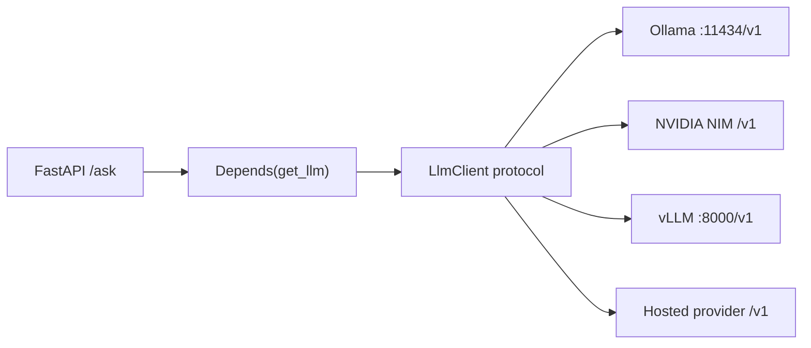
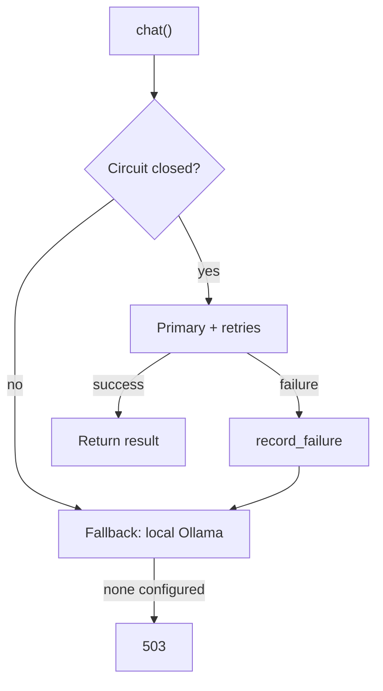

import TOCInline from '@theme/TOCInline';

# One Client, Many Backends

<TOCInline toc={toc} minHeadingLevel={2} maxHeadingLevel={2} />

:::tip[In this guide]
Build the `LlmClient` abstraction properly: Pydantic settings, a protocol,
FastAPI dependency injection, streaming through to SSE, timeouts, retries with
jitter, a circuit breaker, and a fallback from your GPU backend to local
Ollama. Plus an honest list of where the abstraction leaks.
:::

## What Is It?

One interface in your application, several inference backends behind it,
selected by configuration.



This is possible because Ollama, NIM, vLLM, TGI and most hosted providers all
expose the OpenAI chat-completions shape. One HTTP contract, many
implementations behind it.

## Why Does It Matter?

Without the abstraction, the backend choice leaks into every route, test and
background job. Switching means a diff across the codebase and a risky deploy.

With it you get four concrete things:

- **Dev/prod parity by config.** Ollama locally, vLLM or NIM in production,
  identical code path. No `if ENV == "dev"` branches in business logic.
- **Testability.** A fake implementation of the protocol, no HTTP mocking.
- **Vendor substitution.** Price changes, an outage, a better model appears —
  one environment variable.
- **Graceful degradation.** Primary backend down, fall back to a local model
  and serve a worse answer instead of a 500.

The cost is one indirection layer and the discipline to keep it thin. What is
*not* a good trade is building a framework — see
[Where the Abstraction Leaks](#where-the-abstraction-leaks).

## Configuration

Everything backend-specific lives in settings. This follows the pattern from
[Configuration & Environment](../02-fastapi/01-core-path/17-configuration-environment.mdx).

```python
from enum import StrEnum
from functools import lru_cache

from pydantic import Field, model_validator
from pydantic_settings import BaseSettings, SettingsConfigDict


class Provider(StrEnum):
    OLLAMA = "ollama"
    NIM = "nim"
    VLLM = "vllm"
    OPENAI = "openai"


DEFAULTS: dict[Provider, tuple[str, str]] = {
    Provider.OLLAMA: ("http://localhost:11434/v1", "llama3.2"),
    Provider.NIM: ("https://integrate.api.nvidia.com/v1", "meta/llama-3.1-8b-instruct"),
    Provider.VLLM: ("http://localhost:8000/v1", "meta-llama/Llama-3.1-8B-Instruct"),
    Provider.OPENAI: ("https://api.openai.com/v1", "gpt-4o-mini"),
}


class LlmSettings(BaseSettings):
    model_config = SettingsConfigDict(
        env_prefix="LLM_", env_file=".env", extra="ignore"
    )

    provider: Provider = Provider.OLLAMA
    base_url: str = ""
    api_key: str = ""
    model: str = ""

    connect_timeout: float = Field(default=5.0, gt=0)
    read_timeout: float = Field(default=120.0, gt=0)
    max_retries: int = Field(default=2, ge=0, le=5)

    fallback_provider: Provider | None = None
    fallback_base_url: str = "http://localhost:11434/v1"
    fallback_model: str = "llama3.2"

    @model_validator(mode="after")
    def apply_provider_defaults(self) -> "LlmSettings":
        default_url, default_model = DEFAULTS[self.provider]
        if not self.base_url:
            self.base_url = default_url
        if not self.model:
            self.model = default_model
        if self.provider in (Provider.NIM, Provider.OPENAI) and not self.api_key:
            raise ValueError(f"LLM_API_KEY is required for provider={self.provider}")
        return self


@lru_cache
def get_llm_settings() -> LlmSettings:
    return LlmSettings()
```

Three deliberate choices:

- **Provider defaults in a table, not in the client.** Switching provider needs
  one env var, not four.
- **Validation fails at startup.** A missing API key raises on boot, not on the
  first user request at 3am.
- **`lru_cache` on the getter.** Settings are read once; `.env` parsing does
  not happen per request.

```bash
# Local development
LLM_PROVIDER=ollama

# Production on NVIDIA's hosted catalog, falling back to a local Ollama
LLM_PROVIDER=nim
LLM_API_KEY=nvapi-...
LLM_MODEL=meta/llama-3.1-70b-instruct
LLM_FALLBACK_PROVIDER=ollama
```

## The Protocol

Define the interface with `typing.Protocol`. Structural typing means
implementations inherit from nothing, and your test fake is just a class with
the right methods.

```python
from collections.abc import AsyncIterator
from dataclasses import dataclass
from typing import Protocol, runtime_checkable


@dataclass(frozen=True, slots=True)
class ChatResult:
    text: str
    model: str
    prompt_tokens: int
    completion_tokens: int
    finish_reason: str
    duration_s: float


Message = dict[str, str]


@runtime_checkable
class LlmClient(Protocol):
    @property
    def model(self) -> str: ...

    async def chat(
        self,
        messages: list[Message],
        *,
        temperature: float = 0.2,
        max_tokens: int = 1024,
    ) -> ChatResult: ...

    def stream(
        self,
        messages: list[Message],
        *,
        temperature: float = 0.2,
        max_tokens: int = 1024,
    ) -> AsyncIterator[str]: ...

    async def aclose(self) -> None: ...
```

Note `stream` is **not** `async def`. An async generator function returns its
iterator synchronously, so declaring it `async def` would force callers to
`await` before iterating. Returning `AsyncIterator[str]` from a plain `def`
keeps `async for client.stream(...)` working for both real and fake
implementations.

Returning a `ChatResult` rather than a bare `str` is what makes cost and
latency tracking possible without every caller re-deriving it.

## The Implementation

One class covers every OpenAI-compatible backend, which is all four of ours.

```python
import json
import time
from collections.abc import AsyncIterator

import httpx


class OpenAICompatClient:
    """Works against Ollama, vLLM, TGI, NIM and OpenAI itself."""

    def __init__(
        self,
        *,
        base_url: str,
        api_key: str,
        model: str,
        connect_timeout: float = 5.0,
        read_timeout: float = 120.0,
    ) -> None:
        self._model = model
        self._http = httpx.AsyncClient(
            base_url=base_url.rstrip("/"),
            headers={
                # Ollama ignores the value but wants the header present.
                "Authorization": f"Bearer {api_key or 'not-used'}",
                "Content-Type": "application/json",
            },
            timeout=httpx.Timeout(
                connect=connect_timeout, read=read_timeout, write=10.0, pool=5.0
            ),
            limits=httpx.Limits(max_connections=100, max_keepalive_connections=20),
        )

    @property
    def model(self) -> str:
        return self._model

    def _payload(
        self, messages: list[Message], temperature: float, max_tokens: int, stream: bool
    ) -> dict[str, object]:
        return {
            "model": self._model,
            "messages": messages,
            "temperature": temperature,
            "max_tokens": max_tokens,
            "stream": stream,
        }

    async def chat(
        self,
        messages: list[Message],
        *,
        temperature: float = 0.2,
        max_tokens: int = 1024,
    ) -> ChatResult:
        start = time.perf_counter()
        resp = await self._http.post(
            "/chat/completions",
            json=self._payload(messages, temperature, max_tokens, stream=False),
        )
        resp.raise_for_status()
        data = resp.json()
        choice = data["choices"][0]
        usage = data.get("usage") or {}
        return ChatResult(
            text=choice["message"].get("content") or "",
            model=data.get("model", self._model),
            prompt_tokens=int(usage.get("prompt_tokens", 0)),
            completion_tokens=int(usage.get("completion_tokens", 0)),
            finish_reason=choice.get("finish_reason", "unknown"),
            duration_s=time.perf_counter() - start,
        )

    async def stream(
        self,
        messages: list[Message],
        *,
        temperature: float = 0.2,
        max_tokens: int = 1024,
    ) -> AsyncIterator[str]:
        payload = self._payload(messages, temperature, max_tokens, stream=True)
        async with self._http.stream("POST", "/chat/completions", json=payload) as resp:
            resp.raise_for_status()
            async for line in resp.aiter_lines():
                if not line.startswith("data:"):
                    continue
                raw = line.removeprefix("data:").strip()
                if raw == "[DONE]":
                    return
                chunk = json.loads(raw)
                choices = chunk.get("choices") or []
                if not choices:
                    continue
                delta = choices[0].get("delta", {}).get("content")
                if delta:
                    yield delta

    async def aclose(self) -> None:
        await self._http.aclose()
```

Here `stream` *is* `async def` because it contains `yield`, which makes it an
async generator function — calling it returns an `AsyncIterator` without
awaiting, satisfying the protocol's plain-`def` signature.

One class, not four: the backends differ in which *optional* fields they
support, not in the HTTP shape. Subclassing per vendor would duplicate
everything to vary nothing. Add a subclass when a backend needs genuinely
different wire behaviour.

### A fake for tests

```python
class FakeLlmClient:
    def __init__(self, reply: str = "fake answer") -> None:
        self._reply = reply
        self.calls: list[list[Message]] = []

    @property
    def model(self) -> str:
        return "fake"

    async def chat(self, messages, *, temperature=0.2, max_tokens=1024) -> ChatResult:
        self.calls.append(messages)
        return ChatResult(self._reply, "fake", 10, 5, "stop", 0.001)

    async def stream(self, messages, *, temperature=0.2, max_tokens=1024):
        self.calls.append(messages)
        for word in self._reply.split():
            yield word + " "

    async def aclose(self) -> None:
        return None
```

No HTTP mocking, no cassettes, and `isinstance(FakeLlmClient(), LlmClient)` is
`True` thanks to `runtime_checkable`. See
[Testing](../02-fastapi/01-core-path/15-testing.mdx).

## Wiring It Into FastAPI

The client holds a connection pool, so it must be built once per process and
closed on shutdown — not per request. This is the lifespan-plus-dependency
pattern from
[Dependency Injection](../02-fastapi/01-core-path/03-dependency-injection.mdx).

```python
from collections.abc import AsyncIterator
from contextlib import asynccontextmanager
from typing import Annotated

from fastapi import Depends, FastAPI, HTTPException, Request


def build_client(settings: LlmSettings) -> OpenAICompatClient:
    return OpenAICompatClient(
        base_url=settings.base_url,
        api_key=settings.api_key,
        model=settings.model,
        connect_timeout=settings.connect_timeout,
        read_timeout=settings.read_timeout,
    )


@asynccontextmanager
async def lifespan(app: FastAPI) -> AsyncIterator[None]:
    settings = get_llm_settings()
    primary = build_client(settings)

    fallback = None
    if settings.fallback_provider is not None:
        fallback = OpenAICompatClient(
            base_url=settings.fallback_base_url,
            api_key="",
            model=settings.fallback_model,
        )

    app.state.llm = ResilientLlmClient(primary=primary, fallback=fallback, settings=settings)
    try:
        yield
    finally:
        await app.state.llm.aclose()


app = FastAPI(lifespan=lifespan)


def get_llm(request: Request) -> LlmClient:
    return request.app.state.llm


LlmDep = Annotated[LlmClient, Depends(get_llm)]
```

Routes now depend on the protocol, never on a vendor:

```python
from pydantic import BaseModel, Field


class AskRequest(BaseModel):
    question: str = Field(min_length=1, max_length=4000)
    temperature: float = Field(default=0.2, ge=0.0, le=2.0)


class AskResponse(BaseModel):
    answer: str
    model: str
    tokens: int
    duration_ms: int


@app.post("/ask", response_model=AskResponse)
async def ask(body: AskRequest, llm: LlmDep) -> AskResponse:
    try:
        result = await llm.chat(
            [
                {"role": "system", "content": "Answer concisely. Say so if unsure."},
                {"role": "user", "content": body.question},
            ],
            temperature=body.temperature,
        )
    except (httpx.HTTPError, AllBackendsFailedError) as exc:
        # AllBackendsFailedError is defined in the resilience section below.
        raise HTTPException(status_code=503, detail="LLM backend unavailable") from exc

    return AskResponse(
        answer=result.text,
        model=result.model,
        tokens=result.prompt_tokens + result.completion_tokens,
        duration_ms=int(result.duration_s * 1000),
    )
```

Overriding in tests is one line:

```python
app.dependency_overrides[get_llm] = lambda: FakeLlmClient("stubbed")
```

## Streaming Out as SSE

Tokens arrive from the backend as SSE and leave your API as SSE. The middle is
your abstraction.

```python
from fastapi.responses import StreamingResponse


SSE_HEADERS = {
    "Cache-Control": "no-cache",
    "Connection": "keep-alive",
    "X-Accel-Buffering": "no",  # stop nginx buffering the stream
}


@app.post("/ask/stream")
async def ask_stream(body: AskRequest, llm: LlmDep) -> StreamingResponse:
    messages = [
        {"role": "system", "content": "Answer concisely."},
        {"role": "user", "content": body.question},
    ]

    async def event_source() -> AsyncIterator[str]:
        try:
            async for delta in llm.stream(messages, temperature=body.temperature):
                yield f"data: {json.dumps({'delta': delta})}\n\n"
        except httpx.HTTPError as exc:
            # The 200 is already sent; report the failure in-band.
            yield f"data: {json.dumps({'error': str(exc)})}\n\n"
        finally:
            yield "data: [DONE]\n\n"

    return StreamingResponse(
        event_source(), media_type="text/event-stream", headers=SSE_HEADERS
    )
```

Four things this gets right:

- **Errors are reported in-band.** Headers went out with the first chunk, so
  the status code is already fixed. Send an `error` event instead.
- **`finally` always emits `[DONE]`.** Clients waiting for the sentinel would
  otherwise hang.
- **`X-Accel-Buffering: no`** stops nginx buffering the whole response and
  silently destroying streaming — the usual cause of "streaming works locally
  but not in prod".
- **JSON-encoded payloads.** Raw text breaks on any delta containing a
  newline, since `\n\n` terminates an SSE event.

Client disconnects surface as `CancelledError` inside the generator. Let it
propagate — that is how you stop paying for output nobody is reading.

## Resilience

Timeouts, retries, a circuit breaker and a fallback chain. Each solves a
distinct problem, and in this order.

### Retries with exponential backoff and jitter

Retry only what is safe to retry. A `429` or a `503` is transient. A `400` is
your bug and will fail identically forever.

```python
import asyncio
import random
from collections.abc import Awaitable, Callable
from typing import TypeVar

RETRYABLE_STATUS = frozenset({408, 409, 425, 429, 500, 502, 503, 504})

T = TypeVar("T")


async def with_retries(
    operation: Callable[[], Awaitable[T]],
    *,
    max_retries: int = 2,
    base_delay: float = 0.5,
    max_delay: float = 8.0,
) -> T:
    last_exc: Exception | None = None
    for attempt in range(max_retries + 1):
        try:
            return await operation()
        except httpx.HTTPStatusError as exc:
            if exc.response.status_code not in RETRYABLE_STATUS:
                raise
            last_exc = exc
        except (httpx.ConnectError, httpx.ReadTimeout, httpx.PoolTimeout) as exc:
            last_exc = exc

        if attempt == max_retries:
            break

        # Full jitter: random in [0, capped_delay]. Prevents synchronised
        # retry storms across many clients.
        capped = min(max_delay, base_delay * (2 ** attempt))
        await asyncio.sleep(random.uniform(0, capped))

    assert last_exc is not None
    raise last_exc
```

Why **full jitter** and not plain exponential backoff: if a backend blips and
200 clients all retry at exactly 0.5s, 1.0s and 2.0s, you have built a
synchronised load spike that keeps it down. Randomising the delay spreads the
retries out.

Do not retry streaming requests that already emitted tokens. The user has seen
partial output; restarting produces a duplicated, incoherent response. Retry
only before the first token.

### Circuit breaker

Retries make a *transient* failure survivable. They make a *sustained* failure
worse — every request burns its full timeout budget three times before giving
up. A circuit breaker stops calling a backend that is clearly down.

```python
import time
from enum import StrEnum


class BreakerState(StrEnum):
    CLOSED = "closed"        # normal
    OPEN = "open"            # failing; reject immediately
    HALF_OPEN = "half_open"  # probing recovery


class CircuitOpenError(RuntimeError):
    pass


class CircuitBreaker:
    def __init__(self, *, failure_threshold: int = 5, recovery_timeout: float = 30.0) -> None:
        self._threshold = failure_threshold
        self._recovery = recovery_timeout
        self._failures = 0
        self._opened_at: float | None = None

    @property
    def state(self) -> BreakerState:
        if self._opened_at is None:
            return BreakerState.CLOSED
        if time.monotonic() - self._opened_at >= self._recovery:
            return BreakerState.HALF_OPEN
        return BreakerState.OPEN

    def check(self) -> None:
        if self.state is BreakerState.OPEN:
            raise CircuitOpenError("LLM backend circuit is open")

    def record_success(self) -> None:
        self._failures = 0
        self._opened_at = None

    def record_failure(self) -> None:
        self._failures += 1
        if self._failures >= self._threshold:
            self._opened_at = time.monotonic()
```

In `HALF_OPEN` the next request is allowed through as a probe. Success closes
the circuit; failure re-opens it for another `recovery_timeout`.

### The fallback chain

Primary GPU backend, then local Ollama. A slower, weaker answer beats a 503.

```python
import logging

logger = logging.getLogger(__name__)


class AllBackendsFailedError(RuntimeError):
    """No backend could serve the request. Routes map this to a 503."""


class ResilientLlmClient:
    """Retries, circuit-breaks, then falls back to a secondary backend."""

    def __init__(
        self,
        *,
        primary: OpenAICompatClient,
        fallback: OpenAICompatClient | None,
        settings: LlmSettings,
    ) -> None:
        self._primary = primary
        self._fallback = fallback
        self._settings = settings
        self._breaker = CircuitBreaker()

    @property
    def model(self) -> str:
        return self._primary.model

    async def chat(
        self,
        messages: list[Message],
        *,
        temperature: float = 0.2,
        max_tokens: int = 1024,
    ) -> ChatResult:
        try:
            self._breaker.check()
            result = await with_retries(
                lambda: self._primary.chat(
                    messages, temperature=temperature, max_tokens=max_tokens
                ),
                max_retries=self._settings.max_retries,
            )
            self._breaker.record_success()
            return result
        except CircuitOpenError:
            logger.warning("llm.circuit_open provider=%s", self._settings.provider)
        except httpx.HTTPError as exc:
            # HTTPStatusError is a subclass of HTTPError, so this covers both
            # transport failures and non-2xx responses.
            self._breaker.record_failure()
            logger.warning(
                "llm.primary_failed provider=%s error=%s",
                self._settings.provider,
                exc.__class__.__name__,
            )

        if self._fallback is None:
            raise AllBackendsFailedError("no healthy LLM backend")

        logger.info("llm.fallback model=%s", self._fallback.model)
        return await self._fallback.chat(
            messages, temperature=temperature, max_tokens=max_tokens
        )

    async def stream(
        self,
        messages: list[Message],
        *,
        temperature: float = 0.2,
        max_tokens: int = 1024,
    ) -> AsyncIterator[str]:
        # No mid-stream failover: once a token is emitted, switching backends
        # produces incoherent output. Fail over only before the first token.
        target = self._primary
        if self._breaker.state is BreakerState.OPEN and self._fallback is not None:
            target = self._fallback
        async for delta in target.stream(
            messages, temperature=temperature, max_tokens=max_tokens
        ):
            yield delta

    async def aclose(self) -> None:
        await self._primary.aclose()
        if self._fallback is not None:
            await self._fallback.aclose()
```



:::warning
A fallback to a weaker local model changes answer quality, not just latency.
Record which backend served each request in your response metadata and logs,
or you will be debugging quality complaints with no idea which model produced
the output.
:::

## Where the Abstraction Leaks

Be honest about this. "OpenAI-compatible" covers chat completions well and
degrades from there.

| Capability | Ollama | vLLM | NIM | Hosted (OpenAI) |
| --- | --- | --- | --- | --- |
| `/v1/chat/completions` | Yes | Yes | Yes | Yes |
| Streaming (SSE) | Yes | Yes | Yes | Yes |
| `usage` token counts | Partial | Yes | Yes | Yes |
| Tool / function calling | Model-dependent | Model-dependent | Model-dependent | Yes |
| Parallel tool calls | Rare | Sometimes | Sometimes | Yes |
| JSON / schema mode | `format: json` | Guided decoding | Model-dependent | `response_format` |
| `logprobs` | No | Yes | Sometimes | Yes |
| `stop` sequences | Yes | Yes | Yes | Yes |
| `seed` (reproducibility) | Yes (option) | Yes | Sometimes | Best-effort |
| `n` (multiple choices) | No | Yes | Sometimes | Yes |
| Embedding dimensions | Model-dependent | Model-dependent | Model-dependent | Configurable |
| `input_type` for embeddings | No | No | **Required** by QA models | No |
| Context length | Per model, `num_ctx` | `--max-model-len` | Fixed by image | Per model |
| Vision / multimodal | Some models | Some models | Some models | Yes |

The leaks that cause real incidents:

- **Tool calling.** The biggest one. Support is per *model*, not per backend,
  and quality varies wildly. A small local model may emit malformed arguments
  or ignore tools entirely. Always validate tool arguments with Pydantic, as in
  [NVIDIA NIM & Hosted Endpoints](../13-production-genai-and-llmops/01-nvidia-nim-endpoints.mdx).
- **Token counting.** Different tokenizers mean different counts for identical
  text. Never compare token numbers across providers, and never budget cost
  with a count from the wrong tokenizer.
- **Embedding dimensions.** A vector DB index is fixed-dimension. Switching
  embedding backends means re-embedding the entire corpus — see
  [Embeddings](../05-embeddings-and-semantic-search/01-embeddings.mdx).
- **Context length.** Silently differs. Exceeding it either errors or
  truncates, and truncation is worse because it looks like it worked.
- **Unknown fields are ignored, not rejected.** Pass `logprobs` to a backend
  that doesn't support it and you often get a normal `200` with no logprobs.
  Your code sees `None` and takes a confusing branch.

Two rules keep this manageable:

1. **Keep the protocol to the intersection you actually use.** Chat, stream and
   token counts cover the vast majority of applications. Do not model every
   vendor feature.
2. **Make the rest an explicit capability check**, so a route that needs tools
   fails fast with a clear message instead of mysteriously producing prose:

```python
@dataclass(frozen=True, slots=True)
class Capabilities:
    tools: bool = False
    logprobs: bool = False
    max_context: int = 4096


CAPABILITIES: dict[Provider, Capabilities] = {
    Provider.OLLAMA: Capabilities(max_context=8192),
    Provider.VLLM: Capabilities(tools=True, logprobs=True, max_context=32768),
    Provider.NIM: Capabilities(tools=True, max_context=32768),
    Provider.OPENAI: Capabilities(tools=True, logprobs=True, max_context=128000),
}
```

## Cost and Latency Tracking

`ChatResult` already carries tokens and duration. Emit them on every call, in
one place, so the data exists before you need it.

```python
import logging

logger = logging.getLogger("llm.metrics")

# Dollars per 1M tokens. Hosted prices change; self-hosted is amortised
# GPU cost, so zero here and tracked as infrastructure instead.
PRICING: dict[str, tuple[float, float]] = {
    "gpt-4o-mini": (0.15, 0.60),
    "meta/llama-3.1-8b-instruct": (0.06, 0.06),
    "meta/llama-3.1-70b-instruct": (0.35, 0.40),
}


def estimated_cost_usd(result: ChatResult) -> float:
    rates = PRICING.get(result.model)
    if rates is None:
        return 0.0
    prompt_rate, completion_rate = rates
    return (
        result.prompt_tokens * prompt_rate + result.completion_tokens * completion_rate
    ) / 1_000_000


def log_llm_call(result: ChatResult, *, provider: str, route: str, request_id: str) -> None:
    logger.info(
        "llm_call",
        extra={
            "request_id": request_id,
            "route": route,
            "provider": provider,
            "model": result.model,
            "prompt_tokens": result.prompt_tokens,
            "completion_tokens": result.completion_tokens,
            "duration_ms": round(result.duration_s * 1000, 1),
            "tokens_per_s": round(
                result.completion_tokens / max(result.duration_s, 1e-6), 1
            ),
            "finish_reason": result.finish_reason,
            "est_cost_usd": round(estimated_cost_usd(result), 6),
        },
    )
```

Log these as **structured fields**, not interpolated into a message string, or
you cannot aggregate them — see
[Logging & Observability](../02-fastapi/01-core-path/18-logging-observability.mdx).

What to watch once the data flows:

| Signal | Why it matters |
| --- | --- |
| `completion_tokens` p95 | Verbose answers are your main cost driver |
| `finish_reason == "length"` rate | Answers are being truncated by `max_tokens` |
| `tokens_per_s` by provider | Catches a backend degrading before users complain |
| TTFT p95 for streaming routes | What users actually perceive |
| Fallback invocation rate | Non-zero means your primary is unhealthy |
| Cost per request by route | Finds the one endpoint spending all the money |

A `finish_reason == "length"` rate above a few percent is almost always a bug,
not a user preference. It means you are paying for tokens and then throwing
away the end of the answer.

## Common Mistakes

- Creating the HTTP client per request, discarding the connection pool.
- One flat `timeout`, so a dead TCP connect waits as long as a long generation.
- Retrying `400` and `422`. They will never succeed.
- Exponential backoff without jitter, synchronising a retry storm.
- Retrying a stream after tokens were already sent to the user.
- Retries with no circuit breaker, so a sustained outage triples the load.
- Falling back to a weaker model without recording that it happened.
- Returning a bare `str`, so tokens and duration are unavailable to callers.
- An abstraction that grows to model every vendor feature — at which point you
  maintain a framework instead of using an API.
- Comparing token counts across providers with different tokenizers.
- Streaming through a buffering proxy with no `X-Accel-Buffering: no`.
- Forgetting to emit `[DONE]` on the error path, hanging the client.

## Interview Questions

- Why does OpenAI API compatibility let you switch backends by config?
- Why `Protocol` rather than an abstract base class here?
- Why must the HTTP client be created at startup rather than per request?
- Which HTTP status codes are safe to retry, and which are not?
- What does jitter add to exponential backoff, and why add a circuit breaker
  when you already have retries?
- Why can't you retry or fail over a stream mid-flight, and how do you report
  an error after a streaming response has started?
- Name three places the OpenAI-compatible abstraction leaks.
- Why are token counts not comparable across providers?

## Things to Remember

- One `OpenAICompatClient` covers Ollama, vLLM, NIM and hosted providers.
- Settings pick the backend; routes depend on the protocol, never a vendor.
- Build the client in `lifespan`, inject it with `Depends`, close it on
  shutdown.
- Split timeouts: fail connect fast, allow reads to be slow.
- Retry transient statuses only, with full jitter, behind a circuit breaker.
- Never fail over mid-stream; always emit `[DONE]` in `finally`.
- Return tokens and duration from every call so cost tracking is free.
- Keep the abstraction to the intersection you use; make the rest an explicit
  capability check.

## Mini Exercise

Implement `LlmSettings`, the `LlmClient` protocol and `OpenAICompatClient`,
and wire them into a FastAPI app with `/ask` and `/ask/stream`. Then: run it
against Ollama; switch `LLM_PROVIDER` to `nim` (or point `LLM_BASE_URL` at a
local vLLM) and confirm no code changed; set `LLM_FALLBACK_PROVIDER=ollama`,
point the primary at a dead port, and verify `/ask` still answers *and* that
your logs say which backend served it; finally write one test with
`FakeLlmClient` via `dependency_overrides` and no HTTP mocking at all.

## Done When

- [ ] You can switch backends with a single environment variable.
- [ ] Your routes depend on the protocol, not on `httpx` or a vendor SDK.
- [ ] Streaming works end to end and emits `[DONE]` even on failure.
- [ ] Retries with jitter, a circuit breaker, and a fallback chain are in place
      and tested.
- [ ] Every LLM call logs model, tokens, duration and backend as structured
      fields.
- [ ] You can name three ways the abstraction leaks and how you handle each.
