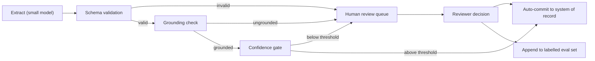

import TOCInline from '@theme/TOCInline';

# Extraction & Classification

<TOCInline toc={toc} minHeadingLevel={2} maxHeadingLevel={2} />

:::tip[In this guide]
Most shipped GenAI work is not chat. It is turning messy input into structured
records and labels. This page covers the task design: schemas, label
taxonomies, abstention, review queues, and the measurement that makes all of it
boring and safe.
:::

## What Is It?

Extraction and classification turn unstructured input — an email, a support
ticket, a scanned invoice — into something a database or a `switch` statement
can consume: typed fields, or a label from a fixed set.

This page is about **task design**. The *mechanism* for reliable typed output
(JSON schemas, Pydantic validation, constrained decoding, retry on invalid
output) lives in
[structured output](../04-prompt-engineering/03-structured-output.mdx). Read it
first; this page assumes valid JSON and asks the harder question: what JSON
should you ask for, and are the values correct?

## Why Does It Matter?

| Property | Extraction / classification | Chat |
| --- | --- | --- |
| Is there a right answer? | Yes, one per record | Fuzzy, many acceptable |
| Scoreable offline? | Exact match, F1 | Needs a judge or humans |
| What does it replace? | Manual data entry, triage | Nothing measurable |
| Needs a UI? | No, it is a batch job | Yes, and a good one |
| Does a small model work? | Usually | Often not |

Chat is hard to ship because "correct" is undefined, so you cannot tell whether
a change improved anything. Classification has a confusion matrix: run it in CI,
watch the number, argue about the number. Replacing a human who keys an invoice
into an ERP in 90 seconds also has a value you can compute up front.

## The Task Shapes

| Shape | Input → output | Example | Primary metric |
| --- | --- | --- | --- |
| Extraction | Text → typed fields | Invoice → vendor, total, date | Per-field exact match |
| Classification | Input → 1 of N | Ticket → one of 7 queues | Per-label precision/recall |
| Multi-label | Input → subset of N | Article → topic tags | Micro and macro F1 |
| Routing / triage | 1 of N, selects code path | Query → RAG, SQL, or decline | Per-route recall, misroute cost |
| Span extraction | Text → offsets in the text | Contract → indemnity clause | Span overlap |
| Entity resolution | Free text → canonical ID | "IBM Corp." → `org_00417` | Accuracy, plus abstain rate |

Routing is the one to watch, because its output *selects a program*. Sent to the
SQL path when it needed retrieval, a query fails loudly; sent to retrieval when
it needed SQL, it fails quietly with a plausible wrong answer. Weight metrics by
what the wrong branch costs, not by branch frequency — plumbing in
[one client, many backends](./01-one-client-many-backends.mdx). For entity
resolution, retrieve candidate IDs from your registry and have the model pick
one or abstain; it cannot know which IDs exist, so never let it invent one.

## Schema Design Is the Core Skill

Your schema is a prompt. Field names, types, enums and descriptions do more work
than any instruction above them.

1. **Flat over nested.** Each nesting level is another place a value can land
   unexpectedly. Prefer `vendor_name` over a `vendor` object unless the nesting
   is a genuine repeated list.
2. **Every field needs defined absent-behaviour** — `X | None` with documented
   null semantics. A silent empty string means you cannot distinguish "absent
   from the document" from "the model gave up".
3. **Enums over free text** wherever the value space is closed.
4. **Field descriptions are prompt surface**, read at inference time. Put
   decision rules there, not notes for colleagues.
5. **Normalise in validators, not the prompt.** Asking for ISO dates works most
   of the time; parsing what came back works always, or raises.

### A worked schema evolution

```python
class Invoice(BaseModel):          # the naive first attempt
    vendor: str
    total: float
    date: str
    currency: str
```

Run that on 200 real documents and here is what breaks:

| Failure on real documents | Cause in the naive schema |
| --- | --- |
| `total` reads `1234.56` from `1.234,56` | `float` coercion succeeds on the wrong reading |
| `date` is `"03/04/2024"` | Ambiguous, and no rule says which convention |
| `currency` is `"dollars"`, `"US$"`, `"usd"` | Free text, so you normalise forever |
| Credit note has a negative total | No field says it is a credit note |
| Vendor missing on a scanned page | Model invents one rather than failing |
| Subtotal returned, not grand total | Nothing says which number you want |

The hardened version encodes each lesson:

```python
from datetime import date as Date
from decimal import Decimal
from typing import Literal
from pydantic import BaseModel, Field, field_validator

class Invoice(BaseModel):
    vendor_name: str | None = Field(default=None,
        description="Legal name of the issuing party, exactly as printed. "
                    "Null if no issuer is printed.")
    grand_total: Decimal | None = Field(default=None,
        description="Final amount payable including tax, as printed. Not the "
                    "subtotal. Negative for credit notes. Null if absent.")
    currency: Literal["USD", "EUR", "GBP", "unknown"] = Field(
        description="ISO code of grand_total, or 'unknown' if not printed.")
    issue_date: Date | None = Field(default=None,
        description="Issue date. If the format is ambiguous (03/04/2024), "
                    "follow the convention used elsewhere; else return null.")
    document_type: Literal["invoice", "credit_note", "receipt", "other"]
    total_source_text: str | None = Field(default=None,
        description="Exact substring the grand_total was read from.")

    @field_validator("vendor_name")
    @classmethod
    def no_empty(cls, v: str | None) -> str | None:
        return (v or "").strip() or None      # empty becomes explicit null
```

`grand_total` now carries its disambiguation rule where the model reads it,
`unknown` gives uncertainty somewhere to go, and `total_source_text` buys a
deterministic grounding check. `Decimal` over `float` is not pedantry: money in
floats produces audit findings.

## Label Taxonomy Design

For classification the taxonomy is the product. A model cannot be more precise
than your definitions.

- **Mutually exclusive and collectively exhaustive.** If an item honestly fits
  two labels, the model's "error" is your design error. Merge them or go
  multi-label.
- **Always include an escape hatch** — an explicit `other` or `unknown` plus a
  rule for when to use it. Without one, out-of-distribution input is forced into
  your nearest label and you never find out.
- **Define labels by decision boundaries, not vibes.** Not "billing issues", but
  "disputes an amount already charged, or asks for a refund".
- **Test on humans first.** Hand 50 examples to two colleagues independently.
  Every disagreement is a broken definition.

**Inter-annotator agreement is the ceiling on achievable accuracy.** If two
trained humans agree on 80% of items, a model scoring 80% against one annotator
is at the noise floor; pushing to 90% fits that annotator's idiosyncrasies, not
the task. Measure agreement before you measure the model — see
[eval datasets](../12-evaluation-testing-and-observability/02-eval-datasets.mdx).

```python
from enum import Enum

class Queue(str, Enum):
    billing_dispute = "billing_dispute"
    technical_fault = "technical_fault"
    account_access = "account_access"
    unknown = "unknown"

class Triage(BaseModel):
    queue: Queue = Field(description=(
        "billing_dispute: disputes a charge already made, or wants a refund. "
        "Pricing for a purchase not yet made is not a dispute.\n"
        "technical_fault: the product does not work as documented.\n"
        "account_access: sign-in, MFA, password, permissions.\n"
        "unknown: does not fit exactly one of the above, or there is not "
        "enough information. Prefer unknown over guessing."))
    evidence: str = Field(description="Verbatim quote supporting the queue.")
```

Models default to being helpful, so abstention needs explicit permission — see
[prompting fundamentals](../04-prompt-engineering/01-prompting-fundamentals.mdx).

## Confidence and Abstention

The model will hand you a confidently wrong answer with no outward sign. Your
options, honestly ranked:

| Technique | Cost | What it tells you |
| --- | --- | --- |
| Explicit `unknown` value | Free | Model declined. Catches ambiguity, not confident errors |
| Grounding check on spans | Free, deterministic | The extracted value is not in the source. Catches a lot |
| Self-consistency over N samples | N times the calls | Instability, which correlates well with error |
| Logprob of the label token | Free if exposed | Relative ranking within one task, against a measured threshold |
| Asking for 1–10 confidence | A few tokens | Mostly theatre. Clusters at 8–9 regardless of correctness |

A self-reported score is uncalibrated and gives false comfort, so do not
threshold on it. Logprobs are informative but fiddly, since a label spans
several tokens and the split is model-specific. The grounding check is the best
value here: deterministic, free, and it catches plausible invented values, the
failure that hurts most in extraction. Related checks are in
[hallucination detection](../04-prompt-engineering/05-hallucination-detection.mdx).

```python
import asyncio
from collections import Counter
from openai import AsyncOpenAI

client = AsyncOpenAI(base_url="http://localhost:11434/v1", api_key="unused")
MODEL = "a-small-instruct-model"    # the cheap tier is the right default here

async def extract_once(doc: str, temperature: float) -> Invoice:
    resp = await client.chat.completions.create(
        model=MODEL, temperature=temperature,
        response_format={"type": "json_schema", "json_schema": {
            "name": "Invoice", "schema": Invoice.model_json_schema()}},
        messages=[{"role": "system", "content": "Extract fields. Return null "
                                                "rather than guessing."},
                  {"role": "user", "content": doc}])
    return Invoice.model_validate_json(resp.choices[0].message.content)

def is_grounded(rec: Invoice, doc: str) -> bool:
    """Deterministic: the quoted source text must exist in the input."""
    if rec.grand_total is None:
        return True                     # nothing claimed, nothing to ground
    src = (rec.total_source_text or "").strip()
    return bool(src) and src in doc

async def extract_with_confidence(doc: str, n: int = 3) -> dict:
    recs = await asyncio.gather(*(
        extract_once(doc, 0.0 if i == 0 else 0.7) for i in range(n)))
    top = recs[0]
    agree = [Counter(str(getattr(r, f)) for r in recs)[str(getattr(top, f))] / n
             for f in ("vendor_name", "grand_total", "issue_date")]
    return {"record": top, "min_agreement": min(agree),
            "grounded": is_grounded(top, doc),
            "abstained": top.currency == "unknown"}
```

## Routing to Human Review

You are not building a system that is always right. You are building one that
knows which 8% to hand to a person.



That last edge is the one teams forget. Every review decision is a free labelled
example, and it is also how you accumulate the data that makes a fine-tune
viable.

Pick the threshold with arithmetic. Review cost: 90 seconds of an analyst at
16 USD/hour = **0.40 USD** per record. Error cost: a wrong total in the ledger
averages **25 USD** to correct. Break-even error probability is 0.40 / 25 =
**1.6%**. At 10,000 documents a month and 94% accuracy, accepting everything
costs 600 × 25 = 15,000 USD; if your confidence signal isolates 1,800 documents
holding 500 of those errors, you pay 1,800 × 0.40 = 720 USD of review and avoid
12,500 USD.

Then stop guessing round numbers and sweep. On a labelled set of
`(confidence, is_correct)` pairs, evaluate every candidate threshold and keep
the one minimising `reviewed * 0.40 + escaped * 25`, where `reviewed` counts
items below the threshold and `escaped` counts incorrect items above it. Report
the winner with its review rate, because capacity is a real constraint: sending
60% of volume to a two-person team is not a solution. The queue itself is an
async job — see
[queues and async jobs](../13-production-genai-and-llmops/06-queues-and-async-jobs.mdx).

## Evaluation Is Easy Here

You have ground truth, so you can compute real metrics in CI on every prompt
change: per-label precision, recall, F1 and a confusion matrix for
classification; micro and macro F1 for multi-label; per-field exact and
normalised match for extraction.

**Aggregate accuracy hides the failure that hurts.** A system at 95% overall can
have 40% recall on `fraud_suspected` — 40 instances out of 2,000, carrying all
the business risk — because the aggregate is dominated by the majority class.
Normalised match matters too: `"IBM "` versus `"IBM"` is a missing `.strip()`,
not a model failure, and conflating the two sends you prompt-tuning when you
should be writing a validator. See [metrics](../12-evaluation-testing-and-observability/03-metrics.mdx).

```python
"""Per-field extraction scoring over a labelled JSONL file."""
import json, re

FIELDS = ["vendor_name", "grand_total", "issue_date", "document_type"]

def norm(v) -> str:
    return "__null__" if v is None else re.sub(r"\s+", " ", str(v).strip()).casefold()

def score(pairs: list[tuple[dict, dict]]) -> None:
    stats = {f: dict(exact=0, nm=0, n=0, miss=0, inv=0) for f in FIELDS}
    for pred, gold in pairs:
        for f in FIELDS:
            p, g, st = pred.get(f), gold.get(f), stats[f]
            st["n"] += 1
            st["exact"] += int(p == g)
            st["nm"] += int(norm(p) == norm(g))
            st["miss"] += int(g is not None and p is None)   # gave up
            st["inv"] += int(g is None and p is not None)    # invented
    print(f"{'field':<16}{'exact':>8}{'norm':>8}{'missed':>8}{'invented':>10}")
    for f, st in stats.items():
        n = st["n"]
        print(f"{f:<16}{st['exact']/n:>8.1%}{st['nm']/n:>8.1%}"
              f"{st['miss']/n:>8.1%}{st['inv']/n:>10.1%}")

if __name__ == "__main__":
    rows = [json.loads(line) for line in open("labelled.jsonl")]
    score([(r["pred"], r["gold"]) for r in rows])
```

The last two columns are different bugs with different fixes: missed values mean
the prompt or chunking lost the information, invented values mean the model
needs stronger permission to return null. Gate merges on per-field regressions
via [eval in CI](../12-evaluation-testing-and-observability/05-eval-in-ci.mdx).

## Document-Shaped Extraction

Long documents exceed context, and accuracy degrades over long inputs even
inside it. Chunk on structure (pages, sections, table boundaries) rather than
fixed token counts, extract the same nullable schema from every chunk, then
reconcile with explicit rules instead of taking the last non-null.

| Conflict across chunks | Rule that works |
| --- | --- |
| One value, others null | Take it, record its page |
| Two different totals | Prefer the chunk matching a header like "amount due"; else review |
| Same value from several chunks | Agreement is a confidence signal |
| Value appears nowhere | Keep null, do not re-prompt harder |

Never silently pick a winner on a genuine conflict: a conflicting total is a
high-value review item, and resolving it by rule destroys the signal. Keep
**provenance** per field — chunk ID, page number, source substring — which buys
the grounding check, auditability when finance asks where a number came from,
and a UI that can highlight the region. Scanned documents follow the same shape
with a vision model doing the per-page read, see
[multimodal RAG](../15-multimodal-genai/02-multimodal-rag.mdx).

## Cost Engineering

- **A small model almost always wins.** Benchmark the cheap tier first and
  escalate only specific failure classes; sending 5% of documents to a stronger
  model costs far less than all of them.
- **Batch.** No user is waiting, so run an async job with high concurrency or a
  provider batch endpoint, and budget by cost per thousand documents — see
  [cost and latency](../13-production-genai-and-llmops/08-cost-and-latency.mdx) and
  [API service design](./02-api-service-design.mdx).
- **Trim the input, not the schema.** Most token spend is the document.
- **Fine-tuning is unusually attractive here**: narrow fixed task, labelled data
  arriving free from the review queue, short outputs so a small tuned model is
  cheap to serve, and an offline metric that proves whether it worked. See
  [when to fine-tune](../14-fine-tuning-and-model-adaptation/01-when-to-fine-tune.mdx), and only
  after a prompt baseline and an eval set exist.

## Common Mistakes

- Allowing an empty string instead of an explicit null, so "absent from the
  document" and "model failed" are indistinguishable.
- Omitting `unknown` or `other`, forcing unexpected input into a wrong bucket
  and hiding drift.
- Reporting one aggregate accuracy that conceals poor recall on the rare,
  important label.
- Thresholding on a self-reported 1–10 score and calling it calibrated.
- Defining labels as nouns ("billing") rather than decision boundaries, then
  blaming the model for not knowing your unwritten rules.
- Measuring the model before measuring human agreement, so you chase accuracy
  past the noise ceiling of your own labels.
- Discarding review decisions instead of appending them to the eval set.

## Interview Questions

1. **Why is a classification feature easier to ship than a chat feature?** One
   right answer per item, so a labelled set gives you per-label precision and
   recall and regression detection in CI without human judgement.
2. **What caps achievable accuracy here?** Inter-annotator agreement. If two
   trained humans agree 80% of the time, a model matching one annotator 80% of
   the time is already at the noise floor.
3. **Rank the confidence signals for an extractor.** Grounding the extracted
   substring against the source (deterministic, free), self-consistency across
   samples (works, costs N calls), label logprobs (relative ranking only),
   self-reported scores (near useless).
4. **How do you choose a review threshold?** Break-even error probability is
   review cost over error cost; sweep on a labelled set to minimise total cost,
   then check the review rate against real capacity.
5. **96% accuracy but the business calls it unusable. First check?** The
   per-label breakdown — the aggregate is carried by a majority class while
   recall on the rare, high-consequence label is poor.
6. **How do you extract from a document longer than the context window?** Chunk
   on structure with page provenance, extract the same nullable schema per chunk,
   reconcile with explicit rules, send genuine conflicts to review.

## Things to Remember

- These tasks ship because they have a measurable right answer. Protect that
  with an eval set.
- The schema and the taxonomy are the product; field descriptions are prompt
  surface the model reads at inference time.
- Flat schemas, closed enums, explicit nulls, normalisation in validators, and a
  documented way to abstain.
- Grounding checks are the cheapest real confidence signal. Self-reported
  confidence is not a signal.
- Set thresholds from review cost over error cost, and report the review rate
  alongside.
- Report per-label and per-field. Aggregate accuracy is a marketing number.
- Start on the cheap tier and treat every review decision as a free labelled
  example.

## Mini Exercise

Take 60 support messages (or 60 invoices) and run the whole loop in an afternoon.

1. Write a 5-label taxonomy with decision-boundary definitions and an `unknown`
   value, then label all 60 yourself.
2. Have a colleague label the same 60 independently and compute percent
   agreement. Under 85%, fix the definitions and relabel before touching a model.
3. Classify all 60 on the cheap tier and print a confusion matrix with per-label
   precision and recall.
4. Add a confidence signal — self-consistency over 3 samples, or a grounding
   check for extraction — sweep the threshold at 0.40 USD review cost and 25 USD
   error cost, then report per-label F1, the threshold, and the review share.

If step 2 goes badly, you have learned the most valuable thing on this page.
