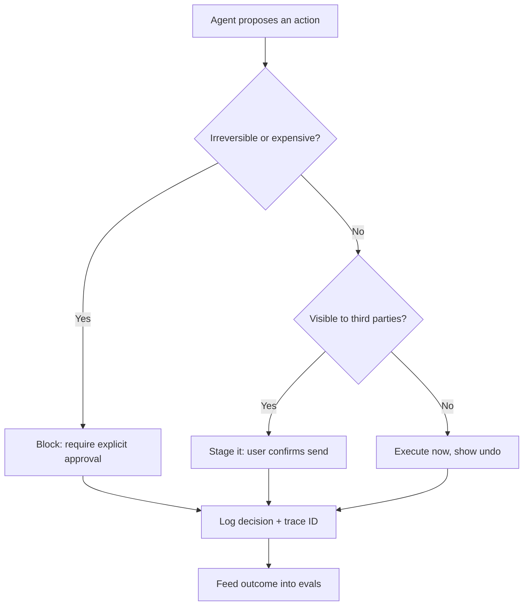

import TOCInline from '@theme/TOCInline';

# AI Product & UX Patterns

<TOCInline toc={toc} minHeadingLevel={2} maxHeadingLevel={2} />

:::tip[In this guide]
How a probabilistic system should present itself to a user, framed as backend
work: what the API streams, what it verifies, what it logs. Includes a typed
SSE protocol, a FastAPI endpoint with a guaranteed terminal event, and a
failure-to-message mapping table.
:::

## What Is It?

The decisions that determine how an LLM feature behaves at the boundary with a
human: how fast it appears to respond, how it signals doubt, how it proves its
claims, how it fails, and how a user gets out when it is wrong.

These get filed as frontend bugs. "Why did it say that?" is answered by whether
you streamed citations. "Why did it hang for 40 seconds?" by whether you
emitted status events. "Why can't we improve it?" by whether you logged a trace
ID next to the user's reaction. The UI renders what the API gives it.

## Why Does It Matter?

A feature's perceived quality is set as much by how it handles being wrong as
by how often it is right. A 90%-accurate feature that abstains clearly, cites
verifiable spans, and offers one click to plain search is trusted more than a
95%-accurate one that fabricates confidently with no recovery path.

The reason is asymmetry: a correct answer earns one unit of trust, a confident
wrong answer with no way to check it costs many, because it teaches the user
that every answer now needs verification — which removes the feature's value.

## Latency and Streaming

Time to first token is the number users feel. A response that starts in 400ms
and finishes in 12s reads as fast; one that shows nothing for 4s and finishes
in 6s reads as broken. Streaming does not make generation faster — throughput
and cost are unchanged. It lets the user read while you are still generating.

When the first useful content token is far away (a reasoning model thinking, a
retrieval step, a multi-hop agent), stream the process instead.

| Situation | Emit | UI shows |
| --- | --- | --- |
| Retrieval or rerank running | `status` with stage and counts | "Searching 1,204 documents" |
| Model thinking | `status` heartbeat every 2s | Indicator plus elapsed time |
| Agent tool call | `tool_call`, args redacted | Step row, collapsed |
| Known output shape | `skeleton` with headings | Greyed layout that fills in |
| Long run | `usage` deltas | Token and cost counter |

Heartbeats matter twice: proxies kill idle connections, and a user with no
signal assumes a hang.

### A concrete SSE event protocol

Use named event types, not one untyped blob. The client switches on type rather
than guessing from shape, and unknown types are ignored safely.

```json
{"type": "start",   "trace_id": "tr_9c4e", "model": "llama3.1:8b"}
{"type": "status",  "stage": "retrieval", "detail": "searching", "elapsed_ms": 120}
{"type": "status",  "stage": "rerank", "detail": "5 of 40 passages kept"}
{"type": "content", "delta": "Refunds are processed within 5 business days"}
{"type": "citation","marker": 1, "doc_id": "policy-refunds", "page": 3, "char_start": 1840, "char_end": 1972, "quote": "refunds are issued within five business days", "verified": true}
{"type": "usage",   "completion_tokens": 96, "cost_usd": 0.0021}
{"type": "error",   "code": "provider_unavailable", "message": "Temporarily unavailable.", "retryable": true}
{"type": "done",    "finish_reason": "stop", "trace_id": "tr_9c4e"}
```

Four rules that save you later:

1. **`start` carries the trace ID**, so the client can attach feedback and
   support can find the request
   ([tracing](../12-evaluation-testing-and-observability/07-tracing-and-observability.mdx)).
2. **Citations are separate events, not inline markup.** The model emits `[1]`;
   the backend resolves it to a span. Inline JSON forces the UI to parse
   half-finished objects.
3. **`error` is a normal event**, because by the time you know generation broke
   you already sent `200 OK`.
4. **`done` is guaranteed** — exactly one terminal event on every path.

### Terminating a stream honestly

The mid-stream error is the trap. You committed to `200 OK` and streamed three
paragraphs; now the provider drops. The status code cannot be changed, and
closing the socket leaves a truncated answer that looks complete, so the user
acts on half a sentence. Catch everything inside the generator, emit a typed
`error`, then `done` with a non-`stop` reason, and mark the answer incomplete
in the UI. Partial output alone is a correctness bug in a network costume.

```python
def sse(e: dict) -> str:                         # one named SSE frame
    return f"event: {e['type']}\ndata: {json.dumps(e)}\n\n"

@router.post("/chat/stream")
async def chat_stream(req: Request, body: ChatRequest):
    trace_id = new_trace_id()

    async def gen():
        reason, sent_content = "stop", False
        try:
            yield sse({"type": "start", "trace_id": trace_id, "model": MODEL})
            yield sse({"type": "status", "stage": "retrieval"})
            passages = await rerank(await retrieve(body.question), keep=5)

            if not passages:                     # abstention is not an error
                yield sse({"type": "content",
                           "delta": "I could not find that in the documents."})
                reason = "no_results"
                return

            async for chunk in llm_stream(body.question, passages):
                if await req.is_disconnected():
                    reason = "client_disconnect"
                    return                       # finally still runs
                if chunk.text:
                    sent_content = True
                    yield sse({"type": "content", "delta": chunk.text})
                for marker in chunk.citation_markers:
                    if cite := verify_citation(marker, passages):
                        yield sse({"type": "citation", **cite})

        except Exception as exc:
            reason = "error"
            log.exception("stream failed", extra={"trace_id": trace_id})
            code = getattr(exc, "code", "internal")
            yield sse({"type": "error", "code": code,
                       "message": USER_MESSAGES.get(code, GENERIC),
                       "retryable": getattr(exc, "retryable", True),
                       "partial": sent_content})
        finally:                                 # exactly one terminal event
            yield sse({"type": "done", "finish_reason": reason})

    return StreamingResponse(gen(), media_type="text/event-stream",
                             headers={"X-Accel-Buffering": "no"})
```

`X-Accel-Buffering: no` disables proxy buffering. Without it nginx batches your
streamed tokens and the TTFT work disappears. The rest of the latency budget
lives in [cost and latency](../13-production-genai-and-llmops/08-cost-and-latency.mdx).

## Communicating Uncertainty

Hedging on every answer destroys trust about as fast as false confidence does.
A hedge on a question the system answered perfectly teaches users to ignore
hedges, so the signal is gone when it matters.

A numeric confidence percentage is usually a lie. Log-probabilities measure
fluency, not factuality — fabrications arrive at high per-token probability — and
a self-rated score is sampled from the distribution of confident-sounding text.
"87% confident" claims a calibration curve over your query distribution; no
curve, no number.

| Pattern | Mechanism | Use when |
| --- | --- | --- |
| Show the evidence | Render retrieved spans beside the answer | Default for RAG |
| Explicit abstention | A `no_results` path naming what is missing | Retrieval empty or below score floor |
| Narrow the claim | Answer the supported part, name the rest | Partial grounding |
| Surface the retrieval set | Let the user judge the sources | High-stakes queries |

Abstention needs first-class treatment: its own `finish_reason`, its own
metric, and a UI affordance offering the next move. Implement it as an error
and product pressure will quietly remove it, after which the model guesses. See
[hallucination detection](../04-prompt-engineering/05-hallucination-detection.mdx).

## Citations and Provenance

Link to the span, not the document. A citation that opens a 60-page PDF at page
one has verified nothing; it moved the cost onto the user, who skips it. A
useful citation resolves to a document, page, character range, and quoted
sentence, so the UI can deep-link and highlight — which requires the chunker to
keep source offsets
([retrieval and generation](../06-rag/02-retrieval-generation.mdx)).

Unverified citations are worse than none. A model asked to cite will cite: it
invents document names, drifts a footnote, or attributes a claim to a passage
that never contained it, turning a checkable statement into one the user
believes is already checked. Verification is a backend job.

```python
def verify_citation(marker: int, passages: list[Passage]) -> dict | None:
    """Resolve a model-emitted marker against what retrieval returned."""
    p = next((p for p in passages if p.marker == marker), None)
    if p is None:
        log.warning("citation_hallucinated", extra={"marker": marker})
        return None                     # drop it; never forward unverified
    return {"marker": marker, "doc_id": p.doc_id, "page": p.page,
            "char_start": p.char_start, "char_end": p.char_end,
            "quote": p.text[:200], "verified": True}
```

Drop unresolvable markers, strip the dangling `[3]` from the text, and count
the drops — a rising hallucinated-citation rate is a strong early warning. See
[logging and guardrails](../13-production-genai-and-llmops/04-logging-monitoring-guardrails.mdx).

## Feedback That Is Actually Usable

Thumbs up/down is weakly informative: response rates sit in the low single
digits, the sample skews toward complaints, and a thumbs-down says that
something was wrong, not what. Keep it as a cheap channel, not a measurement
system. The real signal is in behaviour.

| Signal | Reasonable reading |
| --- | --- |
| Copied it, or accepted a suggestion | Accepted as-is; strong positive |
| Edited, then used it | Directionally right, details wrong |
| Regenerated without editing | Output rejected, intent unchanged |
| Rephrased the question | Retrieval or the model missed the intent |
| Abandoned mid-stream | Too slow, or the opening looked wrong |
| Escalated to a human | Hard failure regardless of thumbs |

Every one of these carries the trace ID from the `start` event. Feedback
without a joinable trace is an anecdote: someone was unhappy and you cannot
reproduce the request, the context, the prompt version, or the model build.

Replay is the point. Feedback is raw material for
[eval datasets](../12-evaluation-testing-and-observability/02-eval-datasets.mdx): triage negatives, write
the expected output, promote the row into a regression set. Aggregate rates
belong in [online evaluation](../12-evaluation-testing-and-observability/06-online-evaluation.mdx). A
pipeline ending in a dashboard nobody turns into test cases is telemetry
theatre.

## Escape Hatches

Every AI feature needs a path to a non-AI outcome. A user stuck with no
alternative does not retry — they leave. The ladder, cheapest first:

1. **Regenerate** — same input, new sample; free if the request is replayable.
2. **Edit the prompt** — refine the question instead of retyping it.
3. **See and change the retrieved context** — show the passages, let the user
   drop a bad one or pin a document. Also the most honest explanation of why
   the answer looked the way it did.
4. **Hand off to search** — keyword search over the same corpus, no model.
5. **Hand off to a human** — carrying the transcript, trace ID, and context.

Each rung needs backend support: replayable requests, exposed retrieval sets, a
search endpoint, an escalation payload.

## Human-in-the-Loop Placement

For anything that writes, spends, or sends, whether review happens before or
after the action follows from reversibility.



Confirmation fatigue is the failure mode to design against. Confirm everything
and users click through everything, so the one dialogue that mattered is
dismissed by the same reflex as the ninety that did not. Spend confirmations
only on the irreversible or expensive.

| Action class | Example | Placement |
| --- | --- | --- |
| Read-only | Search, summarize, answer | No approval |
| Reversible write | Draft saved, label added | Execute, offer undo |
| Externally visible | Email sent, comment posted | Approve before send |
| Spends money | Purchase, paid fan-out | Approve, show the amount |
| Irreversible | Delete, deploy, issue refund | Approve, type-to-confirm |

The tier must be enforced in the backend; a UI-only gate is bypassed by anyone
calling your API directly. See
[agent safety](../09-tool-calling-and-ai-agents/11-agent-safety.mdx).

## Agentic UX

Multi-step agents break the request/response assumption users carry from chat,
so more of the process has to be exposed.

- **Plan before execution.** Show the steps, allow edit or approval. A wrong
  plan caught at step zero is free; at step nine it already sent the email. See
  [planning and reflection](../09-tool-calling-and-ai-agents/09-planning-and-reflection.mdx).
- **Step-level progress.** One row per step with state and tool used; a single
  spinner over a 90-second run is indistinguishable from a hang.
- **Real interruptibility.** Cancel must stop backend work, not just close the
  stream: check `is_disconnected()`, propagate `CancelledError` into tool
  calls, release the model slot.
- **Cost visibility.** Stream `usage` deltas, enforce a ceiling, and show a
  running total with a stop button before the budget is gone.

## Error Taxonomy for Users

Never surface a raw provider error. `APIStatusError: 429` tells the user
nothing, leaks your vendor, and offers no action. Classify in the backend and
map each class to a message and an action, with details in logs.

| Backend failure | Code | User-facing message | Recommended action |
| --- | --- | --- | --- |
| Provider 5xx or timeout | `provider_unavailable` | The assistant is temporarily unavailable. | Retry; auto-retry once with backoff |
| Rate limited | `rate_limited` | Too many requests right now. | Show a wait time, queue it |
| Safety filter tripped | `content_filtered` | This request was blocked by our content policy. | Rephrase; link the policy |
| Prompt exceeds window | `context_too_long` | This conversation is too long to process. | Summarize earlier turns |
| Nothing usable retrieved | `no_results` | I could not find that in these documents. | Hand off to search |
| Model declined | `model_refusal` | I cannot help with that request. | State the scope; show examples |
| Tool or step failed | `tool_failed` | A step could not be completed. | Name the step, retry there |

Two properties make this usable: the code is stable, so frontend and alerting
key off it, and `retryable` is explicit, so the client knows whether a retry
button helps. `no_results` and `model_refusal` get collapsed into one message
most often, and they need opposite responses — one is a corpus problem, the
other a scope problem.

## Onboarding and Expectation Setting

An empty text box is the worst possible prompt. Users do not know the system's
vocabulary or scope, so they type something vague and conclude the feature is
weak. Three or four clickable examples drawn from real top intents raise
first-session success more than most model work does.

Stating scope prevents most failure reports: "Answers questions about the 2024
employee handbook. Does not know about payroll or ticketing", plus an index
freshness date, preempts a whole category of bug reports.

## Common Mistakes

- Optimizing total latency while ignoring time to first token, or leaving proxy
  buffering on so streaming has no effect.
- Streaming tokens but no status events, so retrieval looks like a hang.
- Closing a broken stream silently after `200 OK`, or emitting no terminal
  event, leaving a truncated answer that looks complete.
- Printing a confidence percentage no calibration curve supports, or hedging
  uniformly so genuine uncertainty is invisible.
- Forwarding model-claimed citations unchecked, or citing documents instead of
  spans so nobody verifies anything.
- Treating abstention as an error path instead of a valid outcome.
- Thumbs up/down as the whole feedback strategy, or feedback with no trace ID.
- Confirming every action, which trains users to dismiss the one that matters.
- Cancel that stops the stream but leaves the backend generating and billing.
- Surfacing raw provider exceptions, or one generic error for everything.

## Interview Questions

- Why does streaming improve perceived latency without improving throughput?
- A stream fails after `200 OK` and three paragraphs. What do you send?
- Why typed SSE events rather than one JSON shape?
- Why is a model-reported confidence percentage misleading, and what would you
  show instead?
- Why are unverified citations worse than none, and where does verification
  belong?
- Which implicit feedback signals would you log, and how do they join to a
  specific request?
- How do you decide which agent actions need approval before execution?
- A user cancels a 90-second agent run. What must happen server-side?

## Things to Remember

- Recovery design beats marginal accuracy; how you fail is a product feature.
- TTFT is the felt number. Stream status when content is far away.
- One guaranteed terminal event on every path, with an honest finish reason.
- Show evidence, not confidence scores; make abstention first-class.
- Verify every citation against the actual retrieval set, server-side.
- Implicit signals plus a trace ID turn feedback into eval rows.
- Always provide an escape: regenerate, edit, inspect context, search, human.
- Gate only irreversible or expensive actions, and enforce the tier server-side.

## Mini Exercise

1. Convert your chat endpoint to SSE with typed `start`, `status`, `content`,
   `citation`, `error`, and `done` events, and put the trace ID in `start`.
2. Emit `status` events around retrieval and reranking, then confirm TTFT drops
   under one second even when generation is slow.
3. Force a mid-stream provider failure and verify the client gets an `error`
   event followed by `done` with a non-`stop` finish reason.
4. Add `verify_citation` plus a counter for dropped markers, then ask a
   question with no supporting passage and confirm it abstains.
5. Log `copied`, `regenerated`, and `abandoned` with the trace ID, and promote
   one negative trace into your eval set.
