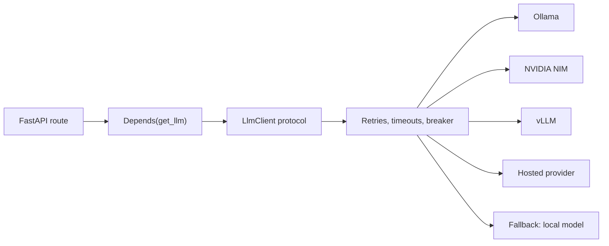

import TOCInline from '@theme/TOCInline';

# 08 · LLM Application Development

<ProgressToggle sectionId="08-llm-application-development" />

<TOCInline toc={toc} minHeadingLevel={2} maxHeadingLevel={2} />

:::tip[In this guide]
You can call a model and you have built a RAG pipeline. This section is the
application layer around them: one client that works against any provider,
streaming out of FastAPI, the resilience work — timeouts, retries, caching,
rate limits — that separates a script from a service, the two task shapes that
make up most production GenAI work, and how a probabilistic feature should
behave when it is wrong.
:::

## Goal

Turn model calls into an application component you would be willing to put
behind a real endpoint: swappable provider, bounded cost per request, graceful
behaviour when the provider is slow or down.

## Estimated Time

1–2 weeks.

## Prerequisites

- [03 · LLM Fundamentals](../03-llm-fundamentals/index.mdx) — you need to be calling a model already.
- [02 · FastAPI](../02-fastapi/index.mdx), particularly [dependency injection](../02-fastapi/01-core-path/03-dependency-injection.mdx) and [configuration](../02-fastapi/01-core-path/17-configuration-environment.mdx).
- [06 · RAG](../06-rag/index.mdx) — the service you are hardening.

## What You Will Learn

1. [One Client, Many Backends](./01-one-client-many-backends.mdx) — a single async `LlmClient` for Ollama, NVIDIA NIM, vLLM and hosted providers, chosen by config: Pydantic settings, a protocol, FastAPI dependency wiring, SSE streaming, retries with jitter, a circuit breaker, a fallback chain, and where the abstraction leaks.
2. [API & Service Design](./02-api-service-design.mdx) — configuration and secrets, timeouts, retries with backoff, caching, connection reuse, and graceful degradation.
3. [Extraction & Classification](./03-extraction-and-classification.mdx) — the task shapes most production GenAI actually takes: schema and label-taxonomy design, confidence and abstention, review queues, and per-field scoring.
4. [AI Product & UX Patterns](./04-ai-product-ux-patterns.mdx) — time to first token, streaming event protocols, communicating uncertainty, citations, feedback capture, escape hatches, and mapping failures to user-facing messages.

Pages 1–2 are the integration layer: almost every LLM-application problem that
is not a prompt problem is an integration problem, and this is where you solve
it once. Pages 3–4 are the two things most roadmaps skip — the chat interface
is the minority case, and how a feature handles being wrong decides whether
anyone keeps using it.

## Related Material Elsewhere

This section is deliberately narrow, because the surrounding concerns have
their own homes:

| Concern | Where it lives |
| --- | --- |
| FastAPI streaming, async endpoints, background work | [02 · FastAPI](../02-fastapi/index.mdx) core path |
| Serving an AI endpoint end to end | [AI Backend with FastAPI](../02-fastapi/01-core-path/22-ai-backend.mdx) |
| Token budgeting and conversation history | [Context Engineering](../04-prompt-engineering/04-context-engineering.mdx) |
| Structured output and validation | [Structured Output](../04-prompt-engineering/03-structured-output.mdx) |
| Queues, gateways, cost control, security | [13 · Production GenAI and LLMOps](../13-production-genai-and-llmops/index.mdx) |

## Where This Fits

The point of the diagram: your route depends on a protocol, never on a vendor.
Development runs against Ollama, production runs against a GPU backend, and the
business logic cannot tell the difference.

## Interview Relevance

"How would you integrate an LLM into our backend?" is a standard question, and
the strong answer is not about prompts. It is about the provider abstraction,
what you do on a timeout, which errors you retry, how you cap cost per request,
and what the user sees when the provider is down. Those answers come from here.

The extraction and classification page carries more interview weight than its
position suggests: a candidate who reaches for a schema, a label taxonomy with
an explicit `unknown`, and per-label recall is visibly someone who has shipped
an LLM feature rather than demoed one.

## Done When

- [ ] Your routes depend on an `LlmClient` protocol, not a vendor SDK.
- [ ] You can switch provider by changing configuration only.
- [ ] The client is built once at startup and closed on shutdown.
- [ ] Timeouts are split, retries are classified and jittered, and a breaker protects a failing backend.
- [ ] A streaming endpoint emits SSE and always terminates its stream.
- [ ] Every call returns token counts and duration, and you log them.
- [ ] You can design an extraction schema and a label taxonomy that handle the absent and ambiguous cases explicitly.
- [ ] Low-confidence results route to a review queue on a threshold you derived from labelled data.
- [ ] Every AI feature you build has an escape hatch and a non-AI fallback path.

Next: [09 · Tool Calling and AI Agents](../09-tool-calling-and-ai-agents/index.mdx).
