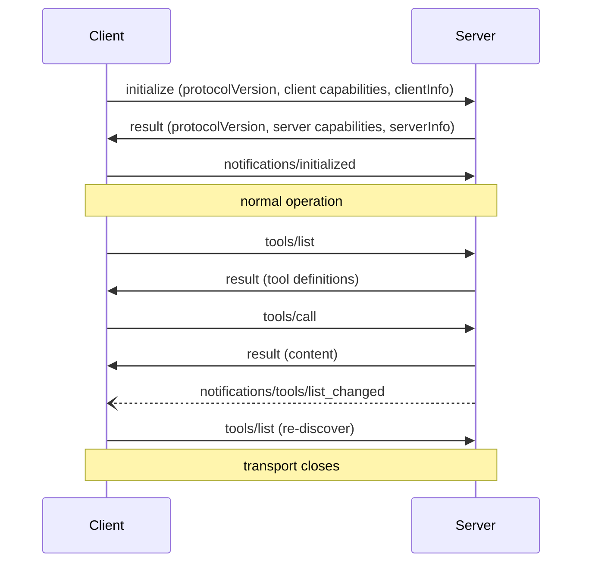

import TOCInline from '@theme/TOCInline';

# Protocol & Transports

<TOCInline toc={toc} minHeadingLevel={2} maxHeadingLevel={2} />

:::tip[In this guide]
What actually goes over the wire. The message shapes, the handshake that
establishes what each side can do, the two transports and when to use each, and
the difference between a protocol error and a tool failure — which is the
distinction that decides whether your agent can recover.
:::

## What Is It?

MCP is [JSON-RPC 2.0](https://www.jsonrpc.org/specification) over a transport.
That is the whole protocol layer. If you have worked with the Language Server
Protocol, this will feel familiar, because MCP borrowed the design
deliberately.

You will rarely write these messages by hand — the SDKs do it. You need to read
them for exactly three reasons: debugging a server that will not connect,
understanding why a feature you expected is missing, and reasoning about the
trust boundary.

## Why Does It Matter?

Three concrete payoffs from knowing the wire format:

- **Capability negotiation explains missing features.** When a host ignores
  your prompts, it is usually because it never advertised prompt support. You
  cannot see that from the SDK's surface.
- **The error model decides recoverability.** A tool failure returned as a
  result lets the model read it and try something else. The same failure raised
  as a protocol error kills the request. Getting this backwards is the most
  common server bug.
- **Transport choice is a deployment decision.** stdio and HTTP have different
  auth, scaling and multi-client stories, and you pick once.

## Message Shapes

Three kinds, straight from JSON-RPC.

**Request** — has an `id`, expects a response:

```json
{
  "jsonrpc": "2.0",
  "id": 7,
  "method": "tools/call",
  "params": {
    "name": "search_docs",
    "arguments": { "query": "refund policy", "top_k": 4 }
  }
}
```

**Response** — correlates by `id`, carries `result` or `error`, never both:

```json
{
  "jsonrpc": "2.0",
  "id": 7,
  "result": {
    "content": [
      { "type": "text", "text": "[handbook/refunds.md] Refunds are processed..." }
    ],
    "isError": false
  }
}
```

**Notification** — no `id`, no response expected, fire and forget:

```json
{
  "jsonrpc": "2.0",
  "method": "notifications/tools/list_changed"
}
```

Requests are bidirectional. A server can send requests to the client too —
that is how [sampling](./04-building-a-client.mdx) works, where the server asks
the host's model to complete something.

## The Methods You Will Actually Use

| Method | Direction | Purpose |
| --- | --- | --- |
| `initialize` | client → server | Handshake; exchange versions and capabilities |
| `notifications/initialized` | client → server | Handshake complete, normal operation may begin |
| `ping` | either way | Liveness check |
| `tools/list` | client → server | Discover tools and their JSON Schemas |
| `tools/call` | client → server | Execute a tool |
| `resources/list` | client → server | Discover concrete resources |
| `resources/templates/list` | client → server | Discover parameterised resource URIs |
| `resources/read` | client → server | Read a resource by URI |
| `prompts/list` | client → server | Discover prompt templates |
| `prompts/get` | client → server | Render a prompt with arguments |
| `sampling/createMessage` | server → client | Ask the host's model for a completion |
| `roots/list` | server → client | Ask which directories the host has exposed |
| `notifications/progress` | either way | Report progress on a long operation |
| `notifications/cancelled` | either way | Cancel an in-flight request |

The `*/list_changed` notifications tell the other side to re-run discovery.

## The Connection Lifecycle

Every MCP session starts the same way.



The handshake request carries the protocol version the client wants, what the
client can do, and who the client is:

```json
{
  "jsonrpc": "2.0",
  "id": 1,
  "method": "initialize",
  "params": {
    "protocolVersion": "2025-06-18",
    "capabilities": {
      "sampling": {},
      "roots": { "listChanged": true }
    },
    "clientInfo": { "name": "my-agent", "version": "0.3.1" }
  }
}
```

The server answers with what *it* can do:

```json
{
  "jsonrpc": "2.0",
  "id": 1,
  "result": {
    "protocolVersion": "2025-06-18",
    "capabilities": {
      "tools": { "listChanged": true },
      "resources": { "subscribe": true, "listChanged": true },
      "prompts": {},
      "logging": {}
    },
    "serverInfo": { "name": "docs-server", "version": "1.2.0" }
  }
}
```

:::note[Version strings are dated]
MCP protocol versions are date-stamped revisions like `2025-06-18`, not semver.
Check the [specification](https://modelcontextprotocol.io/specification) for the
current revision; the SDK negotiates this for you, and a version mismatch is
resolved during `initialize` or the connection fails there.
:::

Nothing but `initialize` and `ping` may be sent before the handshake completes.
Sending `tools/list` first is a protocol violation, and a strict server will
reject it.

## Capability Negotiation

This is the part people skip and then misdiagnose. **Advertised capability is
the contract.** If a server does not list `prompts`, it has no prompts, and
calling `prompts/list` is an error — not an empty list.

So real client code branches on what came back:

```python
from mcp import ClientSession


async def discover(session: ClientSession) -> dict[str, list[str]]:
    """Only ask for what the server said it has."""
    result = await session.initialize()
    caps = result.capabilities

    found: dict[str, list[str]] = {"tools": [], "resources": [], "prompts": []}

    if caps.tools is not None:
        tools = await session.list_tools()
        found["tools"] = [t.name for t in tools.tools]

    if caps.resources is not None:
        resources = await session.list_resources()
        found["resources"] = [str(r.uri) for r in resources.resources]

    if caps.prompts is not None:
        prompts = await session.list_prompts()
        found["prompts"] = [p.name for p in prompts.prompts]

    return found
```

The same applies in reverse. A server wanting to use `sampling/createMessage`
must check that the client advertised `sampling` first — many hosts do not
support it, and a server that assumes it will fail against most of the
ecosystem.

Sub-capabilities matter too. `tools.listChanged` means the server will notify
on changes; without it, your cached tool list can go stale silently.

## Transports

Two, and the choice is a deployment decision more than a technical one.

### stdio

The host launches the server as a child process and talks over its stdin and
stdout, one JSON message per line.

```bash
# What the host effectively runs
python -m docs_server
```

The critical constraint: **stdout belongs to the protocol.** A stray `print()`
in your server corrupts the message stream and the connection dies with a
confusing parse error. This is the single most common first-time bug.

```python
import logging
import sys

# Logs go to stderr. stdout is the transport.
logging.basicConfig(stream=sys.stderr, level=logging.INFO)
```

### Streamable HTTP

The server is a network service. The client POSTs JSON-RPC messages to a single
endpoint; the server may reply with a plain JSON response or upgrade to an
event stream when it needs to push notifications or server-initiated requests.
Sessions are tracked with a session id header, and the stream is resumable.

:::warning[An older transport is deprecated]
Earlier MCP used a two-endpoint HTTP+SSE transport. It has been superseded by
Streamable HTTP. Tutorials and blog posts written against the old design are
common and will not work against current servers — check the
[transports documentation](https://modelcontextprotocol.io/docs/concepts/transports)
before following any HTTP example you find.
:::

### Choosing

| Dimension | stdio | Streamable HTTP |
| --- | --- | --- |
| Process model | Child of the host, one per client | Long-running service, many clients |
| Where it runs | Same machine as the host | Anywhere |
| Auth | Inherits the user's machine authority; secrets via env vars | OAuth, proper tokens |
| Multi-client | No — each client gets its own process | Yes |
| Scaling | Vertical only | Horizontal, with session handling |
| Debuggability | Easy — it is a local process | Normal HTTP tooling |
| Startup cost | Process spawn per connection | None after deploy |
| Best for | Local tools, filesystem access, developer tooling | Shared internal services, anything remote |

The practical rule: **stdio for anything touching the user's machine, HTTP for
anything shared.** A filesystem server has to be stdio. An analytics server
that four teams use has to be HTTP.

## The Error Model

Two completely different failure channels, and using the wrong one breaks agent
recovery.

### Protocol errors

The request itself was invalid. Standard JSON-RPC codes:

| Code | Meaning | Example |
| --- | --- | --- |
| `-32700` | Parse error | Malformed JSON, usually a stray `print()` |
| `-32600` | Invalid request | Missing `jsonrpc` or `method` |
| `-32601` | Method not found | Calling `prompts/list` on a server without prompts |
| `-32602` | Invalid params | Tool called with a missing required argument |
| `-32603` | Internal error | Unhandled exception in the server |

```json
{
  "jsonrpc": "2.0",
  "id": 7,
  "error": { "code": -32602, "message": "Unknown tool: serch_docs" }
}
```

### Tool errors

The request was fine; the *work* failed. These come back as a **successful
response** with an error flag inside the result:

```json
{
  "jsonrpc": "2.0",
  "id": 7,
  "result": {
    "content": [
      { "type": "text", "text": "Search backend timed out after 5s. Retry with a narrower query." }
    ],
    "isError": true
  }
}
```

Why the distinction matters: the model sees the `content`. A tool error becomes
an observation it can reason about — "that timed out, let me narrow the query".
A protocol error does not reach the model at all; the client raises and the turn
fails.

So in a server:

```python
@mcp.tool()
async def search_docs(query: str, top_k: int = 4) -> str:
    """Search the internal knowledge base."""
    try:
        hits = await retriever.search(query, top_k=top_k)
    except TimeoutError:
        # Recoverable: tell the model what happened and what to try.
        return "Search timed out. Try a shorter, more specific query."
    if not hits:
        return "No matching documents. Try different terms or check the spelling."
    return format_hits(hits)
```

Returning a useful string beats raising, every time. Reserve exceptions for
genuine bugs, where a `-32603` and a stack trace in your logs is what you
actually want. This is the same rule as
[Tool Design](../08-agentic-ai/07-tool-design.mdx), enforced by the protocol.

## Long Operations

Three mechanisms worth knowing exist for work that does not return instantly.

**Progress** — attach a progress token to a request and the server sends
`notifications/progress` as it goes. Useful for an ingest tool that takes a
minute.

**Cancellation** — either side sends `notifications/cancelled` with the request
id. Best-effort: the server should stop, but a response already in flight is
not retracted. Your client must tolerate a late response to a cancelled
request.

**Pagination** — list methods return an opaque `nextCursor` when there is more.
Pass it back to continue. Do not try to parse the cursor; it is the server's
business.

```python
async def all_resources(session: ClientSession) -> list[str]:
    uris: list[str] = []
    cursor: str | None = None
    while True:
        page = await session.list_resources(cursor=cursor)
        uris.extend(str(r.uri) for r in page.resources)
        cursor = page.nextCursor
        if cursor is None:
            break
    return uris
```

A server with 500 resources that your client reads one page of is a bug you
will not notice until a user asks why half their files are missing.

## Common Mistakes

- Writing to stdout in a stdio server, corrupting the message stream.
- Raising exceptions for expected tool failures, so the model never sees them.
- Assuming a server has prompts or resources without checking advertised capabilities.
- Sending requests before `notifications/initialized`.
- Following an HTTP+SSE tutorial against a Streamable HTTP server.
- Caching a tool list and ignoring `notifications/tools/list_changed`.
- Reading only the first page of a paginated list.
- Treating cancellation as synchronous and crashing on a late response.
- Using stdio for a server that several users need to share.

## Interview Questions

- What is MCP built on, and what does that buy it?
- Walk through the initialize handshake. What happens if the client skips it?
- Why does capability negotiation exist, and what breaks if you ignore it?
- Contrast a protocol error and a tool error. Which one can an agent recover from, and why?
- Compare stdio and Streamable HTTP on auth and multi-client support.
- Why must a stdio server never print to stdout?
- How does a server ask the host's model to generate something, and what must it check first?
- What is best-effort about MCP cancellation?

## Things to Remember

- JSON-RPC 2.0 plus a transport. Requests, responses, notifications. Bidirectional.
- `initialize` then `notifications/initialized` before anything else.
- Advertised capabilities are the contract. Branch on them.
- Tool failures are successful responses with an error flag. Protocol errors are for invalid requests.
- stdio for local and machine-touching, Streamable HTTP for shared and remote.
- stdout is the transport. Log to stderr.
- The old HTTP+SSE transport is deprecated; use Streamable HTTP.

## Mini Exercise

Run any MCP server over stdio and capture the traffic. The easiest way is the
[inspector](https://modelcontextprotocol.io/docs/tools/inspector), which shows
every message. Find the `initialize` exchange and write down exactly which
capabilities each side advertised.

Then break it deliberately: add a `print("hello")` at the top of your server's
module and reconnect. Read the error you get. That error message is one you
will see again, and recognising it instantly is worth the two minutes.

## Done When

- [ ] You can read a JSON-RPC request, response and notification and name each.
- [ ] You can describe the handshake and why order matters.
- [ ] You can explain capability negotiation and write a client that branches on it.
- [ ] You can decide between tool-error and protocol-error for a given failure.
- [ ] You can pick a transport for a given deployment and defend it.

Next: [Building an MCP Server](./03-building-a-server.mdx).
