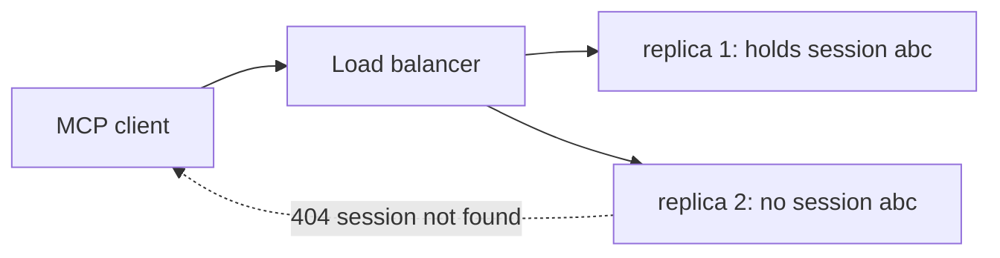

import TOCInline from '@theme/TOCInline';

# Deploying & Operating MCP

<TOCInline toc={toc} minHeadingLevel={2} maxHeadingLevel={2} />

:::tip[In this guide]
Getting a server off your laptop. The two deployment shapes, how to run one
next to an existing FastAPI app, what breaks when you scale the HTTP transport,
how to trace a tool call end to end, and how to change a tool surface without
breaking everyone connected to it.
:::

## What Is It?

Two topologies, and the choice follows from who the consumers are.

| | Local stdio | Remote HTTP |
| --- | --- | --- |
| Who runs it | Each user, on their machine | You, once |
| Consumers | One host, one user | Many hosts, many users |
| Auth | Inherits the user's machine authority | OAuth, per-user tokens |
| Deploy | Ship a package; users configure it | Normal service deploy |
| Upgrades | Each user updates | You deploy, everyone gets it |
| Secrets | In the user's host config | In your secret store |
| Observability | Whatever the user's stderr catches | Your existing stack |
| Right for | Developer tooling, filesystem, personal workflows | Shared internal services |

The decision rule: **if the server needs the user's machine, it is stdio. If it
needs your infrastructure, it is HTTP.** A filesystem server cannot be remote.
An analytics server over your warehouse should not be local.

## Why Does It Matter?

Because an MCP server in production is an API with an unusual client, and the
unusual parts are where the surprises are. A model picks the arguments, the
tool surface is discovered rather than compiled against, and your consumers may
be IDEs you have never tested. None of that is handled by deploying it like a
normal service and hoping.

## Running Alongside FastAPI

You almost certainly already have a FastAPI app wrapping the same logic. Two
ways to add MCP.

### Separate process

The default, and usually right.

```bash
# Two processes, same codebase, same service classes.
uvicorn app.main:app --port 8000          # your REST API
python -m app.mcp_server --port 8001      # your MCP server
```

```yaml
services:
  api:
    build: .
    command: uvicorn app.main:app --host 0.0.0.0 --port 8000
    environment:
      DATABASE_URL: ${DATABASE_URL}
  mcp:
    build: .
    command: python -m app.mcp_server --host 0.0.0.0 --port 8001
    environment:
      DATABASE_URL: ${DATABASE_URL}
```

Why separate is the safer default: independent scaling (agent traffic has a
very different shape from your REST traffic), independent failure (a runaway
tool call cannot starve your API's workers), and independent deploy cadence.

### Mounted in the same app

The SDK can produce an ASGI app you mount on your existing one.

```python
from fastapi import FastAPI

from app.mcp_server import mcp

app = FastAPI()
app.include_router(api_router, prefix="/api")

# One deployment, one port, shared middleware.
app.mount("/mcp", mcp.http_app())
```

:::note
The method that returns an ASGI application has changed names across SDK
versions, and mounting requires that the MCP app's lifespan runs. If your
mounted server never completes a handshake, an un-run lifespan is the first
thing to check. See the current
[Python SDK docs](https://py.sdk.modelcontextprotocol.io/).
:::

Mounting is attractive when you want one deployment and shared auth
middleware. It costs you the isolation above. Reasonable for an internal tool,
less so once agent traffic is significant.

Either way, **the server is a thin adapter over service classes you already
have.** If your MCP handlers contain business logic that your REST routes do
not, you have two implementations of the same thing and they will diverge.

```python
# app/services/retrieval.py   <- the logic lives here, once
# app/routers/rag.py          <- REST adapter
# app/mcp_server.py           <- MCP adapter
```

## Scaling the HTTP Transport

Streamable HTTP sessions have state, which is the thing that bites.

A client gets a session id at initialization and sends it with subsequent
requests. If your load balancer sends the next request to a different replica,
that replica has never heard of the session.



Three ways out, in order of preference:

| Approach | How | Tradeoff |
| --- | --- | --- |
| Stateless server | Hold no per-session state; treat each request independently | Simplest to scale; gives up server-initiated streams and resumability |
| Shared session store | Session state in Redis, any replica can serve | Works with plain round-robin; one more dependency |
| Session affinity | Sticky routing on the session id header | Easy to configure; uneven load, and a replica restart drops sessions |

If your tools are request/response and you do not need progress notifications
or sampling, **go stateless.** It removes the whole problem. Most RAG-style
servers fall in this category.

```python
# Stateless mode: no session store, no affinity needed, scales flat.
mcp = MCPServer("docs-server", stateless_http=True)
```

Also worth setting regardless of mode:

```python
TOOL_TIMEOUT_SECONDS = 20
MAX_CONCURRENT_TOOL_CALLS = 20

_semaphore = asyncio.Semaphore(MAX_CONCURRENT_TOOL_CALLS)


@mcp.tool()
async def search_docs(query: str, top_k: int = 4) -> str:
    """Search the internal knowledge base."""
    try:
        async with _semaphore:
            return await asyncio.wait_for(
                _search(query, top_k), timeout=TOOL_TIMEOUT_SECONDS
            )
    except asyncio.TimeoutError:
        return "Search timed out. Try a narrower query."
```

Without a concurrency bound, an agent in a retry loop will happily open a
hundred connections and exhaust your database pool.

## Observability

The question you need to answer in an incident: *which model turn caused this
query?* That needs an id that survives the hop from host to server.

```python
import logging
import time
import uuid

logger = logging.getLogger("mcp.docs")


@mcp.tool()
async def search_docs(query: str, top_k: int = 4, ctx: Context = None) -> str:
    """Search the internal knowledge base."""
    call_id = uuid.uuid4().hex[:12]
    started = time.perf_counter()
    try:
        result = await _search(query, top_k)
        outcome = "ok"
        return result
    except Exception:
        outcome = "error"
        raise
    finally:
        logger.info(
            "mcp_tool_call",
            extra={
                "call_id": call_id,
                "tool": "search_docs",
                # The client's name from initialize: which host is calling you.
                "client": getattr(ctx, "client_name", "unknown") if ctx else "unknown",
                "principal": getattr(ctx, "principal", None) if ctx else None,
                "query_len": len(query),
                "top_k": top_k,
                "duration_ms": round((time.perf_counter() - started) * 1000, 1),
                "outcome": outcome,
            },
        )
```

Log the query *length*, not the query, unless you have decided prompts are
safe to retain — they are user content and frequently contain personal data.

What to record per call, and why:

| Field | Why you will want it |
| --- | --- |
| Tool name | Which tools are actually used — usually a surprise |
| Client name and version | Which hosts are connecting; who breaks on a change |
| Principal / tenant | Attribution and abuse investigation |
| Duration | Agents are latency-sensitive; a slow tool stalls a whole loop |
| Outcome, split into tool-error vs protocol-error | A rising tool-error rate is a quality signal, not an outage |
| Result size | Catches a tool about to blow up a context window |
| Argument shape, not values | Spot a model passing nonsense without logging user data |

The alarms worth having: p95 tool latency, protocol error rate, tool-error
rate, and **unknown-tool-call rate** — a client calling a tool you removed
means someone is running a stale cached list.

For trace propagation and span structure across a whole agent run, see
[Agents in Production](../08-agentic-ai/12-production-agents.mdx) and
[Logging & Observability](../02-fastapi/01-core-path/18-logging-observability.mdx).

## Versioning the Tool Surface

Your tool surface is a public API consumed by clients that discovered it at
runtime and may have cached it. Changes are riskier than they look.

| Change | Safe? | Notes |
| --- | --- | --- |
| Add a new tool | Yes | But it enlarges every client's prompt; see tool-count effects |
| Add an optional argument | Yes | Defaults must preserve existing behaviour |
| Improve a description | Yes, and valuable | Changes routing behaviour — treat as a behaviour change and test |
| Add a required argument | **No** | Breaks every cached schema immediately |
| Rename a tool | **No** | Clients call the old name until they re-discover |
| Remove a tool | **No** | Same |
| Narrow an enum | **No** | Previously valid calls start failing |
| Change return shape | Risky | Prompts downstream may depend on the format |

The deprecation path for anything in the "no" column:

```python
@mcp.tool()
async def search_docs(query: str, top_k: int = 4) -> str:
    """DEPRECATED: use search_knowledge_base. Still functional until 2026-03-01.

    Search the internal knowledge base.
    """
    logger.warning("deprecated_tool_called tool=search_docs")
    return await _search(query, top_k)


@mcp.tool()
async def search_knowledge_base(
    query: str, top_k: int = 4, team: str | None = None
) -> str:
    """Search the internal knowledge base, optionally scoped to one team."""
    return await _search(query, top_k, team=team)
```

Ship both, mark the old one deprecated in the description the model reads, log
when it is called, and remove it only when that log line goes quiet. If the
server advertises `tools.listChanged`, send the notification so clients
re-discover rather than waiting for a restart.

Two habits that make this manageable: **version your server** (`serverInfo`
carries it, so clients and your logs can see it) and **snapshot your tool
surface in a test**, so a schema change cannot ship unnoticed.

```python
def test_tool_surface_is_unchanged(snapshot) -> None:
    """Fails on any schema change, forcing a deliberate decision."""
    listed = {t.name: t.inputSchema for t in mcp.list_tools_sync()}
    assert listed == snapshot
```

## Packaging and Distribution

For a stdio server other people install, the bar is "one command, no build
step".

```toml
[project]
name = "acme-docs-mcp"
version = "1.2.0"
requires-python = ">=3.11"
dependencies = ["mcp>=1.0", "httpx>=0.27"]

[project.scripts]
acme-docs-mcp = "acme_docs_mcp.server:main"
```

Then the host config is one line, with no absolute paths into someone's
virtualenv:

```json
{
  "mcpServers": {
    "acme-docs": {
      "command": "uvx",
      "args": ["acme-docs-mcp@1.2.0"],
      "env": { "ACME_API_TOKEN": "..." }
    }
  }
}
```

Pinning the version in the config is deliberate — an unpinned server
auto-upgrades into a tool surface and a set of descriptions you never reviewed,
which is both an operational and a
[security](./05-security-and-auth.mdx) problem.

Ship in your README: required environment variables, the exact permissions the
credential needs, the tool list, and a one-line smoke test.

## Pre-Production Checklist

- [ ] Logic lives in service classes; the server is a thin adapter.
- [ ] Every tool has a timeout and the server has a concurrency bound.
- [ ] Output is size-capped, including row counts from any database.
- [ ] Stateless HTTP mode, or a shared session store, or documented affinity.
- [ ] Structured logs per call with client, principal, duration and outcome.
- [ ] Alarms on p95 latency, error rates and unknown-tool calls.
- [ ] Health endpoint, and `serverInfo` carrying a real version.
- [ ] A tool-surface snapshot test in CI.
- [ ] Deprecation path documented; no breaking renames without one.
- [ ] Secrets from the environment or a secret store; nothing in `args`.
- [ ] Scoped, read-only-where-possible credential.
- [ ] Verified against at least two different hosts.

That last one catches more bugs than any other item. Host support for
resources, prompts and structured output genuinely varies, and "works in the
inspector" is not the same as "works in a real assistant".

## Common Mistakes

- Business logic in MCP handlers, duplicating what the REST layer does.
- Scaling a stateful HTTP server behind round-robin routing.
- No per-tool timeout, so one slow upstream stalls agent loops.
- No concurrency bound, so a retry loop exhausts your connection pool.
- Logging full queries and quietly retaining user data.
- Renaming or removing a tool without a deprecation window.
- Adding a required argument and breaking every cached schema.
- Unpinned server versions in host configs.
- Testing only in the inspector and never against a real host.
- No alarm on unknown-tool calls, so stale clients fail silently.

## Interview Questions

- When must a server be stdio, and when must it be HTTP?
- Separate process or mounted in your FastAPI app — what decides it?
- Why does the Streamable HTTP transport complicate horizontal scaling, and what are your options?
- What would you log on every tool call, and what would you deliberately not log?
- Which tool-surface changes are backward compatible and which are not?
- How do you deprecate a tool when clients cache the tool list?
- What is the risk of an unpinned server version in a host config?

## Things to Remember

- stdio for the user's machine, HTTP for your infrastructure.
- Separate process by default; mount only when you want one deployment.
- Stateless HTTP removes the scaling problem — take it if you can.
- Timeouts and a concurrency bound on everything.
- Log client, principal, duration, outcome. Log sizes, not contents.
- The tool surface is a public API. Add freely, never rename or remove without a window.
- Pin server versions in configs; snapshot the schema in CI.
- Test against two hosts before you call it done.

## Mini Exercise

Deploy your `docs-server` over HTTP in stateless mode behind two replicas and a
plain round-robin balancer. Connect a client, run twenty tool calls, and
confirm none fail. Then flip `stateless_http` off, redeploy, and watch the
session errors appear. That contrast is the clearest way to internalise why
statelessness is worth the lost features.

Then rename one tool without a deprecation alias, leave a client running with a
cached list, and observe the failure mode. Add the alias and watch it recover.

## Done When

- [ ] You can choose a topology for a given server and defend it.
- [ ] Your server runs alongside your existing app without duplicated logic.
- [ ] You can scale the HTTP transport and explain the session problem.
- [ ] Every tool has a timeout; the server has a concurrency bound.
- [ ] You log enough to reconstruct an incident, and no more than you should.
- [ ] You have a deprecation plan for your tool surface.

Next: [MCP in Practice](./07-mcp-in-practice.mdx).
