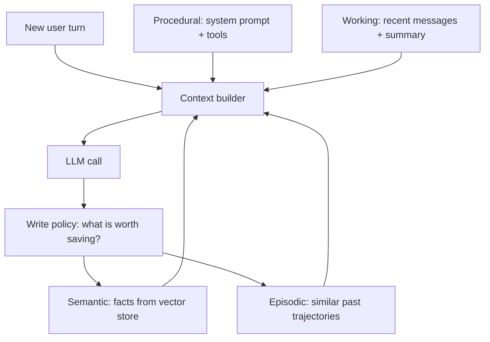

import TOCInline from '@theme/TOCInline';

# Agent Memory Architectures

<TOCInline toc={toc} minHeadingLevel={2} maxHeadingLevel={2} />

:::tip[In this guide]
"Add memory" is not one task. It is four unrelated engineering problems wearing
the same word. This page separates them, shows the mechanism for each, covers
LangGraph persistence, and is honest about memory as a correctness and privacy
hazard.
:::

## What Is It?

An LLM is stateless. Every call sees only the messages you send. **Memory** is
whatever machinery you build to decide what ends up in that payload — and where
the rest lives in the meantime.

That framing matters, because it means memory is not a feature you enable. It is
a retrieval and budgeting problem you own.

## Why Does It Matter?

Agents run long. A coding session is hundreds of turns and hundreds of thousands
of tokens of tool output. A support agent should remember the customer's plan
tier from three weeks ago. Neither fits in a context window, and stuffing more
in makes quality *worse*, not better: models attend less reliably to the middle
of a long context, and irrelevant history actively distracts them.

## Four Different Problems

| Type | Question it answers | Storage | Retrieval |
| --- | --- | --- | --- |
| **Working / short-term** | "What are we doing right now?" | The message list in memory or a checkpointer | Included directly, trimmed to a budget |
| **Semantic** | "What do I know about this user or domain?" | Vector store, or key-value profile rows | Similarity search, or direct lookup by key |
| **Episodic** | "Have I done a task like this before?" | Trajectory log with embedded task descriptions | Similarity search over past tasks |
| **Procedural** | "How do I do this kind of thing?" | System prompt, tool definitions, skill files | Loaded by rule, or selected by task type |

Most teams build working memory, call it done, and then are surprised the agent
does not remember anything across sessions. The four need separate designs.



## The Context Window Is a Budget

Treat it as an explicit allocation, not something you discover when a call
fails. A rough split for a 128k-token agent:

| Slot | Share | Notes |
| --- | --- | --- |
| System prompt and tool schemas | 5–10% | Fixed cost, every turn. Audit it; it grows silently. |
| Retrieved facts and documents | 15–25% | Hard-capped per turn. |
| Recent conversation and tool output | 40–60% | The part that actually needs managing. |
| Headroom for the response | 10–20% | Reserve it, or long answers get cut off. |

Every piece of history then faces four choices:

- **Keep** — recent turns, the current task statement, the last tool result.
- **Compress** — older turns into a summary.
- **Externalise** — big tool output into a store, replaced by a handle (see [Tool Design](./07-tool-design.mdx)).
- **Drop** — superseded intermediate states, failed attempts already recovered from.

The common mistake is treating "keep" as the default and only acting at the
limit. By then you are forced into a lossy decision under pressure.

## Working Memory: Buffers and Summarisation

### Full buffer

Send everything. Perfect fidelity, cost grows quadratically across a session
(each turn resends all prior turns), and it dies at the context limit. Fine for
short, bounded interactions. Not fine for anything that runs for an hour.

### Windowed buffer

Keep the last N messages. Trivial, cheap, and it silently forgets the
instruction given 20 turns ago — the single most common "the agent ignored me"
bug.

```python
def window(messages: list[dict], keep: int = 20) -> list[dict]:
    system = [m for m in messages if m["role"] == "system"]
    rest = [m for m in messages if m["role"] != "system"]
    return system + rest[-keep:]
```

Two rules make this survivable: never drop the system message, and never split a
tool-call pair. An assistant message with `tool_calls` whose matching `tool`
results fell out of the window is an API error on most providers.

```python
def safe_window(messages: list[dict], keep: int = 20) -> list[dict]:
    system = [m for m in messages if m["role"] == "system"]
    rest = [m for m in messages if m["role"] != "system"]
    cut = max(0, len(rest) - keep)
    while cut < len(rest) and rest[cut]["role"] == "tool":
        cut += 1          # never start a window on an orphaned tool result
    return system + rest[cut:]
```

### Running summarisation

When history exceeds a threshold, summarise the oldest portion and keep recent
turns verbatim.

```python
SUMMARY_PROMPT = """Summarise the conversation below for an assistant that will
continue it. Preserve: the user's goal, decisions made, constraints stated,
file paths and identifiers mentioned, and anything already ruled out.
Drop pleasantries and superseded intermediate reasoning. Under 400 words."""

async def summarise_old(messages: list[dict], keep_recent: int = 10) -> list[dict]:
    if len(messages) <= keep_recent + 4:
        return messages
    old, recent = messages[1:-keep_recent], messages[-keep_recent:]
    summary = await llm.ainvoke(
        [{"role": "system", "content": SUMMARY_PROMPT},
         {"role": "user", "content": render(old)}]
    )
    return [
        messages[0],
        {"role": "system", "content": f"Earlier conversation summary:\n{summary.content}"},
        *recent,
    ]
```

| Strategy | Fidelity | Cost | Fails at |
| --- | --- | --- | --- |
| Full buffer | Perfect | Grows quadratically | Hits the context limit and stops |
| Windowed | Recent only | Flat, cheap | Forgetting early constraints |
| Summarised | Lossy, directed | One extra call per compaction | Details the summary prompt did not ask for |
| Summary plus vector recall | Lossy with lookup | Compaction plus retrieval | Recall depends on query quality |

Summarisation quality is entirely determined by the prompt. A generic "summarise
this" loses exactly the things you needed — IDs, paths, constraints. Enumerate
what must survive, as above.

## Context Compaction

Compaction is summarisation applied as a *lifecycle event* rather than a filter.
This is how long-running coding assistants survive sessions far longer than
their context window.

The shape:

1. Track token usage each turn.
2. At a threshold (commonly 70–80% of the window), trigger compaction.
3. Write a structured handover: goal, state of the work, decisions, files
   touched, what is verified versus assumed, next step.
4. Start a fresh message list from the system prompt plus that handover.
5. Keep the raw history on disk for the trace — not in context.

```python
HANDOVER = """Produce a handover note so another engineer can continue with no
other context. Sections, in order:
TASK: the original goal, verbatim intent.
DONE: completed steps and their verified outcomes.
STATE: files changed, commands run, current branch/working state.
DECISIONS: choices made and why, including rejected options.
BLOCKED: known failures and what was already tried.
NEXT: the immediate next action."""

async def compact(state: AgentState) -> AgentState:
    note = await llm.ainvoke([
        {"role": "system", "content": HANDOVER},
        {"role": "user", "content": render(state.messages)},
    ])
    await archive.put(state.thread_id, state.messages)      # keep the trace
    return state.model_copy(update={
        "messages": [
            state.messages[0],
            {"role": "user", "content": note.content},
        ],
        "compactions": state.compactions + 1,
    })
```

Two things make compaction work in practice. Structured sections beat prose,
because the model fills each one rather than writing a vague paragraph. And
anything externalised — files on disk, a task list, test results — does not need
to survive compaction at all, because it can be re-read. Push state out of
context and into the world wherever you can; the filesystem is the best memory
store a coding agent has.

## Semantic Memory: Facts That Outlive the Session

Semantic memory stores durable propositions about a user, account or domain. Two
shapes, and you usually want both.

**Profile memory** — a known schema, updated in place. Best for facts with one
current value.

```python
class UserProfile(BaseModel):
    user_id: str
    plan_tier: Literal["free", "pro", "enterprise"] | None = None
    preferred_language: str | None = None
    timezone: str | None = None
    notes: list[str] = []
```

Cheap, no retrieval ambiguity, trivially inspectable and deletable. Use it for
anything you can name in advance.

**Vector memory** — open-ended facts, retrieved by similarity per turn. Uses the
same [embeddings](../05-embeddings-and-semantic-search/01-embeddings.mdx) machinery as RAG.

```python
async def recall(user_id: str, query: str, k: int = 5) -> list[str]:
    hits = await store.search(
        query_vector=await embed(query),
        filter={"user_id": user_id},       # tenant isolation is mandatory
        top_k=k,
    )
    return [h.text for h in hits if h.score >= 0.75]
```

Note the score floor. Without it, every turn injects five weakly-related facts
and the agent starts confidently referencing things that do not apply.

### The write policy problem

Retrieval is the easy half. *Deciding what to remember* is the hard half, and
where most memory systems go wrong.

Bad policies and their symptoms:

| Policy | Symptom |
| --- | --- |
| Write every turn | Store fills with noise; retrieval precision collapses |
| Write only on explicit "remember this" | Almost nothing gets stored; feature appears broken |
| Let the model write freely, unschema'd | Contradictions, duplicates, hallucinated facts |

A policy that holds up: extract candidate facts after a turn, require them to be
durable and user-specific, and reconcile against what you already store.

```python
EXTRACT = """Extract durable facts about the user from this exchange.
A durable fact is stable for weeks and useful in a future unrelated session.
Include: stated preferences, role, constraints, environment, recurring goals.
Exclude: this task's details, transient state, anything you inferred rather
than were told. Return a JSON array of short strings. Empty array is correct
and common."""

async def maybe_remember(user_id: str, exchange: str) -> None:
    facts = json.loads((await llm.ainvoke(
        [{"role": "system", "content": EXTRACT},
         {"role": "user", "content": exchange}]
    )).content)
    for fact in facts:
        near = await store.search(await embed(fact),
                                  filter={"user_id": user_id}, top_k=1)
        if near and near[0].score > 0.95:
            await store.update(near[0].id, text=fact)     # supersede, not duplicate
        else:
            await store.add(text=fact, user_id=user_id, written_at=now())
```

"Empty array is correct and common" belongs in that prompt. Without it, models
invent something to extract on every turn.

## Episodic Memory: Learning From Past Runs

Episodic memory stores *what happened* — the trajectory of a past task — and
retrieves similar episodes as few-shot examples.

```python
async def remember_episode(task: str, trajectory: list[dict], success: bool) -> None:
    await episodes.add(
        vector=await embed(task),
        payload={"task": task, "steps": compress(trajectory),
                 "success": success, "cost_usd": cost(trajectory)},
    )

async def similar_episodes(task: str, k: int = 2) -> list[dict]:
    hits = await episodes.search(await embed(task), top_k=k * 3)
    return [h.payload for h in hits if h.payload["success"]][:k]
```

Injected as "here is how a similar task was solved before", this measurably
improves tool selection on repetitive workloads — support triage, data pulls,
scheduled report generation.

Keep failed episodes too, but use them differently: as a *negative* hint ("this
approach failed before, for this reason"), and as input to your failure taxonomy
when triaging. Feeding failed trajectories as plain examples teaches the agent
to repeat them.

## LangGraph Persistence

LangGraph splits this cleanly: **checkpointers** persist working memory per
conversation thread; **stores** persist facts across threads.

```python
from langgraph.checkpoint.postgres.aio import AsyncPostgresSaver
from langgraph.store.memory import InMemoryStore

checkpointer = AsyncPostgresSaver.from_conn_string(DSN)   # async context manager
store = InMemoryStore()           # swap for a persistent store in production

graph = builder.compile(checkpointer=checkpointer, store=store)

config = {"configurable": {"thread_id": f"user:{user_id}:conv:{conv_id}"}}

# Second call resumes the same thread; prior messages are loaded automatically.
await graph.ainvoke({"messages": [("user", "and the second one?")]}, config)
```

What you get from the checkpointer, and why each matters:

- **Resumability** — a crash, deploy or timeout mid-run does not lose the run. Central to [running agents in production](./12-production-agents.mdx).
- **Thread isolation** — `thread_id` is the conversation boundary. Derive it from authenticated identity, never from a client-supplied value, or users read each other's threads.
- **Time travel** — inspect or re-run from any checkpoint, which is how you debug a bad trajectory.
- **Human-in-the-loop** — interrupt, wait for approval, resume. See [Agent Safety](./11-agent-safety.mdx).

Cross-thread facts go in the store, namespaced per user:

```python
async def write_fact(store, user_id: str, key: str, value: dict) -> None:
    await store.aput(("facts", user_id), key, value)

async def read_facts(store, user_id: str, query: str) -> list[dict]:
    # Stores configured with an embedding function support semantic search.
    return await store.asearch(("facts", user_id), query=query, limit=5)
```

:::note[API drift]
Checkpointer and store APIs have moved between LangGraph versions (package
paths, sync versus async savers, store search signatures). The split —
checkpointer for thread state, store for cross-thread memory — is stable; check
the current docs for exact imports.
:::

## Memory as a Hazard

Memory is the one agent feature that makes your system *less* predictable over
time. Treat it as a liability with benefits.

**Stale facts.** "User is on the free plan" was true in March. The agent now
refuses features they pay for. Store `written_at`, surface the age to the model,
and set a TTL on anything volatile.

**Contradictions.** Two retrieved facts disagree and the model picks one
arbitrarily. Reconcile on write (supersede, as above) rather than hoping the
model resolves it at read time.

**Poisoned memory.** This is the serious one. If an agent can write to memory
based on content it read from a document or a web page, an attacker can plant
instructions that persist across sessions — a stored prompt injection that fires
on every future turn. Mitigations: only extract facts from *user* messages, never
from tool output or retrieved documents; store facts as data and render them in a
clearly-delimited block rather than as instructions; and cap what memory can
influence.

**PII and deletion.** Memory is a data store subject to retention rules. Vector
embeddings of personal data are personal data. You need to answer "delete
everything about this user" — which means namespacing by user from day one,
keeping the raw text alongside vectors so you can prove what you held, and not
burying facts inside summary blobs where they cannot be selectively removed.

**Cost.** Every memory mechanism adds tokens to every turn. Measure whether
recall actually improves task success before shipping it; often a profile row
beats a vector store at a fraction of the cost.

## Which Memory Do You Actually Need?

| Symptom | Memory type | Fix |
| --- | --- | --- |
| Forgets what was said two turns ago | Working | You are not passing history at all |
| Forgets the instruction from 30 turns ago | Working | Window too small, or no summarisation |
| Dies on long sessions | Working | Add compaction at a token threshold |
| Re-asks the user's name or plan every session | Semantic (profile) | Profile row keyed by user |
| Does not recall a preference mentioned last week | Semantic (vector) | Fact extraction plus per-turn recall |
| Repeats the same multi-step discovery each run | Episodic | Store and retrieve trajectories |
| Uses tools in the wrong order consistently | Procedural | Fix the system prompt and tool descriptions |
| Confidently states outdated facts | Semantic (stale) | Timestamps, TTL, supersede on write |
| Context full of giant tool results | Working (externalise) | Return handles, not payloads |
| Fine in dev, loses state in prod | Persistence | Checkpointer with a real database |

Read it top to bottom: the cheap fixes are at the top, and most "we need a
memory system" requests are satisfied by the first three rows.

## Common Mistakes

- Treating memory as one feature instead of four problems.
- Only managing context when a call fails, instead of budgeting up front.
- Windowing history and dropping the system message or half a tool-call pair.
- A generic summarisation prompt that loses the IDs and paths you needed.
- Writing every turn to the vector store, destroying retrieval precision.
- No score threshold on recall, so irrelevant facts are injected every turn.
- Extracting facts from tool output or retrieved documents, enabling persistent injection.
- Deriving `thread_id` from a client-supplied value.
- No timestamps, so you cannot detect or expire stale facts.
- Shipping memory without measuring whether it improved task success.

## Interview Questions

- Name the four kinds of agent memory and the mechanism for each.
- How do you decide what stays in the context window?
- Compare buffer, windowed buffer and running summarisation.
- How does a coding assistant survive a session longer than its context window?
- What is the write-policy problem, and how do you handle contradictions?
- What is episodic memory, and when does it help?
- What is the difference between a LangGraph checkpointer and a store?
- How would you implement "delete everything you remember about me"?
- How could an attacker poison an agent's long-term memory?

## Things to Remember

- Memory is four problems: working, semantic, episodic, procedural.
- The context window is a budget. Keep, compress, externalise or drop — decide deliberately.
- Compaction with a structured handover is what makes very long sessions work.
- Externalised state (files, stores) beats remembered state.
- The write policy is harder than the retrieval, and it is where quality is won or lost.
- Timestamp everything, namespace by user, and never extract facts from untrusted text.

## Mini Exercise

Add two memory layers to the agent from [Building Agents](./03-building-agents.mdx).
First, a checkpointer plus a `thread_id` so a second call continues the same
conversation. Second, summarisation that triggers past 15 messages, with a
prompt that explicitly preserves identifiers and constraints. Then run a
20-turn conversation where you state a constraint at turn 2 and test it at turn
18. Note whether it survived, and what the summary dropped.

## Done When

- [ ] You can name the four memory types and their storage and retrieval mechanisms.
- [ ] Your agent persists working memory with a checkpointer and a server-derived thread ID.
- [ ] You have a compaction trigger and a structured handover prompt.
- [ ] Your semantic memory has a write policy, timestamps, per-user namespacing and a recall threshold.
- [ ] You can explain how memory poisoning works and what stops it.

Next: [Planning & Reflection](./09-planning-and-reflection.mdx).
