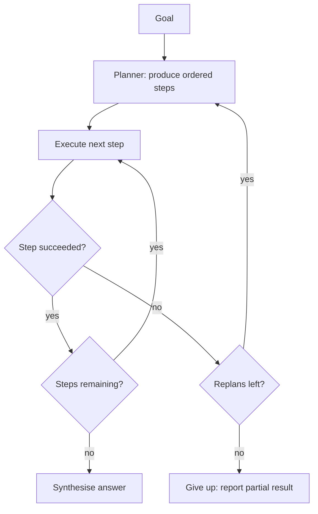
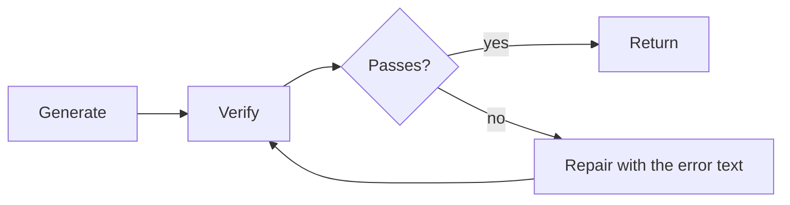

import TOCInline from '@theme/TOCInline';

# Planning & Reflection

<TOCInline toc={toc} minHeadingLevel={2} maxHeadingLevel={2} />

:::tip[In this guide]
The patterns that sit above the basic loop: explicit plans, decoupled tool
execution, self-critique, and verifier-driven repair. Also which of them are
worth their cost in production, which are mostly papers, and how to stop an
agent that is not getting anywhere.
:::

## What Is It?

**Planning** is deciding the sequence of steps before taking them.
**Reflection** is inspecting your own output and revising it. A plain ReAct
agent does both implicitly and invisibly, one step at a time. These patterns
make them explicit artifacts you can inspect, validate and bound.

## Why Does It Matter?

A ReAct agent picks its next action from the full history, every step. That is
remarkably effective and it is where you should start. But it degrades in three
specific situations, and recognising them is the actual skill:

| Situation | What goes wrong |
| --- | --- |
| **Long horizons** (15+ steps) | The goal drifts. By step 12 the agent is solving a subproblem it invented at step 7. |
| **Interdependent steps** | Step 4 needs output from step 2, but the agent did step 3 first and no longer has what it needs. |
| **Expensive or irreversible actions** | Greedy step-by-step choice means a wrong early action costs real money or cannot be undone. |

If your tasks are three to six steps of cheap, independent tool calls, stop
reading and keep using ReAct. Explicit planning adds calls, latency and a new
failure mode — a bad plan executed faithfully. The patterns below are for when
you have measured ReAct failing, not for when you suspect it might.

## ReAct, Briefly

Reason, act, observe, repeat; the next action is chosen fresh each step from the
accumulated context. Full treatment in
[Agent Fundamentals](./01-agents-fundamentals.mdx) and the implementation in
[Building Agents](./03-building-agents.mdx). Its strength is adaptivity — it
responds to whatever the last observation actually said. Its weakness is that it
has no commitment, so it has nothing to drift *from*.

## Plan-and-Execute

Generate a typed plan up front, execute steps in order, and replan when a step
fails or the plan turns out to be wrong.



The plan should be a validated structure, not prose. Prose plans cannot be
counted, ordered, capped or diffed.

```python
from typing import Annotated, Literal, TypedDict
from pydantic import BaseModel, Field

class Step(BaseModel):
    id: int
    description: str = Field(description="One concrete action, not a goal.")
    tool: str | None = Field(default=None, description="Tool name, if known.")
    depends_on: list[int] = Field(default_factory=list)

class Plan(BaseModel):
    goal: str
    steps: list[Step] = Field(max_length=10)

class PlanState(TypedDict):
    goal: str
    plan: Plan | None
    completed: list[tuple[int, str]]      # (step id, result)
    replans: int
```

Nodes stay small:

```python
from langgraph.graph import StateGraph, START, END

planner = llm.with_structured_output(Plan)

async def make_plan(state: PlanState) -> dict:
    done = "\n".join(f"{i}: {r}" for i, r in state["completed"])
    plan = await planner.ainvoke(
        f"Goal: {state['goal']}\n"
        f"Already completed:\n{done or '(nothing)'}\n"
        "Produce the remaining steps. Each must be a single concrete action."
    )
    return {"plan": plan, "replans": state["replans"] + 1}

async def execute_step(state: PlanState) -> dict:
    step = next(s for s in state["plan"].steps
                if s.id not in {i for i, _ in state["completed"]})
    result = await executor.ainvoke({"messages": [("user", step.description)]})
    return {"completed": state["completed"] + [(step.id, result["output"])]}

def route(state: PlanState) -> str:
    if state["replans"] > 3:
        return END
    remaining = len(state["plan"].steps) - len(state["completed"])
    return "execute" if remaining > 0 else "synthesise"

builder = StateGraph(PlanState)
builder.add_node("plan", make_plan)
builder.add_node("execute", execute_step)
builder.add_node("synthesise", synthesise)
builder.add_edge(START, "plan")
builder.add_conditional_edges("plan", route,
    {"execute": "execute", "synthesise": "synthesise", END: END})
builder.add_edge("execute", "plan")      # replan after each step
builder.add_edge("synthesise", END)
```

The `execute -> plan` edge is a design choice with real consequences. Replanning
after every step is adaptive but costs a planner call per step. Executing the
whole plan and only replanning on failure is cheaper but blind to surprises. A
middle ground that works well: replan only when a step fails or returns
something that contradicts the plan's assumption.

What this buys you is **inspectability**. You can show the plan to a user before
executing it, reject plans over N steps, and see in a trace whether the failure
was a bad plan or a bad execution. That diagnostic split alone often justifies
the pattern.

What it costs: a bad plan gets executed faithfully. ReAct would have noticed at
step 2 that the approach was wrong. Plan-and-Execute marches on.

## ReWOO: Decouple Planning From Execution

ReWOO (Reasoning WithOut Observation) writes the entire plan in one call, with
variable references between steps, then executes the tools without going back to
the model between each one.

```text
Plan:
#E1 = search_docs["refund policy"]
#E2 = search_docs["refund processing time"]
#E3 = get_order[order_id="ORD-10492"]
#E4 = summarise[context="#E1 #E2", order="#E3"]
```

The worker resolves the references and runs the calls; only the final synthesis
needs the model again. That is 2 LLM calls instead of 8, and it does not resend
the growing message history each step — so the token saving is larger than the
call count suggests.

```python
import asyncio, re

VAR = re.compile(r"#E\d+")

async def run_rewoo(plan: list[PlanLine], results: dict[str, str]) -> dict[str, str]:
    for layer in topological_layers(plan):          # steps with no unmet deps
        coros = [
            TOOLS[line.tool](substitute(line.args, results))
            for line in layer
        ]
        for line, out in zip(layer, await asyncio.gather(*coros)):
            results[line.var] = out
    return results
```

Independent steps land in the same layer and run concurrently, which is a second
win on top of the token saving.

The tradeoff is sharp: ReWOO cannot react. If `#E1` returns "no such policy
exists", `#E2` through `#E4` still run against nothing. Use it for workloads
where the shape of the task is predictable and the tools rarely surprise you —
fixed research or report-generation pipelines. Avoid it for exploratory work.

## Reflexion and Self-Critique

Generate, critique your own output against the requirements, then regenerate
with the critique in context.

```python
class Critique(BaseModel):
    passes: bool
    problems: list[str] = Field(description="Specific, actionable defects.")

critic = llm.with_structured_output(Critique)

CRITIC_PROMPT = """You are reviewing an answer against its requirements.
List only concrete, checkable defects: unsupported claims, missed requirements,
factual errors, wrong format. Do not comment on style. If there are no such
defects, set passes=true and return an empty list."""

async def reflect_loop(task: str, max_attempts: int = 3) -> str:
    draft = await llm.ainvoke(task)
    notes: list[str] = []

    for _ in range(max_attempts - 1):
        critique = await critic.ainvoke(
            f"{CRITIC_PROMPT}\n\nRequirements:\n{task}\n\nAnswer:\n{draft.content}"
        )
        if critique.passes:
            return draft.content
        notes = critique.problems
        draft = await llm.ainvoke(
            f"{task}\n\nYour previous attempt:\n{draft.content}\n\n"
            f"Defects to fix:\n" + "\n".join(f"- {p}" for p in notes)
        )

    return draft.content      # return best effort, with notes logged
```

Two details matter more than the structure. The critique must be **specific**:
"could be clearer" produces a reworded answer with the same defect, while
"claims a 30-day window but the retrieved policy says 14 days" produces a fix.
And self-critique has a known bias — a model reviewing its own output tends to
approve it. A separate model, a stricter persona, or a lower temperature on the
critic all help; none fully solves it.

Reflexion shines when quality is checkable but not mechanically verifiable:
drafted prose, generated SQL, structured extraction. It is near-useless for
factual errors the model cannot detect from the information it already has — the
same context that produced the error produces the approval.

## Tree-of-Thoughts and Best-of-N

**Best-of-N**: sample N candidates at temperature, score them with a verifier,
take the winner. **Tree-of-Thoughts**: expand partial solutions into a tree,
score intermediate states, prune, continue.

```python
async def best_of_n(task: str, n: int = 5) -> str:
    candidates = await asyncio.gather(
        *(llm.ainvoke(task, temperature=0.8) for _ in range(n))
    )
    scored = [(await verify(c.content), c.content) for c in candidates]
    return max(scored, key=lambda s: s[0])[1]
```

Be honest about these in production. Best-of-N multiplies cost by N and only
pays off when you have a **cheap, trustworthy verifier** — compile the code, run
the tests, validate against the schema. With an LLM scorer you are paying N+1
calls to have a model pick its own favourite, which correlates weakly with
correctness.

Tree-of-Thoughts is worse on that axis: it needs reliable scoring of *partial*
solutions, which is harder than scoring complete ones. It produces strong
benchmark numbers on puzzle tasks and almost never appears in shipped systems. A
single well-prompted call plus a deterministic verifier plus one repair attempt
beats it on cost, latency and debuggability for nearly every real workload.

## Decomposition and Parallel Execution

Once a plan is typed, `depends_on` gives you a DAG, and the DAG gives you free
concurrency.

```python
from collections import defaultdict

def topological_layers(steps: list[Step]) -> list[list[Step]]:
    """Group steps into layers that can each run concurrently."""
    remaining = {s.id: set(s.depends_on) for s in steps}
    by_id = {s.id: s for s in steps}
    layers: list[list[Step]] = []

    while remaining:
        ready = [sid for sid, deps in remaining.items() if not deps]
        if not ready:
            raise ValueError(f"cyclic plan: {sorted(remaining)}")
        layers.append([by_id[sid] for sid in sorted(ready)])
        for sid in ready:
            del remaining[sid]
        for deps in remaining.values():
            deps -= set(ready)
    return layers
```

Guard three things. Reject cycles explicitly rather than hanging — models do
produce them. Cap the layer width so a nine-step layer does not fire nine
concurrent API calls. And never parallelise steps with side effects unless they
are genuinely independent and idempotent; see
[Tool Design](./07-tool-design.mdx).

## Verifier-Driven Loops

This is the pattern to internalise, because it is the one that actually works.



Generate, check, repair, repeat under a cap. The whole value sits in the
verifier, and the ranking is not close:

| Verifier | Trustworthy? | Cost | Example |
| --- | --- | --- | --- |
| Test suite | Yes, strongly | Seconds | `pytest` on generated code |
| Compiler / type checker | Yes | Fast | `mypy`, `tsc`, a build step |
| Schema validator | Yes, for shape | Instant | Pydantic, JSON Schema |
| Linter / formatter | Yes, for style | Instant | `ruff`, `eslint` |
| Deterministic business rule | Yes | Instant | "total equals sum of line items" |
| LLM critic | Weakly | An LLM call | "is this answer well supported?" |

**Whenever a deterministic verifier exists, use it instead of an LLM critic.**
A failing test gives you a precise error string the model can act on, costs
nothing, and cannot be charmed into approving bad output. An LLM critic gives
you a plausible opinion.

```python
async def generate_with_verification(spec: str, max_repairs: int = 3) -> str:
    code = await llm.ainvoke(f"Write Python for:\n{spec}")

    for attempt in range(max_repairs):
        report = run_tests(code.content)          # deterministic, in a sandbox
        if report.passed:
            return code.content
        code = await llm.ainvoke(
            f"Spec:\n{spec}\n\nYour code:\n{code.content}\n\n"
            f"Test failures:\n{report.output}\n\nFix the code."
        )

    raise RepairFailed(attempts=max_repairs, last=report.output)
```

This is how coding assistants get reliable: not better reasoning, just a tight
loop against a real checker. The lesson generalises — before adding a reflection
layer, ask what deterministic check you could write instead.

## Pattern Comparison

| Pattern | Extra LLM calls | Good for | Fails at |
| --- | --- | --- | --- |
| ReAct | 1 per step | Short, adaptive, cheap tasks | Long horizons; goal drift |
| Plan-and-Execute | 1 plan, plus replans | Interdependent, inspectable work | Faithfully executing a bad plan |
| ReWOO | ~2 total | Predictable pipelines, token savings | Anything needing mid-run reaction |
| Reflexion | 2 per attempt | Checkable-but-not-verifiable quality | Errors the model cannot self-detect |
| Best-of-N | N, plus scoring | Cheap deterministic verifier available | Cost; useless with an LLM scorer |
| Tree-of-Thoughts | Many | Research, puzzle benchmarks | Cost, latency, partial-state scoring |
| Verifier loop | 1 per repair | Code, structured output, data | Domains with no real verifier |

Default to ReAct. Add a verifier loop the moment you have something checkable.
Add planning when you have measured goal drift. Reach for the rest rarely.

## Loop Control

Every pattern here is a loop, and every loop needs to be bounded on more than
one axis. One iteration cap is not enough.

```python
from dataclasses import dataclass, field

@dataclass
class Budget:
    max_steps: int = 20
    max_tool_calls: int = 40
    max_usd: float = 0.50
    max_seconds: float = 120.0
    max_repeats: int = 2          # identical tool+args repetitions allowed

    steps: int = 0
    tool_calls: int = 0
    usd: float = 0.0
    started: float = field(default_factory=time.monotonic)
    seen: dict[str, int] = field(default_factory=dict)

    def exhausted(self) -> str | None:
        if self.steps >= self.max_steps:
            return "step limit"
        if self.tool_calls >= self.max_tool_calls:
            return "tool call limit"
        if self.usd >= self.max_usd:
            return "spend limit"
        if time.monotonic() - self.started >= self.max_seconds:
            return "time limit"
        return None

    def record_call(self, name: str, args: str) -> str | None:
        key = f"{name}:{hashlib.sha256(args.encode()).hexdigest()[:12]}"
        self.seen[key] = self.seen.get(key, 0) + 1
        self.tool_calls += 1
        if self.seen[key] > self.max_repeats:
            return f"repeated call to {name} with identical arguments"
        return None
```

**No-progress detection** is the one people skip, and it is the most valuable.
An agent that calls the same tool with the same arguments three times is stuck,
and will stay stuck until the step cap fires — burning the full budget to
produce nothing. Detect the repeat, and feed it back as an observation:
"You have already called `search_docs` with that query and got this result.
Try a different approach or tell the user you cannot find it." That often
unsticks the run, which a hard stop never does.

### What to return when you give up

Never return an empty failure. A partial result with provenance is usually
useful, and always more debuggable.

```python
class AgentResult(BaseModel):
    status: Literal["completed", "budget_exhausted", "no_progress", "blocked"]
    answer: str | None
    partial_findings: list[str] = []
    steps_taken: int
    usd_spent: float
    stop_reason: str | None = None
    trace_id: str
```

Surface this to the user as what was learned plus what remains unknown, not as a
generic error. And log `status` as a metric — the ratio of `completed` to
everything else is the single most useful health number an agent has. Measuring
it properly is [Evaluating Agents](./10-agent-evaluation.mdx).

## Common Mistakes

- Adding explicit planning before measuring that ReAct actually fails.
- Prose plans you cannot count, order, cap or validate.
- Replanning after every step without noticing the per-step planner cost.
- Trusting a model's critique of its own output as a quality gate.
- Reaching for Tree-of-Thoughts or best-of-N without a cheap verifier.
- Writing an LLM critic where a schema validator or test run would do.
- Parallelising DAG steps that have side effects.
- One iteration cap and no spend, time or no-progress limit.
- Burning a full budget on a stuck loop because repeats are not detected.
- Returning a bare error instead of partial findings and a stop reason.

## Interview Questions

- When does ReAct break down, and what are the three signatures?
- Contrast Plan-and-Execute with ReAct. What does each fail at?
- What does ReWOO save, and what does it give up?
- How does Reflexion work, and what is its main weakness?
- Why is a deterministic verifier better than an LLM critic?
- When is best-of-N actually worth the cost?
- How do you detect that an agent is stuck rather than slow?
- What should an agent return when it exhausts its budget?

## Things to Remember

- Start with ReAct. Add structure only against measured failures.
- Typed plans are inspectable, cappable and diffable. Prose plans are not.
- Generate, check, repair is the pattern that pays. The verifier carries it.
- Prefer a linter, a test suite or a schema validator over an LLM critic, every time.
- Bound loops on steps, calls, spend, time and repetition.
- Give up gracefully: partial findings, stop reason, trace ID.

## Mini Exercise

Take the agent from [Building Agents](./03-building-agents.mdx) and add a
`Budget` dataclass as above, including no-progress detection. Then ask it
something your knowledge base definitely does not contain. Confirm from the
trace that it detects the repeated search, receives the no-progress observation,
and returns a `no_progress` result with partial findings — rather than looping
to the step cap.

## Done When

- [ ] You can name the three situations where ReAct degrades.
- [ ] You can implement Plan-and-Execute with a typed, length-capped plan.
- [ ] You can explain what ReWOO saves and what it sacrifices.
- [ ] You have a generate-check-repair loop running against a deterministic verifier.
- [ ] Your agent is bounded on steps, spend, time and repetition, and returns a structured stop reason.

Next: [Model Context Protocol (MCP)](../11-mcp/01-mcp-fundamentals.mdx).
