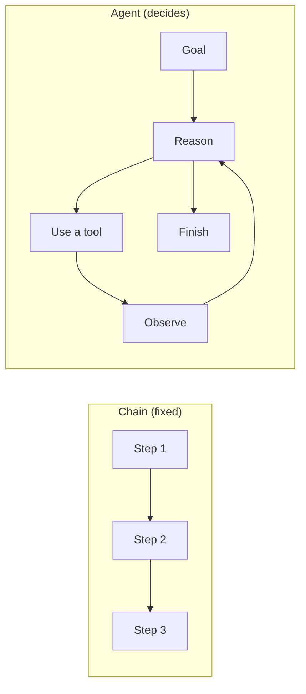
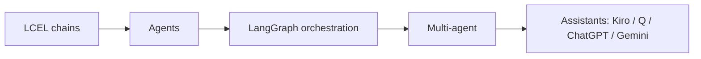

import TOCInline from '@theme/TOCInline';

# 09 · Tool Calling and AI Agents

<ProgressToggle sectionId="09-tool-calling-and-ai-agents" />

<TOCInline toc={toc} minHeadingLevel={2} maxHeadingLevel={2} />

:::tip[In this guide]
Move beyond fixed pipelines to systems that **decide** what to do next. Start
with the agent loop and LangGraph, then go down a level into the things that
actually decide whether an agent works: tool design, memory, planning,
MCP. Then ship it — evaluation, safety and sandboxing, and the production
machinery for long-running stateful runs. Along the way, reverse-engineer how
assistants like Kiro, Amazon Q, ChatGPT and Gemini are built, and build your
own.
:::

## Goal

Understand how agentic systems work, build them step by step from a single
tool-using agent to a mini coding assistant, and know what it takes to run one
in production without it costing too much, breaking, or doing something it
should not.

## Estimated Time

3–4 weeks.

## Prerequisites

- [LangChain / LCEL](../10-genai-frameworks-and-ecosystem/index.mdx) — especially [memory & agents](../10-genai-frameworks-and-ecosystem/01-langchain-core/09-memory-agents.mdx).
- A working [RAG project](../06-rag/03-first-project.mdx) (agents will use retrieval as a tool).
- [Production guardrails](../13-production-genai-and-llmops/04-logging-monitoring-guardrails.mdx) awareness — agents need limits.

## What You Will Learn

### Foundations

Start here. The loop, the framework, a working agent, and coordinating several.

1. [Agent Fundamentals](./01-agents-fundamentals.mdx) — what an agent is, the reason→act→observe loop, tools, autonomy levels.
2. [LangGraph Basics](./02-langgraph-basics.mdx) — state, nodes, edges, and cycles; why graphs beat linear chains for agents.
3. [Building Agents](./03-building-agents.mdx) — a tool-calling agent and a RAG agent, step by step, with guardrails.
4. [Multi-Agent Systems](./04-multi-agent-systems.mdx) — supervisor, hierarchical, and handoff patterns.

### Case Study: Assistants

How the products you use every day are actually put together, then build one.

5. [How Assistants Work](./05-how-assistants-work.mdx) — the architecture behind Kiro, Amazon Q, ChatGPT, and Gemini.
6. [Build a Coding Assistant](./06-build-coding-assistant.mdx) — a mini agentic assistant with tools and safety.

### Depth

The layer underneath the foundations. This is where agent quality is won or
lost, and where most "the model is dumb" bugs turn out to live.

7. [Tool Design & Function Calling](./07-tool-design.mdx) — the wire protocol, Pydantic schemas, granularity, recoverable errors, result size, parallel calls.
8. [Agent Memory Architectures](./08-agent-memory.mdx) — working, semantic, episodic and procedural memory; compaction, checkpointers, and memory as a hazard.
9. [Planning & Reflection](./09-planning-and-reflection.mdx) — Plan-and-Execute, ReWOO, Reflexion, verifier-driven loops, and honest loop control.

### Shipping

Measuring it, containing it, and running it.

10. [Evaluating Agents](./10-agent-evaluation.mdx) — trajectory metrics, tool-call correctness, task success rate, efficiency budgets, and eval harnesses.
11. [Agent Safety & Sandboxing](./11-agent-safety.mdx) — blast radius, permissions, human-in-the-loop, sandboxes, and prompt injection through tool output.
12. [Agents in Production](./12-production-agents.mdx) — execution models, durability, event streaming, cancellation, tracing, caching and deployment.

Tool integration gets its own section next door:
[11 · MCP](../11-mcp/index.mdx) covers the Model Context Protocol — exposing
your tools as a service any assistant can use, and consuming other people's.

## Chains vs Agents

A chain runs the same steps every time. An **agent** loops: it reasons, picks a
tool, observes the result, and repeats until the goal is met.

## Where This Fits

## How to Work Through This Section

Read 1–4 in order and build the agent in page 3 — everything later assumes you
have a running agent to modify. Pages 5–6 are the case study and can be read
any time after page 3.

Pages 7–10 are independent of each other, so take them in whatever order
matches your current problem: wrong tool choices point at 7, forgetting things
points at 8, long multi-step tasks point at 9, and integration reuse points
at 10.

Do not skip 11–13 if you intend to ship anything. Evaluation comes first of the
three, because without it you cannot tell whether a safety or performance
change helped.

:::note[Related sections]
General LLM evaluation technique — datasets, answer-quality metrics, judge
calibration, CI harnesses — lives in the Evaluation section of this roadmap,
and retrieval-as-a-tool (agentic RAG) is covered in Advanced RAG. Page 11 here
stays scoped to agent-specific concerns: trajectories and tool-call
correctness.
:::

## Interview Relevance

"What is an agent?", "chain vs agent", "how does tool-calling work?", "how would
you design a tool schema?", "how do you evaluate an agent?", "how would you
build a coding assistant?", and "how do you keep agents safe?" are increasingly
common — and the depth pages are where senior interviews go. Each page ends with
an interview section.

## Done When

- [ ] You can explain the agent loop and tool-calling, and decide agent vs chain.
- [ ] You can build a stateful agent with LangGraph and cap its steps.
- [ ] You can describe a multi-agent architecture and justify single vs multi.
- [ ] You can explain how a real assistant (e.g. Kiro) is built.
- [ ] You've built a small agentic assistant with guardrails.
- [ ] Your tools have Pydantic schemas, bounded output and recoverable errors.
- [ ] Your agent persists state with a checkpointer and compacts long sessions.
- [ ] You can pick a planning pattern against a measured failure, not a hunch.
- [ ] You can write an MCP server and state its security risks.
- [ ] You have a task suite with programmatic checks on answers *and* trajectories.
- [ ] You can explain prompt injection via tool output and the mitigations that work.
- [ ] You can run an agent durably behind a queue, streaming events to a UI.

Next: [10 · GenAI Frameworks and Ecosystem](../10-genai-frameworks-and-ecosystem/index.mdx).