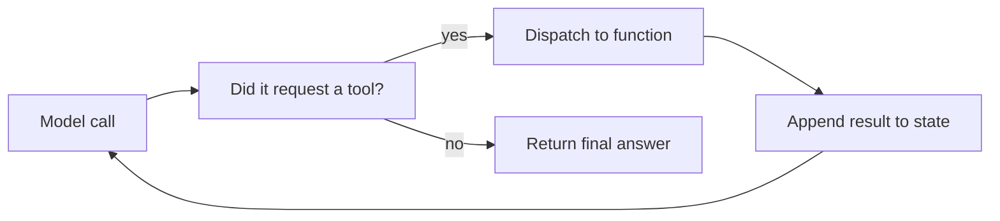
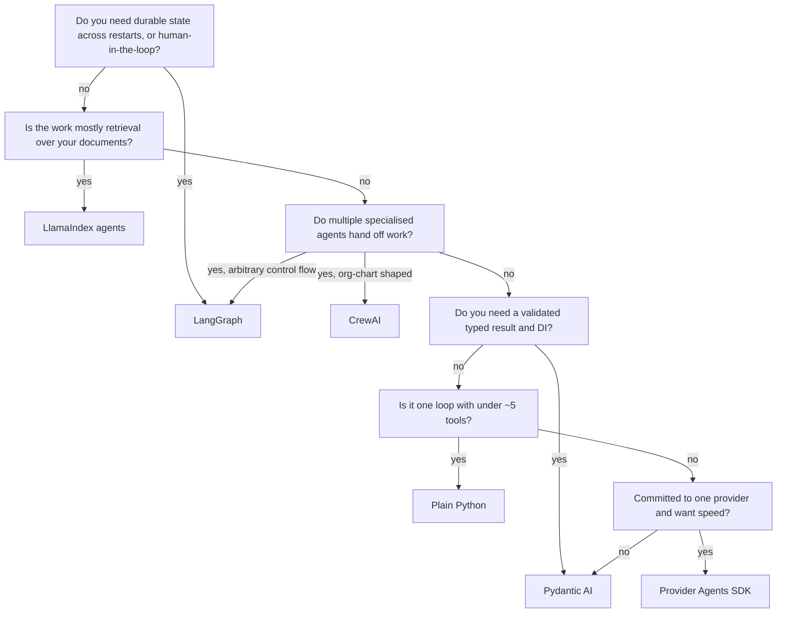

import TOCInline from '@theme/TOCInline';

# Agent Frameworks Compared

<TOCInline toc={toc} minHeadingLevel={2} maxHeadingLevel={2} />

:::tip[In this guide]
You have already built agents with LangGraph. This page is the survey: what
else exists, what each library optimises for, the same small agent written in
each so you can compare them directly, and a serious case for using no
framework at all.
:::

## What Is It?

An "agent framework" is a library that supplies the parts of an agent you would
otherwise write yourself: the loop that calls the model, the dispatch from a
tool call to a Python function, the state that carries between turns, and the
condition that stops the loop.

That is the whole job. The differences between libraries are in how much of it
they hide, what they add on top — persistence, multi-agent handoffs, typed
results, streaming, tracing — and how hard it is to get back out.

## Why Does It Matter?

Picking an agent framework is a lock-in decision disguised as a convenience
decision. The loop itself is fifty lines. What you are actually buying is
someone else's opinion about where your state lives, how your tools are
declared, and how your control flow is expressed. Those opinions reach into your
codebase and are expensive to reverse.

The flip side: writing your own persistence layer, interrupt-and-resume, or
multi-agent handoff protocol is weeks of work that a framework gives you for
free. The question is whether you need those things.



Every framework on this page is that diagram plus features. Keep it in mind as
you read: it makes the marketing much easier to parse.

## The Task, Written Six Times

To compare fairly, here is the same job in each: a **research-and-summarise
agent with one retrieval tool.** The user asks a question, the agent may call
`search_docs`, and it returns a short summary. Deliberately small, so the
framework's shape is the only thing on display.

Treat these as sketches of the shape, not copy-paste code — every one of these
libraries has moved its API inside the last year, so check the current docs
before typing.

### LangGraph — explicit graphs and state

```python
from typing import Annotated, TypedDict
from langchain_core.tools import tool
from langgraph.graph import StateGraph, START, END
from langgraph.graph.message import add_messages
from langgraph.prebuilt import ToolNode
from langchain_openai import ChatOpenAI

@tool
def search_docs(query: str) -> str:
    """Search the internal documentation for a query."""
    return retriever.invoke(query)[0].page_content

class State(TypedDict):
    messages: Annotated[list, add_messages]

model = ChatOpenAI(model="gpt-4o-mini").bind_tools([search_docs])

def call_model(state: State) -> dict:
    return {"messages": [model.invoke(state["messages"])]}

def route(state: State) -> str:
    return "tools" if state["messages"][-1].tool_calls else END

graph = (
    StateGraph(State)
    .add_node("agent", call_model)
    .add_node("tools", ToolNode([search_docs]))
    .add_edge(START, "agent")
    .add_conditional_edges("agent", route, {"tools": "tools", END: END})
    .add_edge("tools", "agent")
    .compile(checkpointer=checkpointer)
)
```

**What it optimises for: control.** The loop is visible as a graph, the state is
a type you declared, and every edge is something you wrote. That is why it wins
on anything non-linear — branching, retry sub-graphs, interrupt-and-resume,
cycles with a step budget — and why persistence is first-class rather than
bolted on.

**What it costs:** the most boilerplate of anything here. Reducers and
`Annotated` state are a genuine learning curve, and the above is the *short*
version because `ToolNode` and `create_react_agent` hide a lot. Also the largest
dependency footprint and the fastest-moving API.

Full treatment in the [LangGraph Complete Guide](./04-langgraph-complete-guide.mdx).

### CrewAI — role-based crews

```python
from crewai import Agent, Crew, Task, Process
from crewai.tools import tool

@tool("search_docs")
def search_docs(query: str) -> str:
    """Search the internal documentation for a query."""
    return retriever.invoke(query)[0].page_content

researcher = Agent(
    role="Documentation Researcher",
    goal="Find the passages that answer the user's question",
    backstory="You are thorough and never invent facts not in the docs.",
    tools=[search_docs],
    verbose=True,
)

summarise = Task(
    description="Answer this question from the docs: {question}",
    expected_output="Three sentences, plain language, citing the doc title.",
    agent=researcher,
)

crew = Crew(agents=[researcher], tasks=[summarise], process=Process.sequential)
result = crew.kickoff(inputs={"question": "How do I rotate an API key?"})
```

**What it optimises for: multi-agent orchestration expressed as an org chart.**
You declare agents with roles, goals and backstories, declare tasks with
expected outputs, and pick a process — `sequential` runs tasks in order,
`hierarchical` adds a manager agent that delegates and reviews. For "researcher
writes, editor reviews, publisher formats", you will have a working pipeline
faster than in anything else here.

**Where the abstraction helps:** declaring a team is genuinely less code than
wiring the equivalent graph, and task outputs chaining into the next task's
context is the common case done for you.

**Where it hides things you need:** prompts are assembled for you from role,
goal, backstory and task description, so when quality is bad it is not obvious
which field to change, and the real prompt lives in the library. The loop and
stopping condition are not yours. `hierarchical` mode can produce surprising
token bills, because the manager re-reads context on every handoff. Backstories
feel like prompt engineering but are mostly flavour; `expected_output` does far
more work.

Reach for it when the org-chart metaphor matches your problem. Avoid it when you
need to know exactly what was sent to the model.

### Pydantic AI — type-first

```python
from dataclasses import dataclass
from pydantic import BaseModel, Field
from pydantic_ai import Agent, RunContext

@dataclass
class Deps:
    retriever: Retriever          # injected, so tests pass a fake

class Answer(BaseModel):
    summary: str = Field(max_length=600)
    sources: list[str]
    confident: bool

agent = Agent(
    "openai:gpt-4o-mini",
    deps_type=Deps,
    output_type=Answer,
    system_prompt="Answer only from retrieved docs. Cite titles in sources.",
)

@agent.tool
async def search_docs(ctx: RunContext[Deps], query: str) -> str:
    """Search the internal documentation for a query."""
    hits = await ctx.deps.retriever.asearch(query)
    return hits[0].text

result = await agent.run("How do I rotate an API key?", deps=Deps(retriever=r))
answer: Answer = result.output        # validated, typed, autocompletes
```

**What it optimises for: the typed boundary.** The return value is a validated
Pydantic model, not a string you parse. Tools are ordinary async functions whose
signatures become the schema. Dependencies arrive through `RunContext`, so
swapping a real retriever for a fake in tests is a constructor argument rather
than a patch.

**The appeal, stated honestly:** if your team already builds FastAPI services
with Pydantic v2, this feels like the same codebase. Same validation errors,
same dependency-injection instinct, same type checker catching your mistakes
before runtime. That familiarity is worth more than it sounds — it is the
difference between a library your team reviews confidently and one they
cargo-cult.

**What it costs:** the youngest of these, with the smallest ecosystem and an API
still settling. Multi-agent support is thinner than CrewAI's or LangGraph's, and
long-running persistence is less developed than LangGraph checkpointers. It is
the best pick for a typed single agent inside a service, and a weaker one for a
long-lived multi-agent workflow.

### LlamaIndex agents and workflows

```python
from llama_index.core.tools import QueryEngineTool
from llama_index.core.agent.workflow import FunctionAgent
from llama_index.llms.openai import OpenAI

search_tool = QueryEngineTool.from_defaults(
    query_engine=index.as_query_engine(similarity_top_k=5),
    name="search_docs",
    description="Search the internal documentation.",
)

agent = FunctionAgent(
    tools=[search_tool],
    llm=OpenAI(model="gpt-4o-mini"),
    system_prompt="Answer from the docs in three sentences.",
)

response = await agent.run("How do I rotate an API key?")
```

**What it optimises for: retrieval.** Note that the tool was not a function you
wrote — it was an index you already had, promoted to a tool in four lines. If
your agent's work is mostly "query these documents well", the ecosystem around
it (node postprocessors, rerankers, response synthesisers, sub-question
decomposition) is the deepest of any option here.

**What it costs:** away from retrieval it is less expressive than LangGraph, and
the `Workflow` event-driven model is a second abstraction to learn. Weaker fit
for agents whose tools are mostly APIs and side effects.

See the [LlamaIndex Complete Guide](./06-llamaindex-complete-guide.mdx) and
[LangChain vs LlamaIndex](../02-llamaindex/03-langchain-vs-llamaindex.mdx).

### OpenAI Agents SDK and provider-native loops

```python
from agents import Agent, Runner, function_tool

@function_tool
def search_docs(query: str) -> str:
    """Search the internal documentation for a query."""
    return retriever.invoke(query)[0].page_content

agent = Agent(
    name="Doc researcher",
    instructions="Answer from the docs in three sentences.",
    tools=[search_docs],
)

result = await Runner.run(agent, "How do I rotate an API key?")
```

**What it optimises for: the shortest path to a working agent on one provider.**
Thin, well-documented, with handoffs, guardrails and tracing included, and it
tracks new provider capabilities — server-side tools, built-in retrieval, hosted
conversation state — on day one rather than after a community PR.

**The lock-in tradeoff:** the abstractions assume one provider's model of the
world. Hosted state and server-side tools in particular have no portable
equivalent, so a migration is a rewrite rather than a config change. That is a
reasonable trade if you have already committed to the provider and value
velocity; it is a bad trade if model portability is a requirement, or if you are
cost-optimising across providers.

### Plain Python — take this seriously

```python
import json
from typing import Any, Callable
from openai import AsyncOpenAI

client = AsyncOpenAI()

TOOLS: dict[str, Callable[..., Any]] = {"search_docs": search_docs}
SCHEMAS = [{
    "type": "function",
    "function": {
        "name": "search_docs",
        "description": "Search the internal documentation.",
        "parameters": {
            "type": "object",
            "properties": {"query": {"type": "string"}},
            "required": ["query"],
        },
    },
}]

async def run(question: str, max_steps: int = 6) -> str:
    messages: list[dict] = [
        {"role": "system", "content": "Answer from the docs in three sentences."},
        {"role": "user", "content": question},
    ]
    for _ in range(max_steps):
        reply = await client.chat.completions.create(
            model="gpt-4o-mini", messages=messages, tools=SCHEMAS
        )
        msg = reply.choices[0].message
        messages.append(msg.model_dump(exclude_none=True))

        if not msg.tool_calls:
            return msg.content or ""

        for call in msg.tool_calls:
            fn = TOOLS[call.function.name]
            result = fn(**json.loads(call.function.arguments))
            messages.append({
                "role": "tool",
                "tool_call_id": call.id,
                "content": str(result)[:8_000],
            })
    return "Step budget exhausted."
```

That is the whole agent: a loop, a tool dict, a model client, a step cap. No
dependency beyond the provider SDK, every token that reaches the model is
visible in `messages`, and the stack trace when something breaks is yours.

**Argue for this seriously, because for many teams it is correct.** If your
agent is one loop with three or four tools and no persistence requirement, a
framework costs you a dependency, an abstraction to learn, a migration you will
eventually pay for, and a debugging layer between you and the prompt — in
exchange for saving fifty lines you already understand.

**When it stops being enough:** you need interrupt-and-resume across process
restarts, you want to replay a run from step four, you have five agents handing
off to each other, or you want streaming token events across a graph. Writing
checkpointing yourself is where this stops being a good deal.

## Comparison

| | LangGraph | CrewAI | Pydantic AI | LlamaIndex | Provider SDK | Plain Python |
| --- | --- | --- | --- | --- | --- | --- |
| Control over the loop | Total, explicit | Low, implicit | Medium | Medium | Low | Total |
| State and persistence | Checkpointers, best in class | Basic | Message history, growing | Workflow context | Hosted, provider-side | Whatever you write |
| Structured output | Via the model layer | Via task output | **Core feature**, validated | Via output parsers | Good | Via the SDK |
| Streaming | Rich, token and event level | Limited | Good | Good | Good | Whatever the SDK gives |
| Observability | LangSmith integration | Basic, `verbose` logs | Logfire integration | Callbacks, tracing | Built-in tracing | You instrument it |
| Multi-agent | Graphs, supervisors, handoffs | **Core feature**, crews | Thinner | Agent-as-tool | Handoffs | You build it |
| Learning curve | Steep | Gentle | Gentle if you know Pydantic | Medium | Gentle | None |
| Lock-in | High, API moves fast | High, opinionated | Medium | Medium to high | **Highest** | None |
| Best fit | Non-linear flows, durable runs, HITL | Role-shaped multi-agent pipelines | Typed agent inside a service | Retrieval-centric agents | Fast build on one provider | Simple loops, few tools |

One caution on that table: the "learning curve" and "lock-in" rows interact
badly. Gentle learning curve plus high lock-in is the combination that produces
a prototype everyone loves and nobody can change.

## Choosing



Two notes on using that honestly. Answer the first question about what you need
*now*, not what you might need — "we might want human-in-the-loop later" has
bought a lot of unnecessary LangGraph. And if two branches both look fine, pick
the one your team can read, because that decides maintenance cost more than any
feature row.

## What They All Share

Every framework here, and every one that launches next quarter, is four things:

| Part | What it does | Where it varies |
| --- | --- | --- |
| The loop | Call model, inspect response, repeat | Explicit graph, implicit `while`, or a hosted run |
| Tool dispatch | Map a requested name and JSON args to a function | Decorator, class, schema dict; sync or async |
| State | What carries across turns | Message list, typed dict, DB-backed checkpoint |
| Stopping condition | When to stop | No tool call, step cap, token budget, goal check |

If you understand those four, **switching frameworks is mechanical.** You are
re-expressing the same four things in new syntax. That is why this page spends
more effort on tradeoffs than on APIs — the APIs are the easy part, and they
will all have changed by the time you need them.

It is also the checklist for evaluating anything new. Ask: where is the loop,
how are tools declared, where does state live, who decides to stop, and can I
see the exact prompt that was sent. A library that cannot answer the last one is
a library you will not be able to debug.

## Migration Cost, and Keeping It Low

Assume you will change framework once. The cost is entirely determined by how
much of your code imported it.

- **Business logic in service classes.** The framework calls your service; your service never imports the framework. Everything valuable stays testable without a model.
- **Tools as plain functions.** Write a typed function, then add the decorator in a thin adapter module. A framework-specific decorator on your business logic makes that function un-reusable.
- **Framework only orchestrates.** It decides what runs next. It does not own your database session, your auth, your retries, or your domain types.
- **Your own types at the boundary.** Convert framework message objects into your Pydantic models at the edge, so `AIMessage` does not leak into fifty files.
- **One module that constructs the agent.** If `langgraph` or `crewai` is imported in one place, migration is a rewrite of that place.

```python
# services/research.py — no framework import anywhere in this file
class ResearchService:
    def __init__(self, retriever: Retriever) -> None:
        self._retriever = retriever

    async def search_docs(self, query: str) -> str:
        """Search the internal documentation for a query."""
        hits = await self._retriever.asearch(query, k=5)
        return "\n\n".join(h.text for h in hits)


# agents/adapters.py — the only file that knows which framework you use
def build_tools(service: ResearchService) -> list:
    return [tool(service.search_docs)]
```

Teams that do this report migrations measured in days. Teams that scattered
framework imports through their domain code report quarters, or never migrate
and stay on a version that no longer gets fixes.

## The Honest Closing

Frameworks help most with **multi-agent orchestration and persistence.** Those
are genuinely hard, genuinely tedious, and a good library saves you weeks.

Frameworks help least with the thing that actually determines whether your agent
works: **tool design and prompts.** No framework makes a badly-scoped tool
usable, writes a description the model reads correctly, or returns errors a model
can recover from. That work is identical in all six options above, it is where
most of your iteration time goes, and it is the difference between an agent that
demos and one that ships. Start at
[Tool Design](../../09-tool-calling-and-ai-agents/07-tool-design.mdx).

The practical consequence: do not spend a week choosing. Pick the one that fits
the decision flow, keep it at the edge of your codebase, and spend the saved
week on tools and evals instead. See
[Agent Evaluation](../../09-tool-calling-and-ai-agents/10-agent-evaluation.mdx).

:::note[MCP is not on this list]
MCP is a *protocol* for exposing tools and data to any agent, not a framework
for building one. It is orthogonal: you can serve the same MCP tools to a
LangGraph agent, a CrewAI crew, or your own loop. Covered in
[11 · MCP](../../11-mcp/index.mdx).
:::

## Common Mistakes

- Choosing a framework before you know whether you need persistence or multi-agent handoffs, which are the only things hard to add later.
- Importing the framework into domain code, turning a future swap into a rewrite.
- Picking CrewAI for a single agent, where the role and backstory abstraction adds tokens and hides the prompt without adding capability.
- Picking LangGraph for a linear chain, paying the graph boilerplate for branching you never use.
- Assuming a framework's multi-agent support means multiple agents will outperform one good agent with good tools. Usually they do not.
- Never printing the actual prompt the framework sent. If you cannot see it, you cannot debug quality.
- Treating backstories and personas as the quality lever instead of tool descriptions and output contracts.
- Letting the framework own retries, auth and DB sessions, which your service layer should own.
- Comparing frameworks on features rather than on which one your team can read and operate.

## Interview Questions

- Name the four parts every agent framework provides. Why does that make switching mechanical?
- When would you build an agent with no framework, and when does that stop being enough?
- LangGraph versus CrewAI: what is each actually optimising for?
- What does Pydantic AI give you that LangGraph does not, and vice versa?
- What is the lock-in risk with a provider-native agents SDK?
- You inherit an agent on a framework you want to replace. What determines the cost?
- Which agent problems do frameworks genuinely solve, and which do they not touch?
- Why is MCP not an alternative to these libraries?
- Your CrewAI crew gives poor answers. How do you debug it?

## Things to Remember

- Every framework is a loop, tool dispatch, state, and a stopping condition. Learn those and the rest is syntax.
- LangGraph for control and durable state. CrewAI for org-chart multi-agent. Pydantic AI for typed single agents in a service. LlamaIndex for retrieval-centric work. Provider SDKs for speed on one provider. Plain Python for simple loops.
- Persistence and multi-agent orchestration are the hard parts worth buying.
- Tool design and prompts determine quality, and no framework helps with them.
- Keep the framework at the edge: service classes, plain functions, one construction module.
- If you cannot see the exact prompt sent, you cannot debug the agent.
- Gentle learning curve plus high lock-in is the trap.

## Mini Exercise

Build the research-and-summarise agent twice: once in plain Python with the loop
above, and once in whichever framework you are least familiar with. Same tool,
same model, same question.

Then answer in writing:

1. How many lines, and how many dependencies, each?
2. For each version, print the exact messages sent to the model on the second iteration. How hard was that to obtain?
3. Add a step cap of three and make the agent explain itself when it hits the cap. Which version made that easier?
4. Add a second tool that writes a file. Which version made it clearer where to put an approval check?
5. Which would you hand to a teammate on call at 3am?

Question 2 is the one that changes people's minds.

## Done When

- [ ] You can name the four parts every framework provides and locate each in two different libraries.
- [ ] You can justify a framework choice from requirements rather than popularity, including choosing none.
- [ ] You have written the same agent in plain Python and in one framework, and compared the prompts they send.
- [ ] Your agent code keeps business logic and tools free of framework imports.
- [ ] You can state which agent problems a framework does not help with at all.
