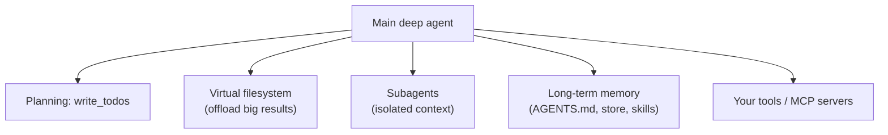

import TOCInline from '@theme/TOCInline';

# Deep Agents: Overview

<TOCInline toc={toc} minHeadingLevel={2} maxHeadingLevel={2} />

:::tip[In this guide]
A plain ReAct loop is enough for a quick lookup and falls apart on a two-hour
research or coding task. Deep Agents is LangChain's "harness" — the same tool
loop plus the four capabilities long-horizon agents actually need: planning, a
virtual filesystem for context, subagent delegation, and long-term memory. This
page is the map: what it is, why it exists, and where it sits relative to
LangChain and LangGraph.
:::

## What Is It?

**Deep Agents** (`deepagents`) is an *agent harness*: a batteries-included agent
loop built on top of LangChain and LangGraph. `create_deep_agent()` returns a
compiled LangGraph graph — a ready-to-run agent — preloaded with the patterns
that make agents reliable on complex, multi-step work. [Content was rephrased for compliance with licensing restrictions, from the [LangChain Deep Agents docs](https://docs.langchain.com/oss/python/deepagents/overview).]

The name comes from "deep" tasks — ones that take many steps over a long time,
like the research and coding agents (Claude Code, Manus, Deep Research) that
inspired it. Those systems converged on the same handful of tricks, and Deep
Agents packages them with sensible defaults.

## Why Does It Matter?

Because a shallow agent — an LLM, some tools, and a `while` loop — degrades
predictably as a task gets longer:

- **The context window fills.** Every tool result stays in the transcript. A
  research agent that reads twenty pages has twenty pages of raw text crowding
  out its own reasoning, and quality falls as the window fills ("context rot").
- **The plan evaporates.** With no explicit place to keep one, the model's
  intent drifts across dozens of steps and it forgets what it was doing.
- **One context does everything.** A single agent juggling search, reading,
  synthesis and writing mixes all of it in one window, and the distractions
  compound.

Deep Agents answers each of those with a dedicated mechanism, so you do not
hand-roll them for every project. The four pillars:

| Pillar | What it does | Fixes |
| --- | --- | --- |
| **Planning** | A `write_todos` tool to keep an explicit task list | The plan evaporating |
| **Virtual filesystem** | `read_file`/`write_file`/… to offload context to files | The window filling |
| **Subagents** | Delegate subtasks to child agents in isolated context | One context doing everything |
| **Long-term memory** | Persist instructions, skills and files across runs | Starting from zero each session |

## Framework, Runtime, Harness

The three layers confuse people constantly, and interviewers ask about it. They
stack; they are not alternatives:

| Layer | What it is | Example |
| --- | --- | --- |
| **LangChain** | The framework — building blocks (models, tools, messages) | `create_agent()` for a basic tool loop |
| **LangGraph** | The runtime — durable execution, state, streaming, human-in-the-loop | `StateGraph`, checkpointers |
| **Deep Agents** | The harness — a loop with built-in capabilities and defaults | `create_deep_agent()` |

Deep Agents is **built on** LangGraph, not a replacement for it. Underneath, it
is a LangGraph graph, so everything you know about LangGraph — checkpointing,
threads, interrupts, streaming — still applies. See the
[LangGraph complete guide](../03-complete-guides/04-langgraph-complete-guide.mdx)
for that layer.

## When to Use It — and When Not To

| Reach for Deep Agents | Prefer `create_agent` / plain LangGraph |
| --- | --- |
| Long-horizon tasks: research, coding, multi-document work | Short, bounded tasks: one lookup, one answer |
| Context routinely overflows a single window | The whole job fits comfortably in context |
| The task naturally splits into isolated subtasks | A single linear flow |
| You want planning, filesystem and subagents out of the box | You want a minimal, fully-controlled loop |

The honest caveat, developed on the
[production page](./06-human-in-the-loop-and-production.mdx): the harness is not
free. Planning, subagents and a filesystem mean more tool calls, more tokens and
more moving parts. For a RAG Q&A endpoint or a three-tool assistant, a plain
[LangChain agent](../01-langchain-core/09-memory-agents.mdx) or a hand-written
[LangGraph](../03-complete-guides/04-langgraph-complete-guide.mdx) graph is
simpler and cheaper. Deep Agents earns its keep when the task is genuinely deep.

## The Rest of This Subsection

1. **Overview** — you are here.
2. [Building a Deep Agent](./02-building-a-deep-agent.mdx) — `create_deep_agent`, tools, model, a research agent, streaming and tracing.
3. [Planning & To-dos](./03-planning-and-todos.mdx) — the `write_todos` tool and when an explicit plan helps.
4. [Subagents & Context Isolation](./04-subagents-and-context-isolation.mdx) — delegation, isolated vs forked context, sync vs async subagents.
5. [Virtual Filesystem & Memory](./05-filesystem-and-memory.mdx) — file tools, backends, permissions, skills, and long-term memory.
6. [Human-in-the-Loop & Production](./06-human-in-the-loop-and-production.mdx) — approvals, sandboxes, managed vs self-hosted, cost, and eval.

## Common Mistakes

- Treating Deep Agents as an alternative to LangGraph rather than a layer on top
  of it.
- Adopting the full harness for a short task a basic tool loop would handle.
- Expecting "deep agent" to mean a smarter model — it is the same model with
  better scaffolding around its context.
- Assuming planning, filesystem and subagents are always on; in current versions
  planning is opt-in and the pieces are configurable middleware.

## Interview Questions

- What is a deep agent, and what four capabilities distinguish it from a plain
  ReAct agent?
- What is the difference between LangChain, LangGraph and Deep Agents?
- Why does a shallow agent degrade on long-horizon tasks?
- `create_deep_agent()` returns what, concretely?
- When would you *not* use Deep Agents?

## Things to Remember

- Deep Agents is a harness on top of LangChain + LangGraph; it compiles to a
  LangGraph graph.
- Four pillars: planning, virtual filesystem, subagents, long-term memory —
  each fixing a specific long-task failure.
- It exists because one LLM, some tools and a loop do not survive a long task's
  context pressure.
- Use it for deep tasks; use a basic agent for shallow ones.

## Done When

- [ ] You can name the four pillars and the failure each one addresses.
- [ ] You can place Deep Agents relative to LangChain and LangGraph.
- [ ] You can decide between a deep agent and a basic agent for a given task.

Next: [Building a Deep Agent](./02-building-a-deep-agent.mdx).
