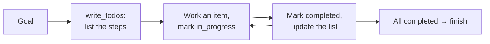

import TOCInline from '@theme/TOCInline';

# Planning & To-dos

<TOCInline toc={toc} minHeadingLevel={2} maxHeadingLevel={2} />

:::tip[In this guide]
A long task needs somewhere to keep its plan, or the model forgets what it was
doing. Deep Agents gives the model a `write_todos` tool to maintain a structured
task list in state. It is a cheap, high-leverage habit — and it is not a
scheduler.
:::

## What Is It?

Planning is a harness capability that gives the agent a `write_todos` tool for
maintaining a structured task list while it works. Each item has a status —
`pending`, `in_progress`, or `completed` — and the list is persisted in the
agent's state, so it survives across steps of a long run. [Content was rephrased for compliance with licensing restrictions, from the [Deep Agents task-planning docs](https://docs.langchain.com/oss/python/deepagents/overview).]

In current versions planning is **opt-in**: add `TodoListMiddleware` to turn it
on. (Earlier versions included it by default.)

```python
from deepagents import create_deep_agent
from deepagents.middleware import TodoListMiddleware   # path may vary by version

agent = create_deep_agent(
    tools=[internet_search],
    system_prompt="...",
    model="anthropic:claude-sonnet-4-5",
    middleware=[TodoListMiddleware()],
)
```

## Why Does It Matter?

An explicit plan does three concrete things on a long task:

- **Keeps intent in front of the model.** Writing the plan down and ticking
  items off means the current objective sits in the transcript, not in the
  model's fading memory of fifty steps ago.
- **Props up weaker models.** A smaller or cheaper model that drifts on a
  multi-step task often stays on track when it has to *declare* what it is doing
  and mark it done. The to-do list is an accountability tool.
- **Drives a progress UI.** Because the list lives in state, you can stream it
  and show the user "step 3 of 7: drafting the comparison" instead of a silent
  spinner. This is often the single biggest UX win for a long-running agent.



## What It Is Not

The to-do list is a **note the model keeps for itself**, not an execution
engine. It does not schedule, enforce ordering, or run steps for you — the model
reads and rewrites it like any other file-ish tool, and nothing stops the model
from ignoring it. The value is entirely in keeping the plan legible to the model
and to you. Treat it as working memory for intent, not as control flow. For
actual control flow — enforced branches, retries, gates — you drop to the
underlying [LangGraph](../03-complete-guides/04-langgraph-complete-guide.mdx).

## When to Add It

| Add planning | Skip it |
| --- | --- |
| Long, multi-step tasks (research, coding, migrations) | Short tasks with two or three tool calls |
| A model that drifts without an accountability aid | A strong model on a simple flow |
| A UI that streams progress from agent state | Headless, single-shot work |

Because it is opt-in and nearly free, the default instinct for any genuinely
deep task is to turn it on; the cost is a few extra tokens per turn for the list.

## Common Mistakes

- Expecting `write_todos` to exist without adding `TodoListMiddleware` on a
  version where planning is opt-in.
- Treating the to-do list as a scheduler that enforces order — it is a note, and
  the model can ignore it.
- Adding planning to a two-step task, paying tokens for a list that never earns
  its place.
- Not streaming the list to the UI, and so missing the biggest reason to have
  it.

## Interview Questions

- What does `write_todos` do, and where is the list stored?
- Why does an explicit plan help a weaker model on a long task?
- Is the to-do list control flow? If not, what is it, and where does real
  control flow live?
- When would you not bother with planning?

## Things to Remember

- Planning = a `write_todos` tool maintaining a `pending`/`in_progress`/
  `completed` list in state; opt-in via `TodoListMiddleware` in current
  versions.
- It keeps intent legible, helps weaker models, and powers a progress UI.
- It is an accountability note, not a scheduler — enforcement lives in LangGraph.
- Cheap enough to default-on for deep tasks, wasteful for shallow ones.

## Mini Exercise

Take the research agent from the previous page and run a multi-part question
("compare A, B and C on price, recall and operational cost") twice: once without
planning and once with `TodoListMiddleware`. Compare the traces. Note whether
the planned run stays more on-topic and whether you could render its to-do list
as a progress indicator.

## Done When

- [ ] You can enable planning and explain why it is opt-in.
- [ ] You can explain what the to-do list is and is not.
- [ ] You can decide whether a given task warrants planning.

Next: [Subagents & Context Isolation](./04-subagents-and-context-isolation.mdx).
