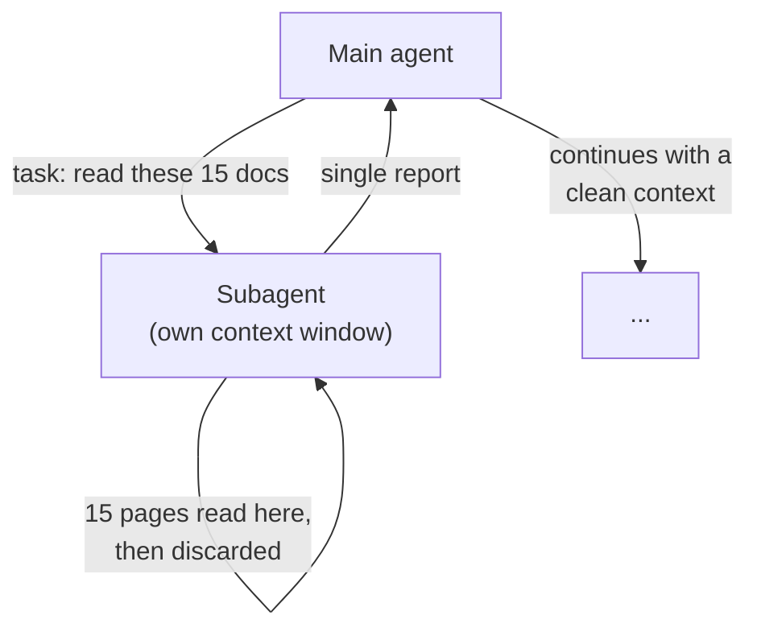

import TOCInline from '@theme/TOCInline';

# Subagents & Context Isolation

<TOCInline toc={toc} minHeadingLevel={2} maxHeadingLevel={2} />

:::tip[In this guide]
The reason to split work across subagents is not "many brains are smarter" — it
is context quarantine. A subagent does a messy subtask in its own window and
returns only the clean result, so the main agent's context stays focused. This
page covers the task tool, isolated vs forked context, sync vs async subagents,
and custom ones.
:::

## What Is It?

Deep Agents includes a built-in `task` tool that lets the main agent spin up an
ephemeral **subagent** to handle an isolated subtask. The subagent runs on its
own, in its own context window, and hands back a single final report. [Content was rephrased for compliance with licensing restrictions, from the [Deep Agents subagents docs](https://docs.langchain.com/oss/python/deepagents/overview).]

By default a **general-purpose** subagent is available; you can also define
**custom** subagents with their own prompt, tools and model for recurring,
specialised jobs.

## Why Does It Matter? Context Quarantine

The core idea is context isolation. Consider "read these fifteen pages and tell
me which mention a refund window." If the main agent does it, fifteen pages of
raw text land in its context and stay there, distracting every later step. If a
subagent does it, those fifteen pages live and die in the *subagent's* window,
and the main agent receives one sentence: the answer.

| | Everything in the main agent | Delegated to a subagent |
| --- | --- | --- |
| Where raw data lives | Main context, forever | Subagent context, discarded after |
| Main agent's window | Fills with noise | Stays focused on the goal |
| Token cost of the subtask | Paid on every later turn | Paid once, compressed to a result |

So the win is **token efficiency and focus**, not raw intelligence. This is the
same logic as the [multi-agent systems](../../09-tool-calling-and-ai-agents/04-multi-agent-systems.mdx)
page, with the harness handling the plumbing.

## Isolated vs Forked Context

Each delegation decides what the subagent starts with:

- **Isolated (default).** The subagent begins with a fresh context — just the
  task you hand it. Best for genuinely independent subtasks; maximum quarantine.
- **Forked.** The subagent inherits the parent's full conversation history. Use
  it when the subtask needs the surrounding context to make sense, at the cost
  of the isolation you were buying.

Default to isolated. Fork only when a subtask genuinely cannot be understood
without the parent's history.

## Synchronous vs Async Subagents

Two execution modes, and the distinction matters for latency:

| | Synchronous (default) | Async |
| --- | --- | --- |
| Behaviour | Blocks the main agent until the subagent returns | Returns a task handle immediately; runs independently |
| Parallelism | One at a time | Many at once |
| Steering mid-run | No | Yes — launch, check, update, cancel |
| Use when | Sequential subtasks | Independent subtasks you want to fan out |

Async subagents (introduced in v0.5) let the main agent fire off several
independent subtasks and keep working, then collect results — the difference
between researching five topics in series and in parallel. [Content was rephrased for compliance with licensing restrictions, from [Deep Agents v0.5](https://www.langchain.com/blog/deep-agents-v0-5).]

## Custom Subagents

Define a specialised subagent once and let the main agent delegate to it by
name — a "critic" that reviews drafts, a "coder" with code tools, a "researcher"
with search and a narrower filesystem. A custom subagent typically specifies its
own name, description (so the main agent knows when to use it), system prompt,
tools and model. Give each the *least* tool access its job needs; a researcher
should not inherit write access it will never use.

## Properties to Remember

- **Single handoff.** A subagent returns one final report; it cannot carry on a
  back-and-forth with the parent.
- **Stateless.** It does not persist across invocations; each call is a fresh
  instance (unless forked).
- **Compressed result.** Heavy work stays isolated and comes back as a compact
  answer — that compression is the feature.

## When Not To Delegate

Subagents add overhead: another agent loop, its own tokens, a round of
delegation. Skip them when the subtask is small enough to do inline, or when the
"subtasks" are really sequential steps of one flow with no independent context.
As with [multi-agent systems](../../09-tool-calling-and-ai-agents/04-multi-agent-systems.mdx),
the failure mode is splitting a simple job into a committee that costs more and
coordinates worse than one focused agent.

## Common Mistakes

- Delegating to subagents for parallelism when the work is actually sequential.
- Forking by default, inheriting the parent's whole history, and throwing away
  the context isolation that was the point.
- Giving a custom subagent broad tool access instead of the least it needs.
- Expecting a subagent to hold a conversation — it returns one report and ends.
- Reaching for subagents to make the agent "smarter" rather than to keep context
  clean.

## Interview Questions

- What problem do subagents actually solve — is it intelligence or context?
- Isolated vs forked context: what does each give up?
- Synchronous vs async subagents: when would you use async?
- Why is "single handoff, stateless" an important constraint?
- When does splitting into subagents make a system worse?

## Things to Remember

- The `task` tool delegates an isolated subtask to an ephemeral subagent that
  returns one compressed report.
- The point is context quarantine and token efficiency, not more brainpower.
- Isolated context by default; fork only when the subtask needs the history.
- Async subagents (v0.5+) enable real parallel fan-out with mid-run steering.
- Custom subagents get their own prompt, tools and model — scope tools tightly.

## Mini Exercise

Give your research agent a question with three independent parts. First let it
run with the default general-purpose subagent and read the trace to see whether
and how it delegated. Then define a custom "researcher" subagent with only the
search tool and a tight prompt, and compare: did delegation get cleaner, and did
the main agent's context stay smaller?

## Done When

- [ ] You can explain context quarantine and why it is the real reason to
      delegate.
- [ ] You can choose between isolated and forked context.
- [ ] You can explain when async subagents help, and define a custom subagent
      with scoped tools.

Next: [Virtual Filesystem & Memory](./05-filesystem-and-memory.mdx).
