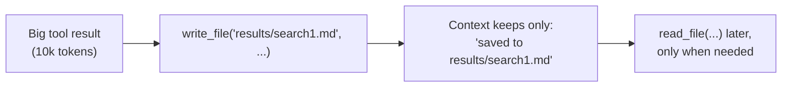

import TOCInline from '@theme/TOCInline';

# Virtual Filesystem & Memory

<TOCInline toc={toc} minHeadingLevel={2} maxHeadingLevel={2} />

:::tip[In this guide]
The filesystem is the pillar that keeps a long run inside its token budget. The
agent writes big results to files and keeps only pointers in context, reads them
back when needed, and — with the right backend — carries files across sessions
as long-term memory. This page covers the file tools, the backends, permissions,
skills, and the context-management machinery around them.
:::

## What Is It?

Deep Agents gives the agent a **virtual filesystem**: a set of file tools backed
by a pluggable storage backend. The agent sees ordinary file operations; where
the bytes actually live is a configuration choice. [Content was rephrased for compliance with licensing restrictions, from the [Deep Agents filesystem docs](https://docs.langchain.com/oss/python/deepagents/overview).]

| Tool | Does |
| --- | --- |
| `ls` | List files with metadata |
| `read_file` | Read contents (with line numbers; supports offset/limit, and multimodal files) |
| `write_file` | Create or overwrite a file |
| `edit_file` | Exact string replacement in a file |
| `delete` | Remove a file or directory |
| `glob` | Find files by pattern (e.g. `**/*.py`) |
| `grep` | Search file contents |
| `execute` | Run shell commands (sandbox backends only) |

## Why Does It Matter? Context Offloading

The filesystem is how a deep agent survives long runs. Instead of letting a
10,000-token search result sit in the transcript forever, the agent does this:

The raw bytes leave the window; a one-line pointer stays. Multiply that across a
long research or coding task and it is the difference between finishing and
hitting the context limit halfway through. This pairs with **summarization**
(the harness compresses conversation history and large intermediate results) and
with **subagent isolation** from the [previous page](./04-subagents-and-context-isolation.mdx).

## Backends

The same file tools, different storage underneath — this is the choice that
decides persistence:

| Backend | Where files live | Persists across sessions? | Use for |
| --- | --- | --- | --- |
| **State** (default) | In the agent's run state | No (tied to the thread) | Scratch space within one run |
| **Local disk** | The host filesystem | Yes | Local dev, working on real files |
| **LangGraph store** | A LangGraph store | Yes, across threads | Long-term memory |
| **Composite** | Routes paths to different backends | Depends | Mixing scratch + durable |
| **Sandbox** | An isolated sandbox with shell | Depends | Code execution, CLIs, installs |

The default state backend is per-run scratch. For memory that outlives a
conversation, back the filesystem with a **store** so a later run picks up both
the transcript and the files the agent wrote.

## Permissions

The filesystem supports declarative permission rules so an agent cannot read or
write where it should not. You pass a list of rules; each has `operations`
(`read`/`write`), `paths` (glob patterns), and a `mode` (`allow`/`deny`). Rules
are evaluated in order, first match wins, and anything unmatched is allowed.

Use it to confine an agent to `/workspace/`, protect secrets like `.env`, and
give a subagent narrower access than its parent. Permissions apply to the
built-in file tools; sandbox backends, which allow arbitrary shell execution,
are governed differently — treat those as a stronger boundary problem (see the
[production page](./06-human-in-the-loop-and-production.mdx)).

## Long-Term Memory

Memory gives the agent persistent context across conversations — style
preferences, project conventions, standing instructions. It uses `AGENTS.md`
files passed through the `memory` parameter. Unlike skills (below), memory files
are **always loaded**, and the content is stored in the configured backend. The
agent can also update memory from interactions, so a preference it learns in one
thread carries into the next. [Content was rephrased for compliance with licensing restrictions.]

## Skills

Skills package specialised workflows and domain knowledge as directories with a
`SKILL.md` file (plus optional scripts and templates). They load with
**progressive disclosure**: the agent reads only the skill's frontmatter at
startup, then reads the full content when a task actually needs it. That keeps
startup context small while making rich capabilities available on demand —
the opposite of dumping every instruction into the system prompt. The contrast
with memory is the key exam point: **memory is always loaded; skills are loaded
on demand.**

## Prompt Caching

On Anthropic and Bedrock models, `create_deep_agent` automatically marks the
static parts of the system prompt — base instructions, memory, skill content —
as cache-eligible, so they are not reprocessed every turn. On a long-running
agent that repeats a large stable prompt on every call, this is a real latency
and cost cut for free. It connects straight back to the
[cost & latency](../../13-production-genai-and-llmops/08-cost-and-latency.mdx)
rule that prompt caching is the best return per hour of work.

## Common Mistakes

- Using the default state backend and expecting files to survive the session —
  it is per-run scratch; use a store for persistence.
- Not offloading large tool results to files, so the context window fills and
  quality drops mid-run.
- Running with no filesystem permissions, letting the agent read secrets or
  write outside its workspace.
- Confusing memory (always loaded) with skills (loaded on demand) and stuffing
  everything into always-on memory, bloating startup context.
- Forgetting that `execute` only exists on sandbox backends, then wondering why
  shell commands are unavailable.

## Interview Questions

- How does the virtual filesystem keep a long run inside its token budget?
- Name the backends and say which ones persist across sessions.
- How would you stop a deep agent reading `.env` or writing outside
  `/workspace/`?
- What is the difference between memory and skills, and why does progressive
  disclosure matter?
- Why does prompt caching help a long-running deep agent specifically?

## Things to Remember

- The filesystem lets the agent offload big results to files and keep only
  pointers in context — the main defence against context overflow.
- Backend choice decides persistence: state (scratch), disk/store (durable),
  sandbox (shell).
- Permissions are declarative allow/deny glob rules, first match wins.
- Memory (`AGENTS.md`) is always loaded; skills (`SKILL.md`) load on demand via
  progressive disclosure.
- Prompt caching on Anthropic/Bedrock is automatic and cuts cost on long runs.

## Mini Exercise

Run your research agent on a question that produces several large search
results, and confirm from the trace that it wrote them to files and kept
pointers rather than raw text in context. Then switch the backend to a store,
run a second related question in a new thread, and verify the agent can read a
file it wrote in the first run. Finally, add a permission rule denying writes
outside `results/` and confirm an attempt elsewhere is refused.

## Done When

- [ ] You can explain context offloading and why it prevents window overflow.
- [ ] You can choose a backend based on whether files must persist.
- [ ] You can write permission rules to confine an agent.
- [ ] You can explain memory vs skills and when each loads.

Next: [Human-in-the-Loop & Production](./06-human-in-the-loop-and-production.mdx).
