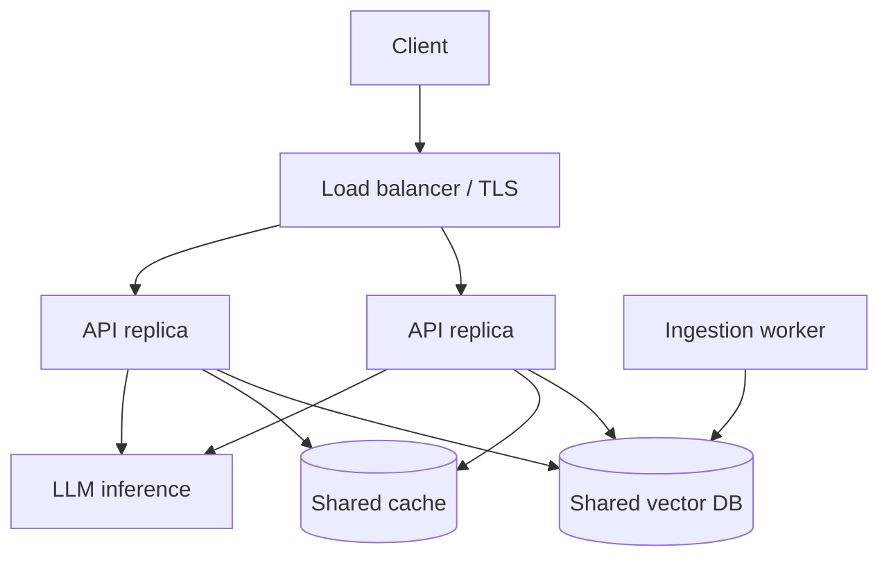

import TOCInline from '@theme/TOCInline';

# Deployment Basics

<TOCInline toc={toc} minHeadingLevel={2} maxHeadingLevel={2} />

:::tip[In this guide]
Package the RAG API into a container, configure it per environment, handle
models and persistent data, roll out safely, and understand the scaling levers —
the concepts, without committing to a provider.
:::

:::note[Scope]
This roadmap doesn't pick a hosting provider. When you're ready to deploy for
real, decide the target (a VM, a container platform, a managed service) and
we'll tailor the steps then.
:::

## What Is It?

Deployment is packaging your app and its dependencies so it runs reliably
outside your laptop, configured per environment.

## Why Does It Matter?

"Works on my machine" isn't a deployment. Containers + externalized config make
runs reproducible and portable.

A RAG service has extra moving parts compared to a plain API: an LLM server,
a vector database with data that must survive restarts, and model files that
can be gigabytes. Deployment is where those details bite.

## Containerize with Docker

A basic image:

```dockerfile
FROM python:3.12-slim

WORKDIR /app
ENV PYTHONUNBUFFERED=1

COPY requirements.txt .
RUN pip install --no-cache-dir -r requirements.txt

COPY app ./app
EXPOSE 8000
CMD ["uvicorn", "app.main:app", "--host", "0.0.0.0", "--port", "8000"]
```

```bash
docker build -t rag-api .
docker run -p 8000:8000 --env-file .env rag-api
```

### A more production-ready Dockerfile

The basic one works, but improve it with a multi-stage build (smaller final
image, no build tools), a non-root user, and a container health check:

```dockerfile
# ---- build stage: install dependencies ----
FROM python:3.12-slim AS builder
WORKDIR /build
COPY requirements.txt .
RUN pip install --no-cache-dir --prefix=/install -r requirements.txt

# ---- runtime stage ----
FROM python:3.12-slim
ENV PYTHONUNBUFFERED=1 \
    PYTHONDONTWRITEBYTECODE=1

# run as a non-root user
RUN useradd --create-home --uid 1000 appuser
WORKDIR /app

COPY --from=builder /install /usr/local
COPY --chown=appuser:appuser app ./app

USER appuser
EXPOSE 8000

# slim images have no curl, so use Python for the check
HEALTHCHECK --interval=30s --timeout=3s --start-period=20s --retries=3 \
  CMD python -c "import urllib.request; urllib.request.urlopen('http://localhost:8000/health')" || exit 1

# exec form so the process receives SIGTERM for graceful shutdown
CMD ["uvicorn", "app.main:app", "--host", "0.0.0.0", "--port", "8000"]
```

Why these matter:

- **Layer caching**: copy `requirements.txt` and install *before* copying your
  code, so dependency layers are reused when only code changes.
- **Pin versions** (base image tag and dependencies) for reproducible builds.
  Avoid `latest`.
- **Non-root user**: limits damage if the container is compromised.
- **Exec-form `CMD`**: lets the app receive `SIGTERM` and shut down gracefully
  (finish in-flight requests, close clients) instead of being killed abruptly.
- **Log to stdout/stderr**, not files; the platform collects container output.

:::tip
Add a `.dockerignore` to keep images small and builds fast, and to avoid
leaking secrets into the build context:

```text
.venv/
__pycache__/
*.pyc
.git/
.env
.env.*
chroma/
data/
tests/
*.md
```
:::

### Models and data: keep them out of the image

Model weights and vector data are large and change on a different schedule than
your code:

- **Don't bake Ollama models or embedding weights into the API image.** Pull
  them at startup into a mounted volume, or run the model server as its own
  container with a persistent model volume.
- **Cache downloaded models** (for example Hugging Face embedding models) in a
  volume so every restart doesn't re-download them.
- **Persist the vector DB directory** on a volume, or use a managed or separate
  vector DB service. A container's own filesystem is wiped when it is replaced.

### Local multi-service with Compose

Ollama + your API can run together (Ollama typically runs on the host or its
own container). Point `OLLAMA_URL` at the right address, and mount a volume so
the Chroma directory persists across restarts.

```yaml
services:
  api:
    build: .
    ports:
      - "8000:8000"
    env_file: .env
    environment:
      OLLAMA_URL: http://ollama:11434
      CHROMA_PATH: /data/chroma
    volumes:
      - chroma_data:/data/chroma
    depends_on:
      ollama:
        condition: service_started
    restart: unless-stopped

  ollama:
    image: ollama/ollama:latest   # pin an exact tag outside of local dev
    volumes:
      - ollama_models:/root/.ollama
    # expose only to the internal network; do not publish this port publicly

volumes:
  chroma_data:
  ollama_models:
```

Notes:

- Inside Compose, services reach each other by **service name** (`ollama`), not
  `localhost`. `localhost` inside a container means the container itself.
- If Ollama runs on your host instead, use `host.docker.internal` as the host
  (on Linux you may need to add it via `extra_hosts`).
- `depends_on` only controls start order. The API must still tolerate Ollama
  being slow to become ready (retries, readiness check).

## Environments & Config

Same image, different config via environment variables:

| Env | Traits |
| --- | --- |
| dev | verbose logs, small model, local Chroma |
| staging | prod-like, test data |
| prod | strict CORS, secrets from a manager, monitoring on |

Never bake secrets into the image; inject them at runtime. This follows the
"build once, configure per environment" principle: the exact image that passed
staging is the one promoted to prod, with only config changing.

- Use environment variables or a secret manager; keep `.env` out of git and out
  of the image (see `.dockerignore` above).
- **Validate config at startup** and fail fast if something required is missing
  (see [API & service design](./01-api-service-design.mdx)).
- Don't enable debug mode, auto-reload, or open CORS in prod.
- Keep a committed `.env.example` with fake values so others know what to set.

## Image Tagging and Registries

- Push images to a **registry** (Docker Hub, GHCR, a cloud registry).
- Tag with an **immutable identifier** (git commit SHA or version), not just
  `latest`, so you know exactly what runs and can roll back to a known tag.
- Scan images for known vulnerabilities in CI and keep base images updated.

## Running the Server in Production

- **Replicas vs workers**: you can scale with more containers (replicas) or more
  worker processes per container. On container platforms, prefer more small
  replicas; use a few workers per container only to use multiple CPU cores.
  Remember each worker loads its own copy of any in-process model or cache.
- **Run behind a reverse proxy or load balancer** that terminates TLS and, if
  needed, sets forwarded headers (`--proxy-headers` for Uvicorn).
- **Align timeouts**: the proxy/load-balancer timeout should be **longer** than
  your app's request deadline, which should be longer than your per-call
  timeouts. Otherwise the proxy cuts the connection while the app keeps working.
- **Resource limits**: set CPU and memory limits/requests so one container
  can't starve the others, and size memory for your embedding model and caches.

## Health, Readiness & Startup in Deployment

Orchestrators use these to route traffic and restart bad instances (from
[Docker & deployment](../02-fastapi/01-core-path/19-docker-deployment.mdx)):

- **Liveness (`/health`)**: restart the container if this fails. Keep it cheap
  and independent of external services.
- **Readiness (`/ready`)**: only send traffic when dependencies (Chroma, Ollama)
  are reachable.
- **Startup probe / start period**: LLM and embedding models can take a while to
  load. Give the container time to start before liveness checks begin killing
  it, or it will restart-loop.

## Graceful Shutdown

On deploy or scale-down, the platform sends `SIGTERM`. A well-behaved service
stops accepting new requests, finishes in-flight ones within a grace period,
then closes clients and pools. Make sure your `CMD` is in exec form, your app
closes resources in its lifespan hook, and the platform's termination grace
period is longer than your longest normal request (LLM calls can be slow).

## Data, Persistence & Backups

- The vector store is **stateful**. Put it on a persistent volume or a managed
  service, and **back it up** on a schedule.
- Treat the vector index as **rebuildable** from the source documents where
  possible. Keep the source documents and ingestion pipeline so you can
  re-index after a model change or corruption.
- **Version the index** (for example by embedding model and chunking config).
  If you change the embedding model, the old vectors are incompatible, so build
  a new index and switch over rather than mixing them.

## Release & Rollout

- **CI/CD**: on every merge, run tests, build the image, scan it, push it with a
  commit-SHA tag, then deploy.
- **Rolling update**: replace replicas gradually; readiness probes keep traffic
  off new instances until they're ready.
- **Blue/green**: run the new version beside the old one and switch traffic at
  once; instant rollback by switching back.
- **Canary**: send a small percentage of traffic to the new version first and
  watch metrics before going wider. This is especially useful for prompt or
  model changes, since quality regressions don't show up as errors.
- **Always keep a rollback path**: a previous image tag you can redeploy
  quickly, and index/data changes that are backward compatible.

## Scaling Concepts

- **Stateless API**: keep request state out of the process so you can run many replicas behind a load balancer.
- **Externalize state**: the vector store and cache live outside the API replicas (shared Chroma/Redis) so scaling out works.
- **Separate ingestion from serving**: heavy ingestion shouldn't compete with low-latency `/ask` traffic — run it as a separate job/worker.
- **The model is the bottleneck**: LLM inference dominates latency/cost. Scale it independently (dedicated inference hosts/GPUs) and cache aggressively.
- **Autoscale on the right signal**: CPU is often misleading for an API that mostly waits on an LLM. Prefer request concurrency, queue depth, or latency.
- **Protect the model**: put concurrency limits and queues in front of inference so a traffic spike degrades gracefully instead of overloading it (see [API & service design](./01-api-service-design.mdx)).
- **Embedded Chroma doesn't scale out as-is**: a Chroma directory opened by one process isn't safe to share between many replicas. Run Chroma as a server, or move to a vector DB built for multi-client access, before adding replicas.



## Security Basics

- Run as a **non-root** user with the minimum permissions.
- **Don't expose internal services** (Ollama, Chroma, Redis) to the public
  internet. Keep them on a private network and expose only the API.
- Terminate **TLS** at the load balancer; require auth on the API.
- Restrict **CORS** to known origins in prod.
- Keep base images and dependencies patched; scan in CI.
- Give each service only the secrets it needs.

## Common Mistakes

- Secrets baked into images or committed.
- Stateful API instances that can't scale horizontally.
- Ingestion running inside the serving process, spiking latency.
- No readiness check → traffic hits a not-ready instance.
- Liveness checks that start before models finish loading (restart loops).
- Using `localhost` between containers instead of service names.
- Vector data stored only in the container filesystem (lost on redeploy).
- Baking multi-gigabyte model weights into the image.
- Running as root, or publicly exposing Ollama/Chroma ports.
- Deploying `latest` tags, so you can't tell or roll back what's running.
- Proxy timeout shorter than the LLM response time.
- Mixing embeddings from different models in one index.

## Interview Questions

- Why containerize? What goes in a Dockerfile for a Python API?
- Why copy `requirements.txt` before the app code? What is a multi-stage build?
- How do you manage config and secrets across environments?
- How do you persist the vector DB and model files with containers?
- How would you scale a RAG service? What's the bottleneck?
- Why separate ingestion from serving?
- Liveness vs readiness vs startup probes?
- How do you roll out a new model or prompt safely, and roll back?
- What happens on `SIGTERM`, and how should your service respond?

## Things to Remember

- One image, env-driven config, runtime secrets.
- Keep models and data in volumes or services, not in the image.
- Stateless API + externalized state = horizontal scaling.
- Scale (and cache) the LLM separately; split ingestion from serving.
- Tag images immutably, roll out gradually, keep a rollback path.

## Mini Exercise

1. Write a Dockerfile and `.dockerignore` for your RAG API, build the image, and
   run it with an `--env-file`, confirming `/health` responds.
2. Upgrade it to a multi-stage build with a non-root user and a `HEALTHCHECK`.
3. Write a `compose.yaml` with `api` and `ollama` services and a volume for
   Chroma; confirm data survives `docker compose down` and `up`.
4. Stop the Ollama container and verify `/ready` fails while `/health` still
   passes.

## Done When

- [ ] The service builds and runs in Docker as a non-root user.
- [ ] Config comes from environment variables per environment; no secrets in the image.
- [ ] Models and vector data live on volumes or separate services and survive restarts.
- [ ] Health, readiness, and graceful shutdown are wired up.
- [ ] You can explain how you'd roll out, roll back, and scale each component.
