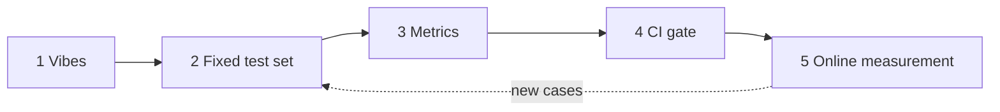

import TOCInline from '@theme/TOCInline';

# The Evaluation Mindset

<TOCInline toc={toc} minHeadingLevel={2} maxHeadingLevel={2} />

:::tip[In this guide]
Evaluation is a habit before it is a tool. This page is about the thinking:
what an eval has to prove, why leaderboards tell you almost nothing about your
task, how to choose a north-star metric you will defend in a review, and how to
keep the whole thing cheap enough that you actually run it.
:::

## What Is It?

**Evaluation** is the practice of measuring the quality of an AI system against
a fixed set of cases, so that a change can be judged as better, worse, or
neutral — with evidence.

That is deliberately broader than "metrics". An evaluation discipline has four
parts, and most teams only build the second one:

| Part | What it is | What happens without it |
| --- | --- | --- |
| Dataset | Fixed, versioned cases that represent your traffic | You measure whatever you happened to type today |
| Scorers | Functions that turn an output into a number or verdict | You argue about screenshots |
| Process | When evals run, who reads them, what blocks a merge | Results exist and nobody acts on them |
| Thresholds | Agreed definition of good enough | Every launch becomes a negotiation |

## Why Does It Matter?

"It looked good in the playground" is the single most expensive habit in AI
engineering. It is expensive because of what it hides, not because playground
testing is useless.

When you test by hand, you type the queries you already know work. You see one
sample from a distribution. You read the output charitably because you wrote the
prompt. You have no record, so next week you cannot tell whether the change you
made improved anything. And you only ever look at the happy path — never the
empty input, the 4,000-word paste, the question in Portuguese, the prompt
injection, or the question your product is not supposed to answer.

The real cost shows up as a specific failure pattern:

- You fix one reported bug by editing the prompt, and silently break three cases nobody tested.
- You upgrade a model because benchmarks improved, and your extraction accuracy drops because the new model formats numbers differently.
- A regression ships, a customer finds it, and you cannot reproduce it because you do not know which prompt version was live.

Each of these is cheap to catch with a 60-case suite and expensive to catch in
production.

:::warning[Non-determinism makes manual testing worse than it looks]
At temperature above zero, the same prompt gives different answers. One good
manual run is weak evidence. One bad manual run is also weak evidence. Without
repeated runs on a fixed set, you cannot separate a real change from sampling
noise — which is how teams end up shipping prompt changes that do nothing.
:::

## The Maturity Ladder

Teams climb this ladder in order. Skipping steps does not work, because each
rung's output is the next rung's input.



| Rung | What you do | What it buys you | What it still cannot tell you |
| --- | --- | --- | --- |
| 1 · Vibes | Try things in a playground | Fast exploration, early intuition | Anything repeatable |
| 2 · Fixed test set | 30–80 saved cases you rerun by hand | Regressions become visible; comparisons become fair | Whether the whole set improved or just the case you stared at |
| 3 · Metrics | Scorers producing per-slice numbers | A defensible before/after, and which slice broke | Whether a bad change can still reach `main` |
| 4 · CI gate | Suite runs on PRs, blocks on thresholds | Quality becomes a build property, not a person's diligence | What real users experience |
| 5 · Online measurement | Guardrail metrics and feedback on live traffic | Ground truth about users, and fresh failure cases | Why a specific case failed, unless you traced it |

Rung 2 is the one worth rushing to. Going from vibes to a saved set of cases is
an afternoon of work and removes most of the pain. Going from rung 4 to 5 is
where you find out your dataset was wrong about what users ask.

## Offline vs Online Evaluation

These answer different questions, and neither substitutes for the other.

| | Offline evaluation | Online evaluation |
| --- | --- | --- |
| Runs on | A fixed dataset | Real production traffic |
| Question answered | Would this change be better on cases I chose? | Is the live system working for real users? |
| Ground truth | Labels you wrote | Implicit and explicit user signals |
| Speed of feedback | Minutes | Hours to weeks |
| Can block a deploy | Yes | Only via canary and rollback |
| Main weakness | Your dataset is a guess about reality | Noisy, confounded, and you cannot rerun history |

Offline evals tell you about your dataset. That is a real, useful thing — it is
how you compare two prompts fairly — but it is a proxy. Only production tells
you about your users, and production cannot tell you whether a change you have
not shipped is safe. You need both, with the loop closed: production failures
become offline cases.

## The Three Questions Any Eval Must Answer

If an eval report does not answer all three of these, it is not finished.

1. **Did quality improve?** On the primary metric, on the slices you care about, by more than run-to-run noise.
2. **Did anything regress?** Per-case and per-slice diffs against the baseline. An average that moves up while your Spanish slice collapses is a failure disguised as a win.
3. **What did it cost?** Latency at p95, tokens, money per request. A 2-point quality gain for 3x the latency is a product decision, not a technical one — and someone has to be able to make it.

:::note[Highlight: regressions matter more than gains]
Users notice something that used to work and stopped far more than they notice
something getting slightly better. Weight your reporting accordingly: list
newly failing cases first, named, before any aggregate number.
:::

## Why Benchmarks Do Not Predict Your Performance

Public leaderboards are useful for narrowing a shortlist of models and useless
for deciding which one is better at your task. Three reasons:

| Problem | What it means | Why it burns you |
| --- | --- | --- |
| Contamination | Benchmark data has leaked into training sets | The score measures memorisation, not capability |
| Distribution mismatch | Benchmarks use clean, well-formed, English, academic prompts | Your inputs are typo-ridden fragments against messy internal documents |
| Aggregate masking | One headline number averages dozens of subtasks | Model A wins overall and loses badly on structured extraction, which is all you do |
| Prompt sensitivity | Benchmarks use tuned harness prompts | Your prompt, your output format, and your tool schema change the ranking |
| Metric mismatch | Multiple-choice accuracy, exact match | Your task is open-ended generation with format and grounding constraints |

The practical rule: use leaderboards to pick three candidates, then run your own
60-case suite to pick one. The suite takes an afternoon and will frequently
disagree with the leaderboard order.

## North-Star Metric and Guardrails

You need one metric that defines success and a small set that defines "did not
break anything". Optimising a single number alone is how you get a system that
is technically excellent and practically unusable.

| Role | Count | Behaviour | Example for a support-answer feature |
| --- | --- | --- | --- |
| North-star | Exactly 1 | Maximise | Percentage of answers rated correct and grounded by a calibrated judge |
| Guardrails | 3–6 | Must not get worse than a bound | p95 latency under 4s, cost under $0.02/request, refusal rate under 8%, format validity 100%, zero PII leaks |

Guardrails are thresholds, not targets. You do not try to make latency as low as
possible; you require it to stay under a line. That framing stops the team from
trading away something important to move the headline number.

```python
from pydantic import BaseModel, Field


class Guardrail(BaseModel):
    """A bound that must hold for a run to be shippable."""

    name: str
    value: float
    bound: float
    direction: str = Field(pattern="^(max|min)$")

    @property
    def ok(self) -> bool:
        return self.value <= self.bound if self.direction == "max" else self.value >= self.bound


class RunVerdict(BaseModel):
    north_star: float
    baseline: float
    guardrails: list[Guardrail]

    @property
    def shippable(self) -> bool:
        return self.north_star >= self.baseline and all(g.ok for g in self.guardrails)

    def report(self) -> str:
        lines = [f"north_star {self.north_star:.3f} vs baseline {self.baseline:.3f}"]
        lines += [
            f"{'ok  ' if g.ok else 'FAIL'} {g.name}: {g.value:.3f} ({g.direction} {g.bound})"
            for g in self.guardrails
        ]
        return "\n".join(lines)
```

## Evaluation Is a Product Decision

"Good enough to ship" is not a technical fact. It depends on what a mistake
costs and who absorbs it.

| Feature | Cost of a wrong answer | Reasonable bar |
| --- | --- | --- |
| Draft suggestion a human edits | Low — the human fixes it | 80% useful, fast, cheap |
| Internal search summary | Medium — wasted time, mild distrust | 90% grounded, cited so users can verify |
| Customer-facing policy answer | High — wrong advice, support ticket, possible liability | 98% grounded, refuses when uncertain, audited sample |
| Automated action with no human in the loop | Very high — irreversible side effects | Deterministic validation, confirmation step, full trace |

Agree the thresholds **before** you measure. Once you have a number in hand,
every threshold discussion becomes a negotiation about that number, and the bar
mysteriously lands just under where you landed. Writing "ship if grounded-rate
is at or above 0.95 and p95 under 4s" into the ticket before the first run is a
small act of discipline that saves an argument.

:::caution[What evaluation cannot tell you]
An eval suite scores what you thought to measure, on cases you thought to write.
It will not tell you that users wanted a different feature, that your tone is
condescending, that the thing is slow enough to feel broken, or that your
retrieval corpus is missing a whole document category. A green suite means "no
known regression", not "good product".
:::

## The Cost of Evaluation Itself

An eval suite is software with a bill attached. Every case is at least one model
call, judged cases are two or more, and a suite that costs $40 and takes 25
minutes will be quietly disabled within a month.

Rough arithmetic for a suite you run on every pull request:

```text
200 cases x 1 generation call (1.5k tokens)  = 300k tokens
160 judged cases x 1 judge call (1k tokens)  = 160k tokens
--------------------------------------------------------
per run: ~460k tokens, maybe $0.50-$4 depending on models
15 PRs/day, 3 runs each  ->  45 runs/day  ->  $20-$180/day
```

Levers, in the order you should reach for them:

| Lever | Effect | Trade-off |
| --- | --- | --- |
| Cache model responses keyed by prompt and config hash | Reruns become free and instant | Must invalidate on prompt, model, or dataset change |
| Tier the suite: fast smoke on PR, full nightly | 10x cost cut on the hot path | A regression can merge and be caught hours later |
| Prefer deterministic scorers | Nearly free, perfectly stable | Only works where a mechanical check exists |
| Use a cheaper judge for narrow criteria | 5–20x cheaper per judged case | Needs re-calibration against human labels |
| Run cases concurrently with bounded concurrency | Wall-clock drops hard | Rate limits; keep the bound configurable |
| Sample the expensive tier | Linear cost cut | Wider confidence intervals |

The target to aim for: the PR tier finishes in under five minutes and costs less
than a coffee. Anything slower gets skipped under deadline pressure, which is
exactly when you need it.

## Maturity Self-Assessment

Score yourself honestly. Most teams shipping LLM features in production sit at
rung 2 or 3 and believe they are at 4.

| Question | No | Partly | Yes |
| --- | --- | --- | --- |
| Is there a committed, versioned eval dataset in the repo? | 0 | 1 | 2 |
| Does it have at least 50 cases covering your real slices? | 0 | 1 | 2 |
| Is there a held-out slice you do not iterate against? | 0 | 1 | 2 |
| Are the primary scorers deterministic where that is possible? | 0 | 1 | 2 |
| If you use a judge, do you know its agreement rate with humans? | 0 | 1 | 2 |
| Does a pull request automatically produce an eval report? | 0 | 1 | 2 |
| Can a bad score block a merge? | 0 | 1 | 2 |
| Are prompt version, model version, and dataset version recorded with every score? | 0 | 1 | 2 |
| Do you track latency and cost per request alongside quality? | 0 | 1 | 2 |
| Do you capture traces with inputs and outputs for production requests? | 0 | 1 | 2 |
| Do you have guardrail scorers running on a sample of live traffic? | 0 | 1 | 2 |
| Did a production failure become a new eval case in the last month? | 0 | 1 | 2 |

Reading the total: 0–8 means you are tuning by vibes and should go write 50
cases today. 9–15 means you have measurement but no enforcement — wire up CI
next. 16–20 means your offline story is solid and online is the gap. 21–24 means
the loop is closed; your remaining work is keeping the dataset honest as the
product changes.

## Common Mistakes

- Treating evaluation as a phase before launch instead of a permanent loop.
- Picking the metric after seeing the results, so every change looks like a win.
- One blended score with no per-slice breakdown, hiding a broken segment behind a good average.
- Iterating against your only test set until the score means nothing outside it.
- Comparing two runs that used different prompt versions, models, or dataset revisions.
- Trusting a leaderboard ranking for a task the leaderboard never measured.
- Measuring quality without cost and latency, then being surprised at the invoice.
- Building an eval suite so slow and expensive the team turns it off.
- Declaring success on a 5-case difference that is well inside sampling noise.

## Interview Questions

- Why is "it looked good in the playground" not evidence? Name three specific failure modes it misses.
- Walk me through how you would take a feature from zero evaluation to a CI gate.
- What is the difference between offline and online evaluation, and what does each fail to tell you?
- A new model scores higher on public benchmarks. What do you do before adopting it?
- What is the difference between a north-star metric and a guardrail metric, and why separate them?
- Your average score improved by 3 points after a prompt change. What would you check before shipping?
- How would you keep an eval suite fast and cheap enough to run on every pull request?
- What can an eval suite never tell you about your feature?

## Things to Remember

- The dataset and the process are the hard parts. Metrics are the easy part.
- Climb the ladder in order: vibes, fixed set, metrics, CI gate, online. Rung 2 is an afternoon and removes most of the pain.
- Every eval must answer three questions: better, regressed, at what cost.
- Benchmarks shortlist models. Your own suite picks one.
- One north-star, a handful of guardrails, thresholds agreed before you measure.
- A green suite means "no known regression", not "good product".

## Mini Exercise

Take an LLM feature you have built or used. Write down, in one page:

1. Its north-star metric, stated precisely enough that two people would compute it the same way.
2. Four guardrail metrics with numeric bounds.
3. Five inputs you have never tested — include one empty input, one very long one, one in another language, and one out-of-scope question.
4. The ship threshold you would commit to before running anything.

Then run those five inputs and see how many you would have been comfortable
shipping. Fill in the self-assessment table and note your lowest-scoring row —
that is your next piece of work.

## Done When

- [ ] You can explain each rung of the maturity ladder and what it buys you.
- [ ] You can state why public benchmark rankings do not transfer to your task.
- [ ] You have written a north-star metric and guardrails for one real feature, with thresholds set before measuring.
- [ ] You can name three things an eval suite cannot tell you.
- [ ] You have a rough token and money budget for running your suite on every pull request.
