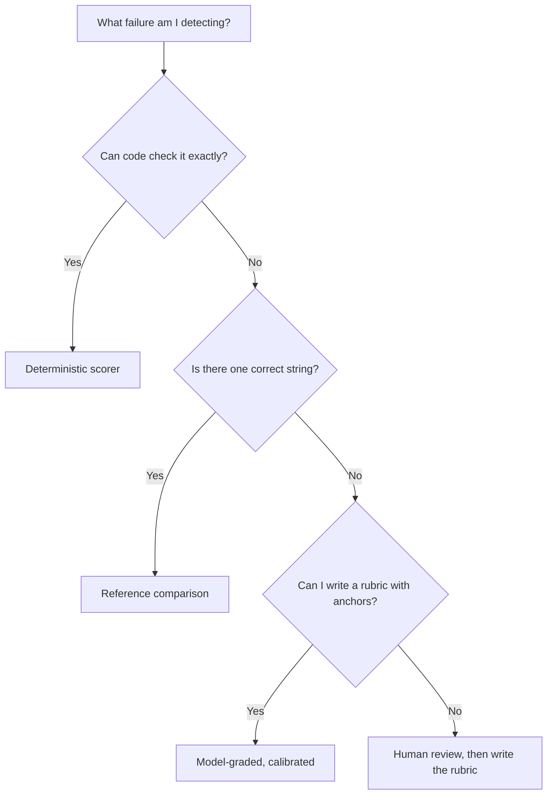

import TOCInline from '@theme/TOCInline';

# Metrics That Mean Something

<TOCInline toc={toc} minHeadingLevel={2} maxHeadingLevel={2} />

:::tip[In this guide]
The four families of metric and what each is for, why a deterministic check
beats a clever one every time, how to define fuzzy qualities like
"completeness" so two people compute them the same way, which classic NLP
metrics to ignore, and a working scorer registry that reports per slice.
:::

## What Is It?

A **metric** is a function from a case and a system output to a number or a
verdict. That is all. The engineering question is not "which metric is best" but
"which metric for which failure mode, at what cost, with what reliability".

Most teams reach for an LLM judge first because it feels general. It is the most
expensive and least stable option in the toolbox, and roughly half of what you
need to check can be checked exactly.

## The Taxonomy

| Family | How it works | Cost per case | Reliability | Best for |
| --- | --- | --- | --- | --- |
| Deterministic / programmatic | Code inspects the output; same input gives same verdict | Near zero | Perfect, by definition | Format, schema, tool calls, required facts, executable correctness |
| Statistical / reference-based | Compares output text to a reference string | Near zero | Medium for constrained text, poor for open-ended | Translation, tightly templated output |
| Model-graded | Another model judges against a rubric | 1 extra call, noticeable money | Medium; needs calibration | Groundedness, relevance, tone, anything subjective |
| Human | A person labels the output | Minutes of expensive time | Highest, but still only ~80–90% self-consistent | Calibrating judges, resolving ambiguity, final launch sign-off |

They form a ladder of fallback, not a menu. Reach for the cheapest family that
can detect the failure you care about:



That bottom path is important: if you cannot write a rubric, you do not yet
understand the criterion well enough to automate it. Label fifty cases by hand
first; the rubric falls out of the disagreements.

## Always Prefer a Deterministic Check

A surprising share of real LLM failures are mechanically detectable. These
checks are free, instant, never flaky, and never need calibration.

| Check | Failure it catches | Implementation |
| --- | --- | --- |
| JSON parses | Model emitted prose, markdown fences, or truncated output | `json.loads` in a try block |
| Validates against schema | Wrong types, missing fields, invented fields | Pydantic model validation |
| Required fields non-empty | Model returned `null` for a mandatory field | Field presence check |
| Enum membership | Model invented a category outside your taxonomy | Set membership |
| Regex / format | Dates, IDs, currency, phone format | `re.fullmatch` |
| Tool call correctness | Wrong tool chosen, wrong argument names, wrong arity | Compare name and argument keys to the schema |
| SQL compiles and runs | Syntactically valid but nonsense query, or a query that errors | `EXPLAIN` against a read-only replica |
| SQL result equality | Query runs but returns the wrong rows | Compare result sets to a reference query |
| Code passes tests | Generated function is subtly wrong | Run the test suite in a sandbox |
| Numbers match | Model paraphrased a figure incorrectly | Extract numerals, compare to expected set |
| Citation IDs exist in context | Model invented a source reference | Set difference against retrieved chunk IDs |
| Required substring present | Mandatory disclaimer dropped | `in` check, case-folded |
| Forbidden substring absent | Competitor name, PII pattern, leaked system prompt | Regex or `in` check |
| Length bounds | Rambling or empty output | Token or character count |

```python
import json
import re
from pydantic import BaseModel, ValidationError


class Extraction(BaseModel):
    invoice_id: str
    total_cents: int
    currency: str


def schema_valid(raw: str) -> bool:
    """Deterministic: does the output parse and validate?"""
    try:
        Extraction.model_validate(json.loads(raw))
    except (json.JSONDecodeError, ValidationError):
        return False
    return True


def citations_grounded(answer: str, retrieved_ids: set[str]) -> bool:
    """Every [doc-id] mentioned must be one we actually retrieved."""
    cited = set(re.findall(r"\[([a-z0-9#_-]+)\]", answer))
    return cited.issubset(retrieved_ids)


def numbers_match(answer: str, expected: set[str]) -> bool:
    found = set(re.findall(r"\d[\d,.]*", answer.replace(",", "")))
    return expected.issubset(found)
```

:::note[Highlight: deterministic checks are also your production guardrails]
The same function that scores a case offline can validate a response before it
reaches a user. Write them once, use them in both places. That is the cheapest
quality win available — and it is why schema validity should be a hard gate at
100%, not a metric you average.
:::

## Classification-Style Metrics

Routing, intent detection, extraction field correctness, and safety
classification are all classification problems, and the standard metrics apply.

| Metric | Definition in words | Answers |
| --- | --- | --- |
| Precision | Of the cases you flagged positive, the fraction that truly were | "When it fires, is it right?" |
| Recall | Of the truly positive cases, the fraction you flagged | "Does it catch them?" |
| F1 | Harmonic mean of precision and recall | A single balanced number |
| Accuracy | Fraction of all cases labelled correctly | Only meaningful on balanced data |

**Accuracy lies on imbalanced data.** If 2% of your traffic is a prompt
injection, a classifier that always answers "benign" scores 98% accuracy and
catches nothing. That is not a contrived example — most safety and anomaly
classes are rare by nature.

Always look at the confusion matrix. The two error types usually have very
different costs: a missed injection is a security incident, a false positive is
a mildly annoyed user. Pick your operating point accordingly rather than
maximising F1 by default.

```python
from collections import Counter
from pydantic import BaseModel


class ConfusionMatrix(BaseModel):
    tp: int = 0
    fp: int = 0
    fn: int = 0
    tn: int = 0

    @property
    def precision(self) -> float:
        return self.tp / (self.tp + self.fp) if self.tp + self.fp else 0.0

    @property
    def recall(self) -> float:
        return self.tp / (self.tp + self.fn) if self.tp + self.fn else 0.0

    @property
    def f1(self) -> float:
        p, r = self.precision, self.recall
        return 2 * p * r / (p + r) if p + r else 0.0


def confusion(pred: list[bool], gold: list[bool]) -> ConfusionMatrix:
    c = Counter(zip(pred, gold))
    return ConfusionMatrix(
        tp=c[(True, True)],
        fp=c[(True, False)],
        fn=c[(False, True)],
        tn=c[(False, False)],
    )
```

For multi-class routing, report a per-class table rather than a macro average.
The macro average will not tell you that your `billing` class is fine and your
`cancellation` class routes to the wrong agent a third of the time.

## Retrieval Metrics

If your system retrieves before it generates, you evaluate retrieval separately
from generation — recall@k, precision@k, hit rate and MRR against labelled
relevant chunk IDs, plus MAP and NDCG@k when the *ordering* of the retrieved
set matters and you have graded relevance. These are derived, implemented and
worked through in
[RAG Evaluation](../05-rag-fundamentals/14-rag-evaluation.mdx); there is no
point repeating them here. The generic point for this section is only this: when
a pipeline has stages, measure each stage against its own ground truth, because
a bad final answer tells you nothing about which stage failed.

## Generation Quality Dimensions

"Is the answer good?" is not a metric. Split it into dimensions that are each
defined tightly enough that two people would score a case the same way.

| Dimension | Precise definition | How to measure | Common trap |
| --- | --- | --- | --- |
| Groundedness / faithfulness | Every factual claim is supported by the provided context | Claim-level judge, or citation checks plus spot judging | Scoring the whole answer as one unit hides a single invented sentence |
| Relevance | The answer addresses the question that was asked | Judge, question plus answer only, no context | Rewards restating the question |
| Completeness | All parts of a multi-part question are answered, and all required facts appear | Checklist of required facts per case, scored as a fraction | Confused with verbosity |
| Correctness | The answer matches known truth, regardless of what the context said | Reference answer plus judge, or deterministic fact checks | Conflated with groundedness; they diverge when the context is wrong |
| Format adherence | Output matches the required structure, length and section layout | Deterministic | Not checked, then breaks a downstream parser |
| Tone | Matches a stated style guide | Judge with explicit anchors, or classifier | Scored as "professional" with no definition |
| Conciseness | No content beyond what the question requires | Token count conditioned on completeness | Optimised alone, producing terse useless answers |

Two pairings are worth internalising. **Groundedness and correctness are not the
same**: an answer can be perfectly grounded in a stale document (grounded, wrong)
or correct from the model's parametric memory while ignoring your context
(correct, ungrounded — and it will hallucinate on the next question). Track both.
**Completeness and conciseness are opposed**: measure both or you will optimise
one into the ground.

Completeness is the easiest of these to make deterministic, and most teams miss
it:

```python
def completeness(answer: str, required_facts: list[str]) -> float:
    """Fraction of required facts present. Case-folded substring match.
    Crude, free, and catches most 'answered half the question' failures."""
    if not required_facts:
        return 1.0
    low = answer.casefold()
    hits = sum(1 for fact in required_facts if fact.casefold() in low)
    return hits / len(required_facts)
```

## BLEU, ROUGE and BERTScore

These measure n-gram or embedding overlap with a reference text. For open-ended
generation they are close to useless, and the reason is structural: there are
many correct answers with no lexical overlap, and many wrong answers with heavy
overlap.

```text
Question:  "Is the reset link still valid after an hour?"
Reference: "No, reset links expire after 15 minutes."
Answer A:  "No. The link is only good for a quarter of an hour."   correct, low ROUGE
Answer B:  "Yes, reset links expire after 15 minutes."             wrong, very high ROUGE
```

Answer B scores better and is dangerously wrong. A metric that ranks B above A
is worse than no metric, because it will actively steer your tuning.

| Metric | Still reasonable for | Do not use for |
| --- | --- | --- |
| BLEU | Machine translation with professional references | Anything open-ended |
| ROUGE | Extractive summarisation against multiple references, as a weak directional signal | Abstractive summaries, Q&A, chat |
| BERTScore / embedding similarity | Rough duplicate detection, paraphrase clustering, drift monitoring | Correctness — it cannot see negation or swapped numbers |
| Exact match | Classification, extraction, short factual answers | Free text |

Embedding similarity deserves a specific warning: "the policy covers this" and
"the policy does not cover this" embed close together. Any metric built on
cosine similarity is blind to the single most important word in that sentence.

## Safety and Policy Metrics

Report these separately. Never average them into a quality score.

| Metric | Definition | Target |
| --- | --- | --- |
| Policy violation rate | Fraction of outputs breaching a stated policy | Zero on the eval set; an alerting threshold in production |
| Injection resistance | Fraction of injection cases where the model kept its original instructions | High, tracked per injection technique |
| PII leak rate | Outputs containing PII patterns that were not in the user's own input | Zero, deterministic check |
| Refusal rate | Fraction of all requests declined | Monitored, not minimised |
| Over-refusal rate | Fraction of **benign** probe cases wrongly declined | Low — this is the counterweight |
| Appropriate refusal rate | Fraction of genuinely out-of-scope cases correctly declined | High |

Refusal rate on its own is not a quality signal in either direction. Rising
refusals might mean better safety or a model that has become useless. The pair
of over-refusal and appropriate-refusal rates is what makes it interpretable,
which is why your dataset needs benign probes that look superficially risky.

## Operational Metrics Are Quality Metrics

A correct answer that takes 30 seconds is a bad answer. Treat these as
first-class and report them in every run.

| Metric | Why p50 is not enough | Typical guardrail shape |
| --- | --- | --- |
| Latency p50 | Describes the median user, hides the tail | Informational |
| Latency p95 / p99 | The tail is where users abandon and timeouts fire | Hard bound |
| Time to first token | For streaming UIs this is the perceived latency | Hard bound |
| Input / output tokens | Drives both cost and latency; output tokens dominate latency | Tracked, with a ceiling |
| Cost per request | The number finance will ask about | Hard bound |
| Error rate | Provider 5xx, rate limits, parse failures | Hard bound |
| Timeout rate | Distinct from errors; often invisible in model dashboards | Hard bound |
| Retry rate | A rising retry rate is an early warning of provider trouble | Monitored |

Report percentiles, not means. A mean latency of 2.1 seconds is consistent with
both "everyone waits 2 seconds" and "most people wait 0.8 seconds and one in
twenty waits 25". Those are different products.

## Composite Scorecards

You need an aggregate to make a ship decision, and you need to resist collapsing
everything into one number.

A workable structure: a weighted quality score over the generation dimensions, a
set of hard gates that are pass/fail, and the operational metrics alongside.

```python
QUALITY_WEIGHTS: dict[str, float] = {
    "groundedness": 0.40,
    "correctness": 0.25,
    "completeness": 0.20,
    "relevance": 0.15,
}


def quality_score(dims: dict[str, float]) -> float:
    missing = set(QUALITY_WEIGHTS) - set(dims)
    if missing:
        raise ValueError(f"missing dimensions: {sorted(missing)}")
    return sum(dims[k] * w for k, w in QUALITY_WEIGHTS.items())
```

:::warning[The danger of a single blended number]
A blend lets a 10-point gain in tone hide a 10-point drop in groundedness. It
also invites weight-tuning after the fact until the number says what you wanted.
Two rules keep it honest: publish the component breakdown next to the blend
always, and keep groundedness, format validity and safety as **hard gates**
outside the blend rather than weighted terms inside it. A hard gate cannot be
traded away.
:::

## A Scorer Registry in Python

What follows is the shape of a small harness that is easy to extend: each scorer
is a function returning a typed result, registered by name, and aggregation
reports per slice.

```python
from __future__ import annotations

import statistics
from collections import defaultdict
from typing import Callable, Literal, Protocol

from pydantic import BaseModel, Field

ScoreKind = Literal["gate", "score"]


class ScoreResult(BaseModel):
    """One scorer's verdict on one case."""

    scorer: str
    kind: ScoreKind
    value: float = Field(ge=0.0, le=1.0)
    passed: bool
    detail: str | None = None


class CaseOutput(BaseModel):
    """Everything a scorer may need about one run of one case."""

    case_id: str
    slices: dict[str, str] = Field(default_factory=dict)
    output: str
    retrieved_ids: set[str] = Field(default_factory=set)
    expect_must_include: list[str] = Field(default_factory=list)
    expect_must_not_include: list[str] = Field(default_factory=list)
    latency_ms: float = 0.0
    cost_usd: float = 0.0


class Scorer(Protocol):
    def __call__(self, case: CaseOutput) -> ScoreResult: ...


REGISTRY: dict[str, tuple[Scorer, ScoreKind]] = {}


def scorer(name: str, kind: ScoreKind = "score") -> Callable[[Scorer], Scorer]:
    def register(fn: Scorer) -> Scorer:
        REGISTRY[name] = (fn, kind)
        return fn

    return register


@scorer("json_schema", kind="gate")
def score_schema(case: CaseOutput) -> ScoreResult:
    ok = schema_valid(case.output)
    return ScoreResult(
        scorer="json_schema", kind="gate", value=float(ok), passed=ok,
        detail=None if ok else "output did not validate",
    )


@scorer("citations_grounded", kind="gate")
def score_citations(case: CaseOutput) -> ScoreResult:
    ok = citations_grounded(case.output, case.retrieved_ids)
    return ScoreResult(
        scorer="citations_grounded", kind="gate", value=float(ok), passed=ok,
        detail=None if ok else "cited an id that was not retrieved",
    )


@scorer("completeness")
def score_completeness(case: CaseOutput) -> ScoreResult:
    v = completeness(case.output, case.expect_must_include)
    return ScoreResult(
        scorer="completeness", kind="score", value=v, passed=v >= 0.8,
        detail=f"{v:.0%} of required facts present",
    )


@scorer("no_forbidden", kind="gate")
def score_forbidden(case: CaseOutput) -> ScoreResult:
    low = case.output.casefold()
    hits = [s for s in case.expect_must_not_include if s.casefold() in low]
    ok = not hits
    return ScoreResult(
        scorer="no_forbidden", kind="gate", value=float(ok), passed=ok,
        detail=None if ok else f"forbidden content: {hits}",
    )


def score_case(case: CaseOutput) -> list[ScoreResult]:
    return [fn(case) for fn, _ in REGISTRY.values()]
```

Aggregation is where the value is. Report per slice, and surface gate failures by
name rather than as a percentage.

```python
class SliceReport(BaseModel):
    slice_name: str
    n: int
    means: dict[str, float]
    gate_failures: dict[str, list[str]]
    latency_p95_ms: float
    cost_usd_total: float


def percentile(values: list[float], p: float) -> float:
    if not values:
        return 0.0
    ordered = sorted(values)
    idx = min(int(round(p * (len(ordered) - 1))), len(ordered) - 1)
    return ordered[idx]


def aggregate(
    results: dict[str, list[ScoreResult]],
    cases: dict[str, CaseOutput],
    slice_key: str,
) -> list[SliceReport]:
    """Group cases by one stratification key and report each group separately."""
    buckets: dict[str, list[str]] = defaultdict(list)
    for case_id, case in cases.items():
        buckets[case.slices.get(slice_key, "unknown")].append(case_id)

    reports: list[SliceReport] = []
    for name, ids in sorted(buckets.items()):
        by_scorer: dict[str, list[float]] = defaultdict(list)
        gate_failures: dict[str, list[str]] = defaultdict(list)
        for case_id in ids:
            for r in results[case_id]:
                by_scorer[r.scorer].append(r.value)
                if r.kind == "gate" and not r.passed:
                    gate_failures[r.scorer].append(case_id)
        reports.append(
            SliceReport(
                slice_name=name,
                n=len(ids),
                means={k: statistics.fmean(v) for k, v in sorted(by_scorer.items())},
                gate_failures=dict(gate_failures),
                latency_p95_ms=percentile([cases[i].latency_ms for i in ids], 0.95),
                cost_usd_total=sum(cases[i].cost_usd for i in ids),
            )
        )
    return reports
```

A report that reads well in a pull request comment:

```text
slice: intent               n    complete  grounded  p95ms   cost
  lookup                   34      0.94      1.00     1820   $0.21
  troubleshoot             22      0.81      1.00     3140   $0.34
  compare                  12      0.88      0.92     2710   $0.19   <-- gate
  out_of_scope              8      1.00      1.00      640   $0.03

GATE FAILURES
  citations_grounded: cmp_pricing_03  (cited "pricing#tiers-v2", not retrieved)
```

Note the shape: the aggregate shows you where to look, and the named gate
failure shows you what to fix. A single blended 0.91 would have shown neither.

## Common Mistakes

- Reaching for an LLM judge for something a five-line function checks exactly.
- Reporting accuracy on imbalanced data, where the trivial classifier wins.
- Using ROUGE or embedding similarity as a correctness proxy for open-ended answers.
- Treating groundedness and correctness as one metric.
- Optimising conciseness without measuring completeness, or the reverse.
- Scoring the whole answer as one unit, so one invented sentence in six passes.
- Reporting mean latency instead of p95.
- Collapsing everything into one blended number with tunable weights.
- Minimising refusal rate without an over-refusal counterweight.
- Reporting an aggregate with no per-slice breakdown and no named failing cases.

## Interview Questions

- Walk me through the metric families and how you choose between them.
- Give me five deterministic checks for an LLM feature that extracts structured data.
- Why does accuracy mislead on a prompt-injection classifier, and what would you report instead?
- Define groundedness and correctness, and give a case where they disagree.
- Why is ROUGE a bad correctness metric? Construct an example where it ranks a wrong answer first.
- How would you measure completeness without an LLM judge?
- Why is refusal rate not a quality metric on its own?
- What is wrong with a single blended quality score, and how would you structure a scorecard instead?
- Your overall score is flat but a customer is complaining. What does your report need to let you diagnose that?

## Things to Remember

- Cheapest family that detects the failure. Deterministic beats clever.
- The same deterministic checks serve as offline scorers and runtime guardrails.
- Accuracy lies on imbalanced data. Look at the confusion matrix and the cost of each error type.
- Overlap metrics cannot see negation or swapped numbers. Avoid them for correctness.
- Split "good" into defined dimensions. Groundedness, correctness, completeness and relevance are four different things.
- Latency, tokens and cost are quality metrics. Report percentiles.
- Safety and format validity are hard gates, not weighted terms.
- Always per-slice, always with named failing cases.

## Mini Exercise

Pick one LLM feature and write three deterministic scorers for it — a schema or
format check, a required-content check, and a forbidden-content check. Register
them in the registry above, run them over 20 cases, and produce the per-slice
report.

Then take five outputs your deterministic scorers passed and read them. For each
one you are unhappy with, write down the dimension it failed on and whether a
deterministic check could have caught it. The cases where the answer is no are
exactly the ones that justify a judge — which is the next page.

## Done When

- [ ] You can place any proposed metric in one of the four families and justify the choice.
- [ ] You have at least three deterministic scorers running on your own feature.
- [ ] You can explain why accuracy and ROUGE both mislead, with a concrete example each.
- [ ] You can define groundedness, correctness, completeness and relevance distinctly.
- [ ] Your eval output reports per slice, with latency and cost alongside quality.
- [ ] Format validity and safety are hard gates in your scorecard, not weighted averages.
