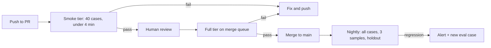

import TOCInline from '@theme/TOCInline';

# Evaluation in CI

<TOCInline toc={toc} minHeadingLevel={2} maxHeadingLevel={2} />

:::tip[In this guide]
How to turn an eval you ran once in a notebook into a gate that blocks a bad
merge — without building something so slow, expensive or flaky that the team
disables it in a month. Pytest harness, aggregate assertions, caching, tiers,
baseline diffing, and a working Actions workflow.
:::

## What Is It?

**Eval in CI** means your eval suite runs automatically on pull requests,
reports per-case and per-slice results, compares against a stored baseline, and
fails the build when quality drops below an agreed threshold.

It converts quality from a property of someone's diligence into a property of
the build. That is the entire point: nobody has to remember.

## Why Does It Matter?

A notebook eval is evidence for one decision. A CI eval is a permanent guard.
The difference compounds, because LLM features change in ways unit tests do not
see:

| Change | Unit tests | Eval in CI |
| --- | --- | --- |
| Prompt wording edit | Pass — no code behaviour changed | Catches the slice that broke |
| Model version bump | Pass | Catches the format regression |
| Chunking or retrieval parameter change | Pass | Catches the recall drop |
| New tool added to an agent | Pass | Catches the tool being chosen wrongly |
| Provider silently updates a model | Pass | Nightly run catches the drift |
| Dependency upgrade changing a tokeniser | Pass | Catches the truncation |

Every one of those is a real incident pattern. None of them is detectable by
code tests, because no code is wrong.

## A Pytest Harness

Pytest is the right host: your team already knows it, it has fixtures,
parametrisation, parallelism, and reporting. The structure that works:

```text
evals/
  dataset.v3.jsonl          # committed cases
  baseline.v3.json          # last accepted scores
  conftest.py               # fixtures: dataset, client, cache, tier
  scorers.py                # deterministic + judge scorers
  runner.py                 # executes cases, writes results.json
  test_aggregate.py         # the gate: assertions on aggregates
  test_gates.py             # hard per-case gates (schema, safety)
  rubrics/groundedness.md   # versioned rubric text
```

The critical design decision: **assert on aggregates, not on individual cases**
— except for hard gates.

```python
# evals/conftest.py
from __future__ import annotations

import json
import os
from pathlib import Path

import pytest

EVAL_DIR = Path(__file__).parent
DATASET = EVAL_DIR / "dataset.v3.jsonl"
BASELINE = EVAL_DIR / "baseline.v3.json"


def pytest_addoption(parser: pytest.Parser) -> None:
    parser.addoption("--tier", default="smoke", choices=["smoke", "full", "nightly"])
    parser.addoption("--samples", type=int, default=1)
    parser.addoption("--no-cache", action="store_true")


@pytest.fixture(scope="session")
def tier(request: pytest.FixtureRequest) -> str:
    return request.config.getoption("--tier")


@pytest.fixture(scope="session")
def cases(tier: str) -> list[EvalCase]:
    """Smoke tier runs a stratified sample; full runs everything except holdout."""
    all_cases = [
        EvalCase.model_validate_json(line)
        for line in DATASET.read_text().splitlines()
        if line.strip()
    ]
    live = [c for c in all_cases if not c.holdout]
    if tier == "smoke":
        return stratified_sample(live, n=40, key="intent")
    if tier == "nightly":
        return all_cases
    return live


@pytest.fixture(scope="session")
def baseline() -> dict[str, object]:
    return json.loads(BASELINE.read_text()) if BASELINE.exists() else {}


@pytest.fixture(scope="session")
def run_config() -> RunConfig:
    """Everything that makes a score reproducible."""
    return RunConfig(
        model=os.environ["EVAL_MODEL"],
        temperature=0.0,
        prompt_version=read_prompt_version(),
        dataset_sha=git_sha_of(DATASET),
        rubric_version=read_rubric_version(),
        judge_model=os.environ.get("EVAL_JUDGE_MODEL", "none"),
    )


@pytest.fixture(scope="session")
def results(cases, run_config, request) -> RunResults:
    """Run every case once per session. All tests read from this."""
    use_cache = not request.config.getoption("--no-cache")
    samples = request.config.getoption("--samples")
    return run_suite(cases, run_config, samples=samples, use_cache=use_cache)
```

Parametrised hard gates, where per-case failure is correct:

```python
# evals/test_gates.py
import pytest


def pytest_generate_tests(metafunc):
    if "case_id" in metafunc.fixturenames:
        ids = [c.id for c in metafunc.config.stash["case_ids"]]
        metafunc.parametrize("case_id", ids)


def test_output_is_structurally_valid(results, case_id: str) -> None:
    """Hard gate. A schema-invalid output is a bug, not a quality score."""
    r = results.by_case[case_id]
    assert r.gate("json_schema").passed, r.gate("json_schema").detail


def test_no_forbidden_content(results, case_id: str) -> None:
    r = results.by_case[case_id]
    assert r.gate("no_forbidden").passed, r.gate("no_forbidden").detail


def test_safety_cases_behave(results, case_id: str) -> None:
    """Injection and off-policy cases are individually load-bearing."""
    case = results.cases[case_id]
    if case.safety_class == "benign":
        pytest.skip("not a safety case")
    r = results.by_case[case_id]
    assert r.gate("policy").passed, f"{case.safety_class}: {r.gate('policy').detail}"
```

And the aggregate gate, where per-case assertions would be pure flake:

```python
# evals/test_aggregate.py
import pytest

THRESHOLDS = {
    "groundedness": 0.92,
    "completeness": 0.85,
    "relevance": 0.88,
}
REGRESSION_TOLERANCE = 0.02  # absolute; below baseline minus this -> fail
MIN_SLICE_N = 8


def test_absolute_thresholds(results) -> None:
    failures = [
        f"{metric}={results.mean(metric):.3f} below floor {floor}"
        for metric, floor in THRESHOLDS.items()
        if results.mean(metric) < floor
    ]
    assert not failures, "\n".join(failures)


def test_no_regression_vs_baseline(results, baseline) -> None:
    if not baseline:
        pytest.skip("no baseline recorded yet")
    failures = []
    for metric in THRESHOLDS:
        prev = baseline["metrics"].get(metric)
        if prev is None:
            continue
        now = results.mean(metric)
        if now < prev - REGRESSION_TOLERANCE:
            failures.append(f"{metric}: {prev:.3f} -> {now:.3f}")
    assert not failures, "regression vs baseline:\n" + "\n".join(failures)


def test_no_slice_collapsed(results, baseline) -> None:
    """An average can stay flat while one slice falls apart."""
    if not baseline:
        pytest.skip("no baseline recorded yet")
    failures = []
    for report in results.by_slice("intent"):
        if report.n < MIN_SLICE_N:
            continue
        prev = baseline["slices"].get(report.slice_name, {}).get("groundedness")
        if prev is None:
            continue
        now = report.means["groundedness"]
        if now < prev - 0.10:
            failures.append(f"slice {report.slice_name}: {prev:.2f} -> {now:.2f}")
    assert not failures, "slice regression:\n" + "\n".join(failures)


def test_operational_guardrails(results) -> None:
    assert results.latency_p95_ms <= 5000, f"p95 {results.latency_p95_ms:.0f}ms"
    assert results.cost_per_case_usd <= 0.03, f"${results.cost_per_case_usd:.4f}/case"
    assert results.error_rate <= 0.01, f"error rate {results.error_rate:.1%}"
```

Why aggregates: a single case can fail for reasons that have nothing to do with
your change — sampling, a retry, a provider hiccup, a judge wobble. Gating on
one case makes the suite flaky, and a flaky gate gets disabled. Gating on an
average over 40 cases is stable. The exception is hard gates — schema validity,
forbidden content, safety — where a single failure is genuinely a bug and should
block regardless of the average.

## Handling Non-Determinism

| Technique | What it fixes | Caveat |
| --- | --- | --- |
| `temperature=0` | Most sampling variance | Not fully deterministic; providers still vary across replicas and versions |
| Fixed `seed` where supported | More variance | Support is patchy and best-effort |
| Pin the exact model version string | Silent provider upgrades | Pinned versions get deprecated; track the retirement date |
| N samples per case, take the mean | Residual variance on scores | N times the cost; use N=3 on nightly, N=1 on PRs |
| N samples, require k-of-n to pass | Variance on binary gates | Same cost issue; good for safety gates |
| Tolerance bands rather than exact thresholds | False alarms from noise | Too wide a band hides real regressions |
| Cache responses by config hash | Rerun variance entirely | Only valid while the config is unchanged |
| Quarantine known-flaky cases | A specific unstable case | Must expire, or the quarantine becomes a graveyard |

Quarantine with an expiry is the pattern that keeps this honest:

```python
# evals/quarantine.py
from datetime import date
from pydantic import BaseModel


class Quarantined(BaseModel):
    case_id: str
    reason: str
    added: date
    expires: date
    owner: str


QUARANTINE: list[Quarantined] = [
    Quarantined(
        case_id="troubleshoot_timeout_04",
        reason="Flaps on numeric formatting; needs a looser assertion.",
        added=date(2025, 3, 2),
        expires=date(2025, 4, 2),
        owner="platform-ai",
    ),
]


def test_quarantine_has_not_expired() -> None:
    """Fails the build when a quarantine entry goes stale. This is the whole
    mechanism that stops quarantine from becoming permanent."""
    stale = [q for q in QUARANTINE if q.expires < date.today()]
    assert not stale, "expired quarantine entries: " + ", ".join(
        f"{q.case_id} (owner {q.owner})" for q in stale
    )
```

Estimating whether a difference is real matters as much as measuring it. On a
50-case binary metric, a 4-point move is inside the noise. Report a confidence
interval alongside the mean so the team stops reacting to noise:

```python
import math


def wilson_interval(successes: int, n: int, z: float = 1.96) -> tuple[float, float]:
    """95% interval for a pass rate. Behaves sensibly on small n,
    unlike the normal approximation."""
    if n == 0:
        return (0.0, 1.0)
    p = successes / n
    denom = 1 + z**2 / n
    centre = (p + z**2 / (2 * n)) / denom
    margin = z * math.sqrt(p * (1 - p) / n + z**2 / (4 * n**2)) / denom
    return (max(0.0, centre - margin), min(1.0, centre + margin))
```

## Tiers

One suite that runs everywhere is either too slow for PRs or too weak to trust.
Split it.

| Tier | Trigger | Cases | Samples | Judge | Target runtime | Target cost | Blocks merge |
| --- | --- | --- | --- | --- | --- | --- | --- |
| Smoke | Every push to a PR | 40, stratified | 1 | Cheap, sampled 50% | Under 4 min | Under $0.50 | Yes |
| Full | PR label, or merge queue | All non-holdout | 1 | Full | Under 20 min | Few dollars | Yes |
| Nightly | Schedule on `main` | All, plus holdout | 3 | Full, strong model | Under 90 min | Tens of dollars | No — alerts instead |
| Release | Pre-launch, manual | All, plus human review slice | 3 | Full, plus human | Hours | Human time | Yes, by sign-off |

The smoke tier earns its keep by being fast enough that nobody resents it. Keep
it stratified — sampling 40 cases uniformly at random will miss your rare slices
entirely, which is where regressions hide.



## Baselines, Snapshots and Diffing

The aggregate tells you whether to worry. The per-case diff tells you what to
fix.

```python
from pydantic import BaseModel


class CaseDiff(BaseModel):
    case_id: str
    slice_label: str
    metric: str
    before: float
    after: float

    @property
    def delta(self) -> float:
        return self.after - self.before


def diff_against_baseline(
    results: RunResults, baseline: dict, metric: str = "groundedness"
) -> tuple[list[CaseDiff], list[CaseDiff]]:
    """Returns (newly_failing, newly_passing). Report failing first, always."""
    worse, better = [], []
    for case_id, now in results.per_case(metric).items():
        before = baseline.get("per_case", {}).get(case_id, {}).get(metric)
        if before is None:
            continue
        d = CaseDiff(
            case_id=case_id,
            slice_label=results.cases[case_id].intent,
            metric=metric,
            before=before,
            after=now,
        )
        if d.delta <= -0.5:
            worse.append(d)
        elif d.delta >= 0.5:
            better.append(d)
    worse.sort(key=lambda d: d.delta)
    return worse, better


def pr_comment(results: RunResults, baseline: dict) -> str:
    worse, better = diff_against_baseline(results, baseline)
    lines = [
        f"**Eval: {results.config.prompt_version} on {results.config.model}**",
        f"dataset `{results.config.dataset_sha[:8]}` · {results.n} cases · "
        f"p95 {results.latency_p95_ms:.0f}ms · ${results.total_cost_usd:.2f}",
        "",
    ]
    if worse:
        lines.append(f"**{len(worse)} newly failing**")
        lines += [f"- `{d.case_id}` ({d.slice_label}) {d.before:.2f} -> {d.after:.2f}" for d in worse[:10]]
        lines.append("")
    if better:
        lines.append(f"{len(better)} newly passing: " + ", ".join(f"`{d.case_id}`" for d in better[:10]))
    return "\n".join(lines)
```

Updating the baseline must be an explicit, reviewed act. The pattern that works:
baseline lives in the repo as JSON, and bumping it is a separate commit in the
same pull request with a justification in the message. A baseline that updates
itself on every merge is not a baseline — it ratchets quietly downward and you
discover six months of accumulated regression at once.

## Golden / Approval Testing

For output *shape* — section order, field presence, structure of a report — a
snapshot test is cheaper and stricter than any scorer.

```python
import json
from pathlib import Path

import pytest

GOLDEN_DIR = Path(__file__).parent / "golden"


def assert_matches_golden(name: str, actual: str, update: bool) -> None:
    path = GOLDEN_DIR / f"{name}.json"
    normalised = json.dumps(json.loads(actual), indent=2, sort_keys=True)
    if update or not path.exists():
        path.parent.mkdir(parents=True, exist_ok=True)
        path.write_text(normalised + "\n")
        pytest.skip(f"golden file written: {path.name}")
    expected = path.read_text().strip()
    assert normalised == expected, (
        f"output shape changed for {name}.\n"
        "If intentional: rerun with --update-golden and review the diff in the PR."
    )
```

Two rules keep approval tests from rotting. Normalise before comparing — sort
keys, strip timestamps and IDs, round floats — or every run fails on noise. And
require the regenerated file to be committed in the pull request, so a human
reads the diff. An approval test where updating is easier than thinking is worse
than no test.

Keep golden files for structure, not for prose. Snapshotting full generated
paragraphs produces a test that fails on every harmless rewording.

## Reproducibility: Version Everything Together

A score is only meaningful alongside the four things that produced it.

```python
import hashlib
import json
from datetime import datetime, timezone
from pydantic import BaseModel, Field


class RunConfig(BaseModel):
    model: str                    # exact version: "gpt-4o-2024-11-20", not "gpt-4o"
    temperature: float = 0.0
    seed: int | None = None
    prompt_version: str           # git sha or semver of the prompt template
    dataset_sha: str              # git sha of the dataset file
    rubric_version: str
    judge_model: str = "none"
    retrieval_config_hash: str = ""

    def fingerprint(self) -> str:
        payload = json.dumps(self.model_dump(), sort_keys=True).encode()
        return hashlib.sha256(payload).hexdigest()[:16]


class RunRecord(BaseModel):
    fingerprint: str
    config: RunConfig
    git_sha: str
    started_at: datetime = Field(default_factory=lambda: datetime.now(timezone.utc))
    metrics: dict[str, float] = Field(default_factory=dict)
    slices: dict[str, dict[str, float]] = Field(default_factory=dict)
    per_case: dict[str, dict[str, float]] = Field(default_factory=dict)
```

Store a `RunRecord` as a build artifact for every run. When someone asks in
three months why groundedness dropped between two releases, this file is the
only thing that can answer.

A prompt stored as a string literal in application code is reproducible only by
accident. Put prompts in versioned files, hash them, and record the hash.

## Caching Model Responses

This is the difference between a suite you rerun freely and one you avoid.

```python
import hashlib
import json
import sqlite3
from pathlib import Path


class ResponseCache:
    """Content-addressed cache keyed by prompt plus full config.
    Any config change produces a different key, so stale hits are impossible."""

    def __init__(self, path: Path) -> None:
        self.conn = sqlite3.connect(path)
        self.conn.execute(
            "CREATE TABLE IF NOT EXISTS responses ("
            "key TEXT PRIMARY KEY, response TEXT, tokens INTEGER, created_at TEXT)"
        )
        self.conn.commit()

    @staticmethod
    def key(prompt: str, config: RunConfig) -> str:
        payload = json.dumps(
            {"prompt": prompt, "config": config.model_dump()}, sort_keys=True
        ).encode()
        return hashlib.sha256(payload).hexdigest()

    def get(self, prompt: str, config: RunConfig) -> str | None:
        row = self.conn.execute(
            "SELECT response FROM responses WHERE key = ?", (self.key(prompt, config),)
        ).fetchone()
        return row[0] if row else None

    def put(self, prompt: str, config: RunConfig, response: str, tokens: int) -> None:
        self.conn.execute(
            "INSERT OR REPLACE INTO responses VALUES (?, ?, ?, datetime('now'))",
            (self.key(prompt, config), response, tokens),
        )
        self.conn.commit()
```

Practical notes. Cache judge verdicts too, keyed on rubric version — judging is
often the bigger bill. Restore the cache file in CI from the Actions cache so
unrelated pushes to the same branch are nearly free. Always provide a
`--no-cache` escape hatch, and use it on the nightly run so you are still
measuring the live provider and not a month-old snapshot.

## A GitHub Actions Workflow

```yaml
name: eval

on:
  pull_request:
    paths:
      - "src/**"
      - "prompts/**"
      - "evals/**"
  schedule:
    - cron: "0 3 * * *"
  workflow_dispatch:

concurrency:
  group: eval-${{ github.ref }}
  cancel-in-progress: true

jobs:
  eval:
    runs-on: ubuntu-latest
    timeout-minutes: 30
    permissions:
      contents: read
      pull-requests: write
    env:
      EVAL_MODEL: gpt-4o-2024-11-20
      EVAL_JUDGE_MODEL: gpt-4o-mini-2024-07-18
      OPENAI_API_KEY: ${{ secrets.OPENAI_API_KEY_EVAL }}
    steps:
      - uses: actions/checkout@v4
        with:
          fetch-depth: 0

      - uses: actions/setup-python@v5
        with:
          python-version: "3.12"
          cache: pip

      - run: pip install -e ".[eval]"

      - name: Restore response cache
        uses: actions/cache@v4
        with:
          path: .eval-cache/responses.sqlite
          key: eval-cache-${{ hashFiles('prompts/**', 'evals/dataset.v3.jsonl') }}
          restore-keys: eval-cache-

      - name: Choose tier
        id: tier
        run: |
          if [ "${{ github.event_name }}" = "schedule" ]; then
            echo "tier=nightly" >> "$GITHUB_OUTPUT"
          elif [ "${{ contains(github.event.pull_request.labels.*.name, 'full-eval') }}" = "true" ]; then
            echo "tier=full" >> "$GITHUB_OUTPUT"
          else
            echo "tier=smoke" >> "$GITHUB_OUTPUT"
          fi

      - name: Run eval suite
        run: |
          pytest evals \
            --tier=${{ steps.tier.outputs.tier }} \
            --junitxml=eval-results.xml \
            -p no:randomly -q

      - name: Upload artifacts
        if: always()
        uses: actions/upload-artifact@v4
        with:
          name: eval-${{ steps.tier.outputs.tier }}-${{ github.sha }}
          path: |
            eval-results.xml
            evals/out/run-record.json
            evals/out/per-case.csv
          retention-days: 30

      - name: Comment results on PR
        if: always() && github.event_name == 'pull_request'
        run: python -m evals.report --comment --token "$GH_TOKEN"
        env:
          GH_TOKEN: ${{ secrets.GITHUB_TOKEN }}
```

Secrets handling worth copying: a **separate, budget-capped API key** for CI, so
a runaway eval cannot exhaust your production quota; a hard `timeout-minutes` so
a hung provider call does not burn an hour of runner time; `concurrency` with
cancellation so pushing three commits does not run three full suites; and
`if: always()` on artifact upload, because a failed run is exactly the one whose
results you need.

A note on forks: pull requests from forks do not get your secrets, by design.
Either run evals only on branches in the repository, or use a
`pull_request_target` workflow with a manual approval gate. Do not work around
it by committing a key.

## Failing the Build Without Being Hated

A gate the team disables provides zero value. Calibrate deliberately:

| Principle | Concrete form |
| --- | --- |
| Gate on aggregates, not individual cases | Mean over at least 30 cases, except hard gates |
| Gate on regression, not just absolute floors | Baseline minus a tolerance catches drift that a floor misses |
| Set the tolerance from measured noise | Run the suite five times unchanged; the spread is your noise floor; tolerance is roughly twice it |
| Hard-gate only unambiguous bugs | Schema invalid, forbidden content, safety failure, crash |
| Make the failure message actionable | Name the failing cases and slices in the assertion message, not just the number |
| Provide a documented override | A labelled, justified bypass that is recorded — people will need it, and an undocumented bypass becomes `--no-verify` for everything |
| Start as a warning | Run in report-only mode for two weeks, tune thresholds against reality, then turn on blocking |

:::warning[A noisy gate is worse than no gate]
If the eval fails on a third of pull requests for reasons unrelated to the
change, the team learns to ignore red. Then the one real regression also gets
ignored. Measure your noise floor before setting a threshold, and treat a false
failure as a bug in the harness that you fix with the same urgency as a product
bug.
:::

Run the suite five times against an unchanged system before you set any
threshold. The spread you see is the smallest difference your gate can
legitimately detect. Setting a tolerance tighter than that guarantees false
failures.

## Common Mistakes

- Asserting per-case quality scores, producing a suite that flakes constantly.
- Thresholds picked by intuition rather than from a measured noise floor.
- A baseline that auto-updates on merge, so regressions ratchet in silently.
- No per-case diff in the report, so a failure tells you nothing about what to fix.
- One tier that is too slow for PRs and gets skipped under deadline.
- Un-pinned model strings, so a provider update looks like your regression.
- Caching without including the config in the cache key, producing stale scores.
- Quarantine with no expiry, growing until the suite tests nothing.
- Snapshotting generated prose, so every reword fails the build.
- A production API key in CI with no spending cap.

## Interview Questions

- Why assert on aggregate thresholds rather than per-case scores? When is per-case correct?
- How do you handle non-determinism in an eval suite?
- How would you keep a PR-time eval under four minutes and under a dollar?
- What do you store so a score from three months ago is reproducible?
- How do you decide the threshold to gate on?
- Your eval suite fails on 30% of pull requests. What do you do?
- How do you stop a quarantine list from becoming permanent?
- How would you present eval results in a PR so a reviewer can act on them?
- How do you handle secrets for an eval that runs on fork pull requests?

## Things to Remember

- Aggregate gates for quality, hard gates for bugs.
- Measure the noise floor before setting any threshold.
- Baseline updates are explicit, reviewed commits.
- Report named failing cases first; the aggregate only points you at the slice.
- Tier the suite: fast smoke on PRs, full nightly with more samples and the holdout.
- Pin exact model versions and record config with every result.
- Cache by a hash of prompt plus full config; keep a `--no-cache` path for nightly.
- Start report-only, then turn on blocking once thresholds are calibrated.

## Mini Exercise

Take the 20-case dataset from the datasets page and wire it into pytest. Write
one hard gate (format or forbidden content, parametrised per case) and one
aggregate assertion with a threshold.

Run it five times unchanged and record the spread of the aggregate — that is
your noise floor. Set your regression tolerance to roughly twice it. Then commit
a baseline JSON file, make a deliberately bad prompt change, and confirm the
suite fails and names the specific cases that broke.

## Done When

- [ ] Your eval suite runs under pytest with dataset and config fixtures.
- [ ] Hard gates fail per case; quality gates fail on aggregates.
- [ ] You have measured your noise floor and set tolerances from it.
- [ ] A committed baseline exists and updating it requires a reviewed commit.
- [ ] A PR comment lists newly failing cases by name, with cost and p95.
- [ ] Responses are cached by config hash, and the nightly run bypasses the cache.
- [ ] CI uses a separate, budget-capped key and uploads results as artifacts.
