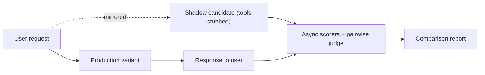
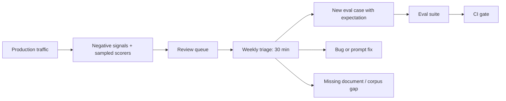

import TOCInline from '@theme/TOCInline';

# Online Evaluation & Feedback

<TOCInline toc={toc} minHeadingLevel={2} maxHeadingLevel={2} />

:::tip[In this guide]
Offline evals tell you about your dataset. Only production tells you about your
users. This page covers the signals worth collecting, cheap scorers you can run
on live traffic, shadow and canary deployment, the honest version of A/B testing
an LLM feature, drift detection, and the review habit that closes the loop.
:::

## What Is It?

**Online evaluation** is measuring quality on real production traffic, using
signals you can collect without ground-truth labels: user behaviour, cheap
automated scorers sampled on live requests, and comparisons between variants.

The gap it fills is specific. Your offline suite scores cases you wrote, under
conditions you chose. Production has inputs you never imagined, users with
context you cannot see, and a distribution that shifts weekly.

## Why Does It Matter?

A green offline suite and an unhappy user base coexist comfortably. Common
reasons:

| Offline says | Production reality |
| --- | --- |
| Groundedness 0.94 | Users ask things the corpus does not cover; the system answers them anyway |
| All intents above 0.90 | 40% of real traffic is an intent that is not in your dataset |
| p95 latency 2.8s | Real p95 is 9s because of a cold cache and a slow tenant |
| Refusal rate 6% | Real refusal rate is 22% on one customer's phrasing |
| Correct on every test case | Users do not trust it, because it never cites anything |

None of these is detectable offline, because each is a statement about the input
distribution or the user, not about the model.

:::note[Highlight: the two directions of the loop]
Offline evaluation gates what ships. Online evaluation tells you what happened
and generates the cases that make offline evaluation honest. A team with only
one direction either ships blind or never learns.
:::

## Implicit Signals

Users tell you things by what they do. Implicit signals are free, high volume,
and ambiguous — their value comes from trending them, not from reading one.

| Signal | What it probably indicates | Noise level | Watch out for |
| --- | --- | --- | --- |
| Copy the answer | The answer was useful enough to take away | Low | Only observable in a UI you control; mobile selection is patchy |
| Edit before using | Directionally right, not quite usable | Low | The diff is gold: it tells you *what* was wrong |
| Accept a suggestion | Clear positive | Very low | Only exists for suggest-style features |
| Retry or regenerate | The answer failed | Low | Some users regenerate out of curiosity |
| Rephrase the same question | Retrieval or comprehension failed | Medium | Hard to distinguish from genuine follow-up |
| Follow-up question | Could be engagement or could be incompleteness | High | Needs intent classification to interpret |
| Escalate to a human | Strong failure signal | Very low | The highest-value signal most teams do not log |
| Abandon mid-stream | Latency, or the first sentence looked wrong | Medium | Conflated with distraction and tab-switching |
| Session ends right after the answer | Success (task done) or giving up | Very high | Nearly uninterpretable alone; needs a task-completion marker |
| Time on answer | Engagement or confusion | High | Long dwell can mean careful reading or bafflement |
| Citation click | Verifying, which is healthy | Low | Low volume |
| Thumbs down | Clear negative | Low | Volume is tiny; see selection bias below |

Two signals are worth engineering specifically because they are nearly
unambiguous. **Escalation to a human** is as close to a labelled failure as
production gives you — log the preceding conversation every time. And the
**edit diff** on a draft-style feature tells you not just that the output was
wrong but exactly how, which converts directly into an eval case.

```python
from datetime import datetime, timezone
from typing import Literal
from pydantic import BaseModel, Field

SignalKind = Literal[
    "copy", "edit", "accept", "retry", "rephrase", "followup",
    "escalate", "abandon", "citation_click", "thumbs_up", "thumbs_down",
]


class InteractionSignal(BaseModel):
    trace_id: str
    session_id: str
    kind: SignalKind
    at: datetime = Field(default_factory=lambda: datetime.now(timezone.utc))
    detail: dict[str, str | int | float] = Field(default_factory=dict)


class SessionOutcome(BaseModel):
    """Derived per session. Rules are heuristics; label a sample by hand
    to check they correlate with anything real before trusting them."""

    session_id: str
    signals: list[InteractionSignal]

    @property
    def likely_failure(self) -> bool:
        kinds = {s.kind for s in self.signals}
        return bool(kinds & {"escalate", "thumbs_down"}) or (
            "retry" in kinds and not (kinds & {"copy", "accept"})
        )

    @property
    def likely_success(self) -> bool:
        kinds = {s.kind for s in self.signals}
        return bool(kinds & {"copy", "accept", "thumbs_up"}) and "escalate" not in kinds
```

Everything derived from implicit signals is a heuristic. Validate it: take 50
sessions your rules called failures, read them, and see how many really were. If
it is 60%, your "failure rate" metric is 40% noise, and you should know that
before presenting it.

## Explicit Feedback People Will Actually Use

Explicit feedback has the opposite profile: unambiguous and extremely sparse.
Typical response rates are well under 1% of interactions.

What raises the rate:

| Design choice | Effect |
| --- | --- |
| Thumbs inline, next to the answer, no modal | The baseline; anything more costs most of your volume |
| One optional reason chip after a thumbs-down (`wrong`, `incomplete`, `not relevant`, `too slow`, `unsafe`) | Categorised negatives at little extra friction |
| Free-text box that is optional and never blocks | A small number of very high-value comments |
| Visible consequence ("thanks, we log this for review") | Modest lift, and it is honest |
| Asking at a natural end point rather than mid-task | Avoids interrupting |

What destroys it: a mandatory rating before continuing, a five-star scale (users
pick 5 or 1), asking on every single message, and a form that takes more effort
than fixing the answer by hand.

:::warning[Selection bias in explicit feedback]
The people who leave feedback are not a sample of your users. They skew toward
the strongly annoyed and the unusually diligent, and the ratio is often ten to
one negative. A thumbs-down rate of 4% does not mean 4% of answers are bad —
it means 4% were bad *and* someone cared enough to say so. Use explicit
feedback to find failure *modes*, not to estimate failure *rates*. Estimate
rates from sampled automated scorers instead.
:::

## Online Scorers and Guardrail Metrics

You can run a subset of your offline scorers on real traffic. Deterministic
checks are cheap enough to run on every request; judges run on a sample.

| Scorer | Sampling | Runs where | Alert on |
| --- | --- | --- | --- |
| Schema / format validity | 100% | Inline, before the response leaves | Any failure |
| Forbidden content, PII pattern | 100% | Inline | Any failure |
| Citation IDs exist in retrieved context | 100% | Inline | Rate above baseline |
| Refusal detection | 100% | Async | Rate shift in either direction |
| Empty or truncated output | 100% | Inline | Any failure |
| Groundedness judge | 1–5% | Async, off the request path | 7-day trend |
| Relevance judge | 1–5% | Async | 7-day trend |
| Retrieval score distribution | 100% | Async | Mean top-1 score drifting down |
| Latency p50/p95, time to first token | 100% | Inline | Threshold breach |
| Tokens and cost per request | 100% | Inline | Budget threshold |
| Error, timeout and retry rate | 100% | Inline | Threshold breach |

The inline/async split is the important design decision. Anything on the request
path adds latency to a real user's request, so inline checks must be
deterministic and fast — microseconds, not a model call. Judges go onto a queue
and score a sample after the fact.

```python
import asyncio
import random
from pydantic import BaseModel


class OnlineScoreConfig(BaseModel):
    judge_sample_rate: float = 0.02
    judge_sample_rate_on_negative_signal: float = 1.0


async def score_response_inline(response: str, retrieved_ids: set[str]) -> dict[str, bool]:
    """Fast, deterministic, on the request path. Fails closed on safety."""
    return {
        "schema_valid": schema_valid(response),
        "citations_grounded": citations_grounded(response, retrieved_ids),
        "no_pii": not contains_pii(response),
        "non_empty": len(response.strip()) > 0,
    }


async def maybe_enqueue_judge(
    trace_id: str, had_negative_signal: bool, cfg: OnlineScoreConfig, queue: asyncio.Queue
) -> None:
    """Sample for async judging. Always judge anything a user complained about —
    those are the cases most likely to become eval cases."""
    rate = (
        cfg.judge_sample_rate_on_negative_signal
        if had_negative_signal
        else cfg.judge_sample_rate
    )
    if random.random() < rate:
        await queue.put(trace_id)
```

Oversampling cases with a negative signal is the highest-value sampling rule
available: it costs almost nothing and it concentrates your judge budget on the
traffic most likely to produce a new eval case.

## Shadow Deployment and Offline Replay

Before exposing a candidate to users, run it against real traffic with nobody
watching the output.

| Mode | How it works | Gives you | Costs |
| --- | --- | --- | --- |
| Shadow (mirrored) | Every live request is also sent to the candidate; its response is scored and discarded | Real distribution, zero user risk | Doubles inference cost; tool side effects must be stubbed |
| Replay (offline) | Captured requests from last week are re-run against the candidate | Real distribution, no production load, repeatable | Stale context; retrieval corpus may have changed |
| Paired comparison on replay | Both variants run on the same captured requests, pairwise-judged | Tightest signal, since case difficulty cancels | Judge cost |

Paired comparison on replayed traffic is the most underused technique in this
whole section. You get the real input distribution, the same inputs for both
variants, and a pairwise judge — which together give you a far more sensitive
comparison than either an offline suite or a live A/B test, at a fraction of the
time cost.

Two hard requirements for shadow mode. **Side effects must be disabled**: a
shadowed agent that can send email will send email. And **cost must be bounded**:
shadow a percentage of traffic, not all of it, with a kill switch.



## A/B Testing LLM Features

A/B testing works, with caveats that are more severe than for a button colour.

| Decision | Guidance |
| --- | --- |
| Randomisation unit | User or account, not request. Per-request assignment means a user sees both variants and the inconsistency itself affects behaviour. For B2B, randomise by account to avoid within-team confusion |
| Primary metric | A behavioural outcome: task completion, escalation rate, edit rate, acceptance rate. Not a judge score — you have that offline |
| Guardrails | Latency p95, cost per session, error rate, refusal rate, escalation rate |
| Duration | At least one full weekly cycle. Weekday and weekend traffic differ |
| Analysis | Fix the metric and duration before starting. No peeking-and-stopping |

The variance problem is the real obstacle. Free-text output produces downstream
metrics with high variance, and your effect sizes are small. Rough intuition for
a binary outcome metric: detecting a 2-point absolute lift on a 30% baseline
needs on the order of several thousand users per arm. Most LLM features do not
have that traffic, and waiting six weeks for significance is usually not a
viable product decision.

What to do when you do not have the traffic:

- **Use a more sensitive metric.** Per-session edit distance or acceptance rate has far lower variance than conversion.
- **Use paired replay offline** for the quality comparison and use the live test only for guardrails.
- **Accept a canary plus guardrails** instead of a powered experiment. "No guardrail breach over 5% of traffic for three days" is a legitimate decision rule even though it is not a significance test.
- **Be explicit that you are not measuring quality**, only the absence of harm. Pretending otherwise is how teams ship changes on noise.

:::caution[Novelty and learning effects]
Users change behaviour when a feature changes, independent of quality. The first
week of a new variant shows inflated engagement from exploration; a variant that
needs a new habit looks worse at first and better later. Both distort a
one-week test. Watch the daily trend, not just the aggregate.
:::

## Canary Rollout and Automatic Rollback

For most LLM changes, a canary with automated rollback is the right tool and an
A/B test is a luxury.

| Stage | Traffic | Hold for | Promote when |
| --- | --- | --- | --- |
| Internal | Staff only | 1 day | No guardrail breach, manual spot-check of 20 traces |
| Canary 1 | 5% | 24h | No breach, judge sample within tolerance |
| Canary 2 | 25% | 24h | No breach, no slice collapse |
| Full | 100% | — | Baseline re-recorded |

```python
from pydantic import BaseModel


class RollbackRule(BaseModel):
    metric: str
    direction: str          # "max" or "min"
    threshold: float
    min_samples: int = 200  # do not trigger on three requests


class CanaryHealth(BaseModel):
    variant: str
    samples: int
    metrics: dict[str, float]
    rules: list[RollbackRule]

    def breaches(self) -> list[str]:
        out = []
        for rule in self.rules:
            if self.samples < rule.min_samples:
                continue
            value = self.metrics.get(rule.metric)
            if value is None:
                continue
            bad = (
                value > rule.threshold
                if rule.direction == "max"
                else value < rule.threshold
            )
            if bad:
                out.append(f"{rule.metric}={value:.3f} breaches {rule.direction} {rule.threshold}")
        return out

    @property
    def should_roll_back(self) -> bool:
        return bool(self.breaches())


ROLLBACK_RULES = [
    RollbackRule(metric="error_rate", direction="max", threshold=0.02),
    RollbackRule(metric="schema_invalid_rate", direction="max", threshold=0.001),
    RollbackRule(metric="latency_p95_ms", direction="max", threshold=6000),
    RollbackRule(metric="escalation_rate", direction="max", threshold=0.15),
    RollbackRule(metric="cost_per_request_usd", direction="max", threshold=0.05),
    RollbackRule(metric="groundedness_sampled", direction="min", threshold=0.88),
]
```

Automate rollback on the deterministic, low-variance rules — errors, schema
validity, latency, cost. Keep the judge-based rule as an alert for a human,
because a sampled judge metric on a few hundred requests is noisy enough to
trigger spuriously, and an automated rollback loop that flaps is its own
incident.

Every change must sit behind a flag that can be flipped without a deploy. If
rolling back requires a release, your rollback takes twenty minutes you do not
have.

## Drift

Four kinds, with different detection methods. All of them are silent by default.

| Drift | What changes | Detection | Typical cause |
| --- | --- | --- | --- |
| Input drift | Users ask different things | Embed inputs, cluster weekly, watch cluster proportions and the share of inputs far from every known cluster | New feature launch, new customer segment, seasonality |
| Output drift | Model responds differently to similar inputs | Response length distribution, refusal rate, format validity, embedding distribution of outputs on a fixed probe set | Provider update, prompt change, context change |
| Retrieval corpus drift | The knowledge base changes underneath | Document count, mean top-1 similarity score, share of queries with no result above threshold, per-source coverage | Documents added, removed, reorganised, or a failed ingest |
| Provider model drift | The same model string behaves differently | A small fixed **canary probe set** run hourly with temperature 0 and compared to stored outputs | Silent provider update, routing change, quantisation |

The provider probe set is the one worth building today, and it is tiny:

```python
from pydantic import BaseModel


class ProbeResult(BaseModel):
    probe_id: str
    expected_hash: str
    actual_hash: str
    expected_len: int
    actual_len: int

    @property
    def changed(self) -> bool:
        return self.expected_hash != self.actual_hash

    @property
    def materially_changed(self) -> bool:
        """Exact-text drift is common and mostly harmless. A big length shift
        or a changed deterministic answer is what you want to be paged about."""
        ratio = self.actual_len / max(self.expected_len, 1)
        return self.changed and not (0.7 <= ratio <= 1.4)
```

Twelve probes with deterministic expected answers, run hourly at temperature 0,
costs cents per day and will tell you within an hour that a provider changed
something. Without it, you find out from a confusing bug report a week later and
spend two days looking for a change in your own code.

For input drift, the metric that matters most is the **share of inputs that
match no known cluster**. A rising out-of-distribution share means your eval set
is going stale, which is actionable in a way that a drift p-value is not.

## Closing the Loop

This is the part that determines whether any of the above compounds. A
production failure that does not become an eval case will happen again.



The review queue needs three properties to survive: it must be **ranked** (worst
first, not newest first), **bounded** (top 20 per week, or nobody opens it), and
have a **named owner on a recurring 30-minute slot**. Make the queue a dashboard
nobody owns and it will be empty of attention within a month.

```python
from pydantic import BaseModel


class ReviewItem(BaseModel):
    trace_id: str
    input_preview: str
    output_preview: str
    signals: list[str]
    judge_score: float | None
    gate_failures: list[str]
    occurrences: int = 1     # deduplicated by input-embedding cluster

    @property
    def priority(self) -> float:
        """Rank by severity times frequency. A hard gate failure that
        happened 40 times outranks one bad judge score."""
        severity = 1.0
        if self.gate_failures:
            severity += 2.0
        if "escalate" in self.signals:
            severity += 1.5
        if "thumbs_down" in self.signals:
            severity += 1.0
        if self.judge_score is not None:
            severity += max(0.0, 1.0 - self.judge_score)
        return severity * (1 + self.occurrences) ** 0.5
```

Deduplicate by clustering inputs before ranking. Forty instances of one problem
should appear as one item with a count of 40, not as forty items that bury
everything else.

The triage outcome for each item is one of four things: a new eval case with a
written expectation, a bug to fix, a document to add to the corpus, or
"acceptable, no action" — which is a legitimate answer that should be recorded
so the same case does not get re-triaged every week.

A reasonable target: every week, at least three new eval cases traceable to real
production traffic. That single habit is what keeps the offline suite honest as
the product changes.

## Privacy and Consent

Logging prompts and outputs means logging whatever users typed, which routinely
includes personal data, customer data, and credentials pasted by mistake.

| Concern | Practice |
| --- | --- |
| Consent and notice | State in your terms and in-product that inputs may be reviewed to improve the service. Honour enterprise opt-outs at the tenant level |
| Redaction before storage | Detect and mask emails, phone numbers, card and national ID patterns, API keys **in-process**, before anything is written or sent to a vendor |
| Reversible vs irreversible | Prefer irreversible masking. If you must support unmasking for debugging, store the mapping separately with tighter access control and a shorter retention |
| Access control | Trace payloads containing user content are not a general engineering read. Separate role, audited access |
| Retention | Short by default — 14 to 30 days for full payloads, longer for aggregates and metrics which contain no user content |
| Promotion to eval case | A case entering the permanent dataset must be rewritten with synthetic details. Never pin real customer data into a git-committed test file |
| Data residency | Third-party eval and tracing platforms mean user content leaves your infrastructure. Check the region, the subprocessor list, and whether your vendor trains on it |
| Deletion requests | You must be able to delete a user's traces. That means a user identifier on every trace, and a deletion path that covers your vendor too |

That sixth row catches people out. A production failure is a great eval case,
and the committed version of it must be scrubbed: same structure, same failure
mode, invented names and numbers. Otherwise your eval dataset becomes an
unmanaged copy of customer data in git, with no deletion path.

Related runtime concerns are in
[Logging, Monitoring & Guardrails](../10-production-patterns/02-logging-monitoring-guardrails.mdx).

## Common Mistakes

- Treating thumbs-down rate as a failure rate, when it is a measure of who complained.
- Not logging escalation to a human — the clearest failure label you have.
- Running a judge inline on the request path and adding seconds of latency.
- Shadow deployment with live tool side effects.
- A/B testing with per-request randomisation, so users see both variants.
- Calling an A/B test from a few hundred users, on a metric with enormous variance.
- Automated rollback driven by a noisy sampled judge metric, causing flapping.
- Assuming a model behind a stable name is a stable model.
- A review queue sorted by recency, unbounded, with no owner.
- Committing real customer data into the eval dataset as a "real case".

## Interview Questions

- Why do you need online evaluation if your offline suite is green?
- Why is thumbs-down rate a poor estimate of failure rate, and what would you use instead?
- How would you compare a candidate prompt against production without exposing users to it?
- What is the randomisation unit for an LLM A/B test, and why not per request?
- You have 400 users a week. Can you A/B test a prompt change? What do you do instead?
- Which metrics would you automate a rollback on, and which only alert? Why the split?
- How would you detect that your provider silently changed a model?
- What has to be true before you log a user's prompt?

## Things to Remember

- Offline evals measure your dataset; production measures your users. You need both.
- Implicit signals are plentiful and ambiguous; validate your heuristics against hand-read sessions.
- Explicit feedback finds failure modes, not failure rates.
- Deterministic scorers inline on 100%; judges async on a sample, oversampled on negative signals.
- Paired replay of real traffic is the most sensitive comparison available to you.
- Canary plus automated rollback on low-variance metrics beats an underpowered A/B test.
- A fixed hourly probe set is the cheapest provider-drift detector there is.
- A ranked, bounded, owned review queue is what makes the loop compound.
- Redact before storage, bound retention, and scrub any case you commit.

## Mini Exercise

For one feature you run, write down the five implicit signals you could collect
today and which you already log. Add the highest-value missing one — escalation
or edit-diff if either applies.

Then build a 10-case probe set with deterministic expected answers, run it twice
a day for a week at temperature 0, and record any output change. Finally, take
the ten worst interactions from the week, rank them with the `priority` function
above, and convert the top three into eval cases with scrubbed details and
written expectations.

## Done When

- [ ] You collect at least three implicit signals and have validated your failure heuristic by hand.
- [ ] Deterministic scorers run on 100% of responses; a judge runs on a sample.
- [ ] You can compare a candidate against production using shadow or replayed traffic.
- [ ] Every change ships behind a flag with defined rollback rules and a canary schedule.
- [ ] A fixed probe set would tell you within hours if your provider changed a model.
- [ ] A ranked review queue has a named owner and a recurring slot.
- [ ] At least three eval cases in your suite came from real production failures.
- [ ] Prompt logging has redaction, a retention limit, and access control.
