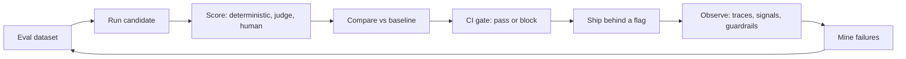

import TOCInline from '@theme/TOCInline';

# 11 · Evaluation

<ProgressToggle sectionId="11-evaluation" />

<TOCInline toc={toc} minHeadingLevel={2} maxHeadingLevel={2} />

:::tip[In this guide]
Evaluation is how you stop guessing. This section covers the generic discipline
that applies to any LLM feature — a classifier, an extractor, an agent, a
summariser, a RAG pipeline — not just one architecture. You will build datasets,
choose metrics, calibrate judges, gate CI, and measure real traffic.
:::

## Goal

Make quality measurable, so every change you ship is a data-driven decision
rather than an opinion. By the end you should be able to answer three questions
about any change to an LLM feature: did quality improve, did anything regress,
and what did it cost.

## Estimated Time

1–2 weeks.

## Prerequisites

- [RAG Fundamentals](../05-rag-fundamentals/index.mdx) — you need a working LLM
  feature to evaluate, and [RAG Evaluation](../05-rag-fundamentals/14-rag-evaluation.mdx)
  covers the RAG-specific case this section generalises from.
- [Production Patterns](../10-production-patterns/index.mdx) — logging, metrics,
  and guardrails are where online evaluation plugs in.

## What You Will Learn

1. [The Evaluation Mindset](./01-evaluation-mindset.mdx) — why playground testing
   is the most expensive habit in AI engineering, and the maturity ladder from
   vibes to online measurement.
2. [Building Eval Datasets](./02-eval-datasets.mdx) — sourcing, stratifying,
   annotating, and versioning the cases that make up your test set.
3. [Metrics That Mean Something](./03-metrics.mdx) — the full taxonomy, when a
   deterministic check beats a clever one, and per-slice scorecards in Python.
4. [LLM-as-Judge, Done Properly](./04-llm-as-judge.mdx) — rubrics, pairwise
   comparison, bias mitigation, and calibration against human labels.
5. [Evaluation in CI](./05-eval-in-ci.mdx) — a pytest harness, aggregate
   thresholds, tiered suites, response caching, and a merge gate the team keeps.
6. [Online Evaluation & Feedback](./06-online-evaluation.mdx) — implicit and
   explicit signals, shadow traffic, A/B tests, canaries, drift, and mining
   production failures back into the dataset.
7. [Tracing & Observability for LLM Apps](./07-tracing-and-observability.mdx) —
   spans, OpenTelemetry GenAI conventions, cost attribution, and turning a bad
   trace into a regression test.

## The Eval Loop

Evaluation is a cycle, not a phase. Offline work (left) proves a change is safe
to ship; online work (right) tells you what actually happened and feeds the next
round of cases back into the dataset.

The loop has one load-bearing property: the dataset grows from real failures. A
suite that never changes slowly stops describing your product.

## Interview Relevance

"How do you know it got better?" is the question that separates people who have
shipped an LLM feature from people who have demoed one. Expect to be asked how
you would build an eval set from nothing, how you would stop a judge from being
gamed by verbose answers, what you would gate a deploy on, and how you would
detect a provider silently changing a model under you.

## Done When

- [ ] You can explain the difference between offline and online evaluation, and why you need both.
- [ ] You have a stratified eval dataset with a held-out slice you do not tune against.
- [ ] You can name a deterministic check for at least three of your own failure modes.
- [ ] You have an LLM judge with a measured agreement rate against human labels.
- [ ] A pull request in your repo runs an eval suite and can fail on an aggregate threshold.
- [ ] You capture per-request traces with model, prompt version, tokens, and cost.
- [ ] You have a habit — not a plan — for turning production failures into new cases.

Next: [11 · Fine-Tuning](../12-fine-tuning/index.mdx).
