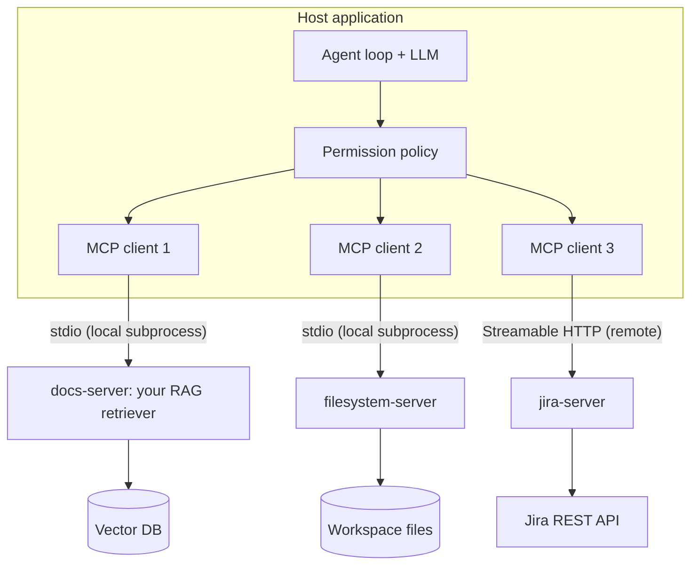

import TOCInline from '@theme/TOCInline';

# MCP Fundamentals

<TOCInline toc={toc} minHeadingLevel={2} maxHeadingLevel={2} />

:::tip[In this guide]
The opening page of the section. What MCP is, the problem it solves, the three
roles, the three primitives and how to choose between them, and the honest
comparison against plain function calling. The wire protocol, the
implementation detail and the security model each get their own page after
this one.
:::

## What Is It?

The [Model Context Protocol](https://modelcontextprotocol.io) is an open
protocol for connecting LLM applications to external capabilities. A **server**
exposes tools, resources and prompts. A **client**, living inside your
application, discovers and calls them. Messages are
[JSON-RPC](https://www.jsonrpc.org/specification) and travel over one of two
transports: a local subprocess, or HTTP.

It started at Anthropic and is now a multi-vendor project with
[official SDKs](https://modelcontextprotocol.io/docs/sdk) in ten languages and
a published spec with dated revisions.

The analogy everyone reaches for is USB-C, and it holds up. Write a GitHub
integration once as an MCP server and any MCP-capable host can use it: your
agent, an IDE assistant, a desktop chat app. You did not write a plugin for
each of them.

The analogy the spec itself uses is more precise: MCP is to AI applications
what the [Language Server Protocol](https://microsoft.github.io/language-server-protocol/)
is to editors. One integration, many consumers, a defined wire format in
between.

## Why Does It Matter?

Without a protocol, tool integration is an **N×M problem**. Five agents needing
the same eight systems means forty bespoke adapters, each with its own auth
handling, its own schema conventions, its own result-size bugs. Fix a pagination
bug in one and the other seven still have it.

| Dimension | Bespoke tools per agent | MCP servers |
| --- | --- | --- |
| Integrations to build | N agents × M systems | N clients + M servers |
| Reuse across hosts | None | Any MCP-capable host |
| Who owns the integration | Every agent team | The system's owners |
| Deployment | Coupled to the agent | Separate process, own lifecycle |
| Discovery | Hardcoded tool list | At runtime, via `tools/list` |
| Credentials | The agent holds everything | Per-server, independently scoped |
| Added complexity | None | A process, a transport, a trust boundary |

That last row is the honest cost, and it is not small. MCP buys reuse and
decoupling at the price of a new process boundary, a new serialisation hop and
a new thing to secure. [MCP in Practice](./07-mcp-in-practice.mdx) is the page
that argues the other side properly.

## The Three Roles

Keeping these straight saves a lot of confusion, especially when reading other
people's docs where "client" gets used loosely.

| Role | What it is | What it owns |
| --- | --- | --- |
| **Host** | The application the user interacts with — IDE assistant, chat app, your agent service | The model connection, the conversation, and every permission decision |
| **Client** | The protocol connection inside the host. One client per server | The handshake, discovery, and request/response correlation for one server |
| **Server** | A separate program exposing capabilities | Its own credentials, its own process, its own blast radius |



The important structural fact: **the host is the only place policy can live.**
A server cannot refuse on your behalf and a model cannot be trusted to. If a
tool should require human approval, the host enforces that or nobody does.

The two transports in that diagram are **stdio** (the host launches the server
as a child process and talks over its standard streams) and **Streamable HTTP**
(the server is a network service). An older SSE-based HTTP transport existed
and is deprecated. Which to pick, and what each costs you, is
[Protocol & Transports](./02-protocol-and-transports.mdx).

## Discovery Is Dynamic

One consequence of the architecture deserves calling out early, because it
shapes both the design and the threat model.

The host does not know a server's tool set until runtime. It connects, calls
`tools/list`, `resources/list` and `prompts/list`, and gets back whatever the
server offers *right now*. Servers may advertise that their lists change and
notify clients when they do.

That is genuinely useful: tools become hot-swappable without redeploying the
agent, and a server can expose a different surface depending on the caller's
authorisation. It is also why reviewing a server once at install time is not
enough — the tool descriptions a model reads as instructions can change under
you. [MCP Security & Auth](./05-security-and-auth.mdx) picks that up.

## The Three Primitives

Choosing the right primitive is the main modelling decision you make when
designing a server. The split is about **who decides to use it**.

| Primitive | Driven by | Semantics | List / invoke methods |
| --- | --- | --- | --- |
| **Tool** | The model | A function with a JSON Schema; may have side effects | `tools/list`, `tools/call` |
| **Resource** | The application | Addressable, readable data identified by a URI | `resources/list`, `resources/read` |
| **Prompt** | The user | A named, parameterised message template | `prompts/list`, `prompts/get` |

Worked examples against the same knowledge base:

- `search_docs(query, top_k)` — a **tool**. The model decides when retrieval is needed, and does it mid-reasoning.
- `docs://handbook/refund-policy` — a **resource**. The user attaches it, or the host includes it as context. The model does not go fetch it.
- "Explain this policy with citations" — a **prompt**. The user picks it from a slash-command menu and the server renders the messages.

### Choosing between them

The heuristic: **tools are model-driven, resources are app-driven, prompts are
user-driven.** Three questions that settle most cases:

| Ask | If yes | Primitive |
| --- | --- | --- |
| Should the model decide, unprompted, to do this? | It needs a schema and a description | Tool |
| Is this a named thing the application already knows it wants to load? | It needs an address, not a name | Resource |
| Is this a workflow a person would trigger from a menu? | It needs arguments and a template | Prompt |

Two traps worth naming now. First, **a resource is not a read-only tool.** If
the model has to decide to fetch something, it is a tool, even if the operation
is a pure read. Reaching for a resource there means the model has no way to ask
for the data. Second, **when in doubt a tool is the safe default** — it is the
best-supported primitive across hosts, and resource support varies in practice.

## What a Server Looks Like

Concretely, to make the abstraction less abstract. This is the whole thing:

```python
"""docs_server.py — the knowledge base, over MCP."""
from mcp.server import MCPServer

mcp = MCPServer("docs-server")


@mcp.tool()
async def search_docs(query: str, top_k: int = 4) -> str:
    """Search the internal knowledge base and return relevant passages
    with their source paths. Use for questions about internal policies and
    architecture notes. Not for source code — use the repo server."""
    return await retriever.search(query, top_k=top_k)


@mcp.resource("docs://{doc_path}")
async def read_doc(doc_path: str) -> str:
    """Read one document from the knowledge base by its path."""
    return await retriever.read(doc_path)


if __name__ == "__main__":
    mcp.run()        # stdio by default
```

No JSON Schema, no request parsing, no protocol handling. The type hints *are*
the schema and the docstring *is* the description the model reads. Everything
from [Tool Design](../09-tool-calling-and-ai-agents/07-tool-design.mdx) applies, and applies
more: the description is the model's only instruction, results must be capped,
and empty results should return a recoverable message rather than raising. A
server is a tool layer with a process boundary around it, not a different kind
of thing.

:::note[Version-dependent]
The SDK's class and decorator names have changed across major releases — the
`MCPServer` shown here is the v2 surface, and `FastMCP` was v1. Treat this as
the right *shape* and check the
[current Python SDK docs](https://py.sdk.modelcontextprotocol.io/) for exact
names. [Building an MCP Server](./03-building-a-server.mdx) does this properly.
:::

## MCP or Plain Function Calling?

The comparison that actually matters, because the default for most teams should
be "not yet".

| Use MCP | Use plain function calling |
| --- | --- |
| Multiple hosts need the same integration | One agent, tools specific to it |
| A third party already ships a good server | The tool is a thin wrapper over your own code |
| The integration is owned by another team | You control the whole stack |
| You want tools hot-swappable without redeploying | Latency and simplicity matter most |
| The host is an IDE or desktop app you do not control | The host is your own service |
| You want per-integration credential scoping | One service identity is fine |

For a single agent calling your own internal functions, MCP adds a process, a
serialisation hop and a trust boundary for no benefit. A local function is
simpler, faster, and easier to test.

MCP earns its keep at the point where **reuse across hosts** or **ownership by
another team** becomes real. For internal tools, that is often never.

A reasonable default: build tools as plain functions, keep the logic in a
service class, and wrap it in an MCP server only when a second consumer
appears. The server then becomes a thin adapter over code you already have —
which is exactly what the example above is.

## Common Mistakes

- Treating an MCP server as configuration rather than code you are executing.
- Modelling something as a resource when the model needs to decide to fetch it.
- Assuming every host supports resources and prompts as well as it supports tools.
- Reviewing a server once at install time, despite discovery being dynamic.
- Expecting the server to enforce permissions the host should be enforcing.
- Adopting MCP for a single agent calling your own functions.
- Writing a server before you have read the tool-design rules, and rediscovering every one of them.

## Interview Questions

- What problem does MCP solve, and what does it cost you?
- Describe the host, client and server roles. Which one owns permissions, and why does it have to be that one?
- Tools, resources and prompts — who drives each, and how do you decide?
- Why is a read-only operation sometimes still a tool rather than a resource?
- Discovery happens at runtime. Name one benefit and one risk of that.
- When would you *not* bother with MCP?
- Your team has one agent and eight tools over your own database. Pitch for and against adopting MCP.

## Things to Remember

- MCP standardises tool integration: N clients plus M servers, not N×M adapters.
- Host owns the model and the policy, client owns one connection, server owns its own credentials and process.
- Tools are model-driven, resources are app-driven, prompts are user-driven. A tool is the safe default.
- Discovery is dynamic, which makes tools hot-swappable and makes one-time review insufficient.
- Every rule from tool design applies to servers, unchanged.
- For a single agent over your own functions, plain function calling wins.

## Mini Exercise

Take the three tools your agent from
[Building Agents](../09-tool-calling-and-ai-agents/03-building-agents.mdx) already has. For
each one, write a sentence saying whether it should be a tool, a resource or a
prompt in MCP terms, and *why* — specifically, who decides to use it. At least
one of them should come out as something other than a tool; if they all look
like tools, look again at anything the user explicitly picks or attaches.

Then write two sentences arguing that this particular agent should not adopt
MCP at all. If you cannot make that argument convincingly, you do not yet
understand what the protocol costs.

## Done When

- [ ] You can draw host, client and server from memory and say what each owns.
- [ ] You can explain the N×M framing and state MCP's cost honestly.
- [ ] You can classify a capability as tool, resource or prompt and justify it by who drives it.
- [ ] You can name both current transports and one thing that makes them different.
- [ ] You can describe a concrete situation where plain function calling is the better choice.

Next: [Protocol & Transports](./02-protocol-and-transports.mdx) — down to the
wire, where the message shapes, the capability negotiation and the error model
live.
